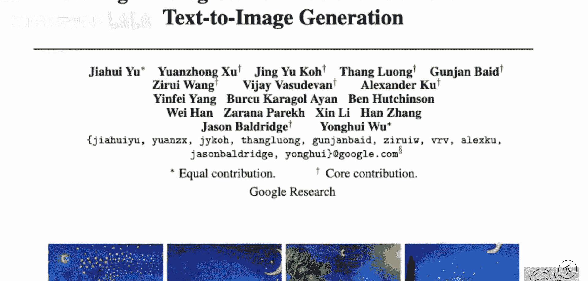
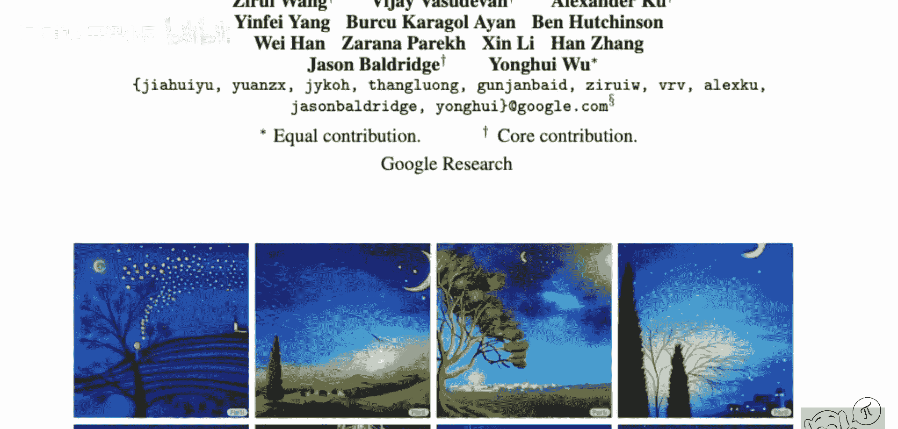
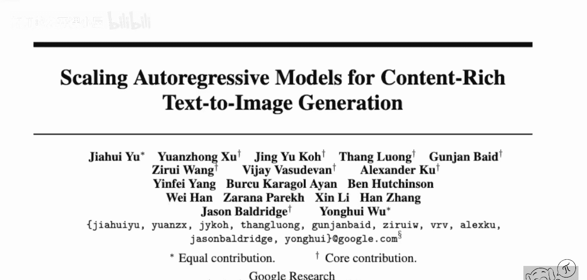
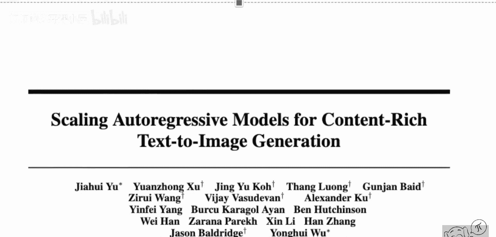
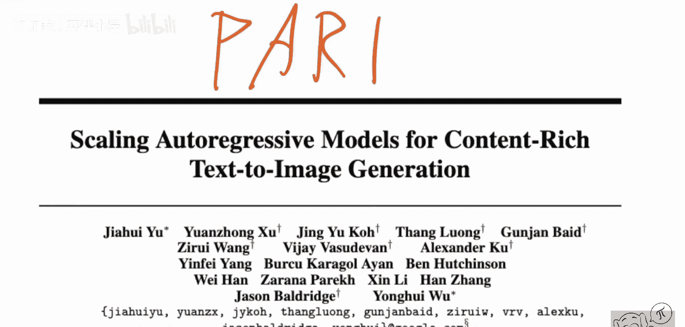
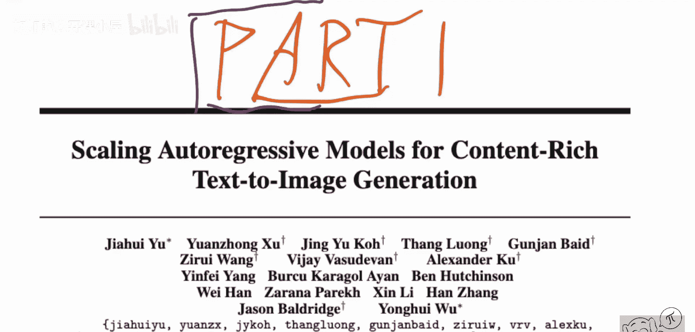
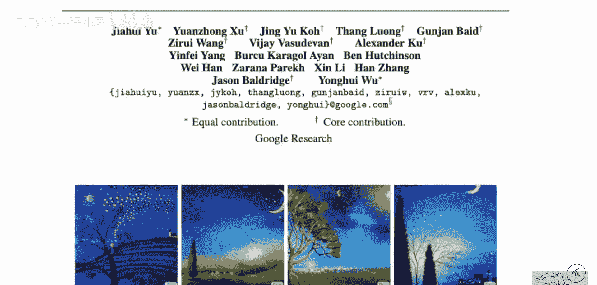
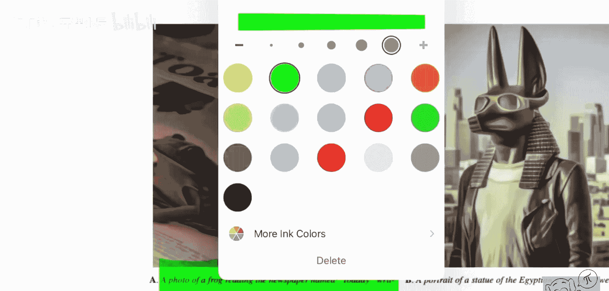
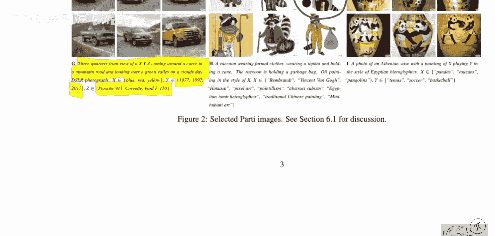
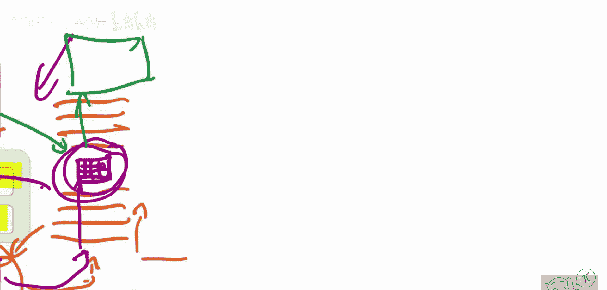

# YannicKilcher【中英⚡AI经典论文领读(全203篇)(下)｜Papers Explained】 p87 P187 Parti - 用于内容丰富的文本到图像生成的规模化自回归模型（论文详解） [BV1j8x5zJEvx_p87]

Not a day goes by an AI research in which we don't get a new image generation model these days。

 So take a look at the top row right here and listen to the prompt that generated them。

 Oil on canvas painting of a blue night sky with roiling energy。

 A fuzzy and bright yellow crescent moon shining at the top below the exploding yellow stars and radiating swirls of blue。

 a distant village sits quietly on the right。 Connect earth and sky is a flame like cypress tree with curling and swayaving swaying branches on the left。

😊，A church spire rises as a beacon over rolling blue hills。

 That is a 67 word description of starry night by Vincent F Go。

 And it is also the prompt that generated the top row of images。

 And the paper does this to show that image generation models， specifically this one。

 they have become super duper capable of incorporating not only wild concepts， as you can see here。

 colocating the Eiffel Tower with the Sydney skyline and fireworks and whatnot。 But also you know。

 minute details about things in the image and where things are and how things look。

 So we've gone from essentially conditionalgans where we could create one of 10 classes to something where we can input like a little essay about what we want to see and get it。

 get it out。 So this is by a group of researcher as。😊，Researchers out of Google research。

 and they are a parallel work to the imaging model that you might have seen。

 So this model or the paper is called scaling auto aggressive models for content rich text to image generation。

 but the the model is called Let me grab， if I can。 Let me grab pen。 The model is called P R T I。

 And I have no clue how to pronounce this。 This could be。

Party， maybe the， the pronunciation is on the art or on the part， because it's pathways like it's。

嗯。Or partai。Or I have no idea。 Let's call it party。

 And party is a model that generates images from text as we have so many models。 However。

 it doesn't do this in the same style as like Iogen， which is a diffusion model。

 It is an auto regressive model。 So here you can see a bunch of other outputs like this。

 This is insane。 Look at the left side right here。😊。

A photo of a frog reading the newspaper named Tou day。 that the newspaper is named Toe day。 Like。

 how crazy is that。

That in itself， is pretty funny。But we know that these image to， sorry。

 these text to image models are pretty bad at spelling stuff in images。 Well， not this model。

 as you can see right here， it gets it completely right。 It doesn't always get it right。

 But it gets it right often enough or this one portrait of a statue of the Egyptian God a nus wearing aviator goggles like another connoisseur of fine eyewear。

 I see why t-shirt and the leather jacket。 The city of Los Angeles is in the background。

 highre DS SLR photograph。 That's literally， that's the academic version of the Un engine trick right here。

 And you can see the images spot on。 So this requires a lot of knowledge not only of you know。

 you know how what a DS SLR photograph is， but also how the skyline of Los Angeles looks how the Egyptian God a nus looks right。

 and the composition of things to get。er like these， this God was never in a leather jacket depicted。

 I guess maybe on the in， on the Internet， you'll find anything。

But you can see a bunch of more examples right here。

 I specifically love the thing on the left side here。 You can see that they generated images。

 So the prompt is。3 quarters front view of a X， Y， Z coming around a curve in a mountain road。

 looking over a green valley on a cloudy day。 So X here is any of the colors blue， red and yellow。

 Y is any of the numbers 1977，1997 and 2017， and Z is any of these car types。

 And now look that the model can essentially track the historical evolution of these cars。

 So not only does it know what a porsche is。 It also knows how a porsche in 77 looked like maybe it's not exactly the correct here。

 But this is pretty crazy。 You can see a bunch more examples right here。

 they do a lot of examples with animals， I specifically like the raccoon here in the style of cubism。

😊，So this is going to be very， very powerful technology。 We can immediately see that， you know。

 the quality of these models gets fast， gets quickly。 Sorry， gets well。

Gets better so quickly that in the foreseeable future。

 we're going to have super powerful tools to just create and edit images from text。

 Look at the left side here。 a giant Cobra snake made from salad。 I You know。

 I'm sure that they they even say these are cherry picked。 but still， this is insane。😊，Now。

 I would love to tell you that behind all of this cool development is a really cool idea。

 like is a smart architecture and something like this。 But I'm afraid it is not。

 It is simply scale and not simply scale。 I mean， you have to have the sort of correct base architecture。

 There is nothing like particularly， there's no cool invention in architecture or a neat trick involved or anything like this。

 It's really just plug basic things together， make them really big。

 train them for long on a lot of data。 and you'll get quality。

 So this is the model overview right here。 The overview of this party or part time model。 This is。

 as I already said， in contrast to Imogen。 It is an autoregressive model。 So not a diffusion model。

 What happens is that on this side here。 you have this V Qgan image encoder。😊。

And decoder。 Well， they call they don't call them encoder and decoder。

 they call them tokenizer and detokenizer。So if you are not aware autoregressive models。

 they work on tokens。 Now， tokens in usually in natural language processing are words or part of words。

 So these would be tokens， token 1， token 2， and so on until token N。

 And then what you would try to do is you would try always to predict the next token。

 That's what makes it autoregressive。 You feed in parts of a token sequence like parts of a sentence。

 you try to predict the next one。 That's exactly what you see right here in the architecture。

 So you pass in the start of sentence token。 you try to predict the first token。

 and you pass in the first token。 And in from these two， you try to predict the second token。

 And then you put that here from these three， you try to predict the third token and so on。

 That's the autoregressivity in text， that works well。 however， in images。

 it's not quite obvious how to do that。That's why you first need to。

Get from the image space to the token space。 So we need a way for any given image that we get out a sequence of tokens and。

It can't be the pixels themselves like we， we would like to have tokens that are kind of latent and have sort of a bit of meaning。

 not just individual pixels， because that first of all， is too many pixels。 And second of all。

 there's not too much， let's say。Information in in the single pixel。

So what we do is we have these image tokenizer and detinizer。

 This is a VQgan that is powered by a vision transformer。 So essentially。

 this is a model that takes this image。 It ships it through a bunch of layers。 And at the end。

 So let's say the image at the beginning has a bunch of rows， a bunch of columns with its pixels。

 This goes through a series of maybe downcals and so on。 I know， actually。

 it's because it's a vision transformer。 It probably even tokenizes like it。

Patches the image at the very beginning。 So these would be image patches。

 Then these are transformed by a transformer to a latent space。 Maybe they are compressed。And。

Then you get tokens。 So you， at the end， you can take these。

 these things right here or the things that correspond to them in the latent representation。

 You can take those as image tokens， and you can unroll essentially this image and then feed it into this model。

Hey， just a short interjection here from Ych from the future。

 the idea I forgot the idea behind the whole setup here is behind the whole V Qgan is obviously that these things here are token。

