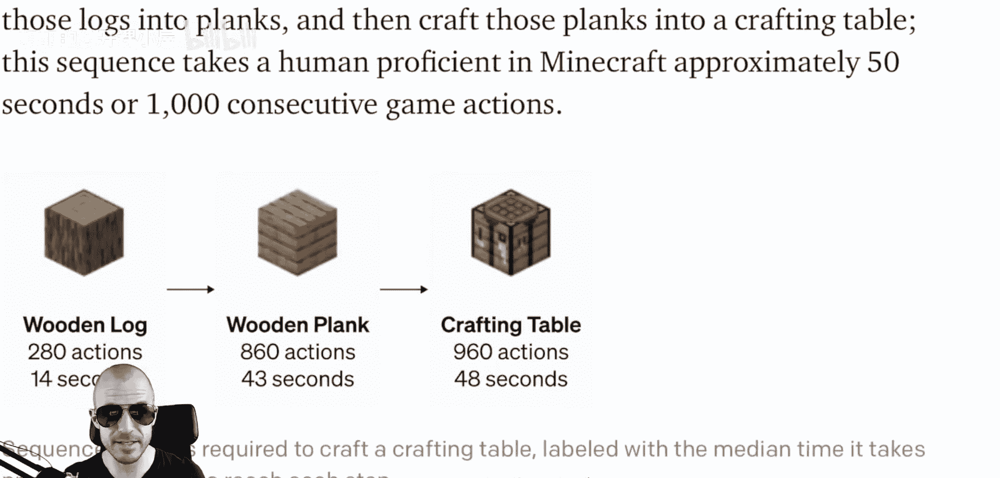
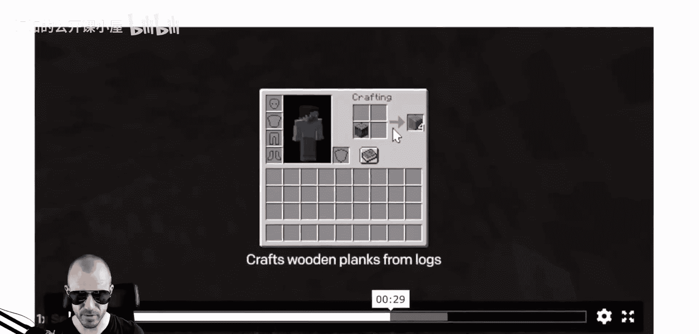
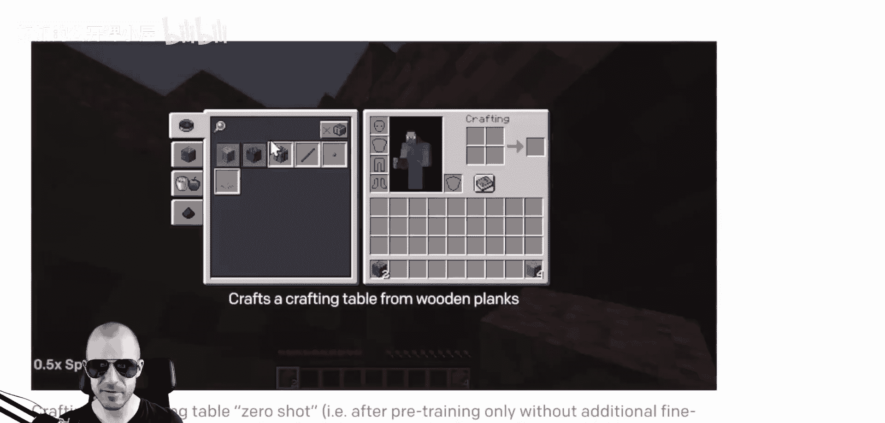
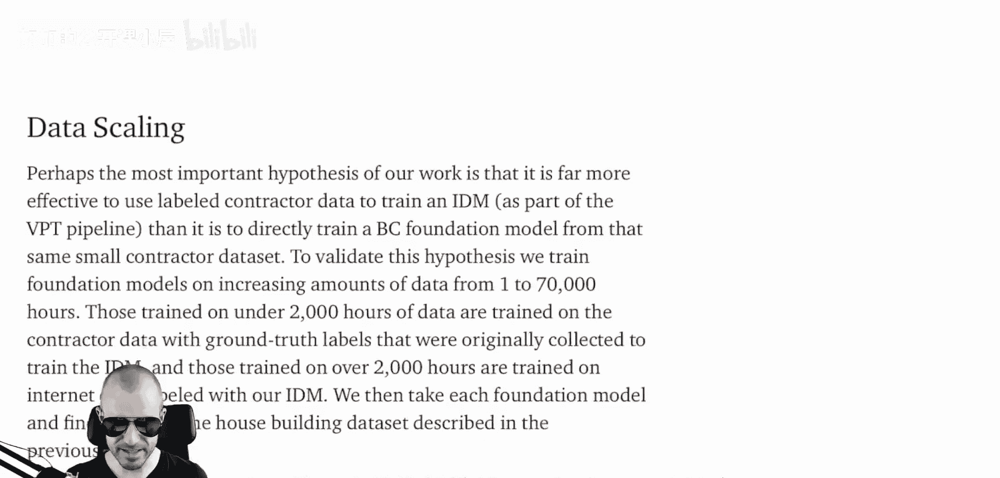
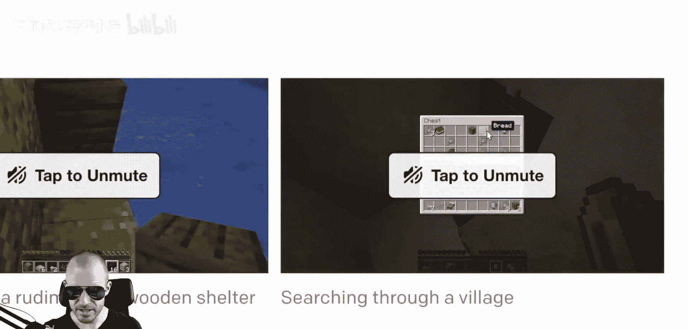
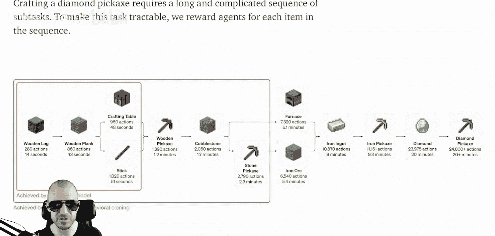
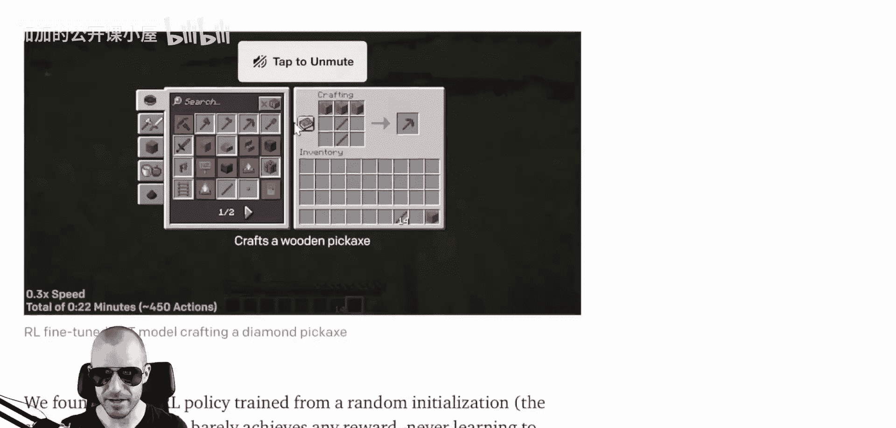
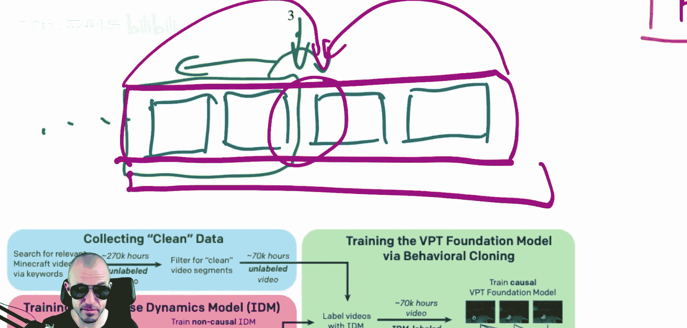
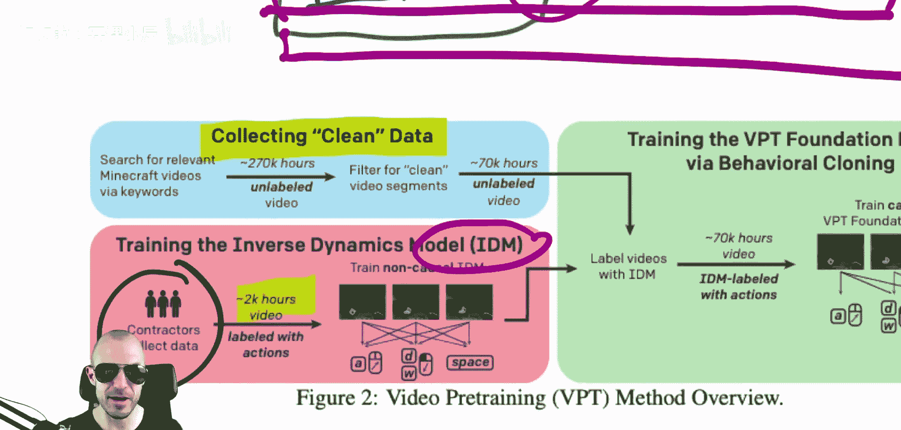

# YannicKilcher【中英⚡AI经典论文领读(全203篇)(下)｜Papers Explained】 p88 P188 视频预训练（VPT）：通过观看未标记在线视频学习行动（论文详解） [BV1j8x5zJEvx_p88]

Hi there。 Today， we'll talk about video pretraining。

 learning to act by watching unlabeled online videos。

 This is by a team out of open AI and is the first system that successfully craft a diamond pickaxe in Minecraft So apart from humans obviously So Minecraft has been sort of a testbed for reinforcement learning algorithms all of these years and it's notoriously hard if you don't know what Minecraft is even if you do it is a hard hard problem。

 So you're in this open world and you can essentially deconstruct any blocks。

 So the first thing is you want to punch a tree this gets you wood and then you want to craft that wood to these logs and you craft these logs to that table Cring is done in a menu like this like the top right here the crafting interface means that you have to arrange the items you have to create new items there is a recipe book but sometimes you also have to know what you're doing。

😊。

Then you walk around in this open world， this is not a very competent player right here。

And you can see there's a menuing interface and so。 So this is hard。

 even if you have like predefined actions。 but if you don't and you just want to use the mouse and the keyboard as this system does right here。

 It becomes nearly impossible。 There is a progression of things to build you know。

 given wooden planks and crafting tables and the sticks， sticks are missing here。

 you can build the wooden pickaxe with the wooden pickaxe。

 you can you can use that to mind cobblestone with the cobblestone。

 you can then build a stone pickaxe with the stone pickaxe， you can go even further and further here。

 you can see a bunch of stuff that this agent learns。 This is tapped on mute。 Well， I did it。😊。

In any case。This agent here learned to raid a village like to look around in a village。

 You can see just how complex these worlds are。 right， there are these villages。 It's an open world。

 the terrain is randomly generated， and it's a completely new terrain every single time you start the game。

 And this is why it's so incredibly look at the amount of the items in in this chest right here。

 So just to give you sort of an idea of now it works an idea of how difficult this game is。

 no agent has yet managed to successfully kind of progress through these things。

 especially no agent that is not like has hardcoded things in it like that。

 So here would be the full progression to the diamond pickax before we saw you get until the stone pickax。

 you can use the stone pickax to mine iron ore from that。

 you can smell the iron ore in a furnace to produce iron。

 you need something that's burnable from that， you can craft an iron pickax and with the iron pickax。

 you can mine the diamond。 if you find。😊。

The diamond now。The episodes the episodes here run for 10 minutes， I believe， or 15。

 We have tried this。 So on our discord， we discussed this paper。

 and thank you very much to everyone who participated。 I've tried it and it was pretty hard。

 I got to two diamonds once within within two diamonds within 10 minutes or 15。

 and the diamond pickax needs three diamonds。 So for a human。

 it's already pretty hard for a system like this。 It is actually is pretty darn hard。

So you can see it right here if you were to train this from a randomly initialized model just with reinforcement learning。

 it doesn't work。 So the entire question is how do we get this to work in a like in the cheapest way possible and that's where this paper comes in。

So I think the fundamental question， even though it's called video video pretrain。

 which essentially means we have a model that's pretrained on videos， the main question is here。

 where do we spend our money most effectively， So let's say we have a bunch of money， right？

 So let's say here is a bucket。 Well， it's more like a。A box， okay。

 And the box is the box has dollars in it。 Now， these aren't as worth as much anymore as they used to in the good old days。

 But in any case， how would you spend that money， right， You can go and collect label data。

 for example， So you can go to contractors and they can play the game。All right， so oops see。

You can tell them， you can say， okay， this much of my money， that's kind of playing。

I pay people to play the game。 I record their actions right。 So。

 and then I have a video together with the labels， the labels being the inputs of the humans。

 And then I have at least the data set where I can do something like behavior cloning。

 right The other thing could be， I could spend the money on getting unlabeled data。 Now。

 if I spend the same money on unlabeled data。 let's say this， this slice right here。Unlabeled。呃。

I suck at writing。 I'm going get much more data， but they don't have labels。

 So can I do something with the unlabelled data， And then lastly。

 I can spend money on labeling itself。 So let's say that the chunk here may be spent on labelling。

I can also do other stuff right， but the question is what's the best distribution of getting your money spent and getting an agent that performs as well as possible？

Okay， I also have to spend some money on training the actual system。 but well， it's open AI。

 They have the compute。 So the way that this paper does it。

 which I find is quite cool and is a good recipe for sort of future applications of if if you have any problem that's in this domain you might want to give this approach here a try。

 by no they are by no means the first people who do it like this。

 but they are the first to show that this significantly reduces your cost in getting a capable Mincraft agent and it's such a general method that it's pretty much applicable almost anywhere where you have this type of problem。

 So what are they doing， They recognize a simple fact， namely that if you have a video sequence。😊。

Meidedia， frame， frame， frame， frame， right。 And if you want to infer kind of what's the next action。

 let's say this is the past， right， you are here and you want to infer what is the next action that the agent is taking。

 essentially， that requires you to learn from the past to look back into the past， right。

 De the next actions。 Although regress， it's a causal model and you know。

What you essentially need to do if you， let's say you watch a video of someone playing。

 you have to predict what's the next action， What's the next mouse movement。

 What's the next key press。You have to understand what they're thinking。

 You have to sort of look ahead， like what might they want to do next， right。

 And then you can sort of predict the next action。 This paper recognizes it's much simpler if you already have the entire video sequence of past and future frames to then from all of this look back and forward。

 So you integrate all the information in hindsight。

 You can determine much more easily what action was in between those two frames， right。

 because you see the future。 you see the effects of the action you might even see a little bit ahead of what the person。

 you know， is actually doing， and then you might infer their plans and so on。

 So that is a much easier task to infer the action from the hindsight situation than to infer the action just from the causal situation。

And this is the basis of their method。 We've seen this in other places before。

 I've once analyzed a talk by Andre Carpatti on Tesla labeling and they're doing exactly the same thing They're saying wait。

 if you actually have the whole video sequence and the car is hidden and then appears again right if you book back in hindsight。

 you can determine much more easily where that car was the entire time same idea here。

So what are they doing， They are。Doing two things， They're collecting labeled data first in two different ways。

 So the first way they collect labeled data is they simply。Tell contractors。 what color is good here。

 They tell contractors to play the game。 As we said。

 they sit them down and they play for 2000 hours of video game，2000 hours of Mincraft。

 They just play it while their key presses and their mouse movements are all recorded， right， so。😊。

That sorry。That gives you a data set where you can train a system now you could run sort of behavior cloning directly on that system and try to get a good agent out of that label data。

 but no they actually train this purple system right here。

 so they train a system that takes into account future and past in a given window and then tries to determine the action of one of the frames in the middle。

 they call this the inverse dynamics model。

Now， they。They have now a model that you can't really build an agent with it because the agent can never see the future。

 But what you can do is you can go out into the Internet and you can collect unlabeled data。 YouTube。

 in case you have noticed happens to be full of minecraft video， even I made a Minecraft video。 So。

 you know， you can go out and you can collect tons and tons and tons of Minecraft data。

 The only thing they have to do is they have to collect what they call clean data。

