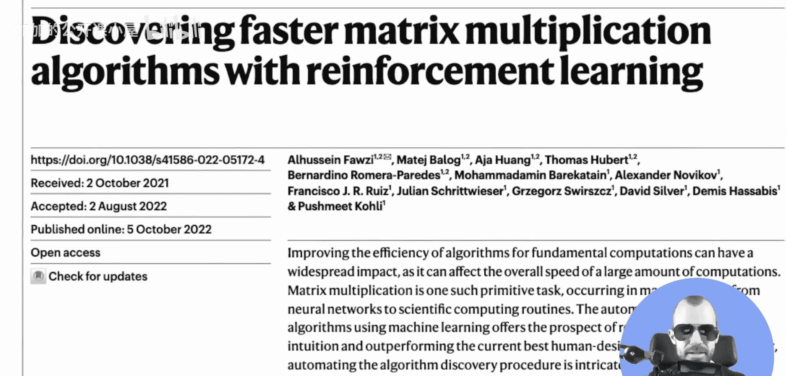
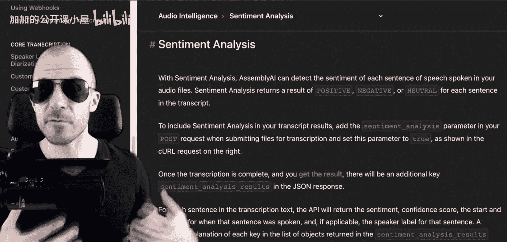
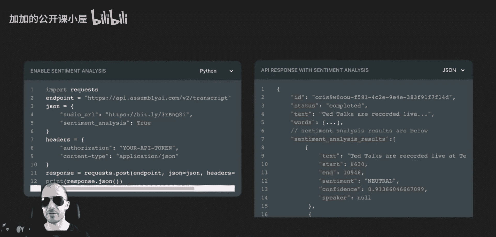
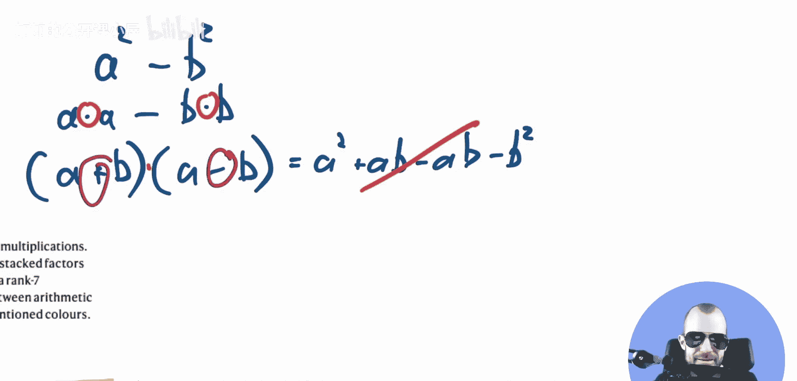

# YannicKilcher【中英⚡AI经典论文领读(全203篇)(下)｜Papers Explained】 p90 P190 这真是颠覆性的突破！（DeepMind的AlphaTensor技术解析） [BV1j8x5zJEvx_p90]

Hello there。 Today， Deep Mind published a new paper called Alpha Tensor。

 This is a system that speeds up matrix multiplications of all things。

 Now it sounds a bit boring to speed up matrix multiplications that's like not as flashy as some of the other things Deep Mind has done but since matrix multiplications are at the foundation of pretty much all of science a speed up of 10%。

20% or even 1% in this domain is huge and can make the whole world better off。

 and this is really cool because it also shows how Deep Mind took their ideas。

 their original ideas from something like Al go and pull them through all the way to now where they have real applications in science。

 and that's cool and it's a bit a validation of this idea because a lot of people said initially when Deep Mind focused that much on games and things like this that it's just for press。

 it's。Flashy and to a certain degree it is。 but definitely it is also applicable because you can frame a lot of things as games。

 not just Atry and chess and go。 in fact， matrix multiplication。

 as we'll see can be framed as a single player game， essentially called Tensor game。

 and then you can apply much the same techniques to it as you do solving chess or solving go。

 So we're gonna look at this paper as I said， this was published by Deepmind。

 It was published in the journal of nature and yeah it it's a big deal。 I think it's a big deal。

 And yeah lets let's dive in。 we're gonna look at what the problem actually is， how it works。

 and what the actual results are。 Hi， this video is sponsored by assembly AI As AI does real time and batch audio transcription of audio and video files powered by the latest advances in artificial intelligence。

😊。

🎼So if you are a developer or work for a company that's looking to get more out of your audio video data through transcription and audio intelligence assembly AI is the best place to go not only do they have a user interface where you can just upload stuff but they do have a very powerful API but transcription isn't all they do once your audio is described they actually postpro it in many different optional ways so they can do things like speaker classification or annotations of various forms inside of your audio one feature I'd like to particularly highlight today is the sentiment analysis Now we're all familiar with sentiment analysis but have you ever done it on a piece of transcribe audio not only can you infer it from the text but you can actually infer it from the tones of voices the breaks people take and much more in order to use this feature with assembly AI simply provide the sentiment analysis equals true in your request and assembly AI will do the rest for you you'll get the result as a neatchson output。

🎼You can take it from there so if you're interested head on over to Asly AI use the link in the description to let them know that I sent you they are the single API to transcribe and understand audio。

 they do so in batch and in realtime via web socket they accept all kinds of audio and video formats and they do so in over 15 languages give it a try and thank you very much to As AI for sponsoring this video and Alice's get into the video。

So the paper is called discoverising fasterster matrixtri multiplication algorithms with reinforcement learning。

As I already said， if you don't， if you don't know what matrix multiplication is。

 we we not not go too much into this here， suffice to say a matrix is just kind of like a a bunch of numbers。

 and there is a specific way of multiplying these bunch of numbers with a bunch of other numbers。

 And you get a bunch of other numbers。 So essentially， a matrix is a square box of numbers。

 and we have ways of multiplying them。 And that's all of science。 there there you go。So what's the。

 the actual deal。 So if we go through it and I'm gonna to make this the tiny bit bigger right here。

 So if we have a matrix like a 1， how they call it a 2， a 3， a 4。And we multiply that by a matrix B。

 B1， B2， B3， B4， right， the classic algorithm of doing matrix matrix multiplication goes something like this。

 If I want to have this， the entry up here， Then I look at the row。 I take that row of this matrix。

 I look at the column。 I take the column of this matrix。 I I compute the inner product。

 So that's kind of like a1 B1 plus a2 B2， right。That's the。That's the。Thing。

 and I do it for every single component right here。 So A 1， B1 plus。A，2， No， B3， B3 I that you see。

 I already fail。So I do that， and then I compute this one by using this row in this column and so on。

And you can see there's a bunch of stuff coming together， mainly additions and multiplications。

 So we have an addition right here。And we have the multiplications， obviously。

 in between the components。 Now， it just turns out that on our hardware that we use in silicon addition is much。

 much faster than multiplication， so the。Bulk of the time that a processor is going to spend on doing matrix multiplications is actually doing。

The individual multiplications between the numbers。

 the additions are not the issue so the question is how many multiplications do we need in order to to multiply two matrices now it's sort of the classic algorithm if I have matrices of size n by n。

 then I'm going to need about O n to the to the third， I think multiplications of achieving that。

So I need to do every row with every column and each of those inner products is again of size n right。

 So those are those are my the square is everything with everything and then inside of each of these of the inner products。

 I again， have n multiplications。Now， what is already astounding is that because you would think this is。

 right， I need this。 I need to do all of these multiplications to compute all of these numbers。 Like。

 I have no choice。 if I want to compute these numbers somewhere。

 there needs to be a multiplication between this number and this number and this number oh。Sorry。

 this。 And you see， I'm， I'm terrible at this。 So between this number and this number and between this number and this number。

 And that's naturally two multiplications， I can't get around it。

 And so I need to compute two multiplications for each of the four entries right here。

 That's  two to the third。 That's 8 like and。I can tell you it's faster than that。

 There is a way of doing it faster。 In fact， it's displayed right here。 So you can see。

 I hope you can see it's not all too big。 but if you compute this term right here。 M1， M1 is8。

 A1 plus a 4 times B1 plus B4。 So I would first go， let me how do I have another color。 yes。😊。

I would first go and add those two numbers。And then I would add those two numbers。

 No multiplication yet。 And then I would simply multiply the addition of the two numbers。

 That's just one multiplication between two numbers， right， not an inner product or anything。

 So that's that's a term that I'll call M1。 And then I do this a bunch of other times。

 You can see here。 it gets kind of tricky。 You subtract subtraction is essentially addition as well。

 So it's really cheap。 but each of these terms right here is just one scalar multiplication。

 And then from these intermediate terms， I can compute down here。 you can see again， only additions。

 the final product。 And if you calculate this all out。 You'll actually see， yes， it actually works。

 it works out。 We can try to follow one of these things。 And oh， yeah， catches。 There's only 7。

 There's only 7， one of these multiplications。 And that seems like magic。 right。

 It seems like it shouldn't be， it shouldn't be possible。 but I'm going to convince you that it is。😊。

The simple example， in fact， you already know this， if you， for example， take the following。

 So take a squared minus B squared。 This is very a common formula in sort of high school algebra。

 So that is a times a minus B times B。2 multiplications， right， One multiplication here。

 one multiplication here。 Now， I can rewrite this， as you know。To。A plus B。Times a minus B。

 And look at that。 There is now just one multiplication。You like that， that's literally it。

 But you might say， well， it's still the same thing。 Yes。

 what you're doing is yourre trading off edition。For multiplication。 In fact。

 when you calculate this out， as you know， this is a squared plus A B minus A B。

Minus b squared And then these terms here cancel out。 So in fact， hidden in all of this are 1，2，3。

4 multiplication。

