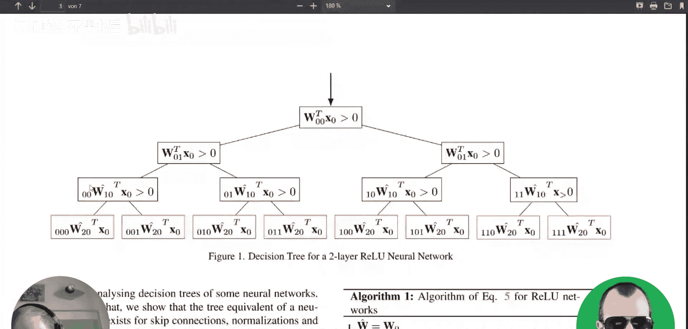
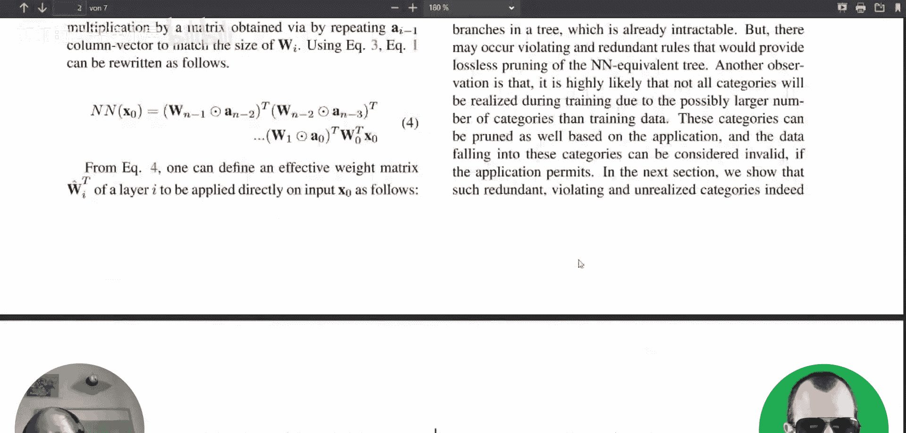
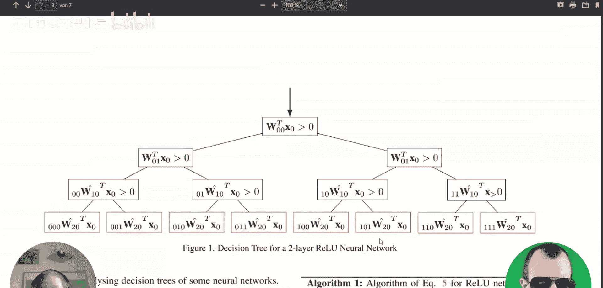
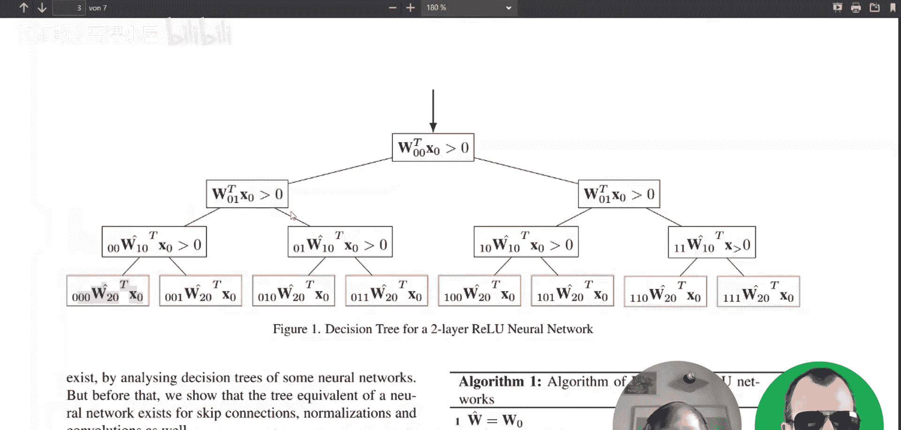
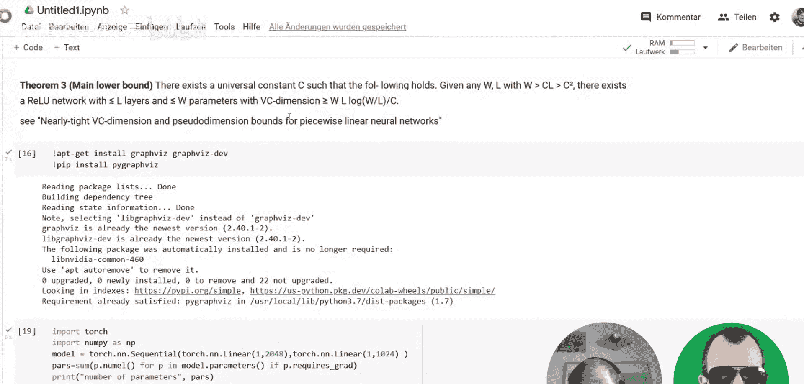
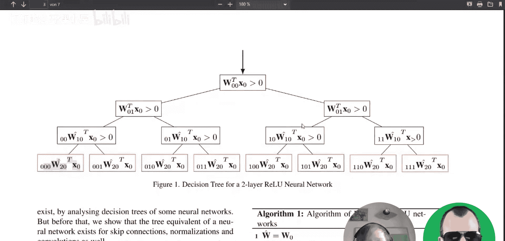
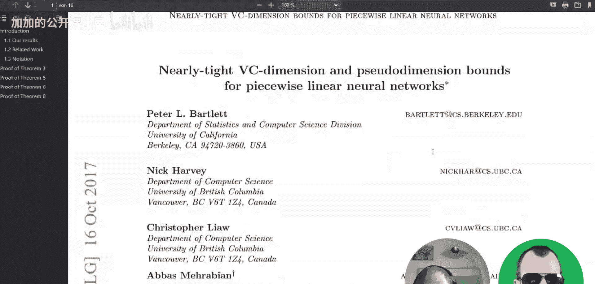

# YannicKilcher【中英⚡AI经典论文领读(全203篇)(下)｜Papers Explained】 p91 P191 神经网络即决策树（与亚历山大·马蒂克合作） [BV1j8x5zJEvx_p91]

Hello everyone Today we're talking about neural networks and decision trees。

 I have Alexander Madock with me who is maybe you want to introduce yourself Yeah I'm currently a student at FAU in Germany and most people don't know me probably through foryik for his discord where I'm one of the people who manage the paper discussions every week and present more of the theoretical papers usually so we came across this paper all across social media I saw I saw it at one point and I'm like meh and then I saw it like all over LinkedIn being like neural networks are no longer a black box we now know what's going on I saw it on Twitter I saw it essentially like like really got some push behind it as I said when I first saw it it was like this has been known for a while so what does this paper say in a general sense and has it been known for。

or is there actually something in there Okay so basically what this network does is what this paper does is it shows how you can basically take a neural network。

 which is a sequence of weights with nonlineararity in between and then you can kind iterate if you rewrite them by effectively pulling out the right slopes and merging them up into new weights and that would give you effectively this kind of structure it's important to say this is only for if if the nonlinearity is piecewise linear for example。

 a re nonlinearity otherwise we have an approximation but this is an actually an exact mapping that we're doing right here So we just rewrite the neural network somehow and then we get out what so we get out such a tree。

😊，And effectively， you can see these W hats here and these W hats。

 I think they're defined somewhere yeah， I think somewhere up here。

 Yeah effectively just unroll the the piece by slopes always from the layer above So effectively we go and we draw the different cases that happened through the previous layer we draw them up through the subsequent weights and that gives us kind of this tree structure because we of course get this unfolding of kind of which path can we go in the neural network and then the next then the next layer and kind of enhancing that path and so on。

 I think it's still a bit unclear maybe to some people who are not super familiar with this they might be under like the general notion is a neural network is a nonline function right Therefore I wouldn't just be able to represent with a single even if the W in the W hat are different right I still at the bottom here I see you know X。

Times W something which is a linear function。 So why all of a sudden I have a neural network。

 Why do I arrive at a bunch of linear functions This mos has to do with the fact that neural networks intrinsically are just compositions of these piecewise linear functions。

For example， there's been more recent work， think here in the sp theory of deep learning more work。

More recent than the paper we're looking at No recent in a sense of it was published after 2000 this paper from I think 2018 and there they make this very。

 very explicit where effectively they show that you can unfold almost every network into what is called splines and you can think of splines as kind of regions which then in and of itself are fi linear so it's a linear transform with some bias against it and these deep neural networks are just different regions all of which have their own slope and slope and bias if we imagine a neural network with relu non-lineities if we imagine a point somewhere in the input if we move that point like just a tiny bit then we move it small enough so that none it crosses none of these boundaries a relu is essentially like this so it has like a boundary here where the slope changes but if we move。

Just small enough that either the signal is in the slope so it changes a bit in the slope or it doesn't change at all because it's in the zero part So if we move just a bit we don't change the relu activation pattern and that essentially means since all the functions are either linear or piecewise linear but we don't switch the piece that means that within such a relu cell it's essentially a linear function I think that's what we see here at the end of the decision tree。

 the decision tree essentially says with this particular input which of these relu cells am I in and inside of that cell it's actually a linear function and that's what's described here the neural network in total is non-line because obviously we piece together super many of these tiny relu cell regions and that can make something that appears almost like smooth like because if we zoom out。

Then， you know， it's like a video game where everything is made of triangles。

 But you zoom out and it kind of looks round。 It kind of looks smooth。 The paper shows。

You can rewrite the neural network and you get something like this。 What does it mean。

 That's an entirely different question because。So there are many different ways of viewing such a conversion。

 one is through a practical lens， another one is from a lens of what does it help us to study decision trees。

 another one is how does it help us to study neural networks。😊。

Pro position of studying decision trees。😊，It doesn't really help us that much because neural networks are inherently a lot more。

Imenetrable than decision trees， really studying a neural network and that helping us to figure out something about decision trees is rather hard。

😊，Additionally， we have the problem that decision trees fundamental to the decision tree learning algorithms we build。

😊，they themselves don't map to neural networks perfectly。😡。

What I mean by that is you can take a decision tree like this thing here and transform it into a neural network。

 however， during the decision tree training process what you usually do is you take one of those effectively edges。

😊，And then you split it up into two lower ones。😡，And for that。

 you may need a new neural network because the capacity of the original one doesn't work out anymore。

 so from a perspective of taking a neural network and then helping to figure stuff out for decision trees。

😡，Pretty hard on the other hand we can use these decision trees to find and figure out stuff about neural networks。

 this is lot more promising， but there is often the case that to do the kind of analysis you can do with the decision trees。

 you don't necessarily have to explicitly build this tree。Like the sp theory of deep learning paper。

 which does lots of notes analysis so for example， there was a recent paper which specifically looks at what batch norm actually does through this lens。

 but they don't need to build the explicit decision tree because they are just interested in this piecewise linearity that're not necessarily interested in how exactly this fits to the actual neural network part or the actual tree part。

 and then last but not least we can also analyze it through the view of let's take an existing neural network like a ResNe。

😊，And try and make it more interpretable。 So that's where I also saw a lot of the hype going on。😡。

because decision trees are more interpretable， you could obviously go and take a resnet。

 transform it into a decision tree and then have this great interpretability。

 but in practice this doesn't really line up that well and the reason is again kind of connected to this idea of decision trees making being small and then progressively growing when neural networks are large and just basically large enough to fit everything inside of them that means that the actual size of these neural network trees can become rather gigantic the way we can do analysis with theoretical lens is by studying something called the VC dimension or the about Schenkin's dimension。

😊。

Which effectively just tells us。How many different points can network distinguish。

 which of course for a decision tree， if you have a fully balanced tree like this one would be two to the power of the depth of the tree while for a neural network it's a lot harder to figure out because you have all of these different architectures what you can do though is we can go in we can bound this and there's been like lots of work in trying to figure out bounds so for example the best bound I could find is from this paper from 2017 which provides nearly tight bounds specifically they provide this kind of theorem for a lower bound meaning what they basically shows is there's some universal constant which has this constraint so effectively square of it has to be less than the number of weights you get a minimum amount of regions of resolution from a neural network of w so the number of weights times L which is the depth of a network times a logarithm of w over L and then you have this。

C constant in here so it effectively means the number of regions we have scales a little bit more than linearly because we have this w in the log and it stay a little bit less than linearly with the number of layers because we divide by L here so if we now take this absolute lower bound so what we can say is because we divide by c here we can just set W equals to so we can just set c square equal to the square root。

😊。

