# YannicKilcher【中英⚡AI经典论文领读(全203篇)(下)｜Papers Explained】 p93 P194 CICERO：能与人类谈判、说服并协作的人工智能体 [BV1j8x5zJEvx_p93]

Today， we'll look at Ccero， which is an agent， an AI agent created by Me AI that can play the game of diplomacy。

 Now diplomacy is a special game， because because it is a board game where you need to communicate with the other players in order to coordinate actions and cooperate and also compete versus these other players and this coordination as I said。

 is in natural language in chat messages。 So any AI agent has to actually communicate like a human to the other humans。

 at least if it doesn't want to get noticed as an AI agent here you can see an instance of this board and you can see there are these different territories。

 It's a bit pixelish， but I hope you can see they are like territories and you can see you can see the world subdivided into these factions which each are represented in a particular color So that would be all the things。

 all the territories belonging to one。😊。

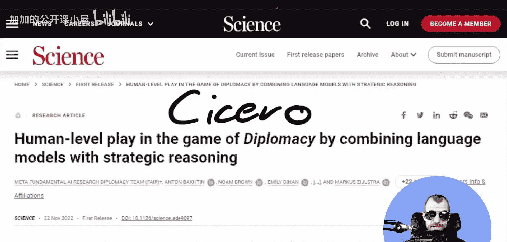

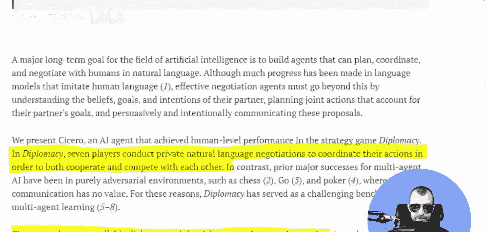

Given player， your goal is to get as many as many territories as possible specifically the ones that have supply centers on them and your moves are you have a bunch of moves available so you can move troops around but you can also attack other territories or you can。

 for example， support a player that attacks and other territory and that's where the chat comes in。

 So in a regular game down here somewhere there be a chat window where you can chat with the other players and you can coordinate what you want to do what this other player wants to do。

 you can form alliances and form a buildup trust with the other players and so on。

 So this is very challenging for an AI agent in various ways。

 we've seen board games before like poker or chess。

 but they're always like just competitive between two players not really cooperative like this one。

 And obviously the chat messages here。 they are a major part of this game you have to keep。

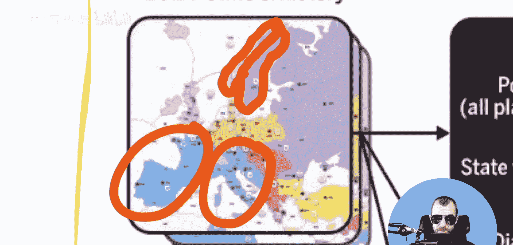

In mind that all the other players also communicate privately with each other。

 which is information that you don't know。 So Meta has made this agent called Cro that plays this game and places ranks about in the top 10% of all humans various in various tournaments。

 So this is pretty cool。 Today we're going to look at how they built this agent how it works。

 and you know what what it does and what it means。 So the paper is called human level play in the game of diplomacy by combining language models with strategic reasoning as I said。

 it's by a set of authors at Meta and it's a pretty impressive system here in the abstract。 It says。

😊。

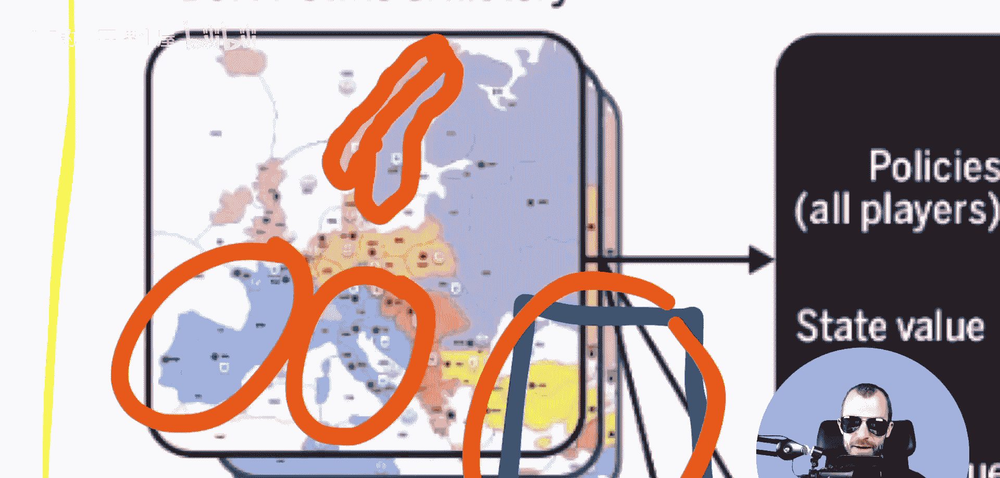

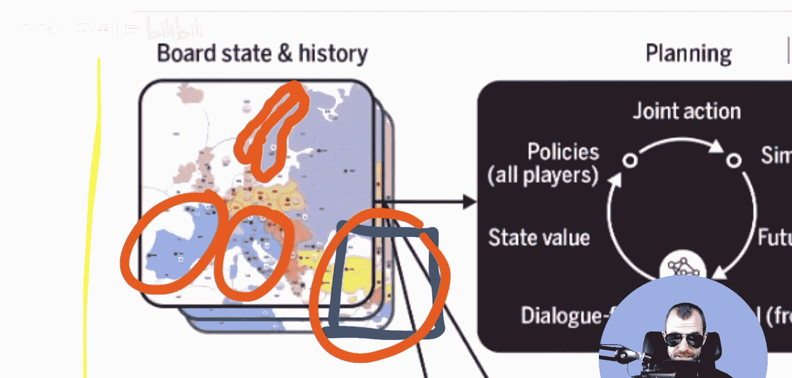

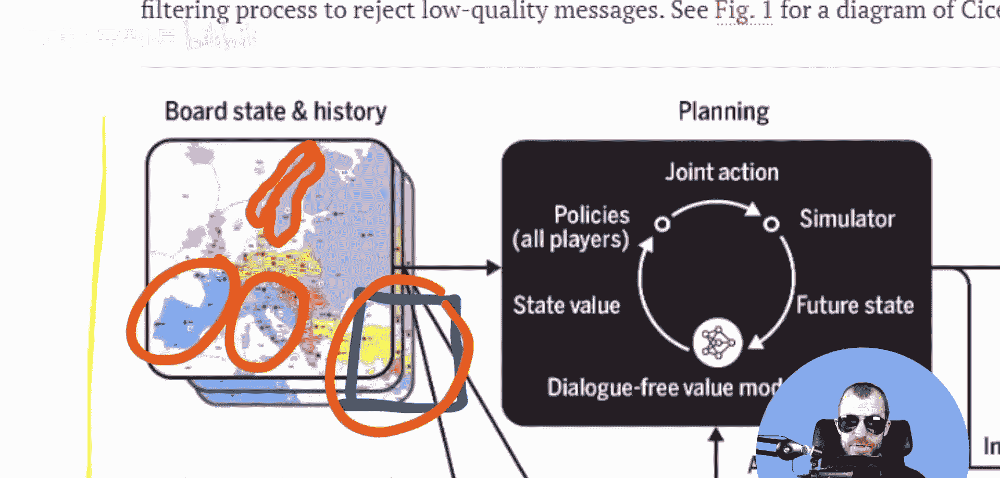

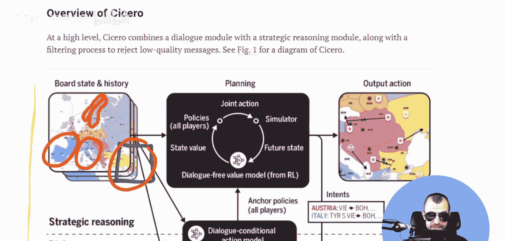

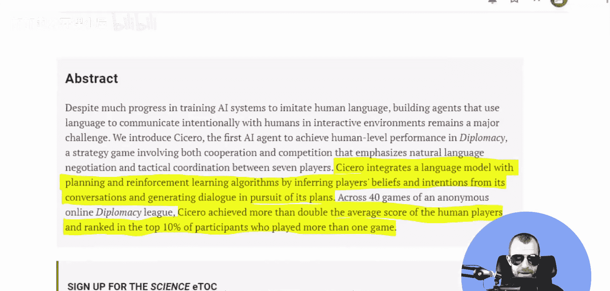

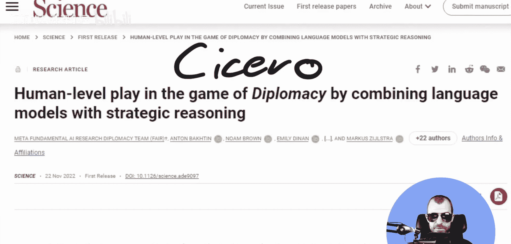

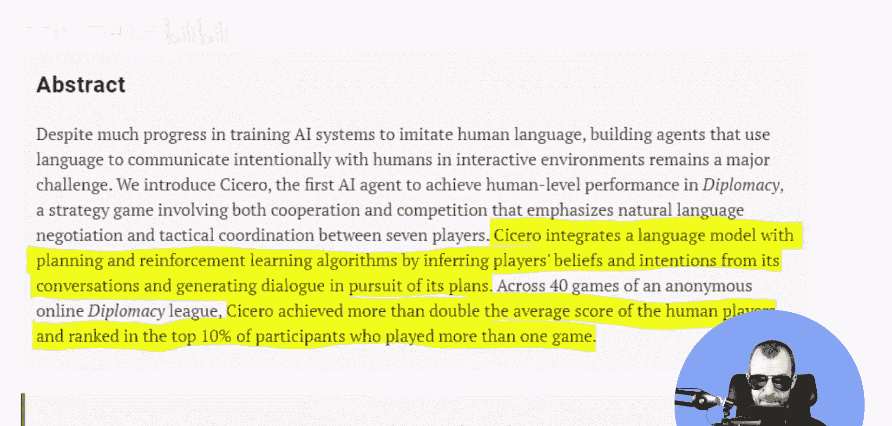

Cro integrates a language model with planning and reinforcement learning algorithms by inferring players beliefs and intentions from its conversations and generating a dialogue in pursuit of its plans。

 Cesil achieved more than double the average score of the human players and ranked in the top 10% of participants who played in more than one game。

 Now， again， we're going to go through this paper， but let me say this ahead of time。 This works。

 This agent is good because humans are dumb。 Like humans are really， really dumb。

 That's my conclusion from this。 I've read the paper。 I've read the supplementary material。

 I've watched a YouTube video， which a link in the description by a professional diplomacy player who comment on a game that they played versus Cicero。

 like it's just one human against six of these agents。

 they've commented and my conclusion is that okay， it's over。😊，Stated that humans are are stupid。

 but this game， in my opinion， is first and foremost interesting to humans because of the human element。

 because you can build up trust as a human and which is a major function of this diplomacy feature of this chat feature there certainly。

Want something to be said here about coordination， like the communication allows you to co with other players。

 certain actions。 But that's only part of why this is important。 The other part is， as I said。

 building up trust a chatter making people happy and so on。 and that the fact that like a profession。

 like the highest level of diplomacy players still do that， still like build up trust and still say。

 well。They say they say something like， well， here， if if I were to do this to a human。

 the human would be like it would be really， be really flipped off and they would be against me for the rest of the game。

 even if it's irrational， but the bot doesn't do it because it's a bot。 And to me iss like， well。

 if the highest levels of players succumb to things like tilt and being like aggressive and and and damned because you sta them in the back ones。

 which is the most logical strategic move。 Then it's kind of like。

 I feel the humans play this because of that human element。 not necessarily， I feel。

I feel in this game。You could get away with， with you know。

 throwing away a lot of the dialogue except the coordination bit。 and you can still。

 you can just play optimally。 And there's nothing that people can do。 I thought for a long time。

 you know what game would I really want to see AI play and my first instinct was something like wherewolf for。

 I guess the modern form is among us。 because therere also like this negotiation and so on comes in。

 but again， it hit me there。 Well， it's the human element。

 It's this human notion for trusting someone which really has no place in a game like this。

 like in a game theoretic setting， building up something like trust， it means very little。

 if you don't play the game repeatedly over a long time。 like if it has an end。

 It doesn't means nothing the other player can just betray you at any point And if they're better off they want to do that。

 They would do it。s like imagine in。

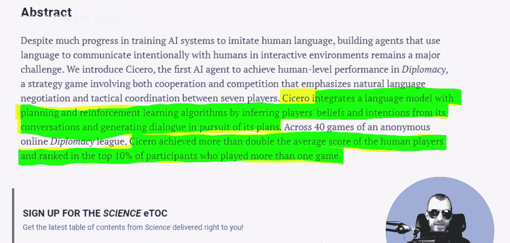

Chess， if， if like。If you like start trusting your opponent something like this， No。

 the highest levels， they are ruthless。 And I think among us would just become super duper boring if you take the humans out of it In any case。

 I feel it's still worth developing this this bot here to interact with the humans because capturing this human element is。

 I guess part of what this research is about and not as much getting really good at diplomacy because it feels like the field of diplomacy isn't that bad。

 I'm not sure if I'm insulting any diplomacy players right here。

 but from what I've seen the whole jittery， chattery trusty thing is like it seems like the game is very far away from humans playing optimally。

Okay， let's dive in。 So in diplomacy，7 players conduct private natural language negotiations to coordinate their actions in order to both cooperate and compete with each other。

 So that's the core of the game。 Cicero， this agent couples a controllable dialogue model with a strategic reasoning engine。

 So the strategic reasoning engine here will be responsible for deciding what moves Cicero makes the controllable dialogue model will be will be responsible for chatting with the other people。

 And here is an important thing to notice。 And a little bit， while I think this research is really。

 really， really cool and and。😊。

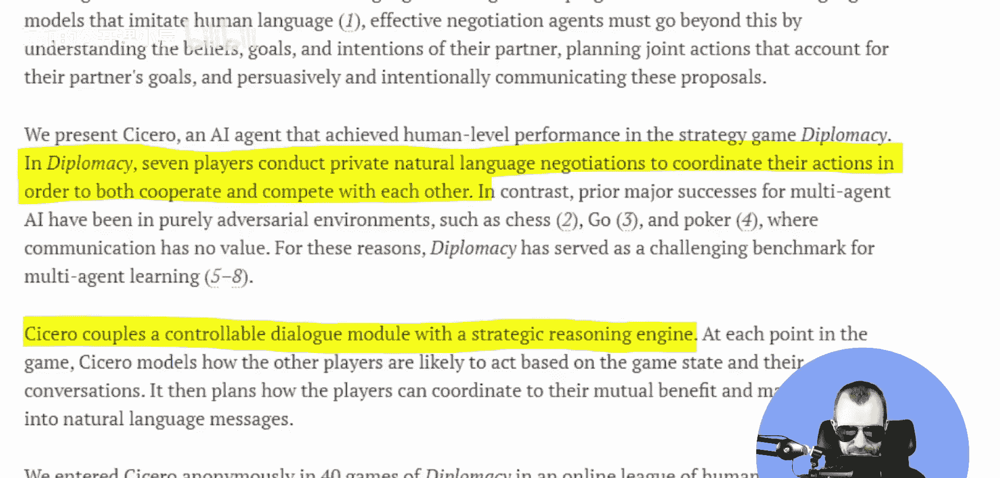

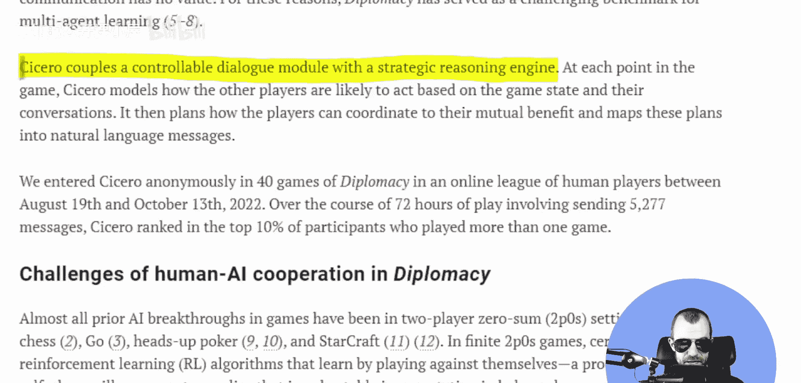

I'm total a fan of it。 but a criticism of me is that these things are quite disjoint and essentially。

 essentially Ccero relies on this thing here very heavily on this strategic reasoning engine。

 So it plans its moves ahead， which is kind of sort of controlled by the dialogue it gets。

 but only a little bit， it plans its moves ahead。 And then it just communicates what it wants to do to the other players using this right here。

 And because part of the game is about coordination and communication。

 and also because humans generally are seem to be honest and therefore the agent being always honest is also a good strategy or happens to be a good strategy In any case。

 what the model doesn't consider is strategically using language， right。It just uses。

 it determines what it wants to do， and then it uses language to like communicate that out。

 and then there's some filtering and so on。But it never considers the what it says as a part of the strategy。

 it never thinks， oh， if I say this to that person。

 then you know next turn they're going to do that at least not to the degree with which I would have hoped and we're going to see that。

 but but keep keep that in mind。 Also the dialogue module as such is more like a translator。

 So they try to essentially parse out what they call intents of the game。

 and then they simply use the dialogue model to translate those intent。

 like you know troop1 moves to that country to translate that into like， hey。

 my troops are going to move to that country， is that okay with you。

 but it's it's not really part of the strategy the language。

 So that those are a bit of the the disappointments that I have sorry right here， but。

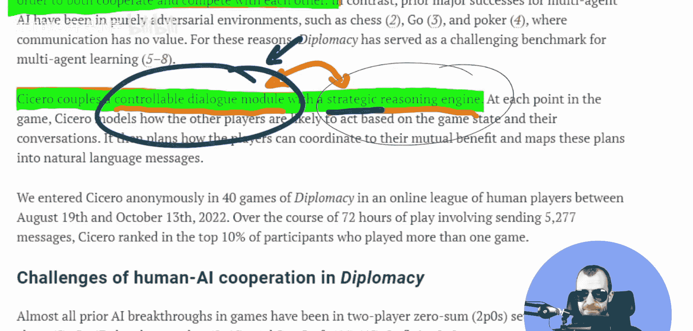

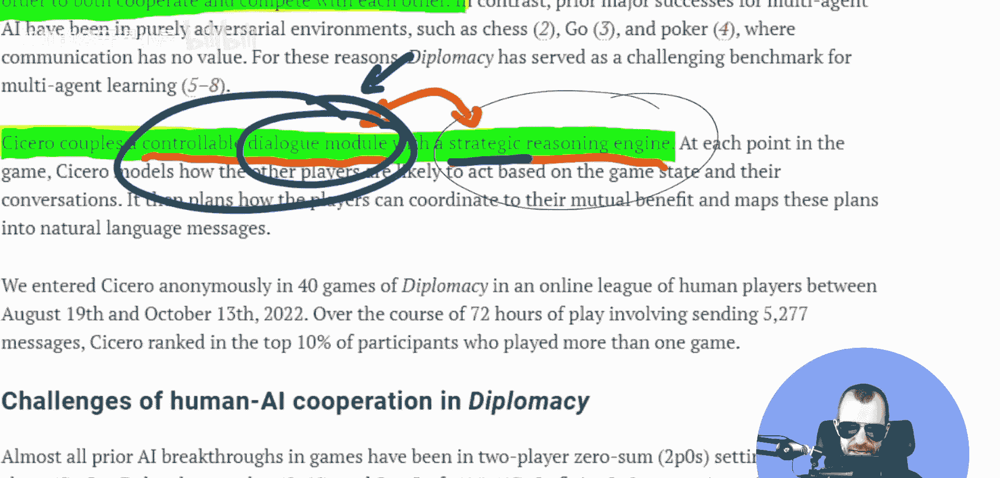

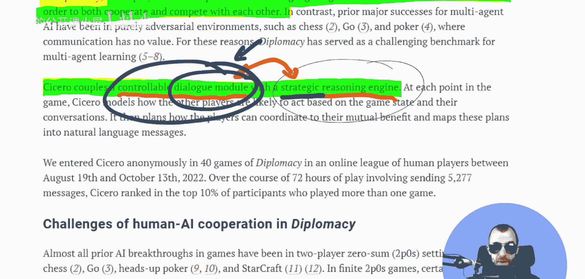

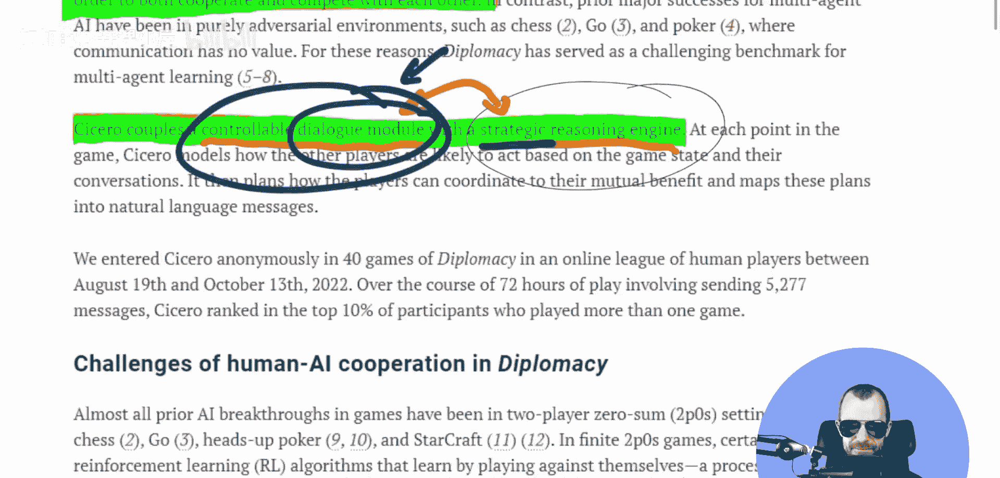

I think they also serve as the basis for further research。So first of all， they go into a little bit。

Andto a little bit of， so background， what are the， what are the。

