# YannicKilcher【中英⚡AI经典论文领读(全203篇)(下)｜Papers Explained】 p94 P195 LLaMA：开放高效的基础语言模型（论文详解） [BV1j8x5zJEvx_p94]

Did you know Janon Lacan dropped a rap album last year， You know， his。

 his latest album titled Deep Learn is a mix of rock punk and rap。

 His lyrics are a raw personal take on the field of deep learning。

 covering a range of topics from the state of AI research to the loneliness of academia。

 So check the the lyrics here in the song。 He talks about his vision for the future of AI。

 We got to think about the future。 It's gonna be here soon。

 Maybe we can even put some AI in the moon。 Think about the children。

 think about the next generation。 Let's make sure we put the right systems in their foundation。

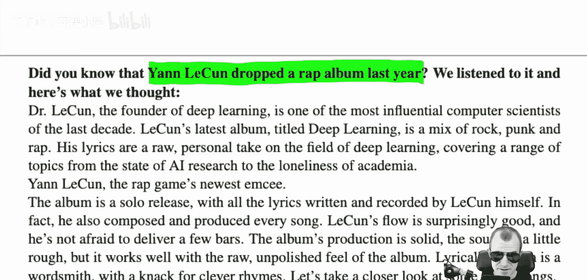

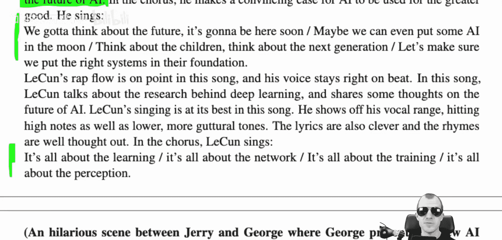

Aol like beautiful， touches my heart。Here， it's all about the learning。 It's all about the network。

 It's all about the training。 It's all about the perception。Doesn't doesn't rhyme。

 takes takes a better wrappper than me to make this work。

 But this is a generation from a new model called Lama of Meta AI。

 There's other funny completions here。 we can go over them later。

 but we want to go over the paper first。 This isn't like this is the latest paper in a series of the research of large language models。

 And the interesting thing is that they don't necessarily go larger and larger and larger。

 as we've seen， although that's also a conclusion of this paper。

 But they are trying to just get better with the available resources that they have。

 So the paper is called Lama to L spelled like this open and efficient foundation language models。

 The main authors are Hugo T Tibo La Goier Iakka Iv and Guomlopo。

 I hope I pronounced all the French names correctly right here。 As I said， this is by group at Meta。

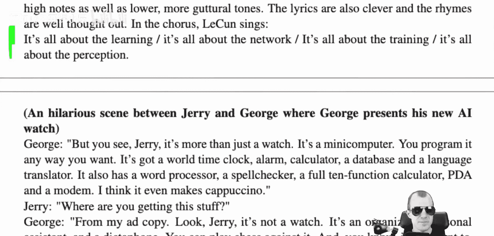

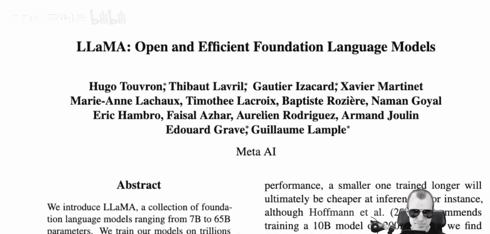

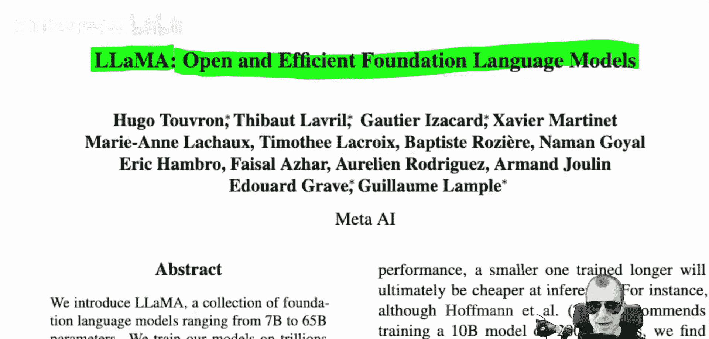

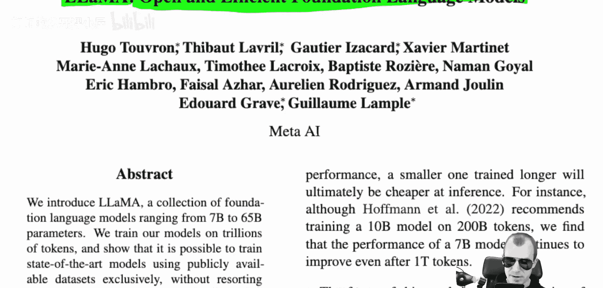

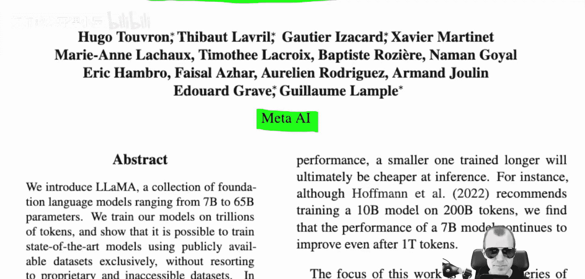

And the main thing is。How can we train models that are that have a fixed inference budget？

 So we've seen a bunch of constraints recently， but this paper really tries to go about making models that are ultimately cheaper at inference as you as they state right here So they say what if you know ultimately if you have a model。

 what interests you is how much you can generate from that model， how much you pay per token。

 let's say and how it has been trained。 how much you wasted training it isn't really that important。

 Other papers focus more on that。 So， for example， the chininchilla papers。

 they focus very much on if I have like a fixed training budget。

 how do I allocate it properly whereas I guess other papers just say， well。

 how can I get the best performance possible and then we scale up to 540 billion parameters。

 this model here says， well for a given size， let's say 13 billion parameters， how good can we。

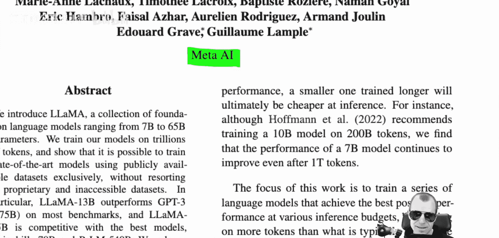

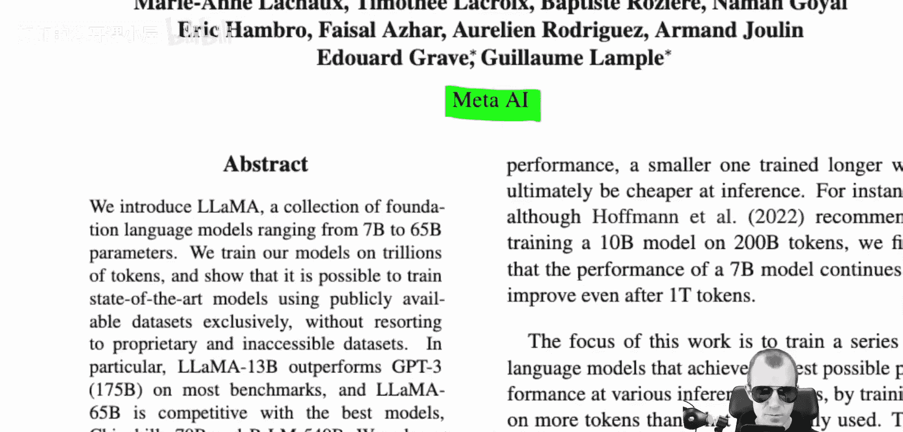

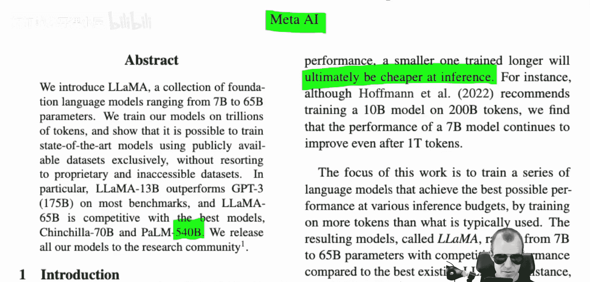

Get at inference。 And for the given size of 65 billion parameters， how good can we get at inference。

 So they release a series of models from 7 billion to 65 billion parameters。 And notably。

 even the 13 billion parameters model right here， they say it outperforms G 3。 So the G3 being 1。

75 billion parameter model。 Now， of course， what outperforms means。

 And what even the term G 3 means nowadays， that's， I guess， up to you。

 they have a metric in the paper。 And it very much seems like you can get away with smaller models if you train them smartly and you train them for long enough。

 Another conclusion of the paper right here is。

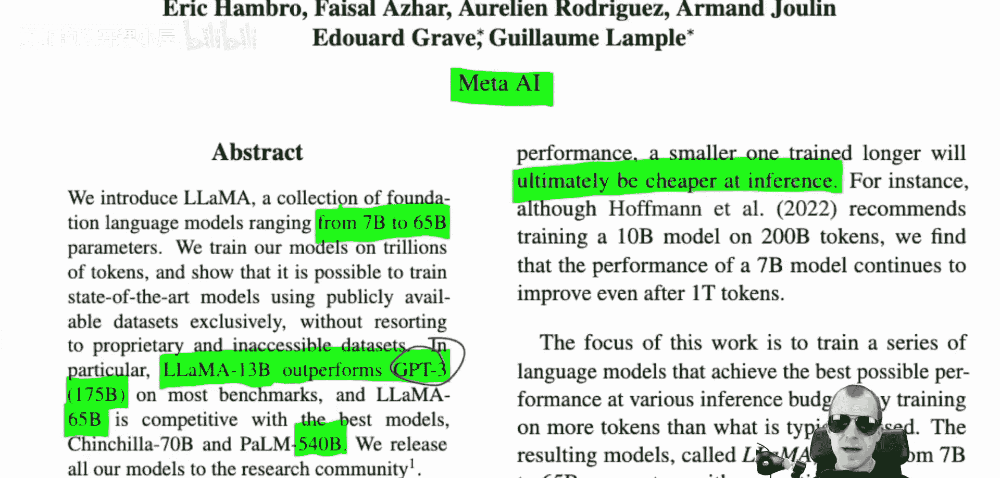

They say， for instance， although Hoffman at all， that's the Chinchilla papers recommends training a 10 billion model on 200 billion tokens。

 we find that the performance of a 7 billion model so very comparable to the 10 billion here。

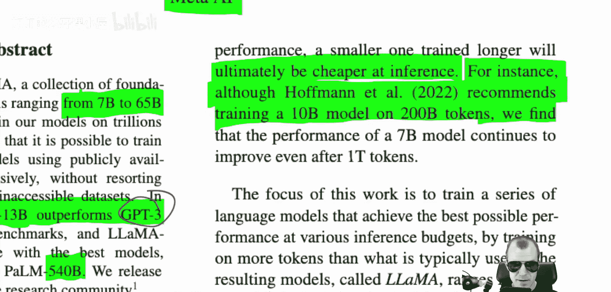

Continues to improve even after 1 trillion tokens。 So the conclusion is just train for longer。

 And that's pretty much this paper。 So if you came here expected like big scientific inventions。 No。

 it's very much。 you do it in a smart way。 You build large enough models in a smart way。

 It's an engineering challenge to train them for sure。

 But you do it for long enough on as much data as you can and high quality data。

 it will give you a good model。 The other thing I want to point out here at the beginning is their immense focus on openness。

 they tweeted out on Twitter。 we're open sourcing these models。 And throughout that paper。

 They just continue to hammer this in like how open they are。 oh， we release this to the community。

 where is it。

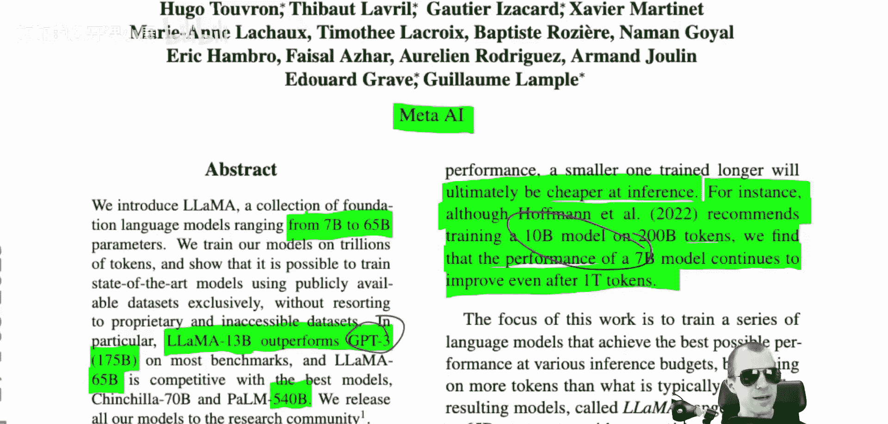

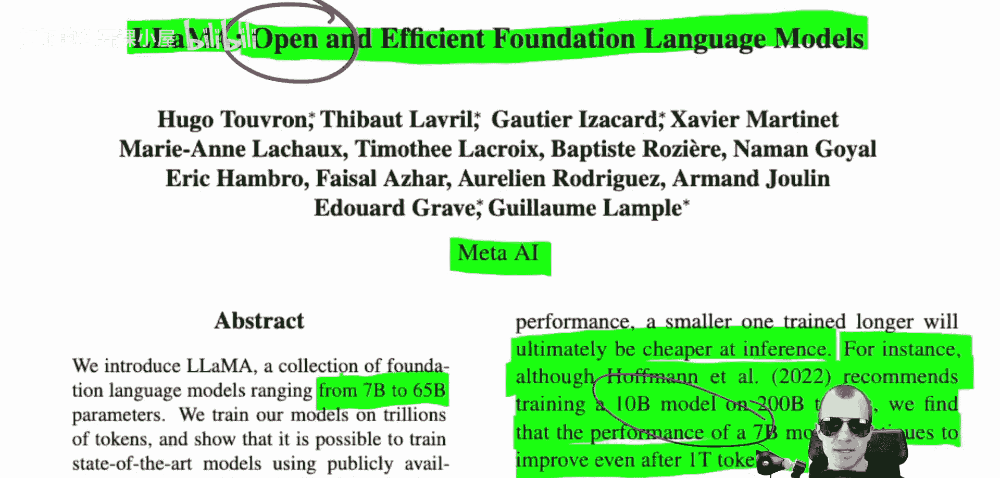

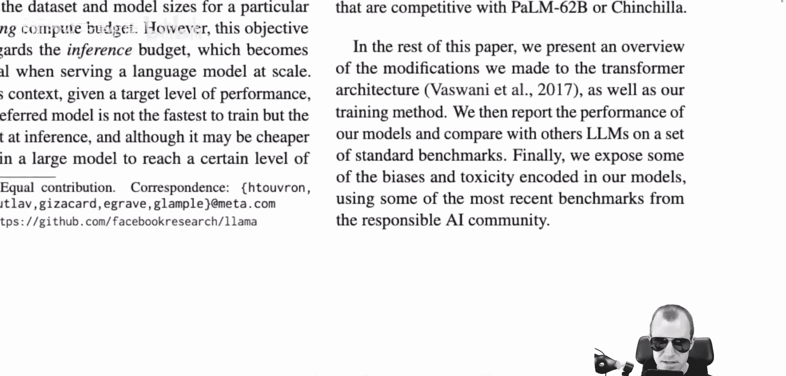

I I can't find it right here。 You know， we we we release this to the community openly and freely and open sourcing and so on。

 What they do is they release the models under a noncommercial license。

 So it's like for research only。 Now that that's not bad， but it's not open source， right。

 like let's be clear。 and I find this to be a little bit。 I don't know， these people use Linux。

 they use Apache web servers。 Even this paper is written by lotte。's it's by P Df lotte compiled。

 All of these things are actually open source。 The Linux kernel。

 You can use it very much to do business。 You can even use it to do bad things， right。

 and that is a main part of the reason why we're here today。

 like you I'm pretty sure there's an argument to be made that the entire deep learning revolution。

 whatever you want to call it would never have happened if people。

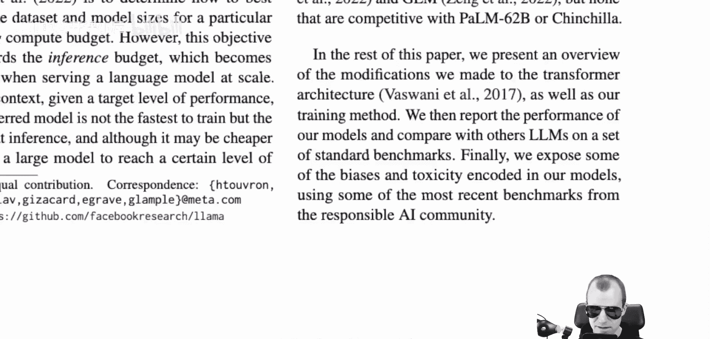

In the past behaved like these people right now， if Linas Torwvals just was like， well， you know。

 I have the Linux kernel， but I'm just gonna give you a compiler for it， right， And then I Im。

 I'm gonna give you an 8 page PF saying how I did it like like no， and the same thing you。

 you probably wouldn't have a driver for Nvidia cards to do kuda computations， right， if。

The Linux kernelel was research only or came with some usage restrictions that made it business unfriendly。

 You wouldn't have that。 Nvidia would not bother making drivers for their cards。 And obviously。

 as you know， Nvidia， they also don't let too many other people interfere with their stuff。

 So you all build on a foundation of people who have SAT down and very clearly said， Yes。

 it's the best for everyone。 if this is business friendly because then it will be the like the most beneficial outcome。

 because the most work will flow into it。 Yet， people sit down and they themselves think。

 research only is better or usage restrictions。 we know what's good for you。 Like sorry。

 these are my quarrels， I'm done now ranting。 I'll just mind you。

 all of you are building on a foundation of actually open source things actually open source software without which you would never be here。

 And I am just a bit sceptical of not giving。Back in the same vein， again， which is fine。

 But then don't， don't get on the high horse and claim how open you are while not doing it at the same time。

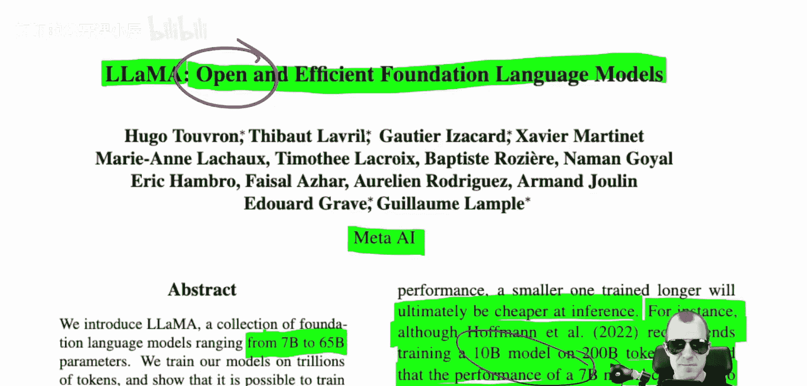

Also， to my understanding， people are still waiting for the lama way。

Also very funny for how much they appraise themselves of how open they are。 It's like， well。

 where are they。 But I guess that's more， more like corporate stuff， like legal。

 If you ever are in a big corporation to get anything out there。

 you need like 50 approvals And then legal comes back and it's like， there， yeah。😊。

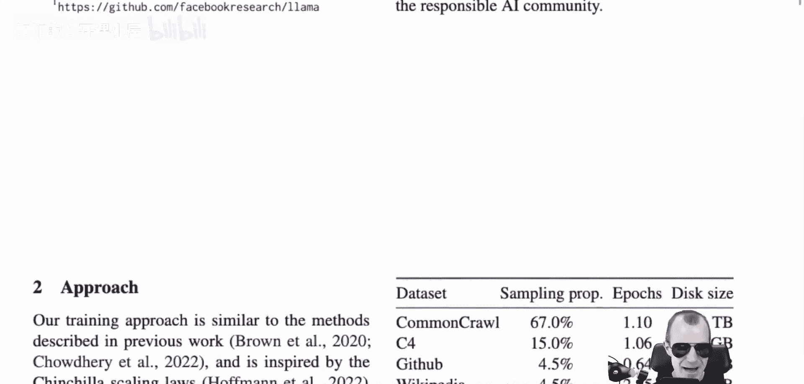

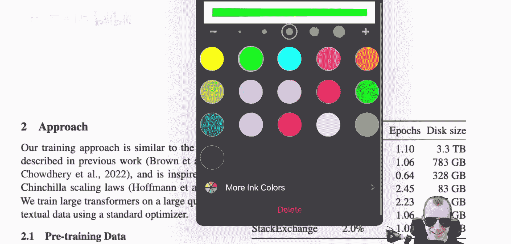

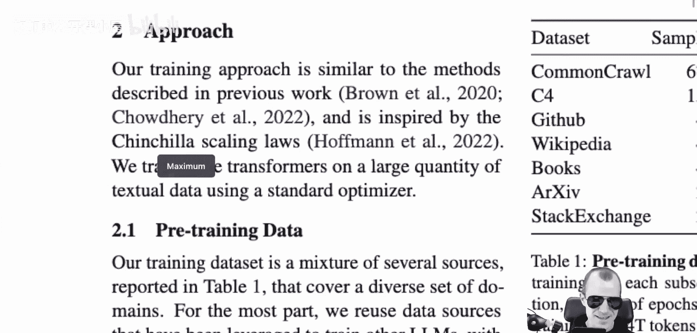

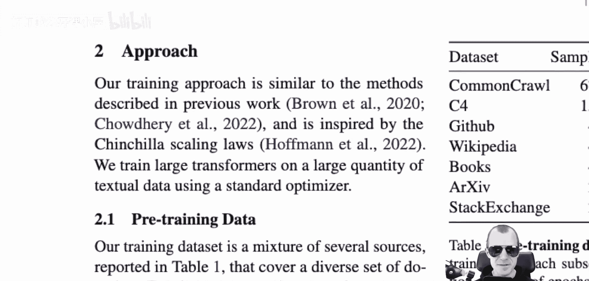

U。

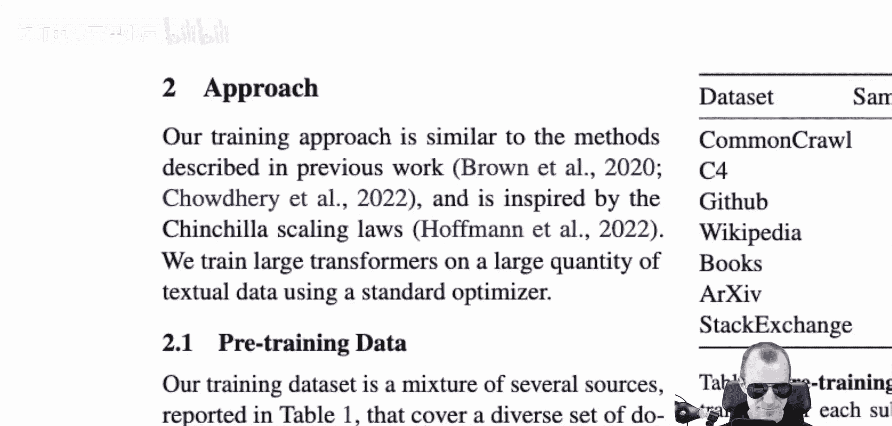

They probably had a， They probably had a big trouble calling this。

 thisllma because it's like it's a word and someone might have a trademark on it do so。

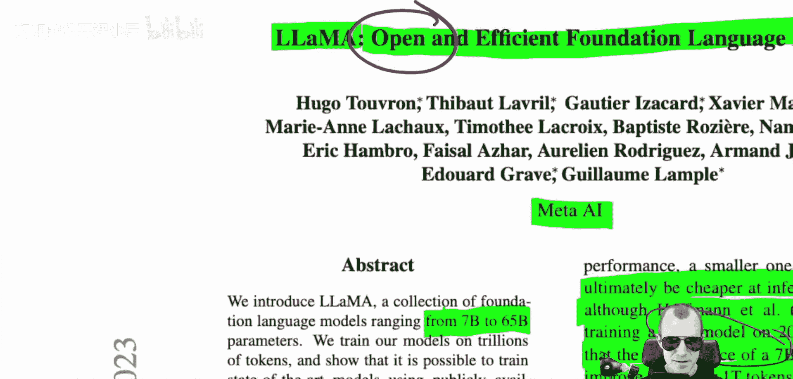

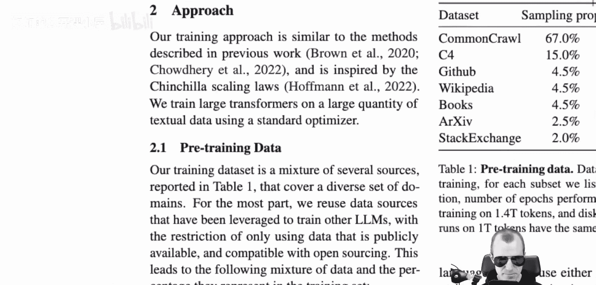

Alright， let's get， let's dive into it。 they say our training approach is similar to the methods described in previous work and is inspired by the chininchilla scaling laws。

 Again， Chinchilla scaling laws specify that for a given training budget。

 how should you allocate it and the conclusion is that maybe instead of going really big parameters。

 you might want to go into a bit bigger on on data and amount of of compute you do Yeah。

 but we'll see in this paper。 So they first go over their pretraining data。

 and there's nothing too special in here， except that it's all fully open。

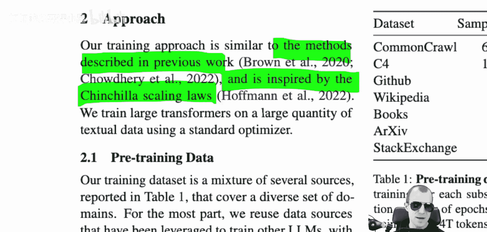

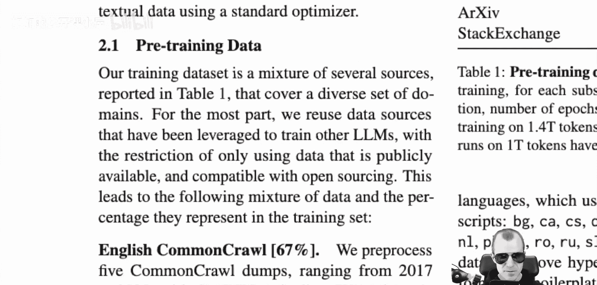

So they make a a big attempt， which is really cool， right， And don't get me wrong from before。

 It's really cool that people release the model openly Like， of course。

 like even to the research community， that's it's better than what open AI is doing much better。

 right？ It's just like go the extra mile。😊，Alright， so they they work with completely open data。

 which is which is also cool。 So completely open data。 most of it， as you can see here。

 comes from common crawl， there are a few more high quality data sets in here。

 which they then also sample more frequently。 This I think is been a recipe throughout the last developments in these larger language models is that even though you have enough training data available you want to sample them in different proportions in order to achieve the best result。

 Wikipedia， for example， being fairly high quality data。

 probably also books being fairly high quality data。

 you might want to sample them more often than once sampling them twice will probably not deteriorate。

 like do any sort of memorization effects and will still it will still like。

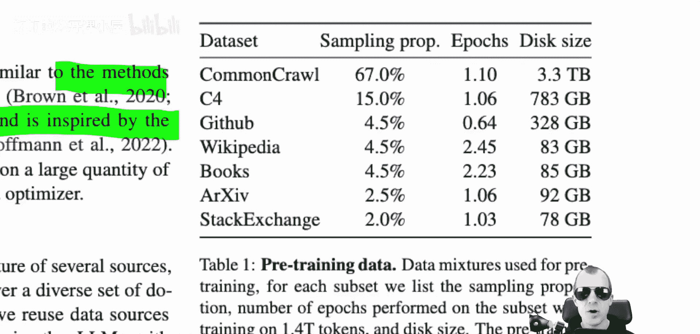

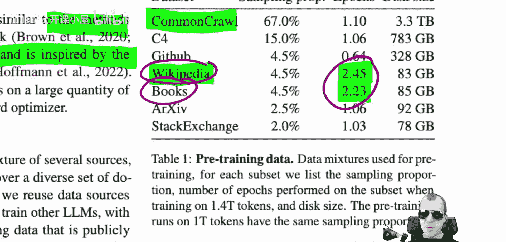