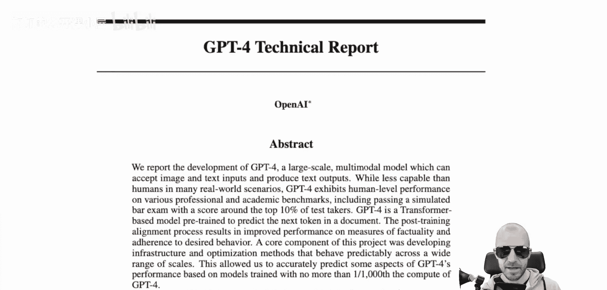
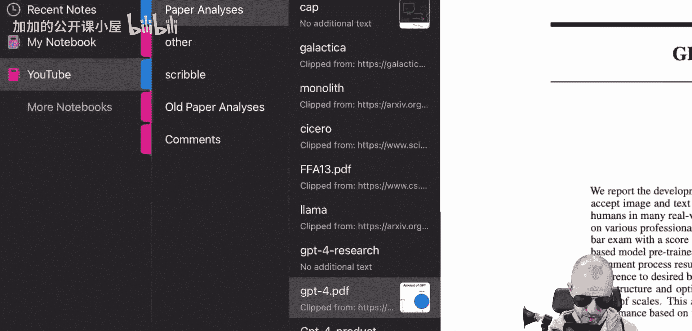
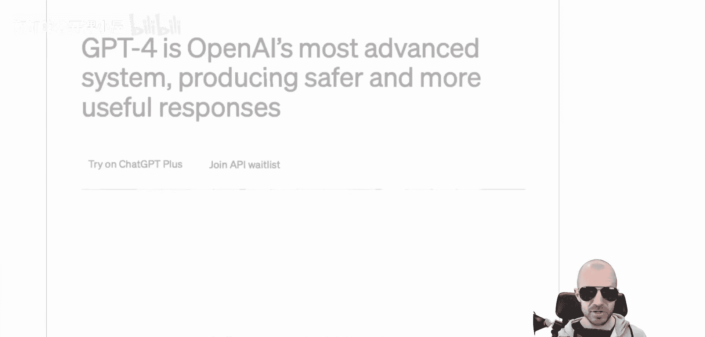
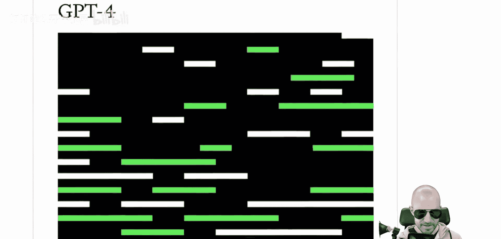
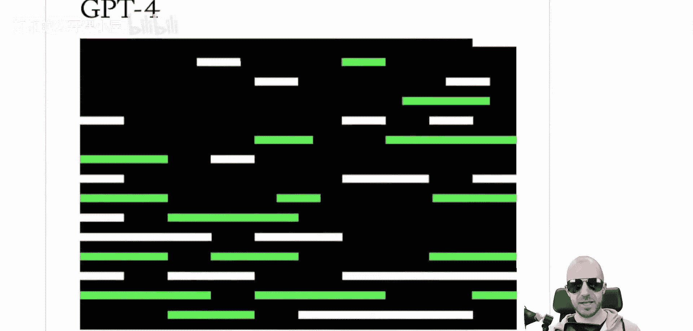
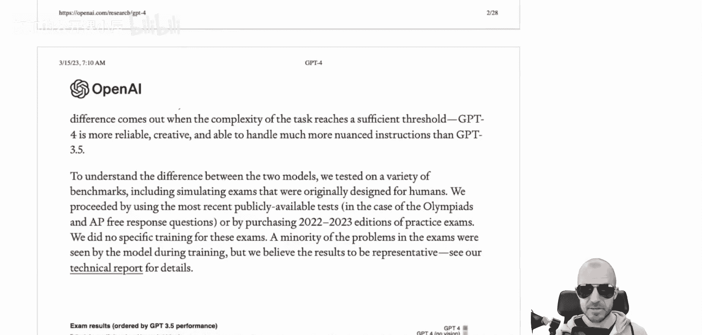
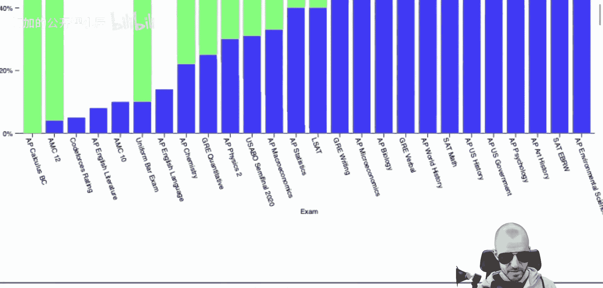
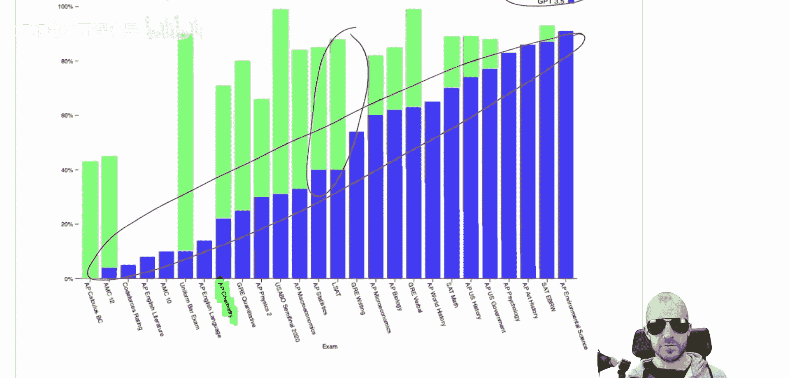

# YannicKilcher【中英⚡AI经典论文领读(全203篇)(下)｜Papers Explained】 p95 P196 GPT-4震撼发布！全方位解析已知核心特性（完整版） [BV1j8x5zJEvx_p95]

All right， It's finally here。 G4 has been released。

 and the amount of G in this one is truly mindblowing is almost for。 as you can see in this graphic。

 So thanks through the Discord members for this meme。

 We're gonna get into G 4 into their release into their technical report or is it a paper or is it a research report。

 One doesn't know。 we're gonna get into what open AI released， what G4 can do。

 and the controversial methods of the release namely that they say absolutely nothing about the model。

 So let me warn you right now， if you expected here for me to make video like I usually do where I discuss how big the model is how they trained it。

 what the tricks they used were and so on， know stuff that's usually coming out of a research lab。

 you're gonna find none of that here。 This is 98。😊。

ges of them saying we trained a model on data and it's good。 and it's safe。

 and they spend a lot of time ensuring you that it is really， really safe。 and safe。

 not in a way like they previously did like who it's safe for humanity or safe against biases and things like this。

 but much more safe in terms of you can build this into a product and you don't have to worry too much that it's going to just whack out and insult your customers。

 So we now see openaiI to fully go away from anything resembling a research organization to a product organization。

 This is a product。 you may use it。 it probably is quite good for some applications。

 But yeah we have to we have to contend with the fact that the big research labs now are going to be more product oriented。

 I strongly believe that as a research community， we should not accept this。 we should be shaming。

Open AI for this。 and this is， yeah， is' not research。re now you're now a software shop。

That's fine with me right， But then don't claim， don't claim openness。 Allright。

 so this is called a technical report。 They have released two other or multiple other things beside this technical report。

 Let's see here they have also released a product page。 This is it's a printout of the product。

 This is a website where its product。 they have videos of people looking at iPads and going like and comparison to chat G and they claim G4 is a lot better than chat G they also have released a website that's a research website。

 They have two websites one is called product slash products slash G4 and one is slash research slash G4 and the research website is probably the one that most people have seen or are seeing。

 So this one is essentially a short condensed form of the technical。

Report they're saying we've created G4， the latest milestone in openaiI's effort in scaling up deep learning。

 It's a large multimodal model。 So multimodal saying they accept image and text inputs。

 emitting text outputs。 So in my mind， this is a little bit of a。

 I want to say disappointment and of course， there there was no other chance for G4 than to disappoint people because expectations have been huge。

 but people have been speculating about can this do video。

 can this maybe be also emit images and things like this it can take text and it can take images as inputs。

 and it can output text。 So anything that you're used to from the open AI text Apis is still possible。

 But now also you're able to provide an image yesterday or this morning depending where you are。

 Greg Brockman that a live stream for developers where。

He showed that he could draw a little picture of a website like he he drew and he's essentially said。

 okay， here is a website sketch。 Here is a button。 So here is a joke。

 and then is a button like reveal， reveal a punch line， and he just sketched a website like this。

 really rude。 Sorry， really roughly and。He input the picture into G4 and then GP4 output the code to make the website。

 including functional buttons and all that's pretty cool。

 And that's now possible you can take a picture of something in the paper。

 they also have various reports of the model reasoning over infographics and things like this Like you just screenshot something。

 input it there and ask the model about it。So that's， that's pretty cool。 The other thing they did。

 And what surprised most people is they， they。Evaluated G4 on human tests。

 So no longer or in addition to academic benchmarks。 Now。

 these models are more and more tested on on human tests and you can see here， there are。

 I don't know， like chemistry tests and algebra tests and things like this。

 one that surprised a lot of people or multiple ones that surprised a lot of people。 for example。

 the the LAT right here， Now， the this number。

The numbers you see right here are the percentile of the model。

 So the 88th percentile essentially means if this were a human。

 how would it rank among 100 other humans。 So in this case， GP4 would be an 8088th in 100 humans。

There is specifically one， Let me find that there is a bar exam。So can I find it？Is it not here。

Is it al here。Okay。Well。It passes a simulated bar exam with a score around the top 10% of test takers。

 In contrast， Gp 3。5。 That's the older model score was around the bottom 10%。

 So this is a bar like the tests for lawyers。 and it passes that better than 90% of humans。

 So people have been saying a lot of of things like ringing the alarm bells and so on。 And yes。

 obviously， these language models are going to be very， very good in in terms of， you know。

 wherever humans have to recant knowledge and write it down in a verbose and elaborate way。

 those things are really nice for these models。 But you have to be。

 you have to pay a bit of attention in in terms of these human tests， right， these models。

 they're not humans。 and the tests are specifically designed for humans。

 like the the tests look at where do humans differ amongst each other。 And then they。

Specifically test for that dimension。 Now， that dimension may be something that the models that we train are particularly good at or particularly not good at。

 but it doesn't necessarily say anything about how they。Eventually。

 compared to a human when it comes to the actual job。 So， for example， if you want to be a lawyer。

 you also have to interact with clients， you have to write emails and schedule appointments。

 a model may be able to do that。 but you also have to understand your clients a little bit。

 You have to talk to them， you have to make a connection。 you have to reason about， you know。

 what to do next， not only in a legal sense， but in the real world。

 every now and then you may have to climb a set of stairs or an escalator。 you know， so there are。

 there are tons and tons of things that humans have to do that。Are really important for a job。

 My examples might be really bad right now， but I hope you understand what I mean。

 These tests only test where humans differ from each other right and evaluating the models on them is is nice。

 is good， tells us about something about progress but cannot really get to the heart of。

 is this A G I， is this， you know， are our lawyers。

 our lawyers going to be unemployed in the future and so on。

 It's very much like if you were to let computers do a calculation like brute force calculation test that。

 you know， you may be doing in in lower grades of school， your multiplication tables。

 And then you go like get the computer out and the computer destroys the kids And you're saying。

 well。That doesn't mean they're going to be mathematicians or even good quick calculators for that matter。

Yeah， I hope I've made myself clear。 you have to pay a bit of attention when you apply machines to benchmarks that are made for humans and which are targeted at specifically。

 at specifically seeing where humans differ。 That being said， G 4 here。With and no。

 no vision and with vision， as I said， a variant of G4 can include pictures does outperform G 3。5。

 the older models almost everywhere or everywhere as far as I can see。

 So you can see the percentile here in blue。 that is the percentile that the older models of O AI achieved。

 and then various times when the newer models really outperform the older models。

As I said， the paper and。