# YannicKilcher【中英⚡AI经典论文领读(全203篇)(下)｜Papers Explained】 p97 P198 思维之树：利用大型语言模型进行缜密问题解决（全文评析） [BV1j8x5zJEvx_p97]

Hi there。 Today。 I thought we' just give a quick look at this paper。 tree of thoughts。

 deliberate problem solving with large language models。 In summary。

 this paper proposes a sort of decoding technique， like a way to use large language models where you don't just ask them once what they think and try to structure your prompts really smartly。

 like something like chain of thought。 But instead。

 you do an explicit tree search over outputs of the language model with the language model itself。

 valuing these three states and therefore being able to branch off and backtrack and so on。

 It turns out this can help for tasks where such a pattern of investigating the task is really helpful。

 So the paper proposes the decoding technique and proposes some new tasks where they expect the decoding technique to work really well。

 And then the decoding technique works really well on those tasks。 make of that， as you will。

 It's an interesting idea。 I do think it's。Like a small step into a new direction where we mix language models with essentially with programming with algorithms。

 So I'm pretty excited for that。 and this paper is a step into that direction is by people from Princeton University and Google Deep Mind and will go right into it。

 So the main。

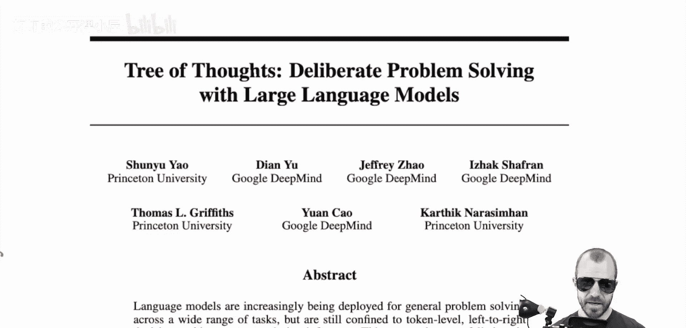

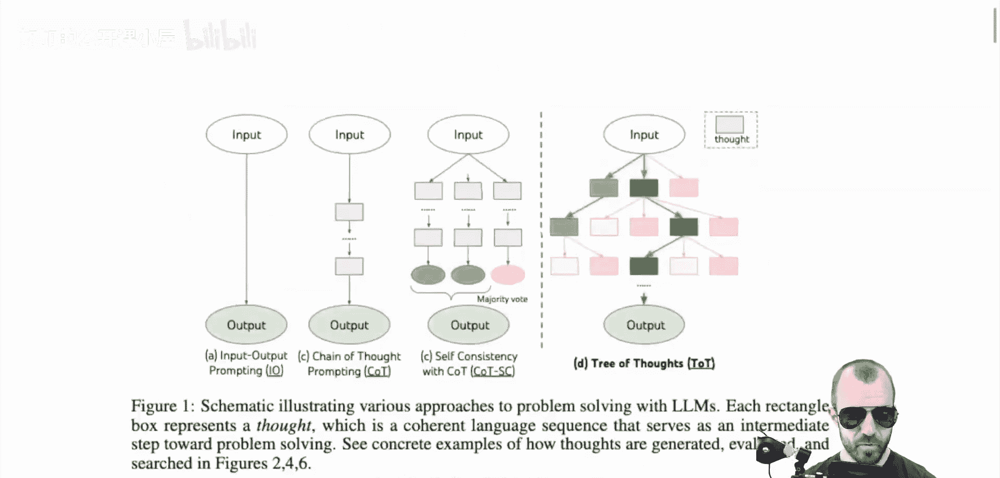

Proposition is this one right here。It's if you simply prompt a language model。

 even if you prompt it really well， you say， you are a super helpful helper。 You're so helpful。

 you just help me in everything。 And I I want you to to do this task。

 That's sort of called what they call here input output prompting input output means you specify the task and optionally。

 you may also specify an output format。 So you may say to a language model。 Hey。

 I have this task right here， I want to write an email to my boss。

 please write it in the following format。 First， write， dear boss。

 then write the text in between and at the end， write a signature。 more commonly。

 if you want models to， for example， output。 Jason， as a response you say， you know。

 don't give me a textual answer only respond using Json formatted output。

 or even more commonly if you want the model to do a classification task， for example， you say。

Don't answer in text。 answer with one of the following four options， right， just output the word。

 and then you give the four classes。 and then you rely on the model only outputting that。

 there are other techniques like restricted decoding that can enforce this stuff and so on。

 But in general， input output prompting simply says you ask the language model。

 what you want it to do。 And optionally， you give a。You give a。

A specifier for how the output should look like in textual form。That doesn't also optional in here。

 you can do some in context examples if you want， So all of this is like like this this is like prompting。

This is like standard prompting today。 then you have chain of thought chain of thought prompting is a different prompting technique where you instruct the model to explicitly make intermediate steps so you say you know please invent please write a song about a little bird right and please do that in steps so please first make a like an overall plan for the song and output that into individual thought。

 so you would instruct the model not only to have to have a prompt。

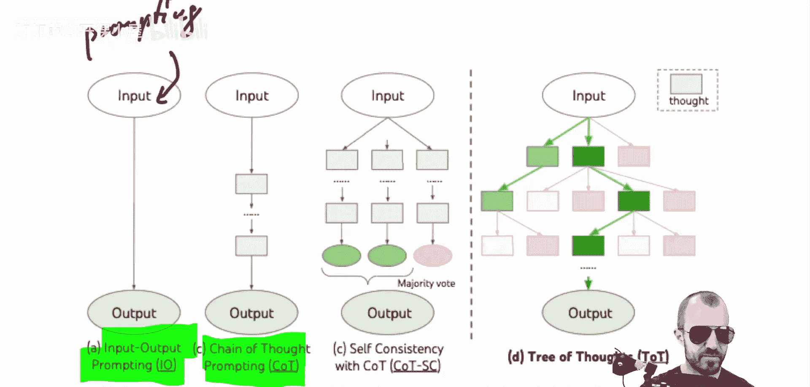

That's too fat。You would instruct it not only to have a prompt。

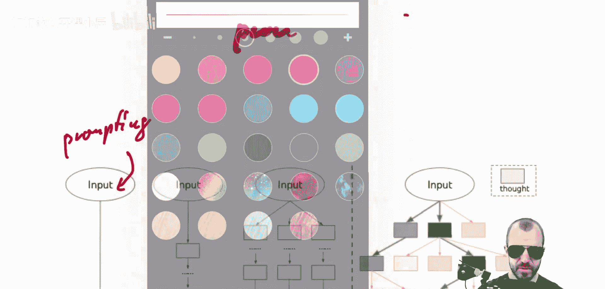

Followed by， followed by an answer， but you would instruct it to output its thoughts。

 So Prom goes here。And then you say， you know， write your thoughts on each line starting with like T。

 and then the model is supposed to put its thoughts right here and its thoughts right here and its thoughts right here。

 And then at the end answer。 So you have to input output prompt for this structure right here you have to tell it。

 please do this。 But it turns out if you do that。 if you do this chain of thought prompting youstruct the model to explicitly write down the intermediate steps of problem solving。

 the problem is going be solved better than if you just ask the model to just provide you the answer。

 It turns out， and I think that is not there are hypotheses around why that is。

 but I believe it's not yet fully understood why exactly the chain of thought prompting helps。

 but hypotheses are that it gives the model kind of a scratch pad like right here in order to write down its thoughts and then the next thoughts can refer back to the previous。

Blesssed thoughts and not everything has to happen sort of in the weights。

 the second opinion is that it just gives the model sort of a longer time to compute。 like it can。

 since it decodedes more tokens， it can sort of invest more compute into a given problem。

 and you're leading it into the correct direction with these thoughts。 multiple hypotheses。

 In any case， the next iteration that this paper considers is selfcon with chain of thought。

 This essentially mixes chain of thought with voting。 So you just do chain of thought multiple times。

 you just can of sample multiple times。 And then。

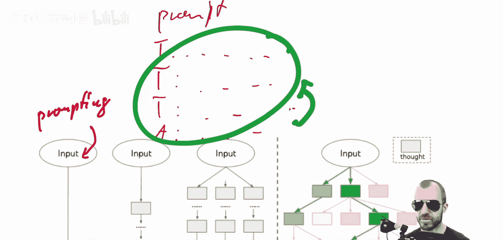

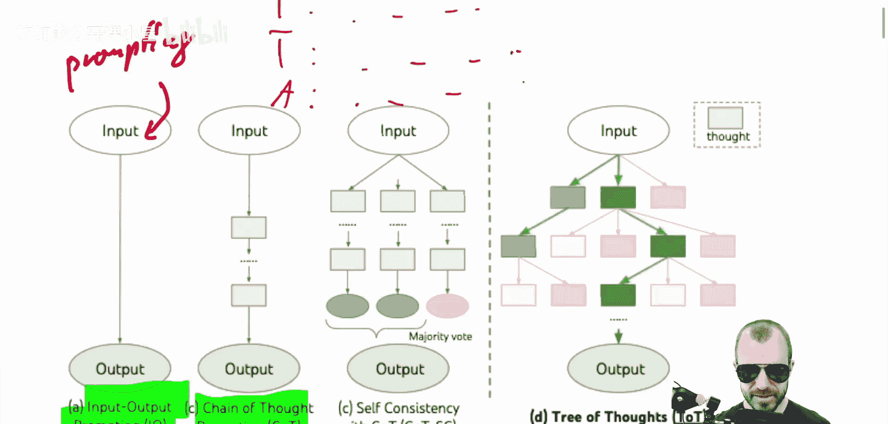

You majority vote on the output。 That obviously is only possible where you have some sort of a classification task where you can assemble a majority vote。

 There's also another concept that's not mentioned here， but that is sort of iterative refinement。

 which comes in later in the paper。 What you can always do is you can always just append the prompt that says。

 Consider your last answer， How， how might you improve it， or consider your last answer。

 Do you think it's correct， If not， please improve it， and you can sort of。

Add that onto any of these techniques。 There's lots of these techniques。

 This paper here considers the tree of thoughts。 and the tree of thoughts is here conposed to the chain of thoughts as in you can see it is。

 in fact， a tree。 So you have nodes and they have nodes branching out。

 and some nodes are kind of abandoned， which here in the red。

 and then some nodes are continued to be expanded here in the green。

 So this represents a language model that I ask something。 and then similarly to chain of thought。

 I ask it to output its thoughts， but I can do that。

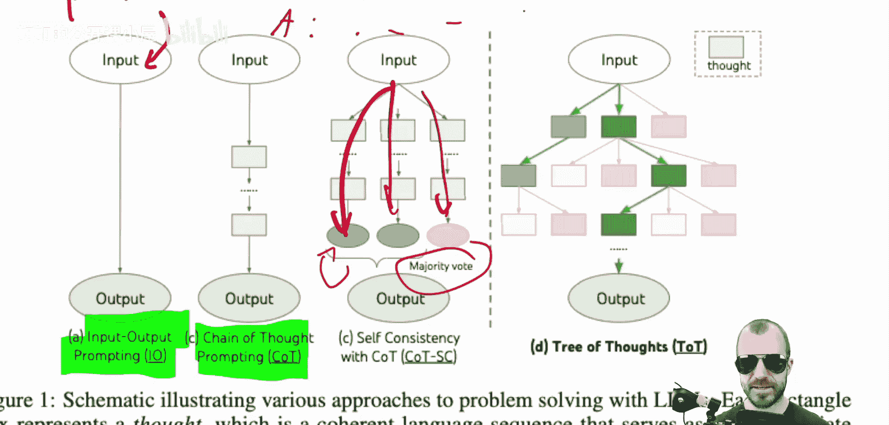

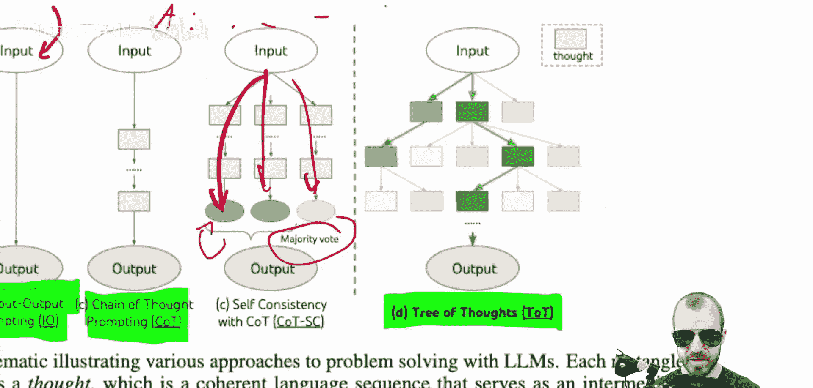

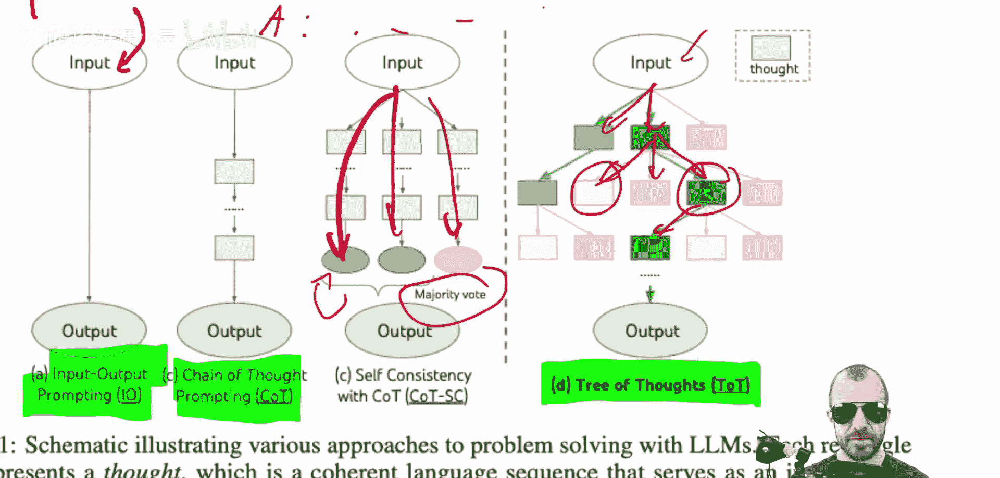

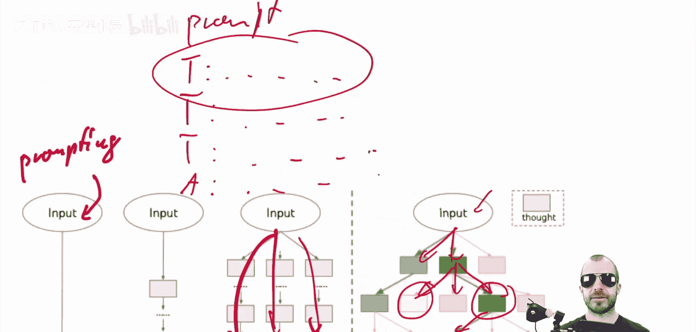

Multiple times， so three times I go to the language model and just ask it to output the first thought in the problem solving step。

 just the first one， not the whole problem， just the first one and those that gives me the three thoughts。

 for example， right here， one，2，3。

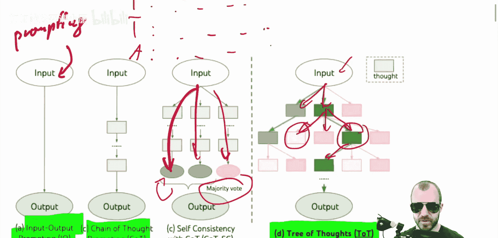

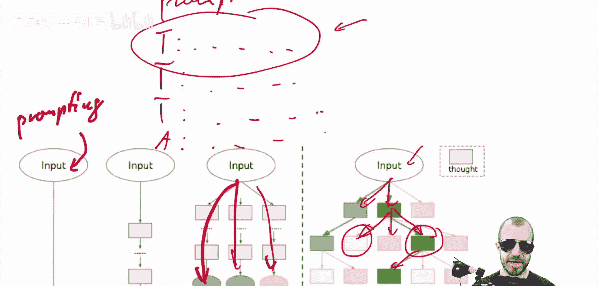

Then， then， as a second step。 So I finish that step as a second step， I take the language model。

 and I use it to self critique all of these thoughts right here with respect to the input problem。

 So I ask it something like， hey， what you just output here as a thought as an intermediate step。

 Do you think that's a good step towards solving the original problem。

 And this relies on the fact that a lot of these models like the language models， but。

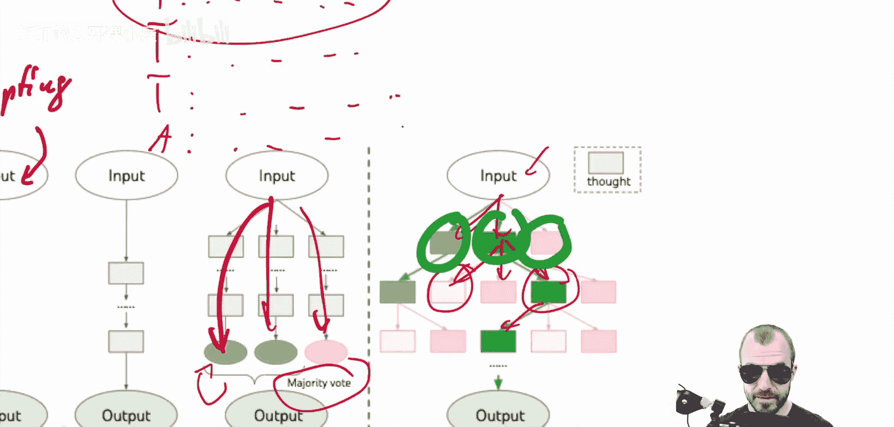

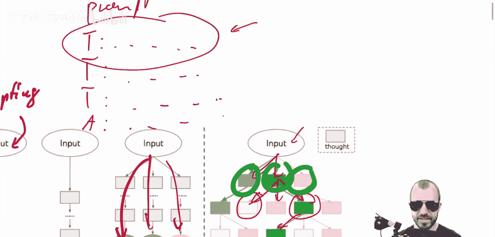

Machine learning in general is much better at evaluating whether two things fit together than generating a new thing。

 That's just， it just turns out to be like that it kind of makes sense because you only need to output a number or a value or something like this。

 rather than generating something。 It is the case so。Even if you use the same model to self critique。

 you'll get a better signal for the critic than you get for the generation。

 So that's why it does make sense that after creating something you go and you ask the same model to consider what it just did and how well it fits。

 So the model， for example， you'll give it all of these tasks let me grab。

You you'll give it all of these tasks and then you'll ask it to consider。

 and maybe you will say this one here is really bad。

 this one's kinda good and this one's like the best。 you can do that in multiple ways。

 you can just give it ask it to give you a score or a label from like good medium bad for everyone or you can put everything into context and then say。

 hey， which one of these is the best。 please vote for the best。

 and you just sample that multiple times So you get like a non-noisy signal。

 And then what you can do is you can simply say， well this one here， the model things is really bad。

 So I'll discard that。 now'll just continue with the ones where I'm more confident。

 Then let's say we consider the middle one right here So we've eliminated the one on the right hand side。

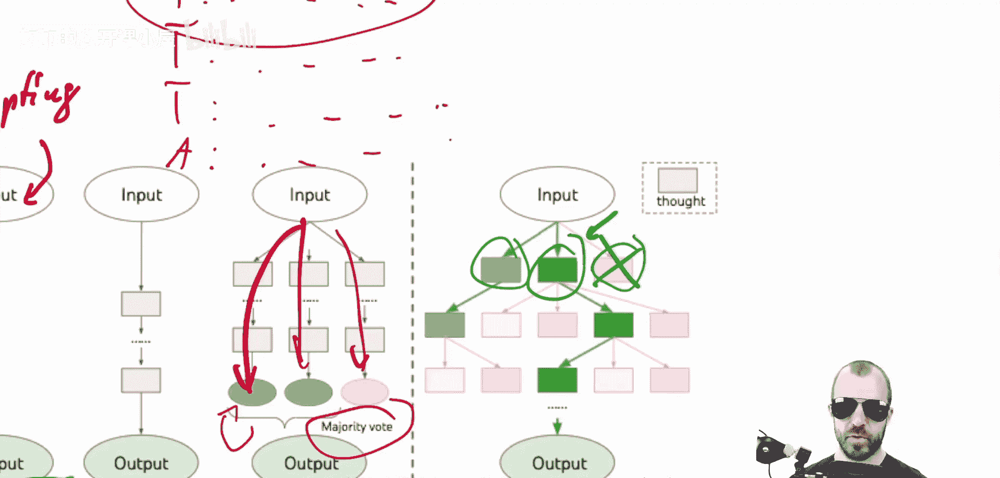

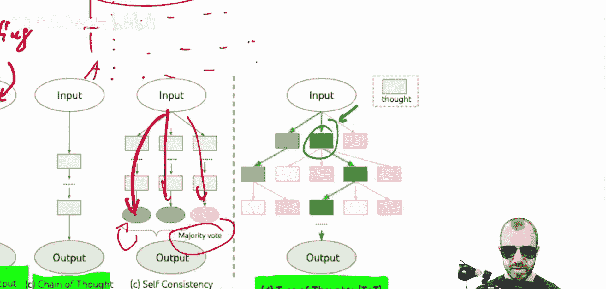

And we consider the middle state right here， again， I sample maybe this time four different thoughts。

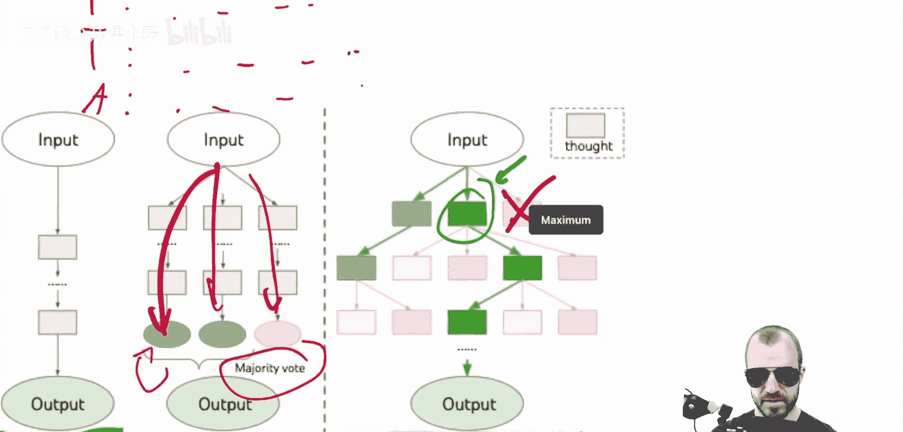

And again， I ask the model， Hey， what do you think of those four thoughts， And now here the， the。

 the drawing is a bit wonky， I think， in that it doesn't display the algorithm。

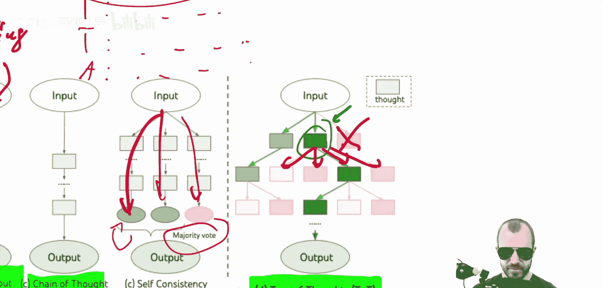

Like this this note right here should probably be， well， I don't know。But let's say we do that。

 And let's assume that this here isn't like full green。 It's also right。 So it kind of says， well。

 none of these are really good towards the goal。 So it's like no， no， no， no。

 let's just assume the critic says all of these are bad。

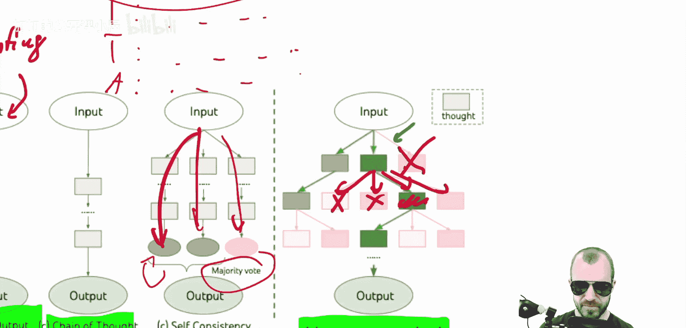