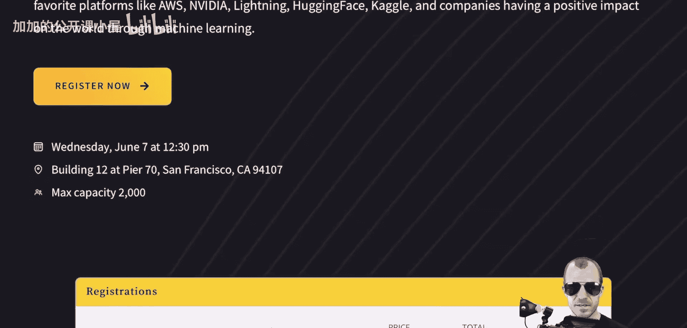
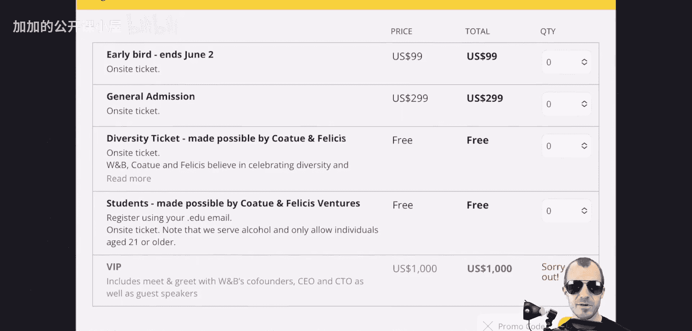
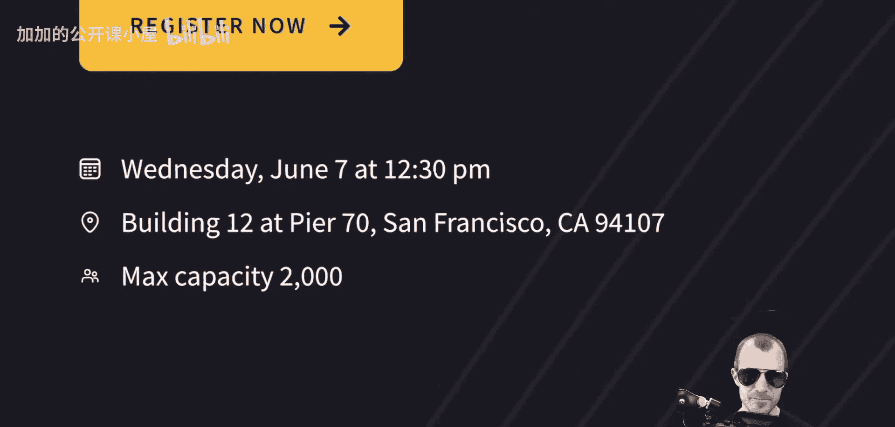
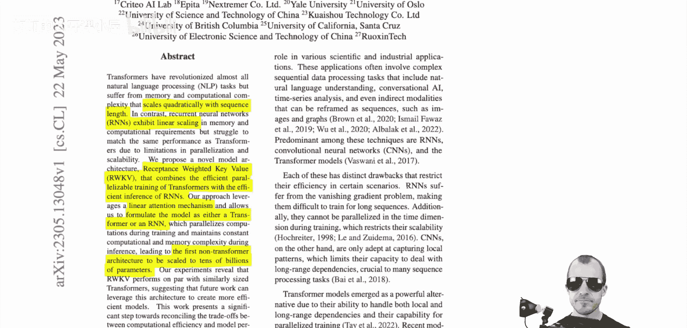

# YannicKilcher【中英⚡AI经典论文领读(全203篇)(下)｜Papers Explained】 p98 P199 RWKV：为Transformer时代重塑RNN（论文详解） [BV1j8x5zJEvx_p98]

Hello today we're going to look at RWKV， which in its own words is reinventing RNN for the Transformer era。

 This is a very interesting project and very interesting model architecture because it has some properties of transformers。

 notably it's a model architecture that's very scalable in terms of training so you can stack it really deep and you can still train it and also you can parallelize training。

At the same time， it avoids the quadratic memory bottleneck that transformers have by essentially being an RN。

 It's kind of a recurrent neural network in the sense that during inference。

 you can compute the output step by step and always have a constant memory because everything is put into a hidden state。

 We're going to look at how these two things come together and what the tradeoffs are between the two。

 The project is also very interesting because it's been largely developed by one person or by just very few people who have worked on this and then compare this to entire corporations that are pouring their human resources into transformers and still the results are that this model in some cases。

 not in all cases， but in some cases can be very comparable in terms of performance with transformers with really big transformers and as I said。

Is scalable， which so far R NNs have been lacking。We'll go over the paper。

 we'll over the architecture and see what's actually happening right here。

 I have some of my own thoughts and you know just opinions on this and I hope you're with me。

 but first let's。Let me show you this。 fully connected is a conference。 It's by weights and biases。

 It's a one day event， and it has pretty cool speakers。

 So not only the cofounders of weights and biases themselves。

 but the cofounder of the Langcha I there the cofounder of Caggle is there Richard So from you do co is there Chian is there of Clapot there's so many people right here and so many cool speakers and as I said。

 if you are in around the San Francisco area go give that event a visit if you want。

 I'm going use put a link and a promo code into the description of this video that will make the tickets cheaper。

 So the tickets will be 49 buck instead of what you see right here。

 So that's going to be on June the 7th。 Don't forget that June the 7 in San Francisco。

 It's an inperson event has a max capacity So grab it now。😊。

That's it。 thanks to weights and biases for also giving me this opportunity and also giving this to you。

 It's very cool。So。RWKV， it stands for。Let me not screw this up， receptive receptance， receptance。

R is for receptance。 W is for weight K is for key and V is for value。

 These describe the different elements of the model architecture and will go through that will go through it。

 So what are we dealing with We're dealing with a model that you can use for lots of things but we're mainly dealing with a model that in the instance it is outlined here is for language modeling by language modeling we simply mean we have a piece of text yada yada yada yada and what we want the model to predict is the next set the next tokens or the next word in the text So from here predict this thing and from here predict this thing and so on。

Transformers are usually used in this manner。 notably。

 I would stick the entire prefix here into a big transformer and the transformer would spit out the next step。

 it will do that in a form that we call causal attention。

 which essentially means that every piece in the text right here。

 So every token can attend to all the other tokens that are before it。

 So all the other tokens that come in front of it would have be would be inputs to that token using attention。

 that results in a quadratic in a quadratic requirement of compute and memory Now if you can see there if every token attends to its back。

 it's like T times t half minus-1 or something like this。Interactions that need to be considered。

 so t squared in expectation。And。No， yes， maybe。Yeah， that makes bad sense。

So transformers naturally have a limit because if you add one token。

 then you always add a memory requirement of of T。 And so very quickly that scales to be out of proportion。

 so their power is traded off by the fact that they can only consider a limited set of tokens at a time。

 Recurrent neural networks trade this off。 recurrent neural networks。

 if they have to do something like this， if they have to have an input and then predict the next thing。

 what they'll do is they'll just start here。Then they'll put something into a hidden state like a little memory。

 I'm going to represent that as a box。 People have forgotten how R and Ns work。 I figured。

Like a few years ago， I could have talked about RnNs。

 and every one of you would have known what I've talking about。

 And then transformers are kind of the new thing。 And now it's more like I have to say。

 I don't even have to mention stuff is a transformer but I do have to conversely explain RN。

 So it would put whatever it learns into a memory like this hidden box。

 this box right here is the memory。 Then from that， it would consume the memory。

 and it would consume this thing and it would build a new memory。

 and then it would consume that memory， and it would consume the next input。

 it would build a new memory。 So it does this step by step。 And it can always。

 you can drop the old memory。 So you can forget about the old memory because all you need pun intended to go forward from here on out is that current memory。

 So you do step by step。 and you always save stuff into the memory into the hidden state or whatever you want to call it。

 So RnNs have this really great property that they only require a constant memory in order to do inference。

😊，However， the individual， the individual inference step， for example， when we are here。

 we have that memory， we predict next the next token from it。

 so we predict the next this thing right here。We can only consider the memory and the previous token。

 That's all We cannot explicitly consider any token that is in the way back because everything goes through that hidden state。

And that bottleneck has usually been one of the downfalls for RNNs。

 There is a problem of vanishing gradients。 There are a couple of other problems that you can't just compress information into that one hidden state plus RNNs have been notoriously hard to train because the inference always requires this step by step thing which means you have to do back propagation through time which gets is part of the vanishing gradient problem but also means that you can't parallelize the training in a transformer。

 I can input a tokenops a token sequence of 50 tokens， and that gives me 50 training examples。

 which I can train all at the same time because of the causal attention mask。In an RNN。

 if I have a sequence of 50 tokens， I can still only train one token loss at a time because I can't infer everything at the same time。

Our WKV is going to strike a trade off in the middle of those two things。 And in a sense。

 so people ask or I asked， is this a transformer more， is it an R and N more。

 And I've come to the conclusion。It's a convnet and I'm going to I'm going to explain my reasoning。

 and they they also refer to that， by the way， it's not like I found out something great right here。

 but in the most basic sense， you can think of this thing as a convolutional network。

 across a one dimensional sequence of tokens。That's that's going to be my statement and we'll go through it。

So they give a bit of an introduction right here on what it。

What this means and what I essentially just said， transformers scale quadraically with sequence length。

 RNNs exhibit linear scaling， which is very beneficial， very advantageous。

 The RWKV model combines the efficient parallelizzable training of transformers with the efficient inference of RNNs。

So it's like almost two modes between which you can switch around。

They say they have a linear attention mechanism and as I said。

 they formulate the model either as a transformer or as an RN that linear attention mechanism is something that we're going to focus on in just a bit because。

It's not， it's not their fault because people have been doing it before them。

 but I think it really stretches the word attention and what what it means。

 I think it stretches that to like a point where I don't agree。Any more calling it attention。

 but again， they are not the first people。