# YannicKilcher【中英⚡AI经典论文领读(全203篇)(下)｜Papers Explained】 p99 P200 树环水印：隐形且鲁棒的扩散图像指纹（技术解析） [BV1j8x5zJEvx_p99]

Hello there。 Today， we're going to look at this paper， Ting watermarks。

 fingerprints for diffusion images that are invisible and robust。 This is by Yushin Wen。

 John Keerkenbaauer， Jon Skyping and Tom Goldstein of the university of Maryland In very brief overview。

 This paper proposes a watermark technique for images of generative model specifically of diffusion models。

 And while other watermark techniques， usually take the image that comes out of a diffusion model and do some sort of modification to it as a postprocesing step。

 this paper， it enters right from the beginning。 So it goes at the source into the latent space into the noise space of the diffusion model。

 watermarks it there。 lets the diffusion process run forward。

 And thus that signal is not distinguishable either by the human and also much more robust to postprocesing attacks or perturbation。

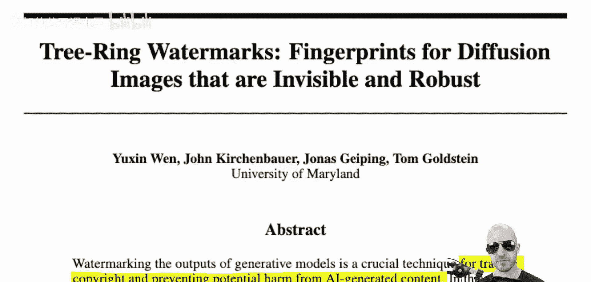

Attacks we're going to go look at a bit of a review of diffusion models themselves because it's important to understand what happens here and then we'll go into how this technique works。

 It's a pretty basic technique in itself but it is quite effective and I find it quite quite ingenious of how this is done。

 So let's start from the top the authors here， they state these diffusion models。

 they obviously can generate images and they get very much better day by day and there has arise arisen the need for tracing whether or not an image is generated by a given model So there is tracing in this case they say there's copyright。

 preventing potential harm from AI generated content or simply you want to know whether or not a given image was produced by one of these models Now the setup we're going to have right here is。

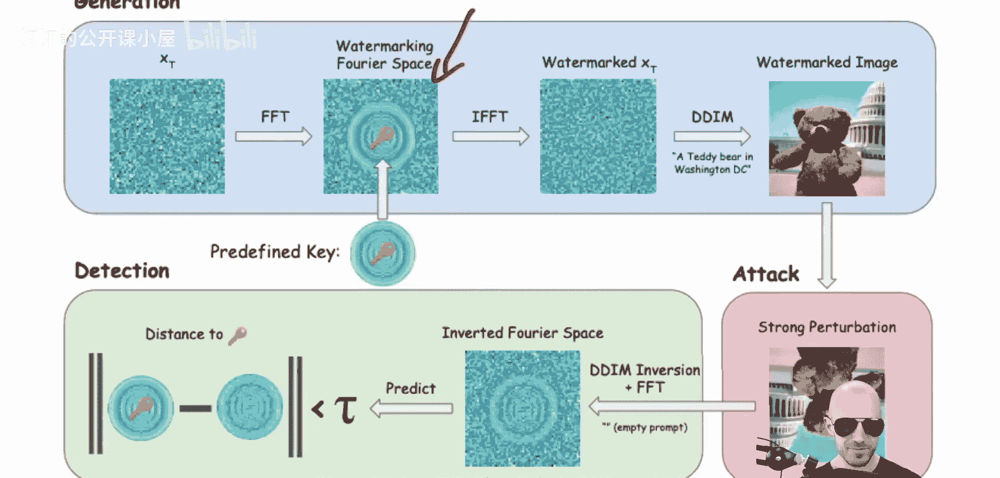

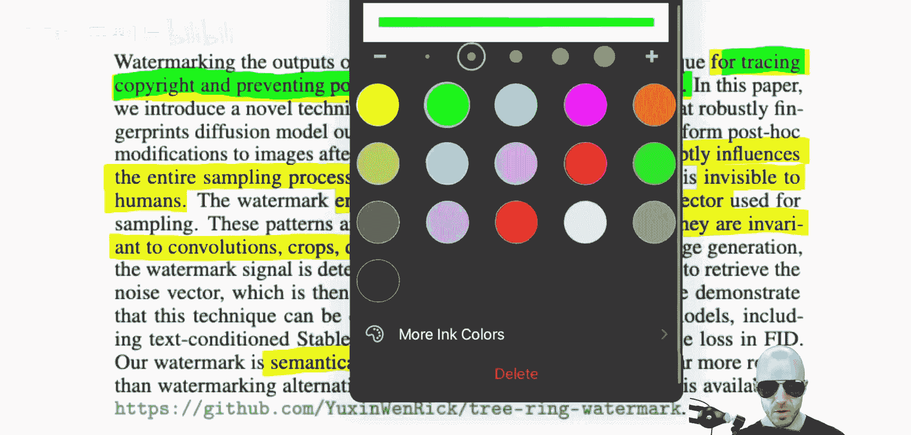

The following is that the model is going to be behind an API。

 so this is the model and there is some sort of an API that people can use in order to generate pictures so people will make a call here and they will get an image out of that。

This the technique works like this， so the weights of the model need to be hidden and need to be only available to the person who does the watermarking。

 otherwise naturally anyone can just use the model and produce images without the watermarks and and thus watermarking would be kind of useless。

 I mean even if the model is available， at least you can then watermark things that that are behind this API。

In any case， our notion considers that it's behind an API。

 People call the model via some sort of API web interface and get an image out。

 Now this image right here if we have watermarked it correctly。

 So if the watermarking process at the location of the model happen correctly then for this image we can always prove that it in fact was created by this model。

 so will implant some kind of signal， some kind of hidden signal in that image that the end user neither notices so it's invisible or indiscernible nor do they have an easy power of making it go away。

 So let's say even if you tell someone hey， by the way。

 Ive watermarked this images not they don't they can't necessarily make it go away easily and the main advantage of the method we're going to look at today is that second part。

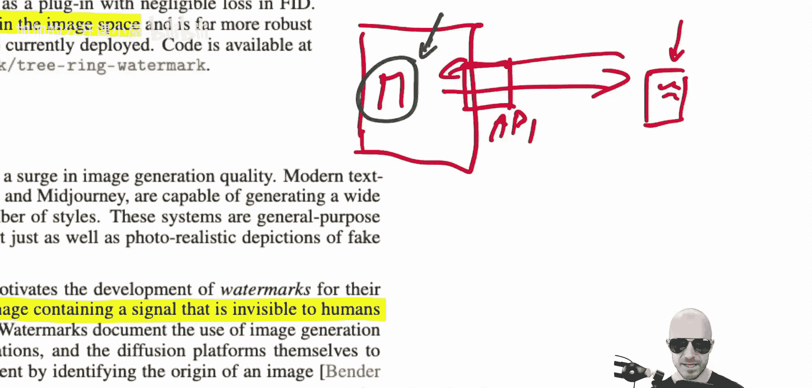

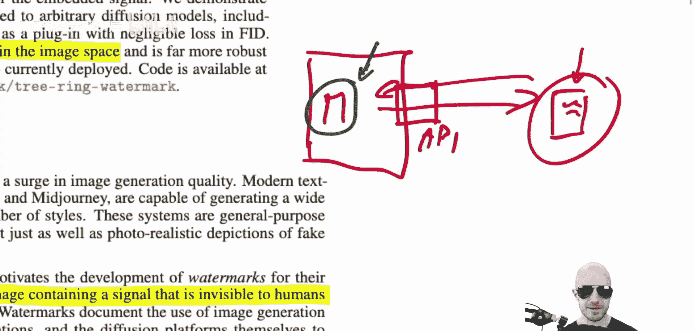

So even if I tell you that I have watermarked this image。

 it is very difficult and you will see a borderline impossible with without strong perturbations to make it go away。

 and even under strong perturbations is usually recoverable。

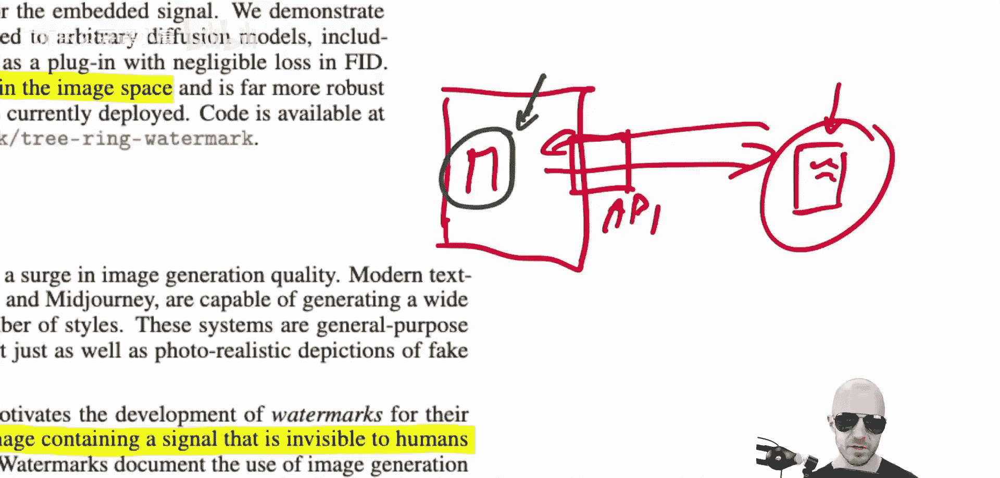

So what does this watermarking technique do？

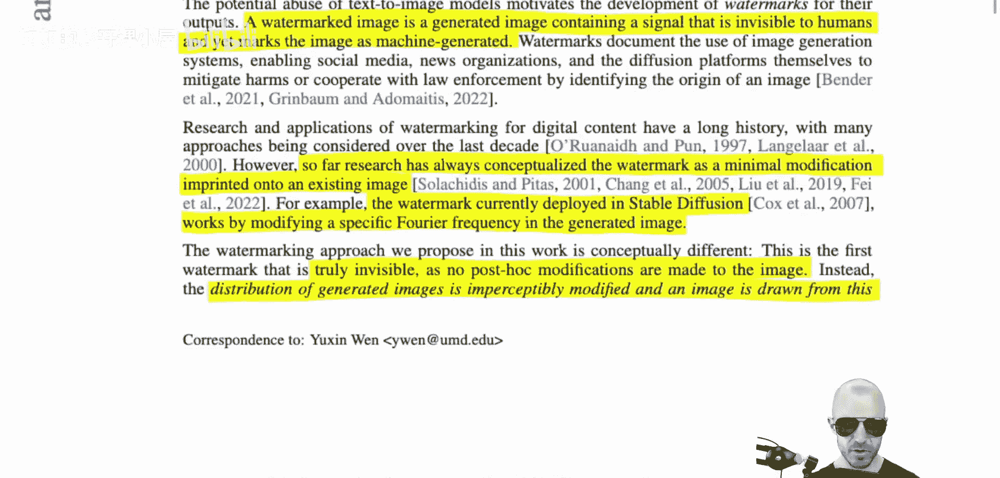

It's quite simple。 it goes into into the latent space， as I said， of a diffusion process。

 So in very basic terms， we're going to first look at what diffusion models do because we needed to understand what this watermarking technique does in a diffusion model。

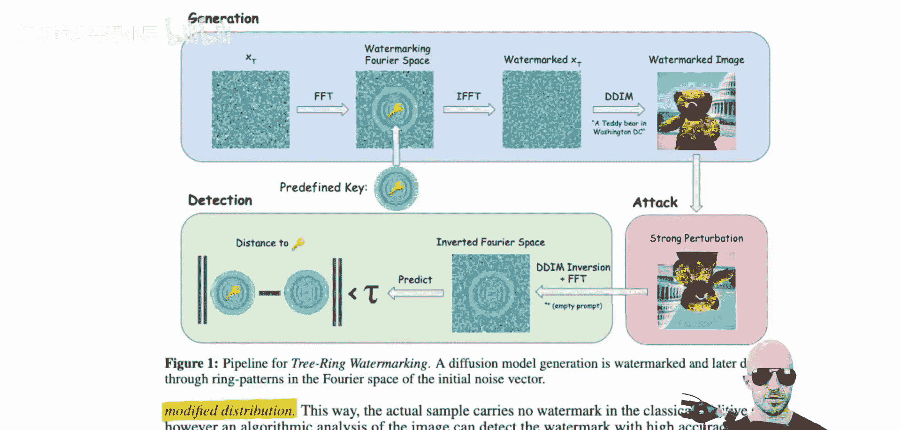

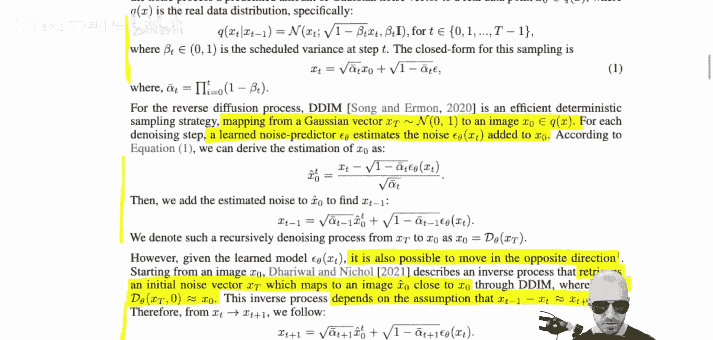

What you'll do is you'll train a model to step by step produce an image from random noise。

 So you'll start with a image。 Let's just consider it of the same size of random noise。

 So this is just。Brandom Gaussian noise， every pixel you sample from a Gaussian。

 and then you go through it step by step。 So in every step。You remove a little bit of noise。

 Every step， every step。Until after many steps， slowly， an image forms like here， in this case。

 the teddy bear we just saw。 this might seem a bit like magic。

 If you've never seen diffusion models work or don't know why they work。 But， yes。

 we have a model that takes in an image that is initially just pure random noise。

 And then by repeated application of that model， we transform that noise into a image。😊。

Why does this work because of the way we train it， The way we train this is we actually take images from the data set。

 so let's say we take an image from a house and we corrupt it by a little bit of noise， So we add。

 we add a little bit of noise in this case， Epsilon noise and that gives us the same image with just a little bit of noise。

And then what we do is we train a model。To take in this image and give back the image before the noise。

 right， That's doable。 That's doable with deep learning。 We can take a little bit of a corrupted。

 noisy image， and we can ask， you know， what's the uncorrupted version of that image。Okay。

 so we have a one step noise remover。 We can also do it two steps。 right。

 We can then take that image and add a little bit of noise again。And that will give us。

 I shall make equal signs here。 That will give us the same image with even a little bit more noise。

 right， more noise。 And then we train a neural network to recover that original image that was only noise once so。

We can create our own training data for this process by simply starting with real data， adding noise。

 adding noise， adding noise， adding noise。 And then it is a property。

Of statistics and of specifically also the Gaussian distribution that if we repeatedly apply noise。

 we have to do some scaling， but if we repeatedly apply noise over and over again。

 infinitely many times， but you know in practice finitely many。

 but just many times what will end up with in the limit is just going to be random Gaussian noise。

 So that is the last piece we need in order to make diffusion work。

 the mathematical fact that if I add noise and noise and noise and noise and noise and noise and noise over and over again。

 to a real data point， no matter what it is in the limit it's going to be pure random Gaussian noise following exactly the Gaussian distribution。

 which means that the reverse process we train right here is exactly So the end point here is exactly something we can actually produce from a sampler。

 So exactly the starting point here。 and because we train a neural network here to。

Each step individually we we create our own training data for that。

 We can then use that to produce each step here individually。 so we can simply say， hey。

 here is the last step of here is the pure random noise。

 What's the one step before that in the noise process。

 It will tell us and what's the one step before that， it will tell us to。

 we just apply that learned neural network， that network that we trained to just reverse one step in this noising process。

 over and over until we arrive at an image。 So this here acts as a bit of like the random seed to to as an input。

 and then the image that's produced is going to be a deterministic function of just applying the reverse network that we trained over and over again starting from that random seed。

And it's exactly in this random seed over here that we're going to embed some sort of key and you can already see what that does by changing the random seed will'll in fact change the image that's being produced and in quite in quite cool ways So the effect of this watermark is going to be entirely different from the effects of other watermarking technique that just work on the end result。

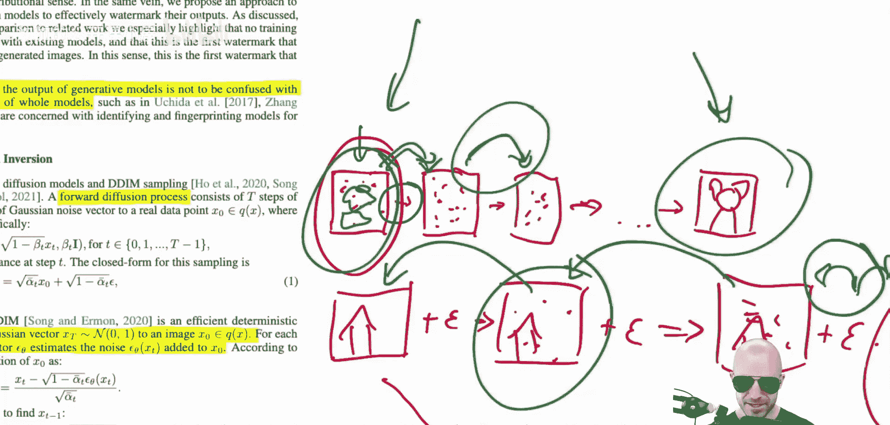

You can already you know think ahead a bit of what that's going to be。

 So formally this is the process。 we define a noisy process。

 so we define the forward process by which we mean how do we produce a more noisy version from a less noisy version So x t -1 here is going to be the less noisy version x0 being the original image and Xt is going to be the more noisy version it's pretty simple we simply take X t minus-1 and I'm pretty sure this here is a typo this should actually be X t 1。

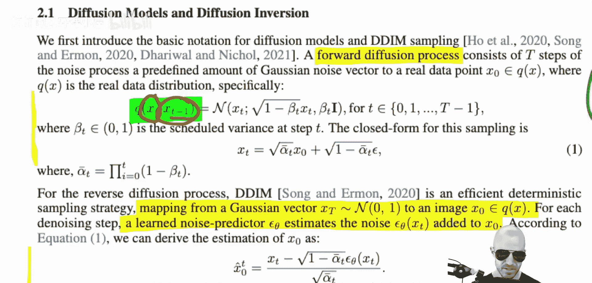

We simply take x t minus1。And we use it as the center of a Gaussian with a diagonal covariance。

Which is going to be defined by Beta here。 Beta is a schedule parameter。

 it's a scheduled variance at step T and because of the properties of this process we have to。

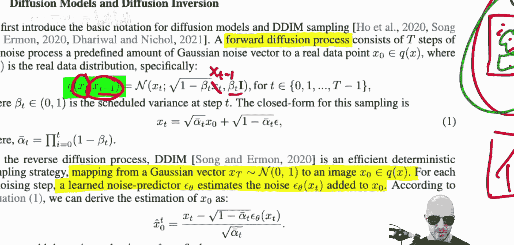