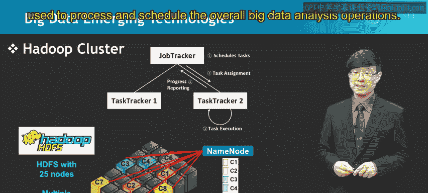
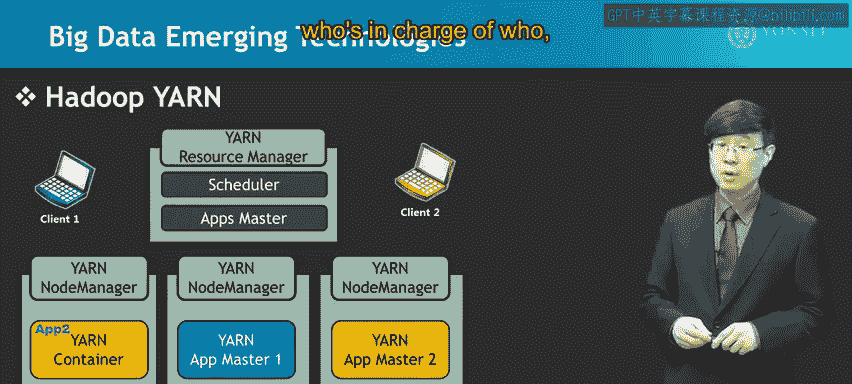
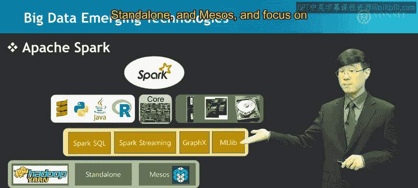
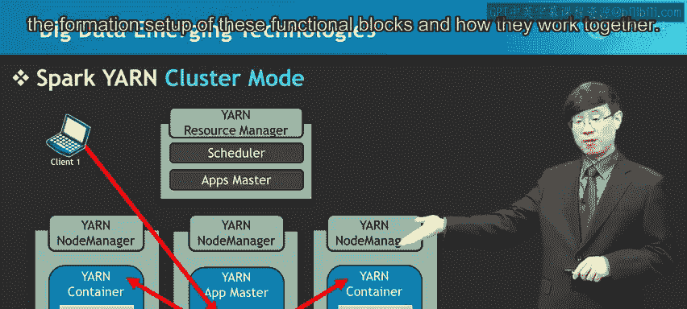
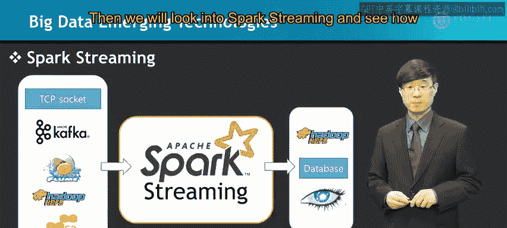
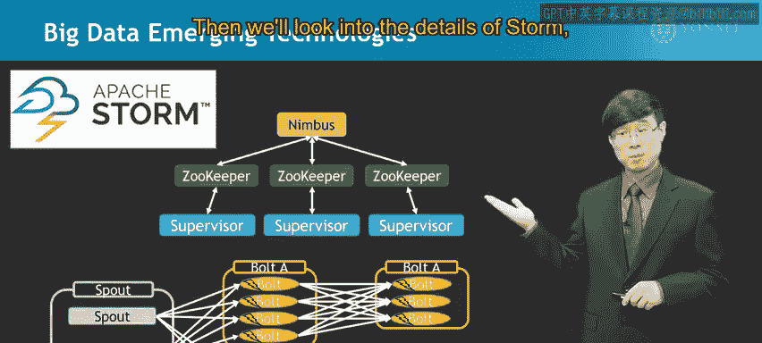
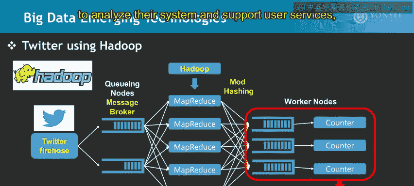
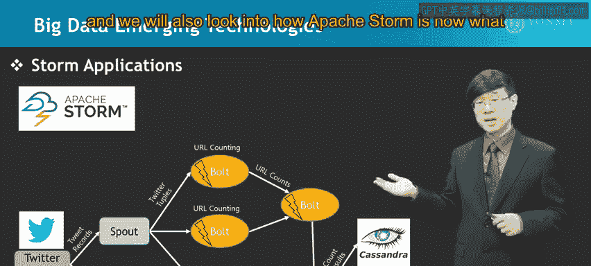
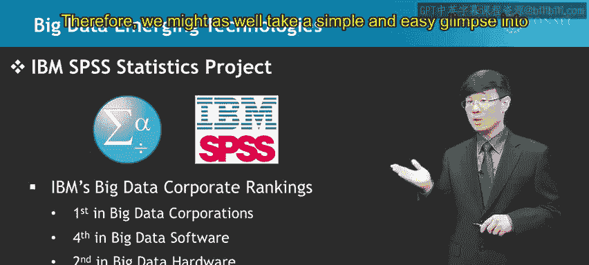

# 1：0_介绍 📚

欢迎来到我的课程《大数据与新兴技术》。在本课程中，我们将探讨大数据服务、产品和核心技术的各个方面。

## 课程概述

在本节课中，我们将要学习大数据领域的整体图景、关键技术、实际应用案例以及一个实践项目。课程内容将从市场概况开始，逐步深入到具体的技术架构和工具。

## 课程内容详解

### 市场与行业分析 🏢

首先，我们将审视大数据市场的格局。我们将基于市场份额来分析企业评级，看看哪些公司是市场的领导者。

以下是市场的主要细分领域：

*   **硬件**
*   **专业服务**
*   **软件**

我们将分析这些领域的市场份额构成，并识别各领域的领军企业。

上一节我们介绍了市场格局，本节中我们来看看未来的潜力。我们还将探讨未来在软件、专业服务和硬件方面的潜在增长趋势。

### 核心技术产品与案例研究 🔬

接着，我们将深入了解这些大数据技术领先公司所提供的主要产品。

我们也会研究一个关键案例：始于美国的H1N1流感病毒。这一事件突显了大数据技术的重要性。

我们将审视美国疾病控制与预防中心当时面临的问题，并探讨谷歌如何利用大数据帮助确定疫苗的供应量和地点。

此外，我们还将分析他们的数据如何被用于预测疫情的发展趋势。

### 大数据的核心挑战：4V模型 ⚡

大数据面临的主要挑战通常被概括为4V模型。以下是其具体内容：

*   **Volume（体量）**：海量的数据规模。
*   **Variety（多样性）**：数据类型的多样化。
*   **Velocity（速度）**：数据生成和处理的速度。
*   **Veracity（准确性）**：数据的质量和可信度。

我们将探讨企业如何利用这些特性来获得竞争优势。

### Apache开源技术栈 🛠️

然后，我们将进入Apache开源应用程序的世界，主要包括Hadoop、Spark和Storm。

我们将从批处理和实时流处理的角度来审视它们的特点。

我们将更深入地研究Hadoop，特别是MapReduce和HDFS技术。

此外，我们还会了解Mahout、Flume、HBase和Hive，以及它们如何支持基于Hadoop的运算。

我们将详细研究Hadoop中的MapReduce和分布式文件系统，并了解这些运算的处理过程。

我们还将研究集群操作，了解名称节点、数据节点、作业跟踪器和任务跟踪器如何协同工作，以处理和调度整体的大数据分析任务。

接下来，我们将探讨Hadoop YARN。我们将分析这些组件块如何设置、它们之间的管理关系以及启动顺序等细节。

### 深入Apache Spark 💥

之后，我们将聚焦Apache Spark。我们将关注其核心，以及内存设备（如内存、SSD和HDD）的作用。

Spark支持多种编程语言的API，主要包括：

*   Scala
*   Python
*   Java
*   R

此外，我们还将了解其主要功能库：

*   Spark SQL
*   Spark Streaming
*   GraphX
*   机器学习库

我们也将学习集群管理技术，包括Hadoop YARN、Standalone模式和Mesos。

我们会关注周边的支持技术，如YARN、ZooKeeper，并了解数据库管理系统，如HDFS、Kafka、Cassandra等。

在Spark的机器学习部分，我们将深入研究其机器学习库包含的功能。

我们还将学习Spark如何基于不同的传输和网络速度差异，实现快速、优化的大数据处理流程。

我们将更细致地观察Spark作业，它被划分为多个阶段，每个阶段又分为多个任务和线程，并分配给运算核心执行。

我们也会研究Spark的Standalone模式，了解这些组件块如何创建及其功能；同时探讨Mesos如何作为集群管理方案来运作Spark。

我们还将查看Spark在YARN集群模式下的功能块形成、设置方式以及它们如何协同工作。

### 流处理技术与应用 🌊

接着，我们将研究Spark Streaming，了解输入源如何处理、结果如何保存和操作，以及像Netflix这样的公司会如何使用它。

此外，对于以极快速度流入的在线销售数据，可以通过Kafka传递；实体百货店的销售记录也可以通过Flume纳入Spark Streaming进行处理。我们将进一步探讨这些细节。

然后，我们将深入了解Storm的细节。Storm能对系统做出更快的响应，它采用了一种由Spouts和Bolts组成的架构，其中Supervisor由ZooKeeper和Nimbus节点管理。

我们将看到Twitter过去如何使用Hadoop来分析其系统并支持用户服务。

我们也将了解Apache Storm目前如何被Twitter用来支持其服务。

以及股票市场操作如何利用Storm来快速适应股票市场内部的新变化。

### 实践项目：IBM SPSS Statistics 📈

最后，我们将进行一个实践项目，重点学习IBM SPSS Statistics。

选择IBM的原因是，IBM在大数据技术的所有领域都拥有极高的排名。因此，如果你在职业生涯中要使用大数据技术，很可能在某个阶段会接触到IBM的服务。

所以，我们不妨简单了解一下如何在IBM SPSS Statistics中完成一个简单的项目。

## 总结

本节课中，我们一起学习了《大数据与新兴技术》课程的完整路线图。我们从市场概述开始，穿越了核心的4V挑战，深入探讨了Hadoop、Spark和Storm等关键技术栈的架构与组件，并了解了它们在实际案例（如流感预测、Twitter、Netflix）中的应用。最后，课程将以一个基于IBM SPSS Statistics的实践项目收尾，为未来的专业应用打下基础。

衷心欢迎你加入我的课程，与我一同学习，非常感谢。

