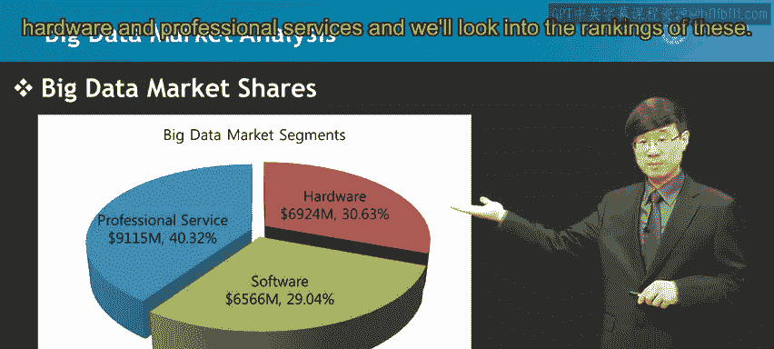
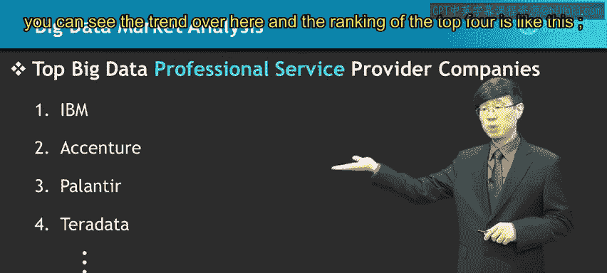
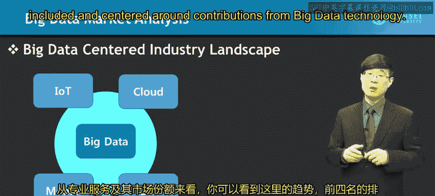
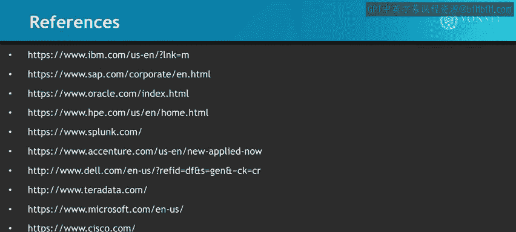

# 2：1_1.1 大数据市场分析 📊

在本节课中，我们将要学习大数据市场的整体格局，分析主要市场参与者的份额排名，并了解大数据技术如何作为核心驱动其他相关产业的发展。

欢迎来到“大数据市场分析”讲座。

首先，我们来看看全球大数据市场份额的排名情况。如图所示，有一些领先的公司总体上占据了市场的大部分份额。

大数据市场份额基于软件、硬件和专业服务这几个细分市场。接下来，我们将逐一查看这些领域的排名。

在上一节我们了解了整体市场后，本节中我们来看看大数据软件的市场份额。以下是排名靠前的公司及其所占份额，例如：**SAP**、**Splunk**、**Oracle**、**IBM**、**Microsoft** 等。

接下来，我们转向专业服务市场。以下是该领域的市场份额趋势图。排名前四的公司情况如下所示。

综合来看，以大数据为中心的产业全景图是这样的：大数据处于中心位置，而物联网云服务、各种移动服务（包括移动通信和交通服务）以及多种生物技术领域，都围绕大数据技术的贡献展开并相互关联。

以上是我所使用的参考资料，在此推荐给你。感谢观看。

在本节课中，我们一起学习了全球大数据市场的份额排名，分析了软件与专业服务等关键细分领域的领导者，并理解了大数据作为核心技术在现代产业生态中的中心地位。