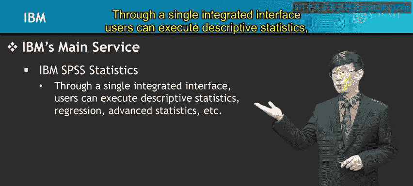
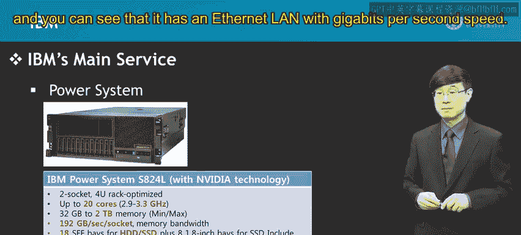
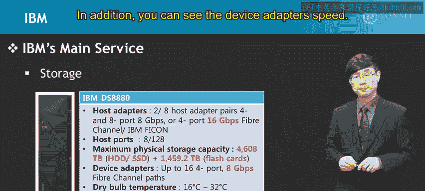
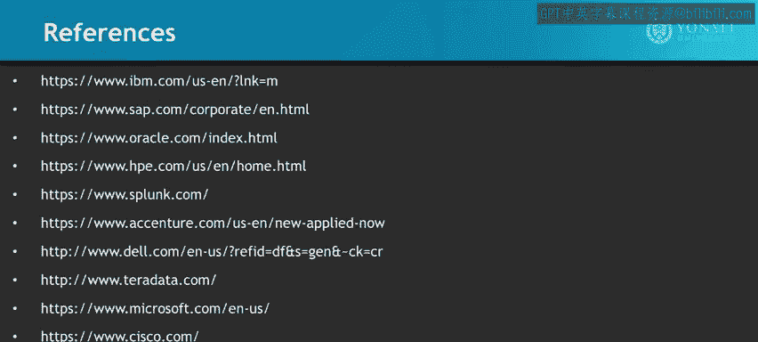

# 延世大学《新兴技术：从智能手机到物联网再到大数据》课程 - P3：2_1.2 IBM 与 1.3 SAP 📊

在本节课中，我们将了解大数据领域的几家领先企业及其核心产品。我们将首先介绍IBM，然后探讨SAP，分析它们如何通过各自的解决方案来应对大数据挑战。

---

## 认识行业领导者：IBM 🏢

上一节我们概述了大数据的基本概念，本节中我们来看看该领域的两位重要参与者。首先，我们将目光投向IBM。

IBM于1911年在美国成立。根据相关排名，IBM在大数据公司中位列第一，在大数据软件中排名第四，在大数据硬件中排名第二，在专业服务领域也位居第一。由此可见，IBM确实是该领域的领导者。

观察IBM Big Insights的界面，可以看到其中包含大量信息，其焦点集中在诸如**HDFS**、**Data Node**、**Name Node**和**YARN**等关键词上。这些术语的含义我们将在后续课程中详细解释。

IBM Big Insights是IBM的企业级平台，它整合了**Hadoop**和**Spark**这两种当前驱动世界发展的开源数据技术。该平台能够实现快速、准确的大数据分析。同时，它还提供了针对Spark、SQL、文本分析等领域的解决方案。

IBM SPSS Statistics的界面如图所示，我们将在本课程末尾的一个项目中详细探讨其功能。通过一个统一的集成界面，用户可以执行描述性统计、回归分析、高级统计等操作。

以下是其部分核心功能：
*   专业的扩展功能允许用户通过R和Python API来增强SPSS的语法。
*   针对产品、服务、集成和大数据分析，提供了SparR、SQL、文本分析等解决方案。

---

## IBM硬件产品解析 🔧

现在，让我们深入了解IBM的具体产品。首先来看IBM Power System。

当你查看这些规格的细节时，请特别注意几个数字。例如，**20个核心**，运行频率为**3.3 GHz**。我们后续将学习Spark核心，以及线程如何进入核心被处理。核心能够以多快的速度工作？这里明确列出：我们有20个核心，它们可以以最高3.3 GHz的速度运行。这将在我们学习大数据处理架构的更多细节时用到。

此外，还有**1 TB内存**，以及**230 GB/秒**的内部模块间数据交换速率。你可以关注这个速度，稍后我将解释，Spark和Storm等框架将利用这些更快的传输速率来整体优化其处理能力。

在底部，你还会看到 **2 x SFF**，这代表**小型规格**，以及**HD**和**SSD**，提供**2 TB**的存储空间。SFF代表小型规格，在后面的内容中，你还会看到**LFF**，代表**大型规格**。这里的参考标准是：小型规格类似于2.5英寸磁盘驱动器尺寸，大型规格类似于3.5英寸磁盘驱动器尺寸。需要说明的是，在其他技术中，小型或大型规格可能指代不同的尺寸标准，但在此处参考此标准是适用的。

另外，**HD**代表**硬盘驱动器**，**SSD**代表**固态硬盘**。SSD内部没有磁盘，但如果下方标明SFF，其小型规格尺寸当然也是这个标准。如你所见，你可以在HD和SSD之间进行选择。

需要指出的是，在本课程后面的讲座中，我们将讨论它们的数据传输速度以及这如何影响整体操作（例如在Hadoop、Spark和Storm中）。请记住你有这个选择，当然，SSD比HD驱动器更昂贵。因此，当你的设备内部有多个驱动器时，它们将决定设备的成本。然而，由于它们的速度不同，稍后你会发现，即使它们更贵，你可能仍希望在系统中使用它们。在接下来的产品中，你会看到其他设备拥有多个此类单元。届时，你需要根据预算和性能需求来决定如何配置。

让我们进一步查看更多设备和产品。

对于IBM的这款Power System，你可以看到它同样拥有20个核心及其速度。此外，你还会看到它拥有**每插槽192 GB/秒**的带宽，以及**18个**用于HD或SSD驱动器的**小型规格**插槽。你还可以看到它配备了**千兆位/秒**速度的以太网局域网。

此外，这里还有另一款存储设备，其总传输速率为**16 Gb/秒**，并拥有用于HD和SSD的大尺寸驱动器。同时，你还可以看到设备适配器的速度。

---

## IBM软件与服务套件 🧠

观察IBM Spectrum Storage Suite，你可以看到这里的界面。它提供了对一个软件家族的无限访问许可，该家族拥有易于使用的用户界面。此外，其成本是固定的，基于**每TB定价**，这非常容易理解。同时，它为扩展提供了可预测的成本，使得预测支持更大系统需要多少额外资金变得更加容易。

接着，IBM还拥有**Watson Analytics**。它提供智能数据分析解决方案，并帮助可视化在云中分析的数据。此外，它还具备自动数据准备、预测建模和数据可视化服务。它可以搜索洞察、提供即时答案，并且无需培训，任何人都可以免费开始使用。

现在，关于在各种系统以及大数据系统中使用的深度学习和机器学习技术，更多细节可以在《深度学习商业应用》课程中找到，这是我的另一门课程。

---

## 另一巨头：SAP 🌍

上一节我们介绍了IBM，本节中我们来看看另一家重要的企业软件公司——SAP。

SAP于1972年在德国成立。它在**大数据公司**中排名**第二**，在**软件**领域排名**第一**。

观察其软件平台**S/4 HANA**，它在业务应用软件中拥有最大的市场份额。对于大数据服务，它提供SAP Cash Apps、欺诈管理、服务票务等功能。

HANA是一个先进的关系数据库管理系统，它将**OLAP**（在线分析处理）和**OLTP**（在线事务处理）的功能结合在一个**内存数据库**中。它支持即时、智能和集成的企业资源规划。

以下是S/4 HANA的主要特性：
*   **符合ACID原则**。
*   具备**内存数据库**功能。
*   存储**压缩数据**。
*   提供跨多处理器核心的**并行处理**。
*   支持**SIMD指令**。

这些是我使用的参考资料，我推荐给你。谢谢。

---

## 课程总结 📝

本节课中，我们一起学习了大数据领域的两家领军企业——IBM和SAP。我们探讨了IBM在大数据硬件（如Power System）、软件平台（如Big Insights、SPSS）及云分析服务（如Watson Analytics）方面的产品布局。随后，我们了解了SAP及其核心的S/4 HANA内存计算平台如何整合事务处理与分析处理，为企业提供智能的ERP解决方案。理解这些行业巨头的技术和产品方向，有助于我们把握大数据技术的实际应用与商业价值。