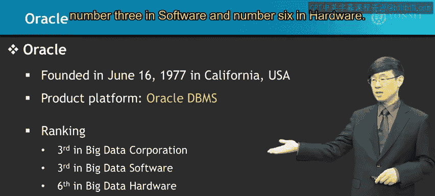
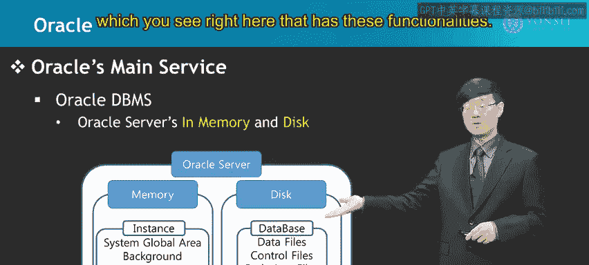
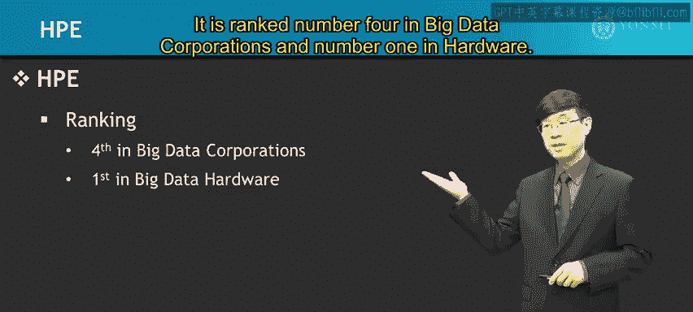
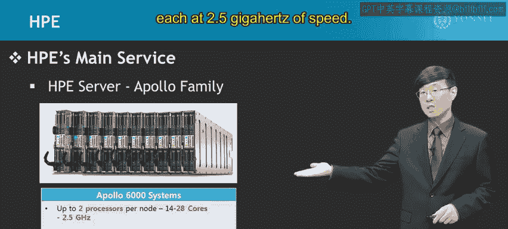
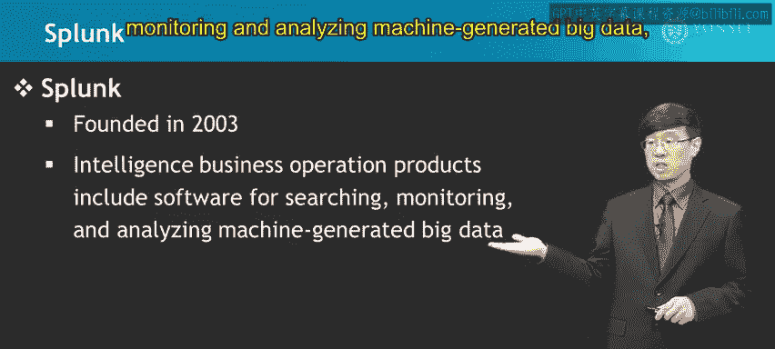
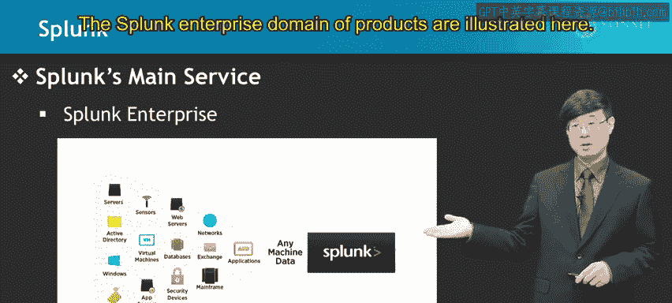
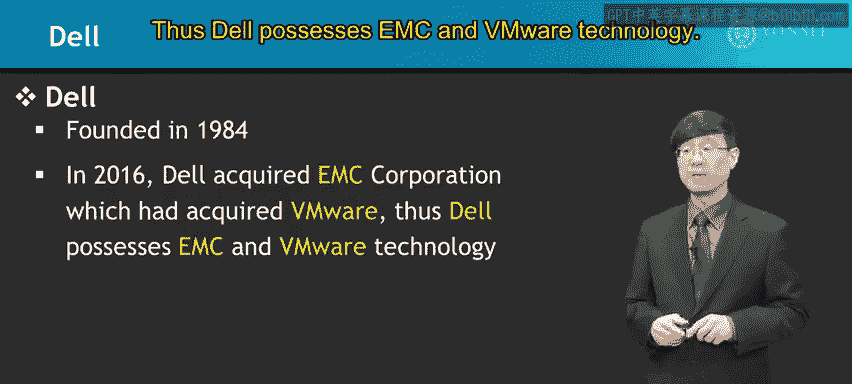
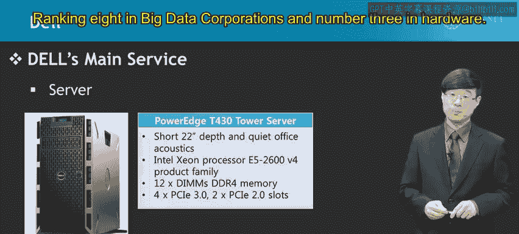
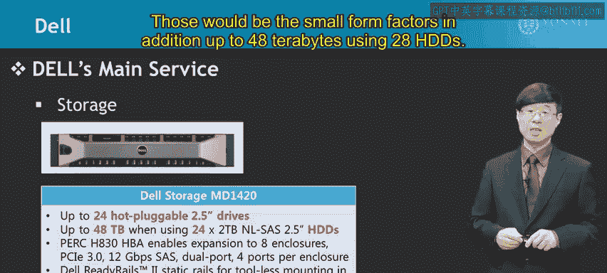

# 4：主要大数据公司概览（Oracle, HPE, Splunk, Accenture, Dell, Teradata）📊

在本节课中，我们将学习几家在**大数据**领域占据重要地位的公司。我们将了解它们的历史、核心产品平台以及在行业中的排名。这些公司分别从**数据库软件**、**硬件服务器**、**数据分析平台**到**专业咨询服务**等不同角度，构成了大数据生态系统的基础。

---

## 🗃️ 1. Oracle

Oracle公司成立于1977年。其核心产品平台是**Oracle数据库管理系统**。

在大数据公司排名中，Oracle位列第三。在软件领域排名第三，在硬件领域排名第六。

Oracle DBMS是运行在内存和磁盘系统上的Oracle服务器，具备多种功能。

---

## 💻 2. HPE

HPE代表**慧与公司**。它是成立于1939年的惠普公司的一部分。

2015年，惠普公司将业务分拆：电脑制造和销售归入**HP Inc.**，而云服务等业务则归入**HPE**。

在大数据公司排名中，HPE位列第四。在硬件领域排名第一。

### HPE服务器产品线

以下是HPE的Apollo系列服务器家族，主要包括2000、4000和6000系统。这些系统在硬盘配置、处理能力和可扩展性方面各有不同。

*   **Apollo 2000系统**：支持最多4个热插拔服务器节点，内存最高可达1.5TB，并提供最多24个小尺寸组件槽位，可选择HDD或SSD。
*   **Apollo 4000系统**：支持28个大尺寸组件和54个小尺寸组件，均可使用热插拔驱动器。
*   **Apollo 6000系统**：每个节点配备两个处理器，每个处理器最多28个核心，主频为2.5 GHz。提供4个小尺寸组件槽位（可选HDD或SSD），内存选项如下文所列。

在**StoreEasy 1550存储系统**中，列出了可支持的用户数量、网络控制器和存储容量等配置选项。

在**内存模块**方面，提供了HPE 8GB设备，其容量和内存大小均有明确记录。

---

## 🔍 3. Splunk

Splunk公司成立于2003年。其智能业务运营产品包括用于搜索、监控和分析机器生成的大数据的软件。

它提供**网页式用户界面**。在大数据公司排名中位列第六，在软件领域排名第二。

### Splunk企业级产品功能域

Splunk企业级产品功能涵盖以下几个核心领域：

*   **数据收集与索引**：接受所有数据类型，无论格式、位置（如指标、日志、点击流、传感器、Web服务器、应用程序数据等）均可建立索引。
*   **搜索与调查**：**Splunk搜索处理语言** 支持对数据和信息进行强大的搜索。
*   **关联与分析**：揭示并分析事件与活动之间的关系。
*   **可视化与报告**：趋势和特征可以轻松地在自定义仪表板中可视化，全面支持业务、运营和安全报告。
*   **监控与警报**：可轻松设置实时警报，并通过电子邮件或RSS自动触发通知。
*   **随时随地访问**：为管理员和用户提供安全的远程访问能力。

---

## 🧠 4. Accenture

Accenture公司成立于1989年，提供管理战略、咨询和大数据解决方案。

它是战略、咨询、数字技术和运营领域的解决方案提供商。在大数据公司排名中位列第七，在专业服务领域排名第二。

---

## 🖥️ 5. Dell

Dell公司成立于1984年。Dell收购了EMC公司，而EMC此前收购了云计算技术公司VMware。

因此，Dell拥有了EMC和VMware的技术。它从事制造、销售、维修和服务，产品包括个人电脑、服务器、存储和云软件。

在大数据公司排名中位列第八，在硬件领域排名第三。

### Dell硬件产品

**PowerEdge服务器**的规格如上图所示。

对于**Dell存储系统**，可以看到24个可热插拔的2.5英寸驱动器（小尺寸规格）。此外，使用2.8TB的HDD最多可提供48TB的存储容量。

---

## ☁️ 6. Teradata

Teradata公司成立于1979年，提供管理、战略和咨询服务。

其产品平台是**Teradata IntelliCloud**。在大数据公司排名中位列第九，在专业服务领域排名第四。

IntelliCloud提供先进、安全、托管的云技术。其服务部署选项包括IntelliFlex和IntelliBase。

这些服务为**Teradata数据库**、**Aster数据分析**、**Hadoop系统**以及**亚马逊云服务**和**微软Azure平台**提供大数据软件支持。

---

## 📚 总结

本节课我们一起学习了几家关键的大数据公司：**Oracle**（数据库软件）、**HPE**（服务器硬件）、**Splunk**（数据分析平台）、**Accenture**（专业服务）、**Dell**（集成硬件与解决方案）以及**Teradata**（云数据仓库服务）。它们各自在不同的细分领域排名靠前，共同构建了处理和分析海量数据的技术基础架构。理解这些主要参与者，有助于我们把握大数据行业的整体格局。