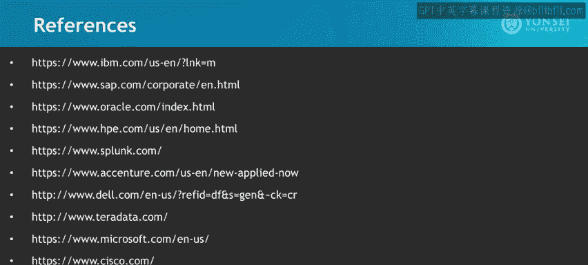

# 课程五：1.9 微软、1.10 思科与1.11 AWS 🏢💻☁️

在本节课中，我们将学习三家在云计算与大数据领域至关重要的科技公司：微软、思科和亚马逊云科技。我们将了解它们的发展历程、核心平台与服务，以及它们在大数据生态系统中的独特定位。

---

## 1.9 微软 (Microsoft) 🪟

上一节我们介绍了多家大数据公司，本节中我们来看看软件巨头微软。

微软成立于1975年，其大数据平台是 **Microsoft Azure**。该平台与SAP、Hannah和Splunk等系统具有良好的互操作性。在大数据公司排名中，微软位列第十；在软件公司中，它排名第五。

Microsoft Azure 提供广泛的服务，包括：
*   计算
*   网络
*   存储
*   Web与移动应用服务
*   数据库
*   数据分析

它是一个一致的混合云技术平台，支持数据驱动的智能应用。Azure强调安全性、隐私性和透明度，并拥有最广泛的合规性认证。由于微软的操作系统普及度极高，这一特性显得尤为重要。

---

## 1.10 思科 (Cisco) 🌐

了解了微软的云平台后，我们转向网络基础设施领域的领导者——思科。

思科成立于1984年，是全球最大的网络公司。它主要开发、制造并提供网络与电信系统及服务。在大数据硬件领域，思科排名第四。

以下是思科的一些核心产品与服务：

*   **服务器**：提供数据中心所需的总带宽和内存选项。
*   **数据中心网络**：支持具有架构灵活性的敏捷网络运营。
*   **计算与存储**：支持统一的计算、存储和网络能力。
*   **自动化与混合云**：支持自动化IT任务、加速应用并优化处理流程。
*   **分析与安全**：提供实时应用分析，以及先进的网络与数据保护。

---

## 1.11 亚马逊云科技 (AWS) ☁️

最后，我们来看看云计算市场的开创者——亚马逊云科技。

亚马逊云科技于2006年作为亚马逊的子公司推出。它提供超过90种服务类型，涵盖计算、存储、网络、数据库、分析、应用服务、物联网工具等众多领域。在大数据硬件领域，AWS排名第七。

AWS的 **S3（简单存储服务）** 是一个非常受欢迎的对象存储服务。它支持从任何地方存储和检索任意数量的数据，可用于网站、移动应用、企业应用、物联网数据等场景。

AWS服务的关键特性包括：
*   **数据持久性与可靠性**：设计目标是提供 **99.999999999%**（小数点后11个9）的持久性。
*   **安全与访问管理**：能够控制和监控所有数据库访问。

---

## 总结

本节课中，我们一起学习了三家顶尖科技公司在大数据与云计算领域的布局。微软凭借其广泛的操作系统基础和Azure混合云平台占据重要地位；思科作为网络硬件巨头，为数据中心和混合云提供核心基础设施；而亚马逊云科技则以丰富的服务生态和极高的可靠性，引领着公有云市场的发展。理解这些公司的核心产品与服务，是构建现代技术解决方案的基础。

以下是我使用的参考资料，也推荐给你。

