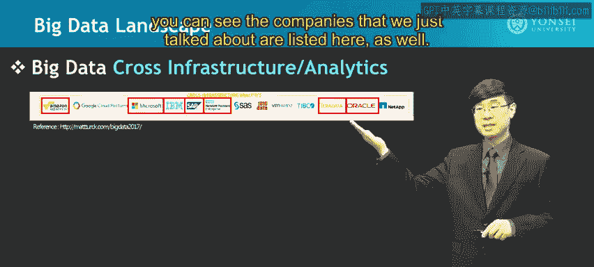
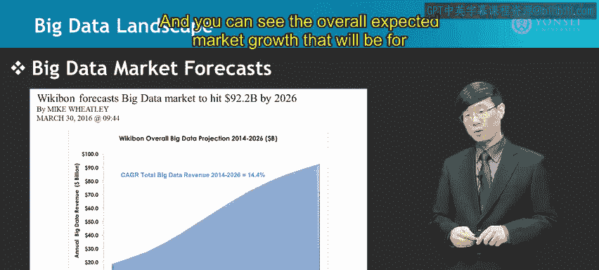
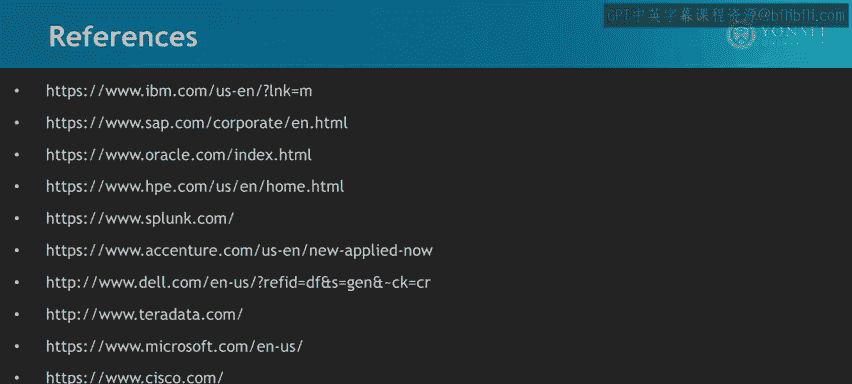

# 6：大数据生态系统概览 🗺️

在本节课中，我们将要学习大数据生态系统的构成、其从2012年到2017年的演变，以及对未来市场的预测。我们将通过图表和分类，清晰地了解参与其中的各类公司和技术领域。

## 大数据生态系统的演变

大数据生态系统在2012年的格局如图所示，当时可以看到参与其中的公司。到了2017年，格局发生了显著变化。更多公司加入进来，产品的数量和多样性都出现了巨大的增长。

## 生态系统的核心组成部分

上一节我们看到了生态系统的整体演变，本节中我们来看看其具体的组成部分。大数据生态系统主要可以分为几个关键领域。

### 基础设施领域

让我们聚焦于其中一个部分，即基础设施领域。我们刚才讨论过的一些公司，连同其他公司，都被列在这里。

以下是该领域的一些代表性公司：
*   Cloudera
*   Hortonworks
*   MapR

### 数据分析领域

接下来，我们看看数据分析部分。你可以看到我们研究过的公司，以及其他一些公司。

以下是该领域的一些代表性公司：
*   Splunk
*   Tableau
*   Qlik

### 应用与跨领域部分

在生态系统的另一部分，你可以看到应用、企业级解决方案以及多样化的公司，其中也包括我们探讨过的一些公司。此外，那个区域是跨基础设施和分析的领域，我们刚刚谈到的公司也列在此处。

以下是该领域的一些类别：
*   企业应用
*   行业特定解决方案
*   跨基础设施与分析平台

## 未来市场预测

了解了当前的生态系统构成后，我们展望一下未来。展望至2026年，这里有一项预测。你可以看到针对大数据技术的整体预期市场增长。

### 市场细分预测

在这项预测中，主要包含三个部分。其中，软件部分是最大的，其次是硬件部分，另外还有专业服务部分。

以下是2026年大数据市场的细分预测：
*   **软件**：预计占据最大市场份额。
*   **硬件**：构成市场的重要组成部分。
*   **专业服务**：包括咨询、部署与维护等服务。

## 课程参考资料

这些是我所使用的参考资料，我推荐给你。

---

本节课中，我们一起学习了大数据生态系统的全景。我们从2012年和2017年的格局对比中看到了其快速发展和参与者数量的激增。接着，我们剖析了生态系统的核心组成部分，包括基础设施、数据分析以及应用与跨领域解决方案。最后，我们展望了到2026年的市场预测，了解了软件、硬件和专业服务等细分领域的发展前景。