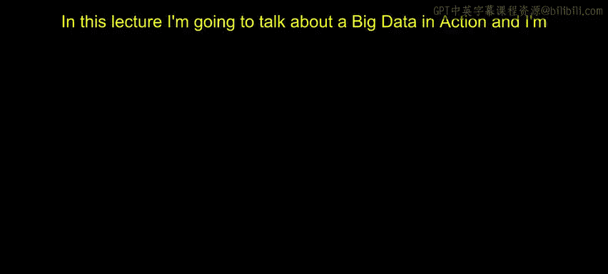

# 延世大学《新兴技术从智能手机到物联网再到大数据》课程笔记 - P7：大数据实践与特征 🧠

在本节课中，我们将学习大数据技术的一个经典实践案例，并深入探讨大数据区别于传统数据分析的核心特征。我们将通过一个真实的故事来理解大数据如何解决现实世界中的紧迫问题。

## 大数据在行动：谷歌流感预测案例 📈

上一节我们了解了大数据的基本概念，本节中我们来看看大数据技术是如何在现实中发挥巨大作用的。一个著名的案例是谷歌公司对H1N1流感病毒的预测。

故事始于2009年，一种结合了禽流感和猪流感基因的新型H1N1流感病毒在美国开始传播。由于这种组合病毒非常危险，其传播速度引起了广泛担忧。

美国疾病控制与预防中心当时每周仅收集一次来自医生的诊断数据。因此，依靠CDC的信息来追踪流感传播情况，会产生大约两周的延迟。这与病毒的快速传播速度相比，显得过于缓慢。

这引发了一系列紧迫问题：需要何种疫苗、需要多少剂量、以及应该将疫苗投放到哪些地区。疫苗的制备和分发计划无法迅速制定，难以有效控制病毒的扩散。

就在这时，谷歌在《自然》期刊上发表的一篇论文引起了巨大关注。该论文表明，谷歌能够利用其搜索引擎的查询数据，准确预测美国冬季流感的传播情况，甚至可以精确到具体的地区和州。这篇论文的发表时间，比H1N1病毒成为头条新闻早了数周。

这篇题为《利用搜索引擎查询数据检测流感疫情》的论文，其核心并非使用CDC的结构化数据库数据，而是利用了用户在谷歌搜索引擎中输入的查询数据。

以下是该研究的关键发现图示：

在图表中，黑线代表基于搜索引擎查询数据的预测结果，红线则代表CDC实际记录的数据。从宏观的年度数据对比来看，两者高度吻合。

进一步从微观时间尺度（例如从二月初到五月中旬）观察，黑线（预测数据）与红线（实际数据）的曲线进展也匹配得相当准确。这一发现极大地激发了人们对于如何利用此类信息的兴趣。

谷歌每天接收超过30亿次搜索查询。为了追踪H1N1病毒的传播，谷歌测试了数百万个最常用的搜索词和数百万个不同的数学模型。分析系统旨在寻找特定搜索查询的频率与流感随时间和空间传播之间的相关性，从而定位疫情爆发的具体地点。

谷歌的分析方法并未使用来自医院或医生的数据，而是利用了关于最常见搜索词的大数据。

需要指出的是，用户在搜索引擎中输入的信息并非都是规整的结构化数据。很多是半结构化数据，并不完全适合直接存入传统数据库。此外，输入内容常包含不完整的词语、拼写错误或非标准术语。谷歌搜索引擎正是利用了这类**非结构化**和**半结构化数据**。

令人惊叹的是，基于这类数据，谷歌系统被证明比专门关注医疗数据的政府统计数据分析更加准确和快速。

## 大数据的核心特征 🔍

了解了大数据的一个成功实践后，我们现在来系统性地比较大数据分析与传统数据分析的特征差异。

以下是两者的主要区别：

*   **分析范围**：大数据分析处理**整个数据集**。传统数据分析则通常基于**样本数据**进行分析。由于是样本数据，其结果需要标明误差范围和可靠率。
*   **可扩展性**：大数据系统具有**极高的可扩展性**。数据集可以扩展到TB、PB级别甚至更大，系统仍能快速准确地处理。传统数据库管理或数据分析方案的可扩展性非常有限，当数据量增长后可能无法有效工作。
*   **数据类型处理能力**：大数据分析功能强大，能够处理**结构化数据**、**半结构化数据**和**非结构化数据**。传统数据分析通常只能用于**结构化数据**。
*   **系统架构**：大数据分析在数据库集群和网络节点上极为高效，数据以**高度分布式**的方式进行处理。传统数据库系统则在**集中式系统**上分析数据，将所有数据汇集到一处再进行分析。
*   **硬件与网络**：大数据分析系统可以部署在**商用计算机和服务器**上，无需专门定制的硬件。其网络也使用标准的快速商用网络（例如通过百兆或千兆以太网连接的Hadoop分布式文件系统节点）。而在许多传统数据分析系统中，不仅服务器是定制的，其网络也常采用为特定计算服务器设计的**存储区域网络**。

## 总结 📝

本节课中，我们一起学习了大数据技术的一个里程碑式应用——谷歌利用搜索查询数据预测流感传播，并系统对比了大数据分析与传统数据分析的核心特征。

我们了解到，大数据的价值在于能够从海量、多样（包括非结构化和半结构化）、快速产生的数据中，通过分布式处理技术，获得比传统方法更及时、更深入的洞察。这为应对公共卫生危机等复杂挑战提供了新的强大工具。

---

**参考资料**：本讲内容基于课程提供的参考文献。更多细节将在后续课程中继续探讨。