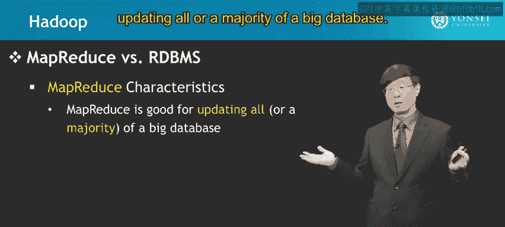
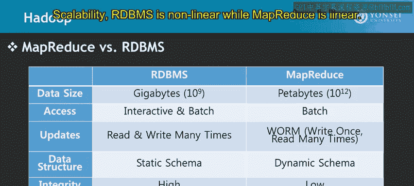

# 10：MapReduce与RDBMS的比较 📊

在本节课中，我们将深入探讨MapReduce与关系型数据库管理系统（RDBMS）之间的比较。我们将分析它们各自的特点、适用场景以及核心差异，帮助你理解在大数据时代如何选择合适的工具。

## RDBMS的特点 🔍

RDBMS代表关系型数据库管理系统。它具备一些特定的特征。

以下是RDBMS的一些关键特性：

*   **擅长更新大数据集中的小部分数据。**
*   它使用传统的B树索引结构。
*   其性能高度依赖于执行搜索操作所需的时间。

## MapReduce的特点 ⚙️

MapReduce是处理大规模数据集的一种编程模型。

以下是MapReduce的一些关键特性：

*   **擅长更新大数据集中的全部或大部分数据。**
*   它使用排序和合并操作来重建数据库。
*   其性能更多地依赖于数据传输操作，而非搜索操作。

## 核心应用场景对比 🎯

上一节我们分别介绍了RDBMS和MapReduce的特点，本节中我们来看看它们各自最适合的应用场景。

RDBMS适用于需要频繁更新数据库数据的应用。例如，点查询或小数据集的更新操作。

MapReduce则更适用于“一次写入，多次读取”的基于批处理的数据应用。MapReduce是RDBMS的补充系统。

## 详细特性对比 📋

让我们通过一个例子，更详细地比较RDBMS和MapReduce的特性、优点和缺点。

以下是RDBMS与MapReduce在多个维度的对比：

*   **数据规模**：优秀的RDBMS系统适合处理GB或更小的数据量，而MapReduce系统能很好地处理PB、TB级别的数据。
*   **访问模式**：RDBMS支持交互式和批处理访问，而MapReduce是面向批处理的。
*   **更新模式**：RDBMS支持多次读写。而MapReduce遵循“一次写入，多次读取”的模式，我们稍后会详细讨论这一点。
*   **数据结构**：RDBMS采用静态模式。MapReduce采用动态模式。我们将在下一讲中，从模式的角度更详细地比较SQL和Hadoop。
*   **数据完整性**：RDBMS的数据完整性高，而MapReduce较低。但另一方面，MapReduce着眼于整个数据集的整体结构。
*   **可扩展性**：RDBMS的可扩展性是非线性的，而MapReduce是线性的。

## 数据类型：结构化、半结构化与非结构化 📁

理解了两种系统的特性后，我们需要认识它们处理的不同数据类型。数据可以根据其组织形式分为三类。

**结构化数据**是指具有正式定义结构的数据。例如，XML文档、数据库表，或者你放入Excel文件中用于绘制图表的数据。如果你放入Excel文件的数据不符合其预设的精确格式，系统将不会接受。这类数据就是结构化数据，它有定义好的结构，对输入数据的类别有预定义的要求。

**半结构化数据**则宽松得多。它有一种格式，数据结构仅作为指导，在某些情况下可能被忽略。当你将半结构化数据放入像Excel文件这样的结构化数据表单时，很多情况下，大量数据可能会被过滤掉而无法使用。因此，如果你查看一个放入了大量半结构化数据的Excel文件，其中很多值会是null或不可接受的。这就是将半结构化数据放入结构化数据系统时会发生冲突的原因。如何接受并使用半结构化数据从中提取信息，这一点非常重要。特别是因为大数据系统面临的挑战之一就是数据类型极其多样，数据的多样性每天都在增长。这就是为什么我们需要研究半结构化数据和非结构化数据，因为这些数据类型正在增长，我们希望找到方法利用它们来提取信息并做出智能决策。

**非结构化数据**是没有任何正式结构的数据。它是纯文本，或来自图像、图片、某种声音、语音对话等各种其他可以被使用的形式。

这三种数据结构，正是像Hadoop这样的大数据系统能够展现其真正优势和强大能力的地方。

## MapReduce在处理非/半结构化数据时的优势 💪

MapReduce在处理非结构化和半结构化数据时是一个非常有效的系统，原因如下：

MapReduce在数据处理会话期间解释数据。MapReduce不使用数据的内在属性作为输入键和输入值。所使用的参数由分析数据的程序员选择。因此，程序员、用户或需要进行查询的人有广泛的选择空间。

MapReduce拥有一个线性可扩展的编程模型，这是MapReduce和Hadoop的真正优势。它有两种函数类型：Map函数和Reduce函数，在接下来的课程中我们将更详细地讨论这些。这两种函数都定义了一个被使用的键值对。因此，我们有键值对1、键值对2，这些是我们从正在大数据引擎中分析的整个数据集中提取的值和信息。

## 总结 📝

本节课中，我们一起学习了MapReduce与RDBMS的核心区别。我们了解到，RDBMS擅长处理小规模、高频率更新的结构化数据，并保证高完整性；而MapReduce则专为海量数据的批处理设计，尤其擅长处理半结构化和非结构化数据，并具备线性可扩展的优势。它们是互补的技术，选择哪一种取决于具体的应用场景、数据规模和数据类型。

这些是我使用的参考资料，我推荐给你。

