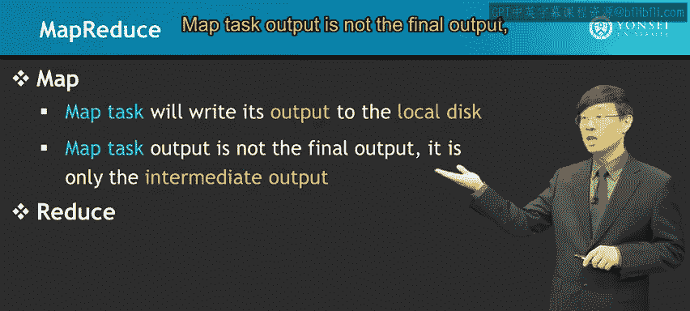
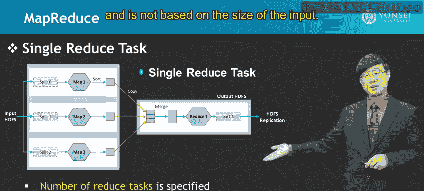
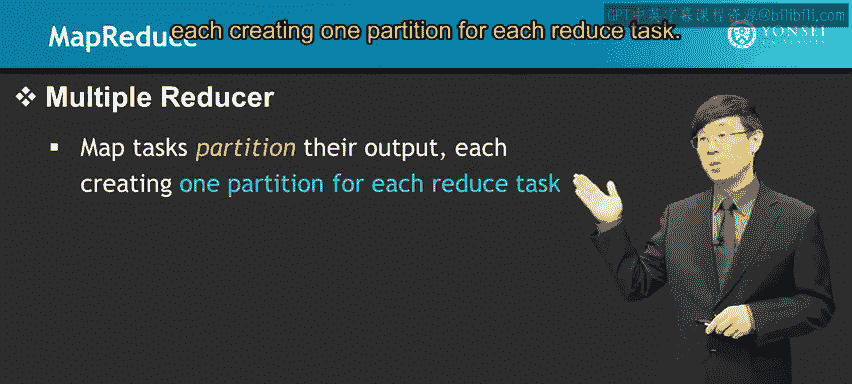
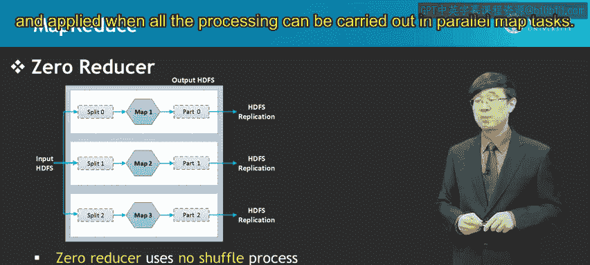

# 11：MapReduce 详解 🗺️➡️📉

在本节课中，我们将深入探讨 Hadoop 的核心组件之一：MapReduce。我们将了解其工作原理、数据流程以及不同的任务类型，帮助你理解大规模数据处理的基本范式。

---

## 概述

Hadoop 是一个可靠的、共享式的存储与分析系统，它主要由 **HDFS** 分布式文件系统和 **MapReduce** 计算框架（以及其他增强功能）组成。本节课我们将聚焦于 MapReduce 的基本原理。

上一节我们介绍了 Hadoop 的整体架构，本节中我们来看看其核心计算模型 MapReduce。

---

## MapReduce 基础

MapReduce 是一个编程模型，用于处理和生成超大数据集。它主要分为两个函数：**Map函数** 和 **Reduce函数**。

扩展性通过分布式文件系统实现，数据被分割并存储在分布式计算机和服务器上。Hadoop 使用 HDFS 将 MapReduce 计算任务移动到多个分布式计算节点上，每个节点处理分配给它的部分数据。

因此，HDFS 负责将数据分割到集群的多个节点上，而每个作为数据节点的计算节点，则使用 MapReduce 引擎来分析数据，以提取键值对。

---

## MapReduce 作业与任务

一个 MapReduce **作业** 是需要执行的一个工作单元。作业类型包括数据输入、MapReduce 程序和配置信息。

作业通过被划分为两种类型的任务来执行：**Map 任务** 和 **Reduce 任务**。

作业执行由两种类型的节点控制：**JobTracker** 和 **TaskTracker**。

*   JobTracker 负责协调所有作业，调度所有任务，并将任务分配给多个 TaskTracker。
*   其运行模式如下图所示：首先，JobTracker 查看需要完成的工作，将其分配给一个 TaskTracker；数据处理完成后，结果将返回给 JobTracker。

这个过程会并行进行，一个 JobTracker 调度多个 TaskTracker 的工作。这个操作实际上是在系统的 NameNode 和多个 DataNode 上进行的。

---

## 数据流与任务本地性

Hadoop 将输入数据划分为适合 MapReduce 作业的 **输入分片**。分片具有固定大小，通常使用 HDFS 默认的 64MB 块大小，因为这是 MapReduce 得出的能实现最高处理效率的方案。

会为每个分片创建一个 Map 任务。Map 任务对分片内的所有记录执行 Map 函数。Map 任务通常会在存储输入数据的节点上执行，这称为“数据本地性”。

以下是 MapReduce 数据流的几种情况：

### 1. 数据本地 Map 任务

在数据本地 Map 任务中，所有 Map 任务和 HDFS 数据块的交换与处理都在同一个节点内完成。整个过程都停留在机架内的节点上，无需使用集群网络。这解释了为什么 64MB 的 HDFS 块大小作为分片大小是最优的。

### 2. 机架本地 Map 任务

在机架本地 Map 任务中，Map 任务和 HDFS 块操作会在同一机架内的不同节点间交换。但是，没有任何数据会离开这个机架。

当一个承载着 Map 任务输入分片对应 HDFS 块副本的节点正在运行其他 Map 任务时，作业调度器会尝试在同一机架内的其他节点上寻找空闲的 Map 任务槽位。

### 3. 跨机架 Map 任务

在跨机架 Map 任务中，Map 任务和 HDFS 块交换发生在不同机架之间。操作可以离开原始机架，但仍在数据中心内部。

当作业调度器无法找到足够的数据本地或机架本地 Map 任务槽位时，就需要使用跨机架网络传输来满足任务需求。

---

## Map 与 Reduce 函数详解

对于 **Map 任务**，它会将输出写入本地磁盘。Map 任务的输出并非最终结果，它只是 **中间输出**。

对于 **Reduce 任务**，它会处理 Map 任务的输出以产生最终结果。Reduce 任务的输出会存储在 HDFS 中。作业完成后，Map 任务的中间输出可以被丢弃。

以下是几种 Reduce 任务类型：

### 单 Reduce 任务

如图所示，HDFS 的输入进入三个 Map 函数，它们的输出被合并后，送入一个单一的 Reduce 函数。因此这被称为单 Reduce 任务。流程包括分片、映射、排序和输出等步骤。图中浅蓝色箭头表示节点内的数据传输，橙色箭头表示节点间的数据传输。

**Reduce 任务的数量是独立指定的，并不基于输入数据的大小。**

### 合并器函数

**合并器函数** 是用户指定的、运行在 Map 输出上的函数。它的输出构成 Reduce 函数的输入。它专门用于最小化 Map 任务和 Reduce 任务之间传输的数据量。

这解决了集群网络带宽有限的问题，有助于减少完成 MapReduce 作业的时间。

### 多 Reduce 任务

在多个 Reduce 任务的情况下，Map 任务会对输出进行分区，为每个 Reduce 任务创建一个分区。每个分区可能包含许多键及其关联值，但同一个键的所有记录都会保存在同一个分区内。

如上图所示，输入经过 Map 函数后，根据合并连接被分配到两个不同的 Reduce 函数中。

在 Map 任务和 Reduce 任务之间的数据流中，会使用 **洗牌** 过程，将数据合并后送入 Reduce 函数。

### 零 Reduce 任务

在某些情况下，可以使用 **零 Reduce 任务**。此时，HDFS 的输入仅通过 Map 函数处理，HDFS 的副本直接用作输出。

零 Reduce 任务不使用任何洗牌操作，适用于所有处理都可以在并行的 Map 任务中完成的情况。

---

## 总结

本节课中，我们一起学习了 Hadoop MapReduce 的核心机制。我们了解了 Map 和 Reduce 函数的分工，探讨了作业与任务的管理方式，并通过数据流图深入分析了数据本地性优化的重要性。我们还介绍了单 Reduce、多 Reduce 以及零 Reduce 等不同任务类型，以及合并器函数在优化网络传输中的作用。理解这些概念是掌握大规模分布式数据处理的基础。

---

## 参考资料

以下是我使用的参考资料，也推荐给你。

