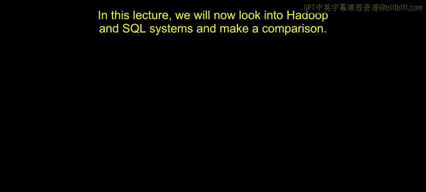
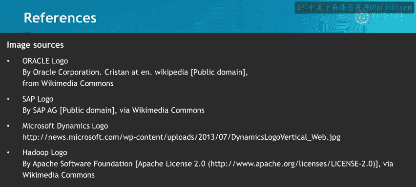
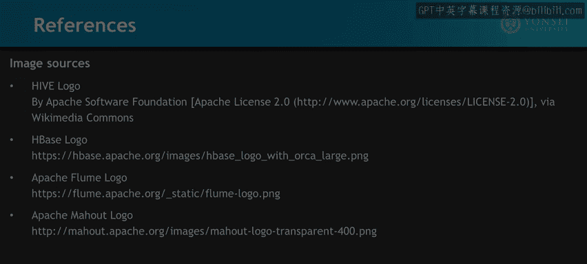

# 12：Hadoop与SQL、RDBMS、RDSMS的比较 🆚

在本节课中，我们将深入探讨Hadoop与SQL系统，并对它们进行比较。这里所说的SQL系统，指的是关系型数据库管理系统（RDBMS）和关系型数据流管理系统（RDSMS）。我们将从数据模式的处理方式、系统架构和适用场景等方面进行对比。

## 核心概念定义

首先，我们来明确几个核心概念。

Hadoop使用HDFS和MapReduce作为其核心组件。而SQL是结构化查询语言的缩写，发音为“S-Q-L”或“Sequel”，它被用于RDBMS和RDSMS的数据处理。

*   **RDBMS**：代表关系型数据库管理系统。
*   **RDSMS**：代表关系型数据流管理系统。

因此，一个是处理静态数据库的系统，另一个是处理动态数据流的系统。

本次比较的核心基础是两种不同的模式处理策略：**写时模式**和**读时模式**。模式（Schema）是指数据的结构、图表或示意性表示。

## SQL系统：写时模式 ✍️

上一节我们定义了核心概念，本节中我们来看看SQL系统的特点。

写时模式意味着，在数据写入数据库之前，其结构必须是已知的，并且必须经过适当的格式化。当你向数据库写入数据时，数据必须具有预定义的结构（模式），否则可能无法正确插入。

所有数据分析和处理都必须在数据库层面完全完成，然后分布式处理的各个部分才能被收集和合并。数据以逻辑上组织好的格式存储，这构成了数据库的元数据结构。

一个典型的例子是，当你使用Microsoft Excel或R等数据分析工具时，你看到客户信息、订单类型、时间以及关联的产品类型等信息，都是基于写时模式的结构。这是RDBMS和RDSMS中典型的数据库结构，我们使用SQL从中提取信息。

### 两阶段提交系统

在基于写时模式的SQL系统中，使用的是一种**两阶段提交**的分布式算法。该算法对事务做出提交或中止的决策。

这个例子在信用卡交易中很容易找到。当你刷卡时，交易要么被接受，要么被拒绝，有时系统还会给出拒绝的原因。这就是我们所说的两阶段提交，结果要么是提交（接受），要么是中止（拒绝）。

在一个整体系统中，你可以看到三个数据系统连接在一起。如果其中一个服务器节点出现延迟，整个数据分析报告都会被延迟，因为中间连接的三个数据系统是相互关联的，它们需要彼此协作来处理数据，以决定是接受还是拒绝交易。因此，如果中间有一个不工作，那么整个系统都无法工作，你将得不到任何结果。这是基于写时模式的SQL类型数据库系统（无论是RDBMS还是RDSMS）的特点。

基于写时模式的SQL，擅长在数据库所有事务都已完成的基础上获取精确结果。例如，一家银行在下午关门后，数据库就固定了，这时你可以开始执行SQL操作来分析数据。

此外，写时模式在数据录入时就已经完成。当银行操作员将账户信息输入数据库时，数据已经具有严格的形式，包含了预定义的模式，并以正确的方式插入数据库。这就是写时模式的含义：当你将数据写入系统时，数据的结构、格式已经准备就绪。

## Hadoop系统：读时模式 📖

与基于写时模式的SQL相比，Hadoop基于读时模式，并且采用“一次写入，多次读取”的操作方式。

数据被插入HDFS时，不需要任何预先格式化，可以具有任何结构。这就是为什么HDFS支持非结构化数据的写入。当然，它也欢迎半结构化和结构化数据。

当从HDFS读取数据时，如何读取、提取和使用数据的规则和结构，是在读取程序代码（通常是Java程序代码）中定义的。

WORM代表“一次写入HDFS（Hadoop分布式文件系统），多次读取”。你写入一次，然后可以多次读取，这些读取操作基于你想要查看和从数据库中提取数据的不同查询。因此，多次读取将完全基于使用什么程序代码来提取什么数据，这些程序执行MapReduce操作。

### HDFS的可靠性与容错性

以下是HDFS实现可靠性的关键机制：

1.  **数据分块与复制**：数据被分割并复制，然后存储在HDFS服务器中。这种复制因子提供了健壮性、可靠性和容错性。
2.  **默认复制因子**：默认的复制因子是3。你会看到一些应用根据他们处理数据的方式和可用资源情况，可能使用2、4或5。
3.  **NameNode的作用**：NameNode会记录复制的文件存储在何处。换句话说，NameNode将数据处理任务分配给DataNode，而MapReduce操作正是在DataNode上完成的。因此，NameNode会记录哪个DataNode获得了哪些数据，以及它们将处理哪些MapReduce程序。

### 读时模式示例分析

一个读时模式的示例如下：

一个1TB的网站搜索文件被分成四个文件，每个250GB。在这个例子中，我们假设复制因子为2（默认是3，但同样可以控制）。如你所见，1TB数据文件被分成粉色、蓝色、绿色和黄色四部分，每部分复制两次，因此我有C1到C8共8个文件需要处理。

假设集群中有25个节点，我们将使用8个DataNode，因为文件有C1到C8。NameNode拥有C1到C8的索引，并将它们分别分配给一个独立的DataNode。因此，8个DataNode将被分别分配文件C1到C8。NameNode记录下被分配了文件副本的这8个DataNode。

一个关键词搜索的Java程序被应用到这8个DataNode上，对一组关键词进行并行同时搜索。MapReduce被应用到1TB文件的不同部分，因此每个DataNode服务器需要分析整个1TB文件中250GB的部分。

Map程序的搜索结果被传递到同一DataNode上的Reduce程序。MapReduce使用键值对将分析问题转化为计算过程，我们有多组键值对。

对于数据分析结果，所有分布式计算部分不需要完全计算完毕就可以进行合并。这是因为我们制作了副本。在这个例子中，我们的复制因子是2。所以，两个副本中的任何一个部分，只要完成了，就足够了。例如，C1和C2是相同的，它们是原始1TB文件中同一部分的两个副本。因此，无论C1还是C2所在的DataNode先完成计算，MapReduce过程完成并提取出所需的键值对，那么只要有一个完成就足够了。另一个失败或延迟，仍然没问题。我可以使用已完成的部分，然后尝试收集所有部分（每个分区至少一个）。我们有四个分区，所以我至少需要四个部分中每个的一个（完成较快的那个）。我将基于这四个完成较快的部分来分析整个1TB文件。这就是实际的处理方式。

因此，在复制的部分中（每个250GB文件部分有两个副本），如果其中一个失败，仍然没问题。当至少有一个副本完成时，整个Hadoop分析结构就将完成。再次强调，默认复制因子是3，因此在默认应用模式下，三个副本中的任何一个部分完成，都能基于每个独立集群组件分区的完成情况来完成整体分析。这里我们有四个分区。

## 总结与对比 🔄

本节课中我们一起学习了Hadoop与SQL系统的核心区别。

这与SQL中使用的两阶段提交方法完全相反。SQL不进行任何复制，并且数据是基于写时模式结构放入系统的，其处理过程是多个数据处理节点协同工作的流水线过程，所有节点必须按顺序完成才能得到结果。而在Hadoop中，我们使用了复制因子和读时模式，因此结果大不相同，基于MapReduce的Hadoop更加健壮和快速。

基于读时模式的Hadoop非常适合那些持续收集各种数据类型的新信息、需要不断更新和分析的数据库。在以下场景中，Hadoop（读时模式）更加强大：网站和电子邮件、社交网络、基于增强现实的系统、关键词搜索引擎以及其他各种领域。

这些是我使用的参考资料，我推荐给你们。

