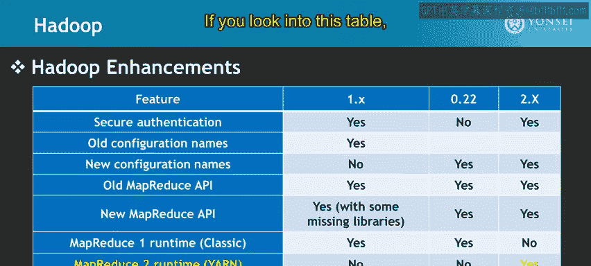

# 延世大学《新兴技术从智能手机到物联网再到大数据》课程 - P13：HDFS增强功能详解 🚀

在本节课中，我们将深入探讨Hadoop分布式文件系统（HDFS）的几项关键增强功能。这些改进旨在提升Hadoop集群的可靠性、可扩展性和容错能力，使其能够更好地处理大规模数据。

---

上一节我们介绍了Hadoop的基础架构，本节中我们来看看HDFS在2.0及更高版本中引入的三个重要增强特性。

## 1. MapReduce 2.0 与 YARN 🧵

从MapReduce 2.0开始，增强的MapReduce运行时系统被称为**YARN**（Yet Another Resource Negotiator）。YARN将资源管理与作业调度/监控功能分离开来，形成了一个更通用、更高效的集群资源管理平台。

在后续的示例中，我们将看到YARN在HDFS中的具体应用。

## 2. HDFS 联邦（Federation） 🌐

HDFS联邦功能将HDFS的命名空间（namespace）划分到多个名称节点（NameNode）上。

以下是HDFS联邦的核心概念：
*   **命名空间卷（Namespace Volume）**：由命名空间的元数据组成。
*   **块池（Block Pool）**：包含该命名空间中所有文件的数据块。

HDFS联邦允许集群通过添加名称节点来进行横向扩展。每个名称节点独立管理一个命名空间卷和一个块池。名称节点之间不进行通信，一个名称节点的故障不会影响其他名称节点及其管理的命名空间的可用性。这使得系统能够更好地支持包含海量文件的集群。

## 3. HDFS 高可用性（High Availability） 🛡️

高可用性特性通过使用备用名称节点（Standby NameNode）作为备份，消除了名称节点可能成为系统单点故障的风险。

其核心机制是配置名称节点，将其构成文件系统元数据持久化状态的文件，写入到多个文件系统中，实现同步且原子性的备份。常见的备份配置是同时写入本地磁盘和远程文件系统。

在高可用性配置中，使用一对处于“主用-备用”模式的主备名称节点。
*   备用名称节点存储最新的编辑日志条目和最新的块映射信息。
*   当主用名称节点发生故障时，备用名称节点会接管并开始服务客户端请求。虽然切换可以在几十秒内快速完成，但为了避免不必要的频繁切换，备用节点的激活通常会在一个足够的观察期（例如大约一分钟或几分钟）后执行。

这与传统的**次要名称节点（Secondary NameNode）** 不同。次要名称节点会定期合并命名空间镜像和编辑日志，以防止编辑日志变得过大。由于其合并过程需要大量的处理能力和内存，它通常运行在一台独立的计算机上，且并不提供故障接管功能。

---

本节课中我们一起学习了HDFS的三大增强功能：**YARN**作为新一代资源管理器，**HDFS联邦**通过多名称节点实现命名空间横向扩展，以及**HDFS高可用性**通过主备节点机制确保服务连续性。所有这些改进共同使得Hadoop系统变得更加可靠、健壮，能够适应更大规模的数据处理需求。