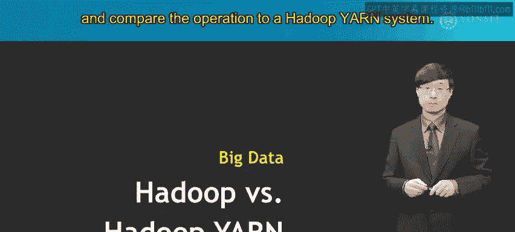
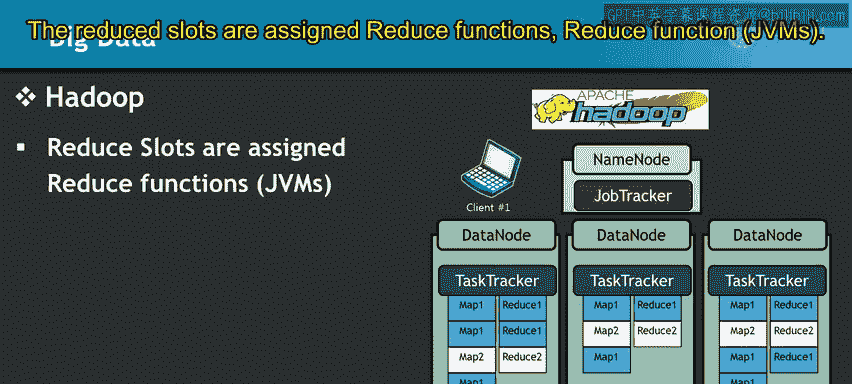
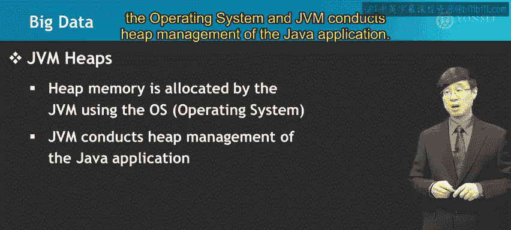
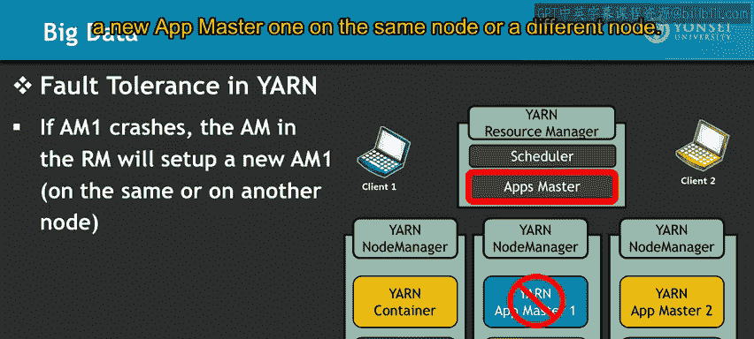
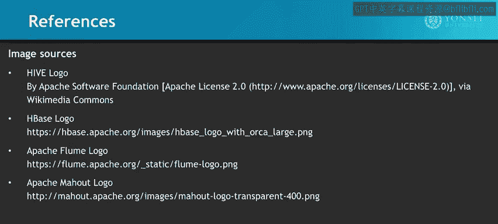

# 延世大学《新兴技术从智能手机到物联网再到大数据》课程 - P14：Hadoop与Hadoop YARN的比较 🆚

在本节课中，我们将深入探讨Hadoop，并将其运行机制与Hadoop YARN系统进行比较。

## 概述

在本节中，我们将学习Hadoop的经典MapReduce架构和基于YARN的现代架构。我们将了解它们如何管理资源、调度任务以及处理容错，并通过对比理解YARN带来的改进。

---

## Hadoop经典架构示例

上一节我们介绍了Hadoop的基本概念，本节中我们来看看其经典架构的工作流程。

在这个示例中，客户端1向HDFS提交了应用1，以执行MapReduce操作。

*   在名称节点上创建了一个作业跟踪器。作业跟踪器也可以位于不同的节点上，但在此示例中位于名称节点上。
*   随后作业跟踪器被创建以执行作业。名称节点选择数据节点。
*   数据节点随后开始每三秒向名称节点发送一次心跳信号。
*   作为“大脑”或主节点的作业跟踪器，会建立多个任务跟踪器作为“劳动力”或从属节点。
*   每个任务跟踪器会分配槽位，这些槽位可以是映射槽或归约槽。
*   映射槽被分配给映射函数。这些是JVM（Java虚拟机）。
*   归约槽被分配给归约函数，同样是JVM。

## 理解JVM（Java虚拟机）

在继续之前，我们需要理解什么是JVM，因为它在Hadoop任务执行中扮演着关键角色。

并行处理基于同时控制多个进程来操作。为了解释JVM是什么，让我们深入了解Java。Java是Oracle公司持有的商标。

*   **JVM** 是Java虚拟机。它是计算机上用于执行Java程序的虚拟抽象计算系统。
*   JVM运行在JRE（Java运行时环境）上。JRE是一个包含名为Hotspot的JVM和JCL（Java类库）的软件包。
*   JVM内存使用类型包括：
    *   **堆**：保存在堆内存中的Java对象。它们使处理速度更快。
    *   **线程栈**
    *   **本地句柄**
    *   **内部数据结构**
    *   以及其他。
*   当JVM启动时，会分配堆内存空间。在应用程序执行期间，堆大小可以增加或减少。
*   堆管理由JVM使用操作系统进行分配，并且JVM负责Java应用程序的堆管理。

## Hadoop YARN架构示例

了解了经典Hadoop架构后，现在我们来看看基于YARN的现代Hadoop架构是如何工作的。

以下是YARN架构的工作步骤：

1.  资源管理器内部包含一个调度器和应用程序管理器。
2.  资源管理器在集群的多个节点上准备节点管理器。
3.  节点管理器向资源管理器发送心跳信号，以显示它们处于活动状态，并提供更新的连接信息。
4.  可以为资源管理器应用Zookeeper以实现高可用性保护。
5.  客户端1向资源管理器提交应用1。
6.  调度器选择一个具有足够资源的节点，在该节点的节点管理器上设置应用主控程序1。
7.  需要说明的是，这是在节点管理器上的应用主控程序1，而在资源管理器上的是应用程序管理器（复数形式）。
8.  资源管理器上的应用程序管理器开始监控应用主控程序1，以检查是否发生故障。这个监控过程在整个应用程序运行期间持续进行。
9.  应用主控程序1与资源管理器中的调度器通信，请求在节点上设置容器。
10. 调度器向应用主控程序1发送密钥和容器信息，以便设置容器。
11. 基于从调度器接收到的密钥和容器信息，应用主控程序1联系已知的节点管理器，发送密钥和容器信息，并请求在其上设置容器。
12. 然后，每个被应用主控程序1联系的节点管理器将设置一个容器，在其节点上运行应用1（图中黄色部分所示）。

现在，让我们看看如果另一个客户端请求运行其应用程序会发生什么。

1.  应用2将被提交给资源管理器。
2.  调度器将选择一个节点来设置应用主控程序2。
3.  应用程序管理器将开始监控应用主控程序2以检查是否发生故障，只要客户端2的应用正在处理中，这个过程就会持续。
4.  应用主控程序2请求容器设置，调度器向应用主控程序2发送密钥和容器信息。
5.  应用主控程序2联系节点管理器，发送密钥和容器信息，请求在其节点上设置容器。
6.  每个被应用主控程序2联系的节点管理器将设置一个容器，在其节点上运行应用2。
7.  应用2将在新容器上运行。

## YARN中的容错机制

YARN架构设计包含了强大的容错能力。

*   如果**一个容器崩溃**，应用主控程序1将与资源管理器通信，并设置一个新容器来替换崩溃的容器。
*   如果**应用主控程序1崩溃**，资源管理器中的应用程序管理器将在同一节点或不同节点上设置一个新的应用主控程序1。

---

## 总结

本节课中，我们一起学习了Hadoop经典MapReduce架构与Hadoop YARN架构的核心区别。我们了解到，经典架构依赖于单一的JobTracker进行资源管理和任务调度，而YARN通过引入ResourceManager和ApplicationMaster实现了更灵活、可扩展且高可用的资源管理与应用调度分离。YARN支持多租户和多种计算框架，是现代大数据生态系统的基石。

## 参考资料

以下是我使用的参考资料，也推荐给你。

