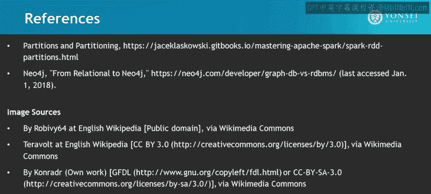

# 15：Apache Spark 详解 🚀

在本节课中，我们将学习 Apache Spark 这一核心的大数据处理技术。我们将了解它的定义、特点、与 Hadoop 的关系以及其应用场景。

Apache Spark 是一种大数据通用处理技术。它目前是全球最流行、最活跃的大数据开源项目。因此，了解其细节非常必要。

在 Spark 出现之前，Hadoop 是应用最广泛的开源大数据技术。接下来，我们将看到 Spark 是如何利用 Hadoop 的。

## Spark 的核心特性 ⚙️

上一节我们提到了 Spark 的流行地位，本节中我们来看看它的核心功能与特性。

Spark 自行管理集群。它支持批处理应用、迭代算法和交互式查询。Spark 独立于 Hadoop，但可以利用 Hadoop 进行存储或处理。

Spark 拥有内置的机器学习库，这使其功能非常强大。Spark 支持流处理功能，它通过微批处理技术为实时应用提供流处理模式。

据报道，Spark 比 Hadoop 快十倍到百倍，我们很快将了解其原因。Spark 速度极快，并采用了改进的数据处理技术。

以下是其关键技术点：
*   **内存处理**：利用 RAM 进行高速计算。
*   **弹性分布式数据集**：即 **RDD**，是 Spark 的核心数据抽象。
*   **有向无环图**：即 **DAG**，用于优化任务执行流程。
*   高级调度、持久化技术、实时流处理等。

## Spark 与存储系统及 Hadoop 的关系 🔗

了解了 Spark 的强大性能后，我们来看看它如何与存储系统协作，特别是与 Hadoop 生态系统。

Spark 自身没有独特的分布式存储系统，但它被设计为可以使用各种第三方分布式文件系统。许多 Spark 系统连接到 Hadoop 系统，因为已有大量数据存储在 Hadoop 分布式文件系统 **HDFS** 中。

在数据处理层面，Hadoop 的 **MapReduce** 被 Spark 的 **RDD**、**DAG** 以及转换和行动操作所取代。Spark 通过 **YARN** 资源管理器来使用 HDFS，我们后续会详述这一点。

Spark 的高级分析应用和内置机器学习库功能，使得从 HDFS 及其他各类数据集中提取信息的能力非常出色。相比之下，Hadoop 没有内置的机器学习库，因此需要使用第三方库 **Mahout**。

## Spark 为何比 Hadoop 更快？ ⚡

我们已经知道 Spark 速度优势明显，现在我们来探究其背后的原因。

Hadoop 速度较慢，是因为 **MapReduce** 在每次操作后，为了容错，会将所有过程数据保存在物理存储介质上（通常是硬盘驱动器）。我们即将看到硬盘驱动器的速度限制。Hadoop 在一个作业中会多次重复此过程，这使其变得更慢。

## Spark 的应用场景 🏭

理论之后，我们看看 Spark 在实际中有哪些用武之地。

Spark 的应用包括零售商推荐引擎、工业机械与制造的监控和自动化预测系统（用于预估部件故障时间、最佳更换时间以及订购替换组件的时间），以及物联网和网络物理系统的控制器。

## Spark 的发展历程 📜

最后，我们来简要回顾一下 Spark 的起源与发展。

Spark 和 Mesos 由加州大学伯克利分校的 AMP 实验室开发。2010 年，Spark 基于 BSD（伯克利软件发行版）许可证成为开源软件。2013 年，Spark 被捐赠给 Apache 软件基金会。2014 年，Apache Spark 成为 Apache 顶级项目，并于同年 5 月首次发布。

## 深入探讨：Spark 的特点与对比 🔎

现在，让我们更深入地探讨 Spark 的一些关键特点及其与 Hadoop 的对比。

首先，Spark 的扩展性非常好。Spark 可以在由数千个节点组成的集群上执行，处理 PB 级别规模的数据库。

以下是 Spark 与 Hadoop 关系的总结：
*   Hadoop 和 Spark 都是大数据技术。
*   两者都提供了最流行的大数据工具。
*   两者都是 Apache 软件基金会的工具。
*   Hadoop 和 Spark 系统可以协同工作，我们稍后会看到相关示例。
*   许多 Spark 系统通过 **YARN** 连接到 Hadoop 的 **HDFS**。
*   两者都具有可扩展性，随着数据集增长，可以向网络中添加更多数据驱动器，因此非常适合扩展以容纳更多信息和数据。
*   它们的任务管理和数据处理方案不同。

---

本节课中，我们一起学习了 Apache Spark 的基本概念、高速性能的关键技术、它与 Hadoop 生态系统的协作关系、典型应用场景以及发展简史。Spark 凭借其内存计算、灵活的 RDD 和优化的 DAG 执行引擎，已成为现代大数据处理不可或缺的核心框架。

**参考资料**
（此为课程中提及的参考资料列表，建议学习者查阅。）