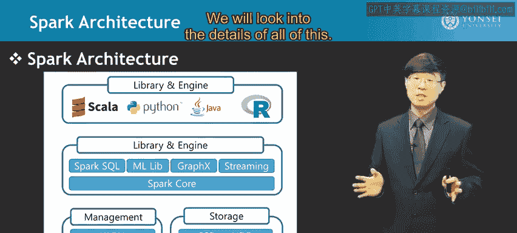
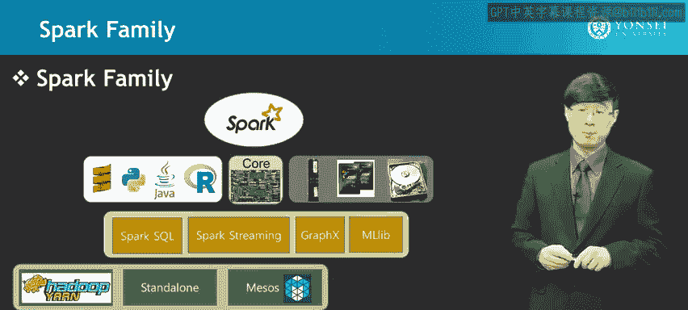
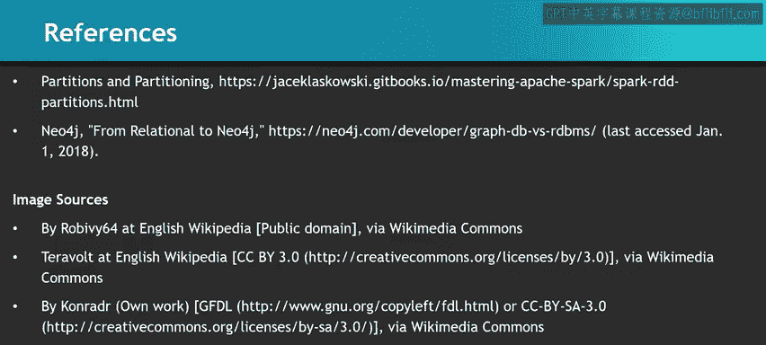

# 延世大学《新兴技术从智能手机到物联网再到大数据》 - P16：Spark架构与家族 🚀

在本节课中，我们将学习Apache Spark的架构及其生态系统中的关键组件。我们将从Spark的核心架构开始，然后深入了解其家族成员，包括各种库、引擎和集群管理工具。

---

## Spark架构概览

上一节我们介绍了Spark的基本概念，本节中我们来看看Spark的整体架构。Spark架构主要关注其库、引擎以及运行基础。

Spark架构的核心是**Spark Core**，它是一个通用的底层执行引擎。所有其他功能都构建在Spark Core之上。它提供了基于内存的快速计算能力，并能引用外部存储系统中的数据集。

在Spark Core之上，运行着多个库和引擎，它们共同构成了Spark的强大功能。以下是Spark架构中的主要组件：

*   **Spark SQL**：这是一个基于模式RDD的数据抽象层，为结构化和半结构化数据提供支持。
*   **Spark Streaming**：利用Spark Core的快速调度能力对流数据进行实时分析。它将输入数据流划分为小批量（mini-batches），并对这些批次执行RDD转换操作。
*   **MLlib（机器学习库）**：这是一个内置的机器学习函数库，它使Spark功能强大且计算速度极快。MLlib可以轻松应用于基于分布式内存的Spark架构。
*   **GraphX**：这是一个分布式图处理框架。Spark使用GraphX的图计算API，为用户自定义的图提供优化的运行时处理。

此外，使这一切协同工作的还包括编程API（基于Scala、Python、Java和R）以及存储引擎（如SSD、HDD、HDFS、Amazon S3、RDBMS和NoSQL数据库）。集群管理则可以通过YARN、Mesos或Spark自带的调度器来实现。

---

## Spark的核心：弹性分布式数据集（RDD）

Spark架构的基础是**弹性分布式数据集（RDD）**。RDD是Spark的核心数据结构。它本身不是一个完整的数据集集合，而更像是一个用于处理数据的**转换（transformations）和行动（actions）操作序列的“公式”**。

RDD的转换操作可以表示为：
`新的RDD = 旧的RDD.转换操作(参数)`

例如，一个过滤操作的代码可能是：
`filteredRDD = originalRDD.filter(lambda x: x > 10)`

这种设计使得Spark能够高效地进行容错处理和并行计算。

---

## Spark家族成员

了解了核心架构后，本节我们将深入探索Spark庞大的生态系统家族。Spark家族不仅包括其核心引擎和库，还涵盖了一系列与之协同工作的资源管理、存储和协调系统。

以下是Spark家族中的关键成员：

### 1. 集群资源管理器

*   **YARN**：全称为“Yet Another Resource Negotiator”。它是Apache Hadoop的集群资源管理和作业调度平台，被视为Hadoop的下一代MapReduce。YARN将资源管理和作业调度/监控功能分离为独立的守护进程。它包含一个全局的Resource Manager和每个应用独有的Application Master。一个应用可以是一个单独的作业，也可以是一个有向无环图（DAG）的作业集合。
*   **Mesos**：这是一个分布式集群资源管理和调度平台。“Mesos”在古希腊语中意为“中间人”或“调解者”。它为整个数据中心和云环境提供资源管理和调度API，能够轻松实现包含数万个节点的大型集群的线性扩展。Mesos通过ZooKeeper实现主节点和代理节点的复制，从而提供高可用性、容错性和非破坏性升级。

### 2. 存储与协调系统

*   **Tachyon**：这是一个开源的、基于内存（RAM）的分布式容错文件系统。它具有非常快速的高性能数据共享特性。它存储用于生成数据集的二进制程序以及输入数据集，每个写入操作都保存在单个节点的内存中，从而实现跨框架的快速读取和数据共享。
*   **ZooKeeper**：Apache ZooKeeper为集群提供高度可靠的分布式协调服务。它维护配置信息、命名、提供分布式同步和分组服务，实现基于集群的集中控制和易于管理的功能。
*   **HDFS**：Hadoop分布式文件系统，是Spark常用的底层存储系统之一。
*   **Cassandra**：Apache Cassandra是一个分布式NoSQL数据库管理系统。它支持跨多个商用服务器的大型数据集和数据交换，通过无单点故障（SPOF）的设计实现高可用性和鲁棒性。
*   **Kafka**：一个分布式数据流平台，提供数据流的读写管理系统功能。它能安全地将数据流存储在分布式、可复制、容错的集群中。Spark Streaming经常会使用Kafka的流特性。

### 3. 其他组件

Spark家族还包括编程语言接口（Scala, Python, Java, R）、各种存储系统（如Amazon S3, MongoDB, Neo4j, RDBMS）以及其核心处理引擎和内存单元（RAM, SSD, HDD）。

---

## 总结

本节课中，我们一起学习了Apache Spark的架构及其生态系统。我们从Spark的核心架构入手，了解了以RDD为基础的计算模型，以及构建在其上的Spark SQL、Spark Streaming、MLlib和GraphX等关键库。随后，我们探索了庞大的Spark家族，包括负责资源调度的YARN和Mesos，提供高速缓存的Tachyon，确保协调一致的ZooKeeper，以及用于数据存储和流处理的HDFS、Cassandra、Kafka等系统。这些组件共同构成了一个强大、灵活且高效的大数据处理平台。