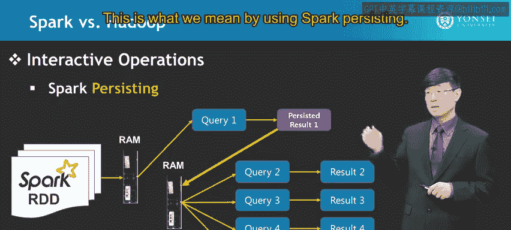
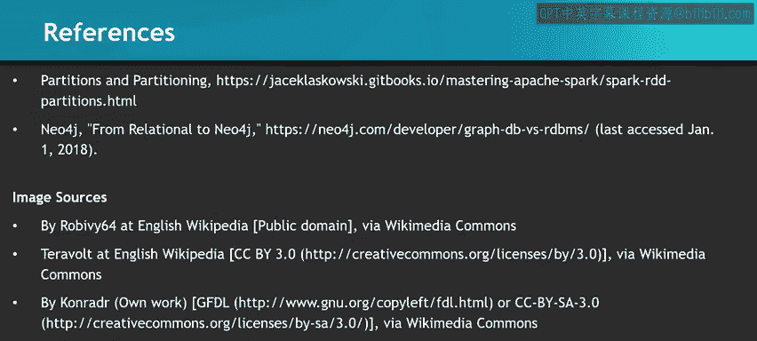

# 17：16_3.4 Spark与Hadoop的比较 🔄

在本节课中，我们将学习Spark系统的工作原理，并将其与我们已经了解的Hadoop架构进行比较。我们将重点探讨Spark相较于Hadoop的优势，包括其更快的分析能力、实时数据处理、机器学习功能以及其高性能背后的技术原理。

我们已经了解了Hadoop的结构，现在让我们通过对比Hadoop和Spark来理解Spark系统的工作原理以及Spark的优势。

## Spark的优势 🚀

与Hadoop相比，Spark的优势包括更快的分析能力。

由于这些原因，Spark还拥有Spark Streaming技术，能够进行实时数据流分析。

Spark Streaming使用微批处理技术。

机器学习功能是Spark的另一个主要优势。

机器学习库拥有可编程的算法，这些算法能够思考并根据变化的条件自动更新。

机器学习需要通过统计建模和模拟进行学习的能力。

基于变化的条件，推导并适应理想的解决方案。

Spark速度更快的另一个原因是它使用随机存取存储器。

你可以看到Hadoop速度较慢，因为它使用硬盘驱动器，而基于RAM的操作要快得多。

如果数据批处理的大小超过了Spark内存中RAM的大小，那么溢出的缓存数据集可以转移到本地存储器。

选项一是固态硬盘，选项二是硬盘驱动器。当然，固态硬盘作为选项一是更优选择，因为它要快得多，我们很快就会研究速度选项。

溢出的缓存数据集在需要时会按需重新计算。

## 速度比较 ⚡

我们将基于每秒比特数的单位来比较近似速度，使用这里的这个符号。

从CPU到硬盘驱动器，访问时间大约为2到12毫秒，而数据本身的传输速度约为每秒800兆比特。

观察CPU到固态硬盘，它的访问时间要短得多，数据传输速度约为每秒4.8千兆比特。这快了6倍。

然后从CPU到RAM，访问时间将为0.0001到0.05毫秒，这个值要小得多，数据传输速率将达到每秒80千兆比特。

这比固态硬盘快16.7倍，比硬盘快100倍。

此外，还有网络速度。我们有千兆以太网，速度为每秒1千兆比特或更高；快速以太网，速度为每秒100兆比特；以及以太网，速度为每秒10兆比特。

协议的细节会像这里列出的这样：对于千兆以太网、快速以太网，这些是标准；对于以太网，这些是标准。

综合来看所有速度，你可以看到RAM到CPU是最快的，其次是SSD到CPU，而HDD到CPU是三者中最慢的。

此外，你还可以看到，基于网络，千兆或每秒100兆比特的网络速度。

Spark系统的设计考虑了这些速度差异，并进行了整体优化，以在集群上以分布式处理方式提供最大性能。

## MapReduce功能 🔧

MapReduce支持在集群上使用并行分布式算法处理和生成大型数据集。

它使用户能够使用高级操作符轻松分析数据。

它易于在数据库集群上执行并行计算。

它负责工作分配。

它具有高可靠性和容错性。

MapReduce存在哪些问题？数据共享和多阶段MapReduce作业处理通常通过从HDFS读取数据、执行MapReduce、将输出写入HDFS，然后一遍又一遍地重复这个过程来完成。

研究表明，许多Hadoop应用程序花费超过90%的时间在HDFS上进行读写操作。

这是一个耗时的过程，Spark通过利用内存中的RAM减少了这个时间。

对于需要分布式数据、并行作业处理和共享的迭代和交互式应用程序，Hadoop会很慢。

MapReduce在数据共享方面速度慢，原因是复制、序列化和磁盘输入输出耗时。我们当然会更多地讨论这些因素，我已经在我的Hadoop讲座中谈到了复制因子，也将包括关于序列化的更多细节。

迭代操作是一个多阶段过程，在应用程序的一系列计算中重复使用中间结果。

与Spark RDD相比，Hadoop速度较慢，因为它需要多次读写HDFS。

而Spark速度更快，因为它使用并利用了内存中的RAM。

观察Hadoop的MapReduce部分，你会看到从HDFS读取数据，进行映射处理，然后保存回HDFS，接着再次读取以进行归约处理，然后再保存回去。

从宏观角度看迭代操作，你可以看到从HDFS到MapReduce到HDFS到Reduce，这个过程可能会重复多次，最终回到Hadoop HDFS。

而在Spark中，RAM的处理过程将介入，而不是返回HDFS的过程，这将极大地加快处理速度，特别是对于需要重复多次的内部部分，RAM的速度优势将是巨大的，最终结果可以保存在Cassandra中。

## 交互式操作 💬

交互式操作是在相同数据上运行多个查询的操作，Spark在这方面具有巨大优势。通常需要在同一数据集上并行执行的查询。

对于Hadoop，MapReduce将在硬盘上的同一数据集上进行多次写入和读取以运行这些多个查询。

每个查询将通过硬盘的输入输出端口单独对硬盘进行写入和读取，这可能主导整个消耗的时间。

例如，观察Hadoop，HDFS有我们需要处理的这五个查询，轮流读取可能非常繁琐，例如一、二、三、四、五，以满足这五个查询并获得这五个结果。

在Spark中，我们有默认的RDD处理能力，它使用Spark DAG，这是一系列设置的转换，然后它们以最优化的方式一起执行。

每次执行一个动作时，这些都会重新计算。

由于更快的RAM输入输出速度，Spark在交互式操作中比Hadoop快得多。

使其如此快速的关键因素之一，除了使用RAM之外，就是持久化RDD处理。

现在，在DAG中，一个特定的RDD处理输出可以保存在RAM上。

它可以用于额外的基于查询的处理。

由于RDD中间处理结果被持久化，它可以立即被交互式查询重用，无需额外处理。

Spark比Hadoop快得多。

例如，从Spark RDD，我处理它并将其保存在RAM上，然后我可以与我的这些查询共享它。

此外，我可以持久化它，换句话说，如果需要中间结果，那么我将继续执行查询1，然后持久化结果1，我将使用结果1，将其发送回RAM，然后用它来满足这些查询。

因此，这些查询不需要重复执行查询1，那是它们需要处理的一部分。然后我可以更快地获得这些结果。这就是我们所说的使用Spark持久化。

## 灵活性与任务切换 🔄

在比较Hadoop和Spark的处理速度时，我们需要考虑的另一点是灵活性和任务切换。

在Hadoop中，作业跟踪器设置任务跟踪器，每个任务跟踪器将槽位分配为映射槽或归约槽。

在应用程序过程中，槽位分配不能动态更改。

任务跟踪器对槽位功能的重新分配需要作业跟踪器的许可，这需要时间。

在Spark中，分配给核心的转换或任务的交换是灵活且快速的，因为它是基于线程的。

与Hadoop相比，Spark速度更快，并且可以轻松更改分配给核心的转换或任务的处理线程。

此外，还有并行处理速度。Spark基于在多个核心上同时操作的多个线程执行并行处理。

Hadoop基于预定义的映射和归约槽，通过同时控制多个进程ID来执行并行处理。

这就是为什么Spark具有更高的利用率，当然是与Hadoop相比。

这些是我使用的参考资料，我推荐给你。谢谢。

---

在本节课中，我们一起学习了Spark与Hadoop的核心比较。我们探讨了Spark在速度上的优势，这主要源于其对内存的利用、更高效的DAG执行引擎以及灵活的线程模型。我们还分析了MapReduce的局限性，特别是其在迭代和交互式工作负载中因频繁磁盘I/O导致的性能瓶颈。最后，我们了解了Spark如何通过持久化RDD和灵活的并行处理来优化这些场景。理解这些差异有助于我们根据不同的数据处理需求选择合适的工具。