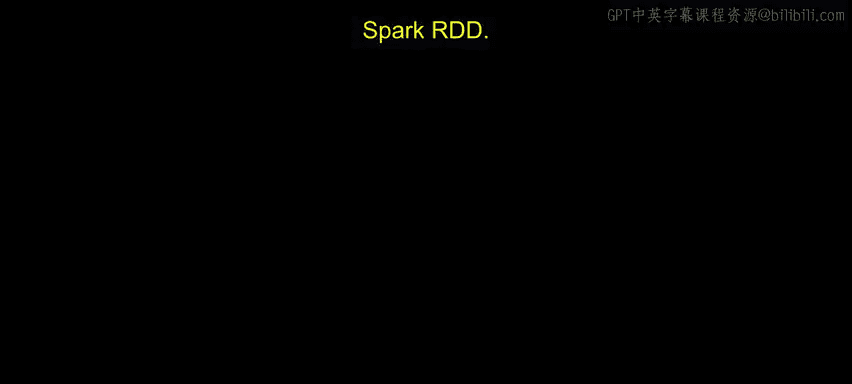
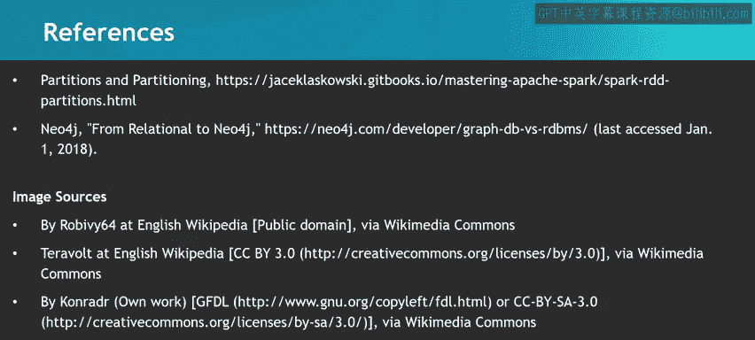

# 延世大学《新兴技术从智能手机到物联网再到大数据》课程 - P18：Spark RDD 核心概念解析 🚀

在本节课中，我们将学习 Spark 的核心数据结构——弹性分布式数据集（RDD）。我们将详细探讨其定义、核心特性、分区机制以及相关操作，帮助你理解其在分布式数据处理中的关键作用。

---

## 什么是 Spark RDD？💡

Spark RDD 代表 **弹性分布式数据集**。它是一系列确定性转换和操作作用于存储数据、另一个 RDD 或一组 RDD 的结果。RDD 这个词由 **弹性**、**分布式** 和 **数据集** 三个术语组合而成。

接下来，我们将逐一深入探讨这三个核心概念。

---

## RDD 的核心特性

### 1. 弹性

“弹性”意味着 RDD 是一个**容错的数据集合**。RDD 能够从节点故障中自动恢复，因此我们说它是容错的。它也被描述为**不可变的分布式对象或数据集合**。

### 2. 分布式

“分布式”源于**分布式数据集的并行处理**概念。数据集的每个逻辑分区都可以在集群的不同节点上进行计算。转换操作在 RDD 创建时是**惰性**的。用于持久化和缓存的函数列在括号中。

### 3. 数据集

RDD 将每个数据划分为**逻辑分区**。RDD 使用的是**只读的、分区的数据集合**。所有类型的 Python、Java、Scala 对象都可以在 RDD 中处理。

**不可变数据**意味着如果需要，它可以被重新创建。它源于对输入数据集应用的一系列确定性转换。因此，不可变性使得保存、复制和共享变得非常容易和高效。不可变性有助于解决多线程同时读写更新的问题。此外，它可以安全地在进程和节点之间共享和分发。

---

上一节我们介绍了 RDD 的基本定义和三大特性，本节中我们来看看 RDD 的持久化机制。

### 持久化

在内存中持久化数据集可以**提高跨多个操作的数据处理速度**。持久化的 RDD 使节点将其转换后的数据存储在其分区内存中，以便快速重用于对数据进行的其他操作。我们之前已经在一个例子中看过这一点。

RDD 持久化使用 **DAG（有向无环图）** 和**惰性转换**来帮助为要执行的多个操作调度优化的 RDD 持久化。

---

## RDD 的分区

RDD 分区是 RDD 或更大数据集的**逻辑划分块**。所有 RDD 都被划分为分区。RDD 数据处理的主要单位就是分区。RDD 会自动对数据集进行分区。程序员可以控制分区的数量和大小，以便在 Spark 中更有效地支持应用程序。

以下是 Spark RDD 关于 HDFS 的默认分区设置：
*   **Spark RDD 对 HDFS 的默认分区大小是 64 MB**，这是 HDFS 的标准块大小。
*   **Spark RDD 对 HDFS 的最大分区大小是 2 GB**。

基于此，你可以看到一个分区的大小以及它如何在系统中运行。

---

## RDD 的组件与操作

### 元数据与数据类型

RDD 分区和数据放置中考虑的数据和对象类型包括：
*   **结构化数据**
*   **半结构化数据**
*   **非结构化数据**

### 转换中的任务

在转换中，函数被应用于处理数据分区。我们将看到父 RDD 经过一个函数（即转换）后，会产生一个子 RDD。

父 RDD 与子 RDD 的比例可以是：
*   **一对一**
*   **N 对一**
*   **一对 M**
*   **N 对 M**（即多对多）

对于这些未预定义的数量，我使用 N 和 M 作为变量。

---

## RDD 的类型

RDD 包含多种类型，以下是部分示例：
*   HadoopRDD
*   FilteredRDD
*   JoinedRDD
*   MappedRDD
*   PairedRDD
*   ShuffledRDD
*   UnionRDD
*   PythonRDD
*   DoubleRDD
*   JdbcRDD
*   JsonRDD
*   **SchemaRDD**
*   VertexRDD
*   EdgeRDD
*   CassandraRDD
*   GeoRDD

其中，**SchemaRDD** 值得我们进一步了解。

---

## 深入理解 SchemaRDD

SchemaRDD 是一个**具有关联模式的 RDD**。它拥有所有标准 RDD 函数，并且可以用于关系查询。

创建 SchemaRDD 的方法包括：
1.  从外部源加载数据到 SchemaRDD 形式。
2.  应用将标准 RDD 转换为 SchemaRDD 的方法。
3.  导入 SQL 上下文。
4.  在 SQL 上下文上应用 `createSchemaRDD` 函数。

SchemaRDD 可以在其导入的 SQL 上下文中**注册为一个表**。并且，注册为表的 SchemaRDD 可以用于 SQL 语句中。

---

## 总结

本节课中，我们一起学习了 Spark 的核心——弹性分布式数据集（RDD）。我们从其名称的由来讲起，深入探讨了其**弹性**、**分布式**和**数据集**三大核心特性。我们了解了 RDD 的**分区机制**、**持久化**原理以及各种**转换操作**。最后，我们还特别介绍了 **SchemaRDD** 这一特殊类型，它结合了 RDD 的灵活性和关系型数据库的结构化查询能力。理解 RDD 是掌握 Spark 并行与分布式计算模型的基础。

---

**参考资料**：以上内容基于课程提供的资料整理，推荐你进一步查阅相关官方文档和教程以加深理解。