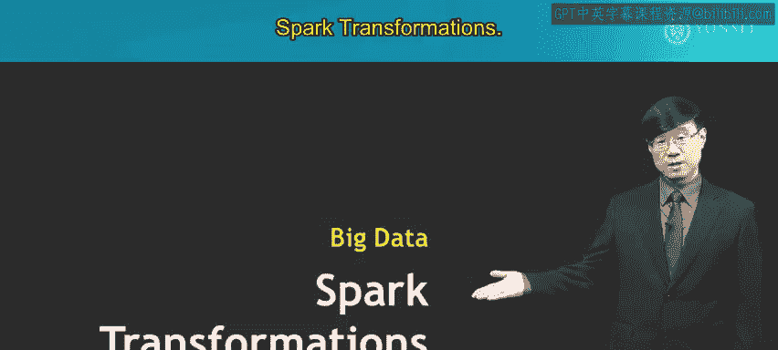
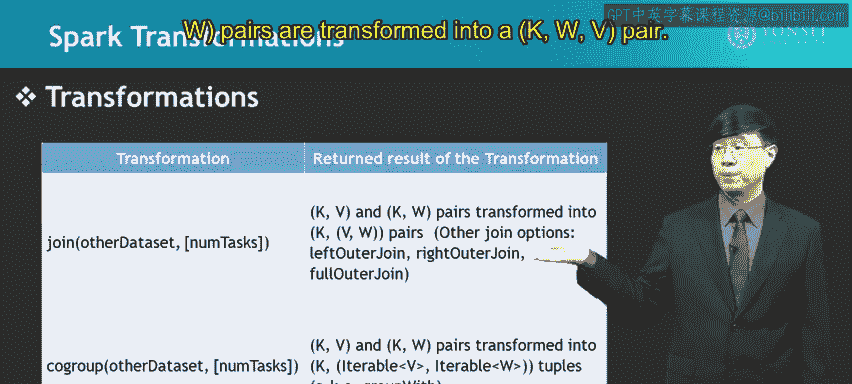
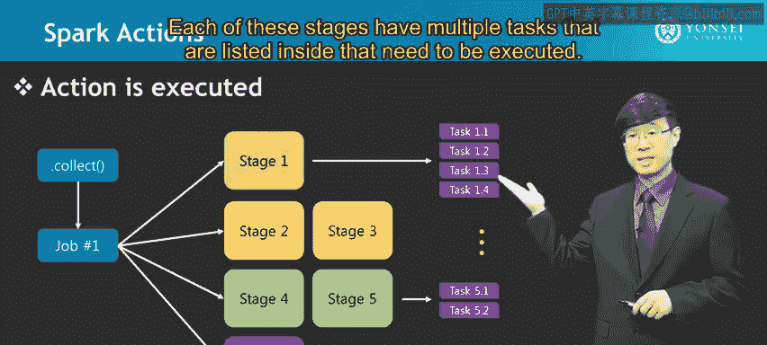
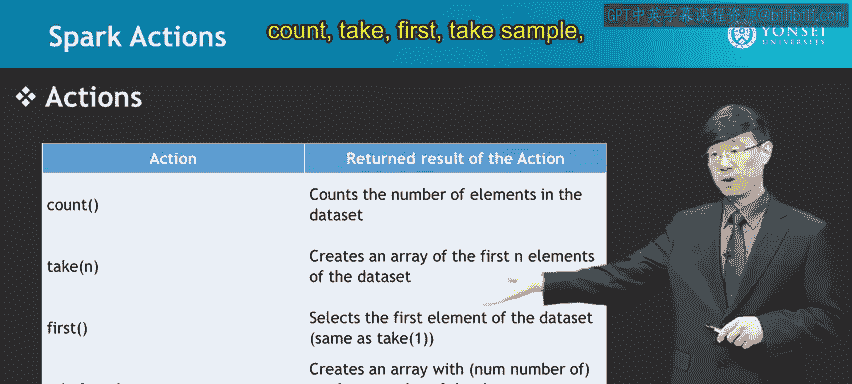
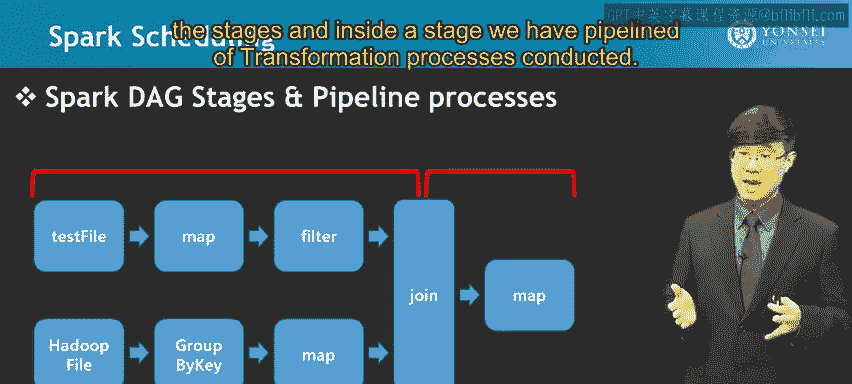
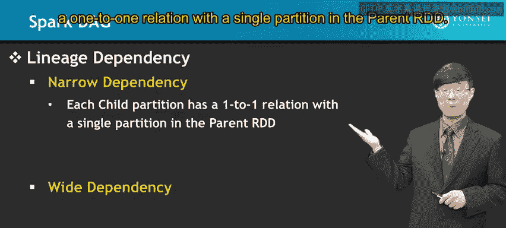
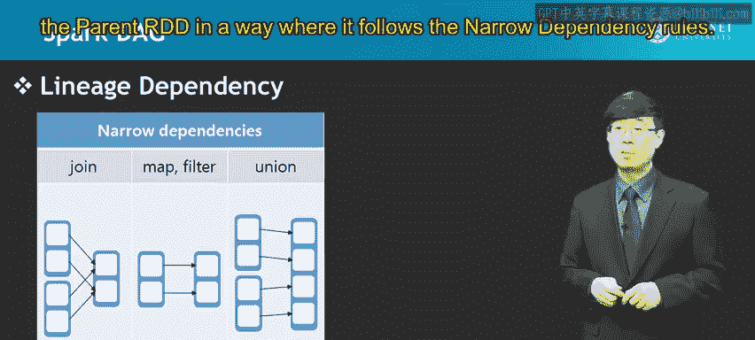
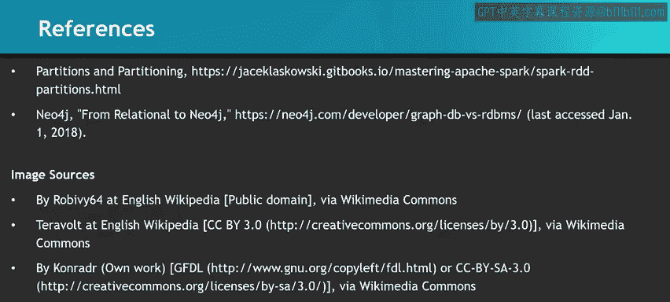

# 19：Spark转换、动作与DAG 🚀

在本节课中，我们将学习Apache Spark的核心概念：转换（Transformations）、动作（Actions）和有向无环图（DAG）。我们将了解不同类型的转换操作，理解动作如何触发计算，并探索Spark如何利用DAG进行高效的惰性计算和容错。

---

## 3.6 Spark转换 🔄

上一节我们介绍了Spark的基础。本节中，我们来看看Spark转换。转换是对弹性分布式数据集（RDD）的操作，它从一个RDD创建出一个新的RDD。转换是惰性的，意味着它们不会立即执行，而是记录下要执行的操作。

以下是主要的Spark转换操作：

*   **map**：将源数据的每个元素通过一个函数进行转换。函数定义在`map`的括号内。
    *   **代码示例**：`rdd.map(lambda x: x * 2)`
*   **filter**：根据定义的函数，筛选出结果为`True`的元素。
*   **flatMap**：将每个输入项映射为零个或多个输出项，输出一个序列。
*   **mapPartitions**：在每个RDD分区上分别运行函数。
*   **mapPartitionsWithIndex**：运行`mapPartitions`并提供分区的索引值。
*   **sample**：基于给定的比例，使用随机种子对数据进行采样（可放回或不放回）。
*   **union**：创建源数据与其他数据元素的并集。
*   **intersection**：输出源数据与其他数据元素的交集。
*   **distinct**：选择源数据集中的不重复元素。
*   **groupByKey**：将键值对（KV）转换为另一种格式（按键分组）。
*   **reduceByKey**：将KV对转换为KV对，其中每个键通过一个归约函数进行聚合。
*   **join**：将KV对和KW对转换为K(V, W)对。
*   **cogroup**：将KV对和KW对转换为K(iterable<V>, iterable<W>)格式。
*   **cartesian**：将类型为T和U的数据集转换为(T, U)元素对。
*   **pipe**：将每个RDD分区通过一个shell命令管道传输。
*   **coalesce**：将RDD分区的数量减少到转换中指定的数量。
*   **repartition**：将RDD分区的数量更改为`numPartitions`，并随机重新洗牌数据以在分区间实现数据平衡。
*   **repartitionAndSortWithinPartitions**：更改RDD分区数量，并在每个分区内根据键对记录进行排序。

---

## 3.7 Spark动作 ⚡

上一节我们介绍了各种转换操作。本节中我们来看看Spark动作。动作是返回结果到驱动程序或将结果写入存储系统的操作。**当动作被执行时，一个作业（Job）才会启动运行**。

一个作业包含多个串行和并行的阶段（Stage）。每个阶段又包含多个任务（Task），这些任务在RDD的每个分区上并行执行。

例如，当执行`collect`动作时，会启动一个作业来运行该动作。该作业被划分为多个阶段，其中一些阶段可以并行运行。每个阶段内部又包含多个需要执行的任务。

以下是主要的Spark动作：

*   **reduce**
*   **collect**
*   **count**
*   **first**
*   **take**
*   **takeSample**
*   **takeOrdered**
*   **saveAsTextFile**
*   **saveAsSequenceFile**
*   **saveAsObjectFile**
*   **countByKey**
*   **foreach**

---

## 3.8 Spark有向无环图 (DAG) 🕸️

上一节我们了解了动作如何触发计算。本节将深入探讨Spark执行计划的核心——有向无环图。DAG代表有向无环图，它是在RDD上执行的一系列串行和并行计算序列。

转换的计算序列，形成了从父RDD到子RDD关系的链条，这被称为**血统图（Lineage Graph）**。当我们讨论DAG时，会用到“惰性转换”这个术语。

### 什么是惰性转换？

在DAG建立的过程中，**没有任何转换会被执行**，因此我们称之为“惰性”。所有转换及其串行和并行处理序列都在程序中设置好。当这个结构完成后，我们称之为一个DAG。它被称为“有向无环图”是因为转换形成了一个图处理过程，并且图中没有循环。

**当执行一个动作（如`collect`）时**，调度器会找到执行DAG的最优方式。此时，操作才会真正执行。调度器以最优方式执行DAG血统图中的所有转换，动作将一切整合运行，并将结果交付输出。

### DAG处理示例与阶段划分

一个常见的处理示例是：从HDFS读取 -> 包含连接（join）和洗牌（shuffle）的映射组合 -> 分区归约 -> 写回HDFS。这种过程会重复进行。

在Spark DAG和阶段示例中，例如，`groupByKey`和`join`操作需要洗牌过程，因此它们构成了阶段边界。而像`map`和`filter`这样的操作则可以一起流水线化（pipelined）。

观察一个DAG结构，在到达`join`操作之前的部分可以是一个阶段，其中从`map`和`filter`开始的所有过程都可以流水线化以到达`join`。阶段内的这些函数可以一起流水线化。`join`之后经过`map`的最终阶段也可以一起流水线化。因此，图中红线指示的分离区域就是不同的阶段，阶段内部我们进行的是转换过程的流水线执行。

### 惰性转换的优势

Spark中使用的惰性转换具有以下优势：
1.  **高度优化**：调度器在检查完整个需要完成的DAG工作序列后，才决定最优的数据处理方法，因此效率极高。
2.  **避免不必要的操作**。
3.  **更有效地共享处理能力**。
4.  **减少内存消耗**。

### DAG调度流程

1.  在RDD上调用一个动作。
2.  Spark创建DAG并将其提交给DAG调度器。
3.  DAG调度器将操作符划分为多个任务阶段。
4.  每个阶段由基于RDD输入数据分区的任务组成。
5.  DAG调度器将操作符流水线化在一起，多个操作符可以在单个阶段中调度。
6.  DAG调度器的最终结果是一组待处理的阶段。
7.  阶段被传递给任务调度器。
8.  任务调度器通过集群管理器（Spark独立模式、Mesos或YARN）启动任务。
9.  任务调度器不知道阶段之间的依赖关系。
10. 工作节点在从节点上执行任务。

### RDD弹性与依赖关系

RDD是一个跨机器集合分区的只读对象集合。RDD数据可以在多个节点上缓存，并在多个并行操作中重用。它提供了基于血统的容错能力。如果一个分区丢失，RDD血统被用来仅重建丢失或出错的分区部分，这就是其“弹性”的由来。

转换类型包括**窄转换**和**宽转换**：
*   **窄转换**：数据仅在分区内进行洗牌。例如：`map`, `filter`, `union`。
*   **宽转换**：数据在不同的分区之间进行洗牌。例如：`groupByKey`, `reduceByKey`。

这导致了血统依赖关系，同样我们可以称之为**窄依赖**和**宽依赖**。

*   **窄依赖**：每个子分区与父RDD中的**单个**分区存在一对一关系。父RDD的每个分区最多被一个子分区使用。
    *   例如，`join`（在某些条件下）、`map`、`filter`或`union`的窄依赖关系。
*   **宽依赖**：子分区与父RDD中的**多个**分区存在一对多关系。父RDD的分区被用于多个子分区。
    *   例如，`groupByKey`或某些`join`操作中的宽依赖关系。你可以看到子RDD分区是从父RDD的多个分区创建的，因此被称为更“宽”的依赖。

---

本节课中，我们一起学习了Spark的转换操作、动作执行以及有向无环图（DAG）的核心原理。我们理解了转换的惰性特性、动作如何触发实际计算，以及DAG如何通过阶段划分和流水线执行来优化任务调度。此外，我们还探讨了RDD基于血统的容错机制和窄/宽依赖的区别，这些是Spark实现高效、弹性分布式计算的基础。