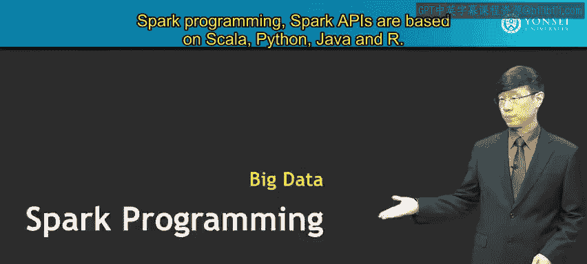
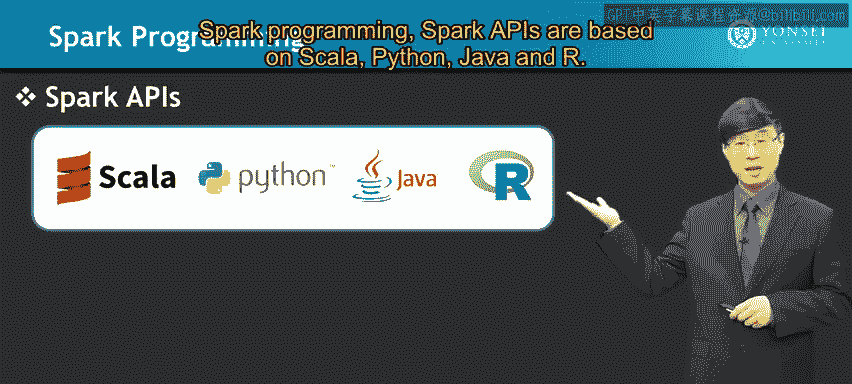
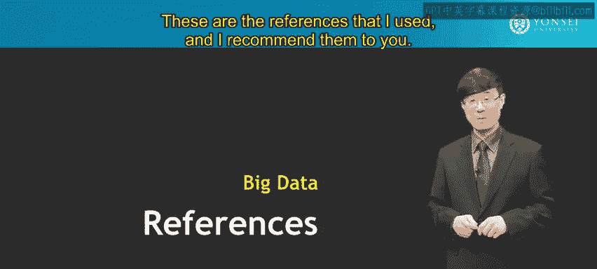
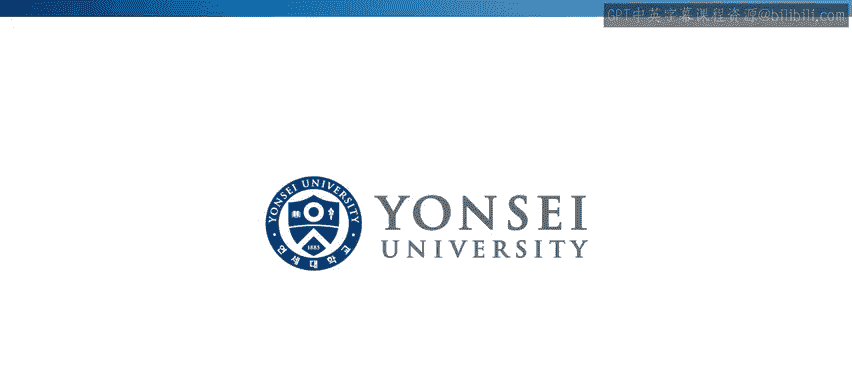

# 20：19_3.9 Spark编程 🚀

在本节课中，我们将要学习Apache Spark编程的基础知识，包括其支持的编程语言API、核心编程概念以及如何高效地编写Spark程序。

---

## Spark API概述

Spark提供了多种编程语言接口，便于不同背景的开发者使用。这些API基于Scala、Python、Java和R语言构建。

API包含函数、子例程、协议和工具，用于构建和执行应用程序软件。一个优秀的API应具备以下特点：
*   易于高效地进行软件编程。
*   功能多样且强大。
*   易于管理、控制和适配。
*   具备出色的可扩展性，便于扩展并实现快速性能。

---

## 支持的编程语言

上一节我们介绍了Spark API的通用特性，本节中我们来看看它所支持的具体编程语言及其特点。

以下是Spark支持的主要编程语言：

1.  **Java**
    *   这是一种通用计算机编程语言，是客户端-服务器Web应用开发平台中最流行的语言之一。
    *   它支持面向对象、命令式、泛型、反射式和并发多范式编程。
    *   由Sun Microsystems于1995年首次发布，后由Oracle公司收购。
    *   其语法与C/C++相关，文件扩展名包括 `.java`、`.class` 和 `.jar`。

2.  **Scala**
    *   Scala是一种基于Java和JVM的多范式API。
    *   它支持函数式、面向对象、命令式和并发多范式编程。
    *   首次出现于2004年，文件扩展名包括 `.scala` 和 `.sc`。

3.  **Python**
    *   Python是一种通用高级编程语言，于1991年首次发布。
    *   其设计哲学强调代码可读性，相比C/C++或Java能实现更高效的编程。
    *   它包含动态类型系统和自动内存管理功能，支持面向对象、命令式、函数式和过程式多范式编程。
    *   文件扩展名包括 `.py`、`.pyc`、`.pyd`、`.pyo`、`.pyw` 和 `.pyz`。

4.  **R**
    *   R是一种用于统计计算和数据挖掘软件开发的免费编程语言，因此在大数据分析中极具吸引力。
    *   主要用C、Fortran和R本身编写，支持数组、面向对象、命令式、函数式、过程式、反射式多范式。
    *   首次出现于1993年8月，由R核心团队开发，R统计计算基金会支持。
    *   文件扩展名包括 `.R`、`.rdata`、`.rds` 和 `.rda`。

---

## Spark编程核心概念

了解了编程语言后，我们进入Spark编程的核心环节。编写Spark程序时，需要理解并应用几个关键概念。

使用上述API（Scala、Python、Java、R）进行Spark编程时，需要考虑RDD的创建方法。您可以通过并行化集合或从数据文件系统（如HDFS、Cassandra或Amazon S3）读取数据来创建RDD。

驱动程序在编程时需要考虑以下问题：
*   将要使用的Spark核心数量。
*   集群中将使用的节点数量。
*   RDD的分区数量应与集群中使用的节点数量成比例，以充分利用集群的计算能力，实现更高的效率和更快的处理速度。

分区越多，并行度越高。集群上的节点数量应与RDD中的分区数量成比例。例如，对于一个拥有1000个节点、5000个核心的集群，可以考虑将RDD设置为1000个分区。

---

## Spark作业执行流程

掌握了核心概念，本节我们来看看一个Spark作业是如何被调度和执行的。

驱动程序基于一系列转换构建一个有向无环图（DAG）。驱动程序将工作分配给工作节点。在一个工作节点上，执行器JVM可以处理多个分区。

**动作**（Action）会触发DAG和并行计算。多个RDD对象构建了操作符DAG，其中父RDD会经过一个或多个转换阶段，最终生成子RDD。

DAG中的持久化操作会被识别，可重用的部分会被缓存在中间RDD中。每个RDD分区都将通过一个计算线程执行一个任务。

一个作业被划分为多个阶段，每个阶段又被划分为多个任务。DAG调度器将DAG图拆分为多个阶段和多个任务以供执行。任务调度器执行各个任务。JVM执行器使用任务线程和块管理器执行任务，然后块被处理，结果存储在子RDD中。

---

## 总结

本节课中我们一起学习了Spark编程的基础。我们了解了Spark支持Scala、Python、Java和R等多种API语言，探讨了高效编程需要考虑的核心因素，如资源分配和RDD分区策略，并梳理了从驱动程序构建DAG到任务在集群上最终执行的完整作业流程。理解这些概念是编写高效Spark应用程序的关键。

---

**参考资料**：以上内容基于课程提供的参考资料进行整理。