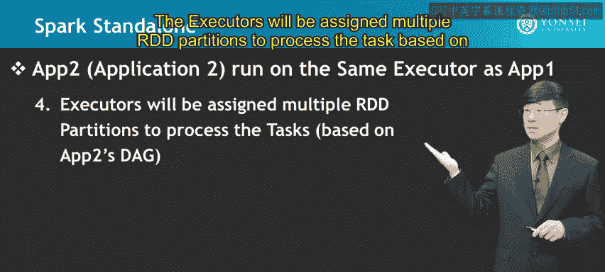
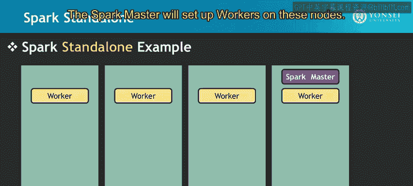
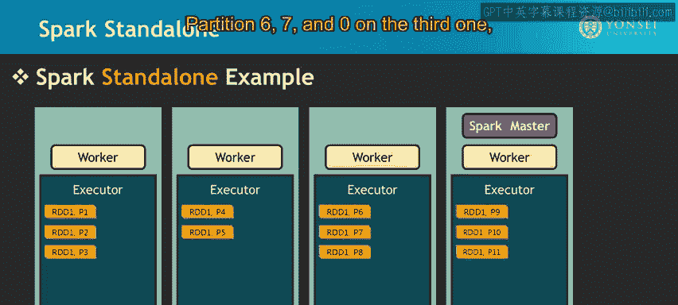
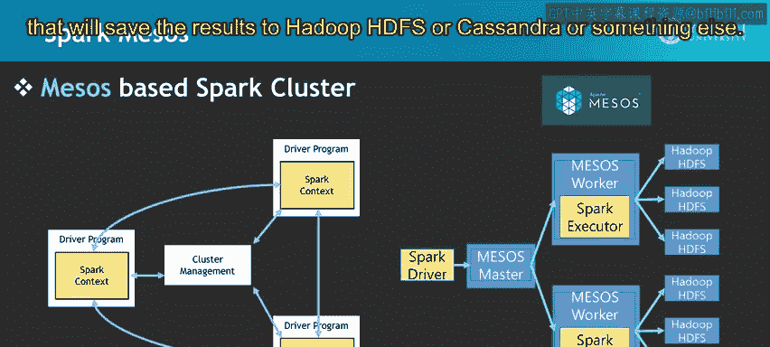
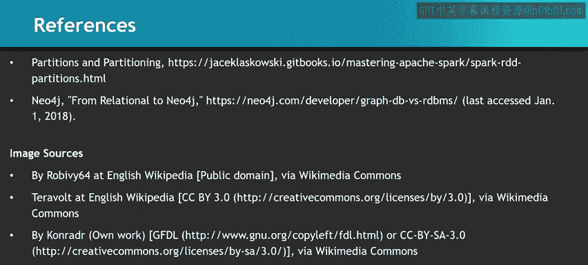

# 22：Spark集群操作详解 🚀

在本节课中，我们将学习Spark集群的三种主要管理方式：独立模式、YARN和Mesos。我们将深入探讨Spark集群的调度层次、任务执行流程，并详细比较不同集群管理模式的架构与特点。

---

## 3.12 Spark集群操作

上一节我们回顾了Spark的核心概念，本节中我们来看看Spark在集群环境中的整体操作流程。

Spark集群管理方法主要包括独立模式、YARN和Mesos。Spark中央主节点（Master）负责执行器的启动和任务执行调度。

在深入集群管理之前，让我们再次回顾Spark的操作流程。以下是其调度层次结构：

Spark集群调度器包括YARN、Mesos和独立模式调度器。在此之上，我们有RDD和各类库。DAG调度器将DAG划分为多个阶段，这些阶段进一步被分解为以串行和并行模式运行的多个任务。任务调度器处理每个阶段内的任务，而执行器则利用其核心（CPU核心）通过线程处理这些任务。

以下是Spark调度过程的一个示例：
1.  多个RDD对象通过转换操作形成DAG。
2.  这些转换是惰性的，直到一个行动操作被触发。
3.  作业开始运行，包含多个串行和并行的阶段。为此，系统会审视整个DAG并制定调度计划。
4.  每个阶段并行执行多个任务。
5.  父RDD经过DAG操作后生成子RDD。
6.  每个任务处理一个分区，最终形成输出RDD。

当行动操作触发时，Spark驱动程序的JVM会使用DAG调度器将整个DAG划分为多个阶段。每个阶段被分配给任务调度器。任务调度器将任务分配给执行器进行处理。执行器利用其核心通过线程处理任务。块管理器（Block Manager）负责提供数据块并存储处理输出。

当一个阶段的所有任务处理完成后，任务调度器会通知DAG调度器。如果还有未处理的阶段，DAG调度器会继续分配新的阶段给任务调度器。当作业的所有阶段都完成后，最终的子RDD将被存储。

---

## 3.13 Spark独立模式

基于对Spark操作流程的理解，本节我们具体看看第一种集群管理方案：Spark独立模式是如何工作的。

在Spark独立模式下，Spark主节点（Master）设置在集群中的一个节点上。工作节点（Workers）则设置在集群的多个节点上。Spark主节点和工作节点都是JVM进程，处理负担相对较轻。

以下是其工作流程：
1.  应用程序1（App1）启动驱动程序1（Driver 1）在选定的节点上运行。
2.  驱动程序1运行作业1，并与作为调度器的Spark主节点通信，调度作业1的执行。
3.  Spark主节点（SM）指示选定的工作节点在其执行器（JVM进程）上处理作业1的任务。
4.  一个作业由多个阶段组成，一个阶段由多个任务组成。
5.  执行器根据App1的DAG被分配多个RDD分区来处理任务。
6.  每个执行器识别其节点上的多个核心，用于处理App1的线程。
7.  多个线程被分配给各个核心，可能共享核心以实现并行处理。

如果此时新增了应用程序2（App2），并且它与App1运行在相同的执行器上：
1.  App2启动驱动程序2在选定的节点上运行。
2.  驱动程序2运行作业2，并与Spark主节点通信以调度作业2的执行。
3.  Spark主节点指示选定的工作节点在其执行器JVM上处理作业2的任务。
4.  执行器根据App2的DAG被分配多个RDD分区来处理任务。
5.  每个执行器识别其节点上的多个核心，用于处理App2的线程。

**独立模式示例动画描述**：
1.  在集群中选定节点。
2.  启动Spark主节点。
3.  Spark主节点在这些节点上设置工作节点。
4.  工作节点在这些节点上设置执行器。
5.  执行器需要核心来执行任务。
6.  对于RDD1，分区被分配到不同工作节点的执行器上。
7.  作业被划分为阶段，阶段又划分为多个任务，这些任务在串行和并行模式下运行。
8.  任务形成线程，进入核心执行。
9.  如果有另一个作业需要执行，RDD2的分区也会被分配到多个节点的执行器上，并经历同样的阶段划分和任务执行流程。

如果App1和App2运行在不同的核心集上，流程会有所不同：
1.  App2启动驱动程序2。
2.  驱动程序2与Spark主节点通信，请求在选定节点上为作业2设置新的执行器。
3.  Spark主节点指示选定的工作节点在新的JVM执行器上处理作业2的任务。
4.  新的执行器根据App2的DAG分配RDD分区来处理任务。
5.  每个新执行器识别其节点上的多个核心，用于处理App2的线程。
6.  这些核心独立于分配给App1作业的核心。

**独立模式的容错性**：
*   **执行器崩溃**：由其上层的**工作节点**恢复。
*   **工作节点崩溃**：由**Spark主节点**恢复。
*   **Spark主节点崩溃**：通过**ZooKeeper**实现高可用性。备份主节点在集群中的另一个节点上复制，可以设置多个备份以提高安全性和可靠性。在作业执行过程中，如果需要也可以添加更多的主节点。

---

## 3.14 Spark on Mesos

了解了独立模式后，我们来看另一种强大的集群管理方案：Mesos。

在独立模式下，集群管理器是Spark主节点。当Spark与Mesos一起使用时，集群管理器则是**Mesos主节点**。Mesos在设计上就支持Spark。

使用Mesos的优势包括：
*   支持Spark与集群中运行的其他框架之间的**动态资源分区**。
*   为在Spark集群上执行的多个作业提供**高效且可扩展的分区支持**。

以下是Spark集群操作与Mesos管理的Spark集群操作的比较：
*   在标准Spark集群中，组件通过中间的集群管理器进行交互。
*   在Mesos中，它有自己的主节点和工作节点。Spark执行器在工作节点内部运行。Spark驱动程序与Mesos主节点交互，Mesos主节点激活与工作节点的协作，并将结果保存到HDFS、Cassandra等存储系统中。

**Mesos操作示例**：
1.  驱动程序创建一个作业。
2.  作业产生多个串行和并行的阶段。
3.  每个阶段包含多个任务。
4.  每个任务被分配处理节点执行器内的RDD分区。
5.  **Mesos主节点**调度执行器将在分区上运行的任务。

**Mesos主节点调度决策基于以下因素**：
*   节点上的剩余资源。
*   执行器上核心的处理能力。
*   短生命周期任务和长生命周期任务的数量。
*   对短生命周期和长生命周期任务处理时长的预估。
*   当前集群中共存的其他框架。
*   资源的动态分区潜在调度方案。

**Mesos运行模式**：

1.  **客户端模式**：
    *   Spark on Mesos的驱动程序Shell程序在客户端计算机上启动。
    *   驱动程序可以交互式地监控和控制进程。
    *   最终的RDD结果数据在客户端驱动程序上显示，并保存到SSD或HDD（如HDFS）。

2.  **集群模式**：
    *   驱动程序在集群中的一个节点上启动。
    *   Mesos集群分发器（MCD）Shell驱动程序在集群节点上启动。
    *   最终的RDD结果数据集在Mesos的Web UI上显示。

**容错**：ZooKeeper可用于故障恢复。Mesos支持将恢复状态写入ZooKeeper。

**Mesos资源分配模式**：

1.  **粗粒度模式**：
    *   执行器的大小由配置变量决定，需考虑执行器的内存大小、核心数量及处理能力。
    *   执行器数量基于应用程序的统计信息。
    *   粗粒度模式的启动开销非常小。
    *   **限制**：在粗粒度模式下，分配给应用程序的Mesos资源在应用程序结束前无法更改。

2.  **动态分配模式**：
    *   从名称可知，此模式具有更强的动态适应性。
    *   Mesos支持在粗粒度模式基础上进行动态分配。
    *   每个作业根据执行器所需和可用资源进行动态配置。

---

**本节课总结**：
本节课我们一起深入学习了Spark的集群操作。我们首先回顾了Spark的调度流程，然后详细探讨了三种集群管理模式。重点分析了**Spark独立模式**的架构、多应用资源分配以及容错机制。接着，我们介绍了**Spark on Mesos**，了解了其动态资源管理的优势、两种运行模式（客户端与集群）以及两种资源分配策略（粗粒度与动态）。理解这些集群管理方式对于在复杂环境中高效部署和运行Spark应用至关重要。