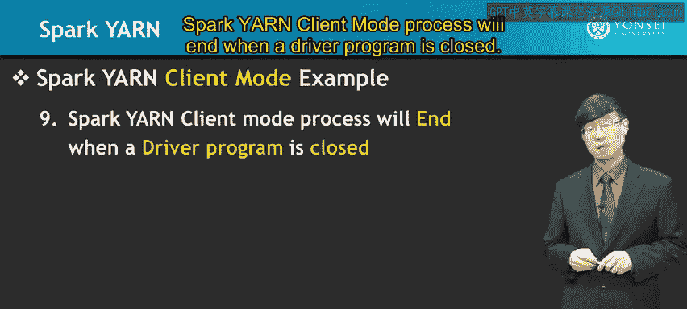
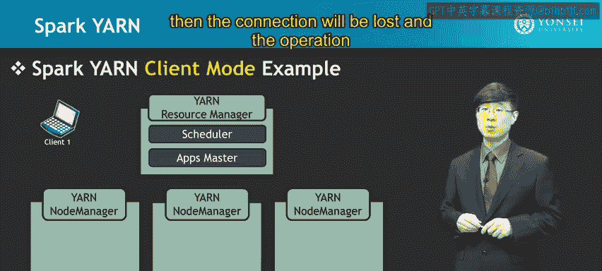
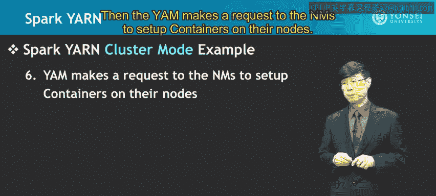
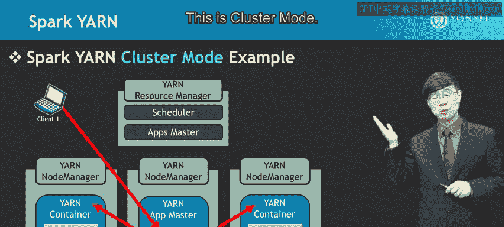
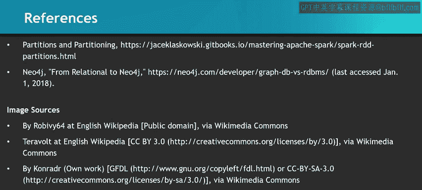

# 23：Spark YARN 🚀

## 概述

在本节课中，我们将要学习 Spark 如何与 YARN 资源管理器协同工作。YARN 是 Hadoop 生态系统中的核心组件，Spark 通过集成 YARN，能够高效地利用现有的 Hadoop 集群资源来处理大数据。我们将重点探讨 Spark on YARN 的两种运行模式：客户端模式和集群模式，并理解它们的工作原理与区别。

---

## Spark YARN 的特点

上一节我们介绍了 Spark 的基本概念，本节中我们来看看 Spark 与 YARN 结合时的关键特性。

Spark on YARN 的主要特点包括：
*   **兼容 Hadoop**：通过使用 YARN 来运行 Hadoop 集群，Spark 能够与 Hadoop 生态系统无缝集成。Hadoop 曾是其时代最著名和主导的大数据技术，至今仍有大量 HDFS 数据库广泛存在。因此，利用 YARN 访问 HDFS 等数据库，并在 Spark 上分析数据，具有很大吸引力。
*   **广泛的数据源支持**：Spark 可以处理任何 Hadoop 输入格式的数据，这非常强大。支持的数据源包括 HDFS、HBase、Cassandra、Hive 等。

---

## 客户端模式

现在，我们深入了解一下 Spark on YARN 的第一种运行模式：客户端模式。

在客户端模式下，应用程序的驱动程序运行在提交任务的客户端机器上，因此得名“客户端”模式。

以下是客户端模式的工作流程步骤：
1.  客户端上的驱动程序向 YARN 资源管理器发送请求。
2.  YARN 资源管理器选择一个资源充足的节点，并请求该节点的 YARN 节点管理器启动一个 YARN 应用主控器。
3.  YARN 资源管理器内的应用主控器会监控并管理多个 YARN 应用主控器，在发生故障时提供恢复。
4.  YARN 应用主控器向 YARN 资源管理器请求在集群中建立多个带有执行器的 YARN 容器。
5.  YARN 资源管理器通知 YARN 应用主控器哪些节点有足够资源建立容器，并发送建立容器所需的信息。
6.  YARN 应用主控器请求 YARN 节点管理器在节点上建立 YARN 容器。
7.  在每个 YARN 容器内部，会建立一个执行器来处理 RDD 分区的任务。
8.  客户端可以通过驱动程序直接与节点上 YARN 容器中的执行器进行交互。
9.  在客户端模式下，客户端可以使用驱动程序接口实时检查执行器中转换和操作的结果。

需要强调的是，驱动程序位于客户端的计算机上。整个流程涉及两级调度器：
*   **YARN 资源管理器调度器**：决定哪些节点运行执行器的 JVM 容器。
*   **驱动程序调度器**：决定在每个执行器上运行的具体任务。它会尝试根据每个节点上缓存的 RDD 数据来优化任务分配。

当驱动程序程序关闭时，Spark YARN 客户端模式进程就会结束。例如，当客户端的驱动 Shell 被终止，或者客户端直接关闭了计算机，客户端模式都将被终止。

---

## 集群模式

了解了客户端模式后，我们来看看另一种模式：集群模式。

在集群模式下，客户端将应用程序和驱动程序提交到集群的资源管理器。此时，YARN 资源管理器负责驱动程序本身，驱动程序不再在客户端计算机上执行，因此我们称之为“集群模式”。

以下是集群模式的工作流程步骤：
1.  客户端提交应用和驱动程序到集群的资源管理器。
2.  资源管理器决定 YARN 应用主控器的部署位置。
3.  应用主控器监控 YARN 应用主控器，确保其正常运行，并在发生故障时提供备份和恢复。
4.  YARN 应用主控器在集群的某个节点上内部启动执行驱动程序。
5.  YARN 应用主控器向资源管理器请求建立多个带有执行器的容器在集群中工作。
6.  资源管理器通知 YARN 应用主控器，哪些节点有足够资源开启新容器以执行操作。
7.  YARN 应用主控器请求节点管理器在其节点上建立容器。
8.  在每个 YARN 容器内部，建立一个执行器来执行 RDD 分区的任务。
9.  最终结果被保存到 HDFS、Cassandra 或其他存储系统中。
10. 客户端可以在之后连接回来，检查保存在 HDFS 或 Cassandra 等地方的结果。

在集群模式下，即使客户端断开连接或关闭计算机，作业仍会在集群中继续运行，直到完成。客户端可以在之后重新连接，通过驱动程序查询结果或从存储系统中获取最终结果。

---

## 总结

本节课中我们一起学习了 Spark on YARN 的两种核心部署模式。
*   **客户端模式**：驱动程序运行在客户端机器，适合交互式调试，但客户端需要保持在线。
*   **集群模式**：驱动程序运行在集群中，适合生产环境，提交作业后客户端可以断开连接。

理解这两种模式的区别和工作原理，对于在实际的 Hadoop 集群上有效部署和运行 Spark 应用程序至关重要。