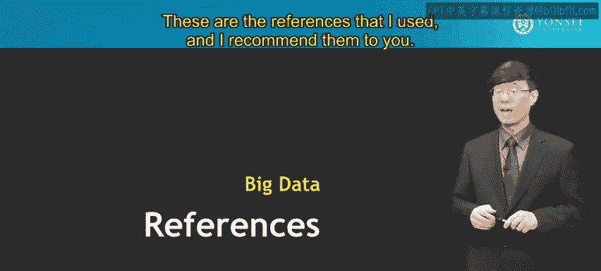

# 延世大学《新兴技术从智能手机到物联网再到大数据》课程 - P24：Spark SQL 与 Spark GraphX 🚀

在本节课中，我们将学习 Apache Spark 生态系统中的两个重要组件：**Spark SQL** 和 **Spark GraphX**。我们将了解它们的功能、核心概念以及如何在实际数据处理中应用它们。

---

## Spark SQL 🔍

上一节我们介绍了 Spark 的核心概念。本节中，我们来看看 Spark SQL，它是一个支持基于 Spark 核心进行 SQL 操作的模块。

Spark SQL 支持将 SQL 查询轻松集成到 Spark 程序中，并且可以使用 Java、Scala 或 Python 进行编程。程序员可以连接到任何数据源，并以相同的方式轻松地跨这些不同类型的数据源连接数据集，这非常方便。

以下是 Spark SQL 的一些关键特性：

*   **数据抽象**：它使用基于 Schema RDD 的数据抽象，并提供基于数据框（DataFrame）的数据提取。
*   **数据支持**：它提供对结构化和半结构化数据的支持，这一点非常重要。
*   **领域特定语言（DSL）**：它提供了用 Scala、Java 或 Python 操作数据框的领域特定语言。
*   **商业智能工具集成**：通过服务器模式提供行业标准的 JDBC 和 ODBC 连接，商业智能工具可以轻松使用。

为了理解 Spark SQL 的操作，我们需要了解一些额外的术语。

*   **数据集（Dataset）**：一个分布式的数据集合。它是 Spark 提供的一个接口，结合了 RDD 的功能和 Spark SQL 的优化功能。它从 JVM 对象构建，并使用转换操作进行处理。
*   **数据框（DataFrame）**：一个按命名列组织的 Dataset。它类似于基于 R 或 Python 的数据框，或关系数据库（RDB）中的表。DataFrame 可以从结构化数据文件、Hive 中的表、外部数据库和现有的 RDD 创建。
*   **数据抽象（Data Abstraction）**：一个获取整个数据集简化表示的归约过程。
*   **ODBC（开放数据库连接）**：一个用于访问数据库管理系统的标准应用程序编程接口（API）。该 API 的设计独立于数据库系统和操作系统。
*   **JDBC（Java 数据库连接）**：一个用于客户端访问数据库的 Java API。它是一个基于 Java 标准版的平台 API，支持数据库查询和更新功能。

---

## Spark GraphX 🕸️

了解了用于结构化数据查询的 Spark SQL 后，本节我们转向用于图计算的 Spark GraphX。

Spark GraphX 是一个分布式图处理框架。它最初由加州大学伯克利分校的 AMPLab 和 Databricks 公司开发，后来捐赠给了 Apache 软件基金会和 Spark 项目。它通过批处理方式检查整个图来推导出最优解和答案。

GraphX 通过提供图计算 API 来实现这一目标，并通过 Spark 中的 GraphX 启用用户自定义图的优化运行时处理。

Spark 的分布式图处理框架当然基于其 RDD。由于 RDD 是不可变的，GraphX 中的图也是不可变的。因此，GraphX 不适合需要更新的数据库图，因为如果更改了 GraphX 的值或结构，将会创建一个新图。一些程序员会将图数据库技术与 Spark GraphX 结合使用。

Spark 的分布式图处理框架基于 RDD，其中整个图的 RDD 被转换为顶点 RDD 和边 RDD 的组合。顶点 RDD 和边 RDD 适合进行图计算，并且易于应用图优化算法。

Spark 的分布式图处理框架基于 RDD，其 API 支持实现大规模并行算法和 MapReduce 风格的 API。Pregel API 支持基于顶点属性在图结构上发送消息进行计算。它支持更高效的分布式执行和图计算的灵活性，并以图的形式提供数据库抽象。

---

## 总结 📚

本节课中，我们一起学习了 Apache Spark 的两个高级组件。

*   我们首先探讨了 **Spark SQL**，它允许我们使用熟悉的 SQL 语法或 DataFrame API 来处理结构化和半结构化数据，并能方便地连接多种数据源。
*   接着，我们学习了 **Spark GraphX**，这是一个用于大规模图计算的框架，它基于 Spark RDD 构建，提供了丰富的图算法和 Pregel API，适用于社交网络分析、推荐系统等场景。

理解这两个工具将帮助你在处理不同类型的大数据任务时，选择更高效、更合适的 Spark 组件。

---

**参考资料**：以上内容基于课程中使用的参考资料，推荐你进一步查阅。