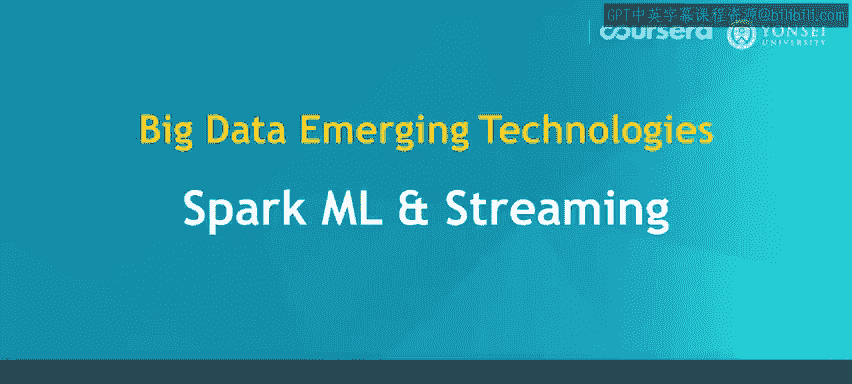
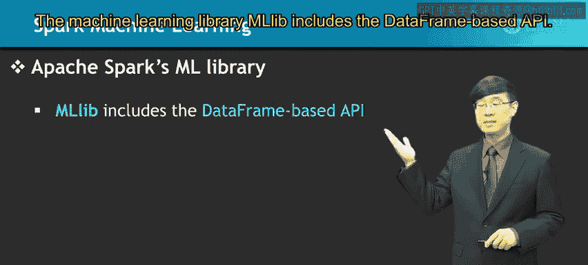
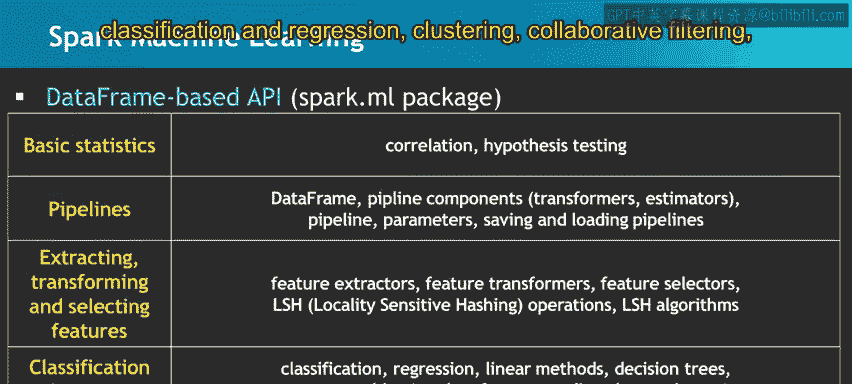
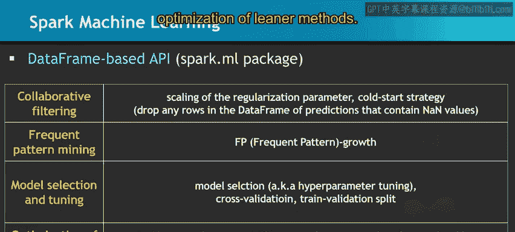
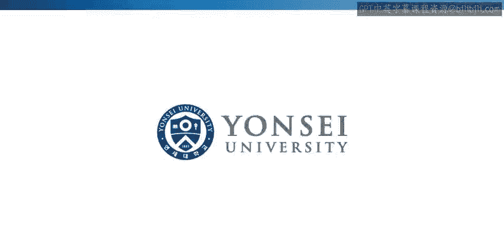

# 延世大学《新兴技术从智能手机到物联网再到大数据》课程 - P26：Spark ML机器学习 🚀

在本节课中，我们将要学习Spark机器学习库（Spark MLlib）的核心概念、主要功能及其基于DataFrame的API。我们将了解它为何易于使用且功能强大，并概览其包含的各类算法与工具。

---

## Spark机器学习库概述

Spark机器学习库易于学习和使用，提供了非常实用的功能。它具有可扩展的性能和高级的机器学习功能。

该库包含机器学习算法、特征化工具、流水线、持久化以及实用工具等。

---

## 深入探究：机器学习算法与工具

上一节我们介绍了Spark MLlib的概况，本节中我们来看看其核心组成部分的细节。

以下是机器学习算法部分包含的工具：
*   用于构建、评估和调优机器学习流水线的工具。

以下是特征化部分包含的工具：
*   特征提取
*   特征转换
*   降维与特征选择

以下是流水线部分包含的算法：
*   分类算法
*   回归算法
*   聚类算法
*   协同过滤算法

以下是持久化部分的功能：
*   保存与加载算法、模型和流水线。

以下是实用工具部分包含的内容：
*   线性代数
*   统计学
*   数据处理

---

## 基于DataFrame的API

机器学习库MLlib包含基于DataFrame的API。

`spark.ml`包中的基于DataFrame的API是Spark的主要机器学习API。

基于RDD的API可以在其他文档中找到，它位于`spark.mllib`包中。该API自Spark 2.0起已处于维护状态，因此在本讲座中我们将重点关注基于DataFrame的API。

以下是基于DataFrame的API所涵盖的主要领域：
*   基础统计
*   流水线
*   特征提取、转换与选择
*   分类与回归
*   聚类
*   协同过滤
*   频繁模式挖掘
*   模型选择与调优
*   线性方法优化

---

## 参考资料

以下是我所使用的参考资料，我推荐给你。

---

本节课中我们一起学习了Spark机器学习库（MLlib）的核心架构与功能。我们了解到它主要提供基于DataFrame的API，涵盖了从特征处理、算法实现到模型调优的完整机器学习工作流，并且易于使用、性能可扩展。