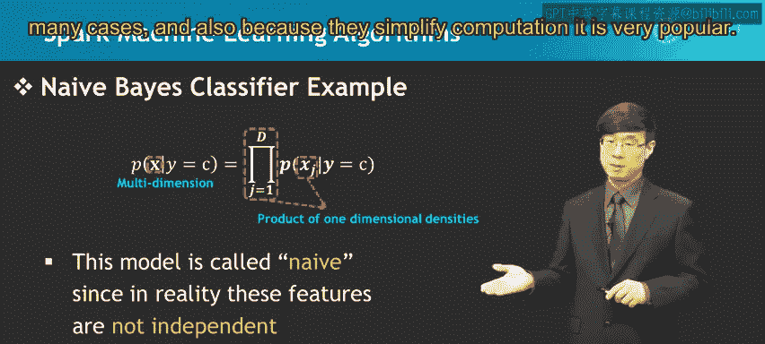

# 延世大学《新兴技术从智能手机到物联网再到大数据》课程 P27：Spark ML算法（第1部分）🧠

在本节课中，我们将要学习Spark机器学习库中的核心算法。我们将从基础统计方法开始，然后深入探讨分类与回归模型，了解它们的基本原理和应用场景。

---

## 基础统计方法 📊

上一节我们介绍了Spark ML算法的概览，本节中我们来看看基础统计方法，主要包括相关性分析和假设检验。

### 相关性分析

变量之间的关系可以是独立的、弱相关的或强相关的。相关性指示了变量之间相互影响、使其增加或减少的程度。

例如，在下图所示的X轴和Y轴上，蓝色点呈现出强相关性。我们知道这一点是因为它们呈现出对角线结构，这意味着当X值增加时，Y值也很可能较大。

与这些红色点相比，红色点显示出X和Y之间较弱的关联。你可以看到这一点，因为仅仅X值大并不意味着Y值也大。这就是为什么数据点的分布更加分散。

此外，如果这些点分布得更加分散，那么X和Y之间的相关性就会更小，因此这些点将具有更弱的相关性，直到它们可能完全不相关。那时你会看到它们分布得更加分散。

### 假设检验

假设检验方法基于以下情况：如果假设正确，我们定义一个服从特定分布的统计量。

然后我们尝试去检验。我们收集样本并计算统计量的概率。

如果样本统计量显示的概率低于从该分布中抽取的阈值，则拒绝假设。

例如，如果概率低于阈值π（如右图所示），为了满足这种情况，对于T统计量，如果t大于ω（如右下方所示），则假设被拒绝，正如你在下方看到的那样。

---

## 线性模型 📈

上一节我们介绍了基础统计方法，本节中我们来看看线性模型。线性模型常用于回归分析。

它们包括支持向量机、逻辑回归、线性回归等。

什么是回归？回归是一种预测方法，用于在给定一个D维向量输入x的情况下，预测一个或多个连续目标变量y的值。因此它被用于预测，并且你知道在很多地方都可以使用预测，所以它非常强大且常用。

### 线性回归

首先深入了解线性回归，它是最简单的回归模型。线性回归的输出是连续的。

为了从输入变量X和权重W的线性组合中获得输出y，你可以看到下方的公式：

**`y = w^T * x`**

这里，线性回归的一个例子如下图所示，其中红色点是输入值，蓝色曲线是线性回归输出模型。

### 逻辑回归

逻辑回归则不同。它用于需要做出决策的分类问题。

我们在两个或多个选项之间做决定。例如，使用S形曲线在0和1之间做决定是一个典型的逻辑回归例子。当然，在多个选项之间做决定也是可能的。

例如，一个S形曲线（Sigmoid曲线），就在这里，你在这里可以看到。它经常与决策边界一起用于做出决策。

我们在中间有一个决策边界，这条黄线，基于此，如果在左边，则分类为0；如果在右边，则分类为1。

这条曲线在阈值附近的微小变化将根据它上升或下降，因此在该区域很敏感，你可以用它来做决定。

### 支持向量机

现在我们看看支持向量机。这项技术经常用于解决分类、回归和新颖性检测中的问题。

SVM算法创建一个决策边界，使被分类组之间的边界最大化。

例如，H1代表另一种算法，比如最大似然法，它根据自身的标准划分、分类红点和白点。

H2代表SVM机制。你可以看到它试图以最大边界分离数据集。边界可以是这里的这些区域，因此，SVM的分类结果将与其他算法不同。

---

## 朴素贝叶斯分类器 🎯

上一节我们讨论了线性模型，本节中我们来看看朴素贝叶斯分类器。朴素贝叶斯分类算法假设条件独立性以简化分类决策。

这是什么意思？贝叶斯理论基于条件概率。

让我们看看x的条件概率。给定Y和Z，写在那里。

**`P(x | Y, Z)`**

这是一个条件概率，表示在给定Y和z先前发生的条件下，x发生的概率。如果x独立于Z，那么它不需要出现在条件区域，可以像你在这里看到的那样被移除。

所以，移除一个变量可以基于它的独立性。

在现实世界中，当你分析数据、市场营销销售和各种参数时，一切都依赖于其他一切。实际上，一切都相互关联，一切都存在某种程度的相关性和依赖性，没有什么是真正彼此独立的，但这些关系太复杂，难以分析，甚至更难将它们放入公式中。

因此，为了简化我们的计算，朴素贝叶斯模型天真地假设某些事件是独立的。

它提供了快速且易于计算的结果，这是其优点。但另一方面，其缺点是牺牲了准确性和可靠性。当结果的准确性足以应用于其目的时，你可以使用它。

### 一个朴素贝叶斯分类器的例子

在给定类别C的条件下。如果假设输入变量x1到Xd的概率分布是独立的（实际上它们并非如此），那么类别条件概率密度方程可以写成一个简化的乘法形式，即一维概率密度函数的乘积。

让我们找出数据集X通过类别C发生的概率。

观察那个条件概率。天真地假设特征之间的条件独立性，那么我们可以得到这样的形式：

**`P(X | C) = ∏_{i=1}^{D} P(x_i | C)`**

深入看这个公式，D是特征的数量。

进一步看公式，在假设下，多维概率可以很容易地从许多一维密度的乘积中获得。

其中，原本的x是一个多维变量。一维密度的乘积被用来获得整体的多维值。

这个模型之所以被称为“朴素”，是因为在现实中，这些特征并不是独立的，尽管它们被假设为如此。朴素贝叶斯分类器技术实际上在很多很多情况下都表现得非常好，并且由于其简化的计算，它非常受欢迎。

---

---

## 总结 ✨

本节课中我们一起学习了Spark机器学习算法的第一部分。我们首先探讨了基础统计方法，包括相关性分析和假设检验。接着，我们深入研究了线性模型，涵盖了线性回归、逻辑回归和支持向量机的基本原理与应用。最后，我们介绍了朴素贝叶斯分类器，理解了其基于条件独立性假设的工作机制及其优缺点。这些算法为处理大数据中的预测和分类问题提供了基础工具。