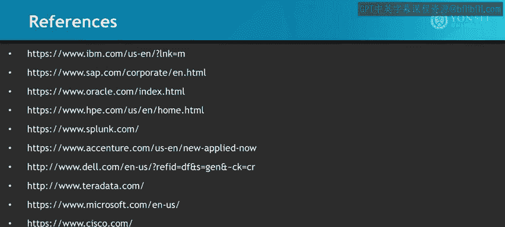

# 延世大学《新兴技术从智能手机到物联网再到大数据》课程 - P28：27_4.2 Spark ML算法（第2部分）📚

在本节课中，我们将继续学习Spark机器学习库中的核心算法。我们将探讨决策树、协同过滤、聚类技术和降维方法。这些算法是处理大数据分析任务的重要工具。

## 决策树技术 🌳

上一节我们介绍了基础的统计与分类算法，本节中我们来看看决策树技术。决策树通过一系列递归分割决策，以高效的方式识别逻辑区域并进行分类。

决策树使用较少的处理步骤，且每一步的计算复杂度较低，这使其非常适合分析大数据。其最终结果呈现为一种分层的树形结构。

该分层算法用于决策树的**监督学习**训练。那么，什么是监督学习？监督学习是机器学习系统使用的一种训练方式，其中我们拥有**带标签的数据**，即已知期望输出的数据。

由于期望输出已知，我们将其作为输入来计算输出。这样，我们既知道期望输出，也知道实际输出，因此可以计算误差。我们可以利用这个误差去训练系统，使机器学习系统变得更加精确。这就是我们在反向传播中所做的：将误差反向传播回系统中，重新调整参数，通过迭代学习过程使其更精细、更准确。

这里提供了一个决策树分类的例子。对于数据中的分类决策边界（白点和红点），可以使用决策树来确定。

决策过程如下：首先判断 `x > H1` 是否成立，这是一个决策阈值。然后，根据 `y > H2` 或 `y < H2` 进行另一个决策。如果通过第一个阈值，则基本属于红点区域；如果通过第二个决策边界，则根据是否满足条件进一步划分为红点或白点。将决策边界放置在图表上，可以看到H1右侧是我们分类红点的区域，然后我们使用H2（蓝色线下方）来进一步分类红点。通过决策树机制使用H1和H2，我们可以对红点的位置进行分类。

## 协同过滤 🤝

协同过滤是一种机器学习算法，它从众多用户那里收集偏好或品味信息，并利用这些信息对其他用户的兴趣进行自动化预测。

观察这个术语：因为我们使用了**组合、收集**的信息，所以得到了“协同”一词。然后，我们将过滤掉可能性较低的选项，直到找到最可能的预测结果，这就是“过滤”。将这两个词组合在一起，就得到了“协同过滤”这个名称。

以下是协同过滤的一个应用示例：一个音乐供应商可以根据用户A（其特征与新用户相似）的信息，向新用户推荐音乐。

当一位新用户进入我们的领域时，我们想推荐一些音乐，但我们不知道新用户会喜欢什么，没有参考价值。因此，我们会寻找一个具有相似特征的用户，找出该用户喜欢的音乐（比如音乐B），然后将其推荐给我们的新用户。这类结果可以通过协同过滤获得。

## 聚类技术 🔍

聚类技术是在数据集中寻找相似特征以形成数据组的过程。

训练数据由一组输入向量组成，没有任何对应的目标值。数据集中不包含信息，数据没有标签，也没有聚类关系。这就是为什么需要**无监督学习**。

**K均值算法**是现有最流行、最著名的聚类算法之一。接下来我们将深入了解它。

无标签数据被分类到K个类别中，类别数量K是你在算法中指定的参数。“无标签”意味着我们拥有的输入数据没有对应的期望输出标签。因此，我们必须使用这些无标签数据来训练系统，并决定如何进行聚类。

当接收到新的数据向量时，每个类别的**均值**（平均值）会被更新。这个均值用于更新类别（即聚类）的划分。

所有数据最初是无色的，但在我们将其分类为红色或白色之前，我将用黄色表示其原始颜色。

第一步，随机决定两个类别的中心。在图中，你可以看到两个“X”，它们被任意放置。基于此，在第二步中，将数据分配到最近的聚类。根据我们这里的两个“X”，我们将对数据进行分类，然后在这里画一条蓝线，作为两个聚类（两个类别）的分界线。接着在第三步，基于平均距离计算每个类别的均值。然后，再次将数据分配到最近的中心，你可以看到蓝线在这里进行了划分。

然后，我们将再次基于平均距离计算每个类别的均值。在最后一步，我们将数据向量再次分配到最近的中心。正如你所见，我们来回更新了几次：重新计算平均值，然后计算最近距离，再次进行聚类，然后返回计算平均值，如此反复。最终，我们得到了一个良好的聚类划分。如果有新的数据向量加入，我们将重复这个过程，以便对其进行正确分类。

这个过程需要几个步骤，但操作非常简单，这就是为什么K均值算法如此流行和有效。此外，它是基于无监督学习的，意味着我们在开始时没有任何参考信息，但最终我们找到了一种很好的方式来对数据进行分类和聚类。

## 降维 📉

降维用于通过将数据投影到更低维度的子空间来减少维度。它捕捉数据的本质，降低了分类器和回归器的复杂度。复杂度取决于输入的数量，需要考虑时间和空间复杂度。

这里以无人机管理地图生成为例。我们拥有的无人机数据是三维的：经度、纬度和高度。我们将经度映射到x轴，纬度映射到y轴，高度映射到z轴。因此，它是三维的。

然而，如果我们想绘制一个简化的二维经度-纬度无人机地图，我们可以进行这个过程。需要说明的是，降维通常应用于更复杂的问题，我选择这个例子是为了让你尽可能简单地理解。但我希望这个概念能很好地传达。

从许多具有经度、纬度和高度信息的三维无人机位置，我们可以通过移除高度信息，将它们映射到经度和纬度上，从而实现降维。信息映射在这里完成，我们将地图结果从3D转换到2D。然后我们看到，由于已经移除了高度信息，我们可以移除Z轴。接着，我们可以将其翻转，得到那个二维结构（X和Y）的结果。假设不需要高度信息Z，我们可以执行此操作，通过从数据中消除Z，在二维结构中捕捉数据的本质。这就是降维的意义。

## 总结 📝

本节课中我们一起学习了Spark ML库中的几种关键算法。我们探讨的机器学习算法包括基础的统计方法、分类与回归方法，以及本节介绍的决策树、协同过滤、聚类和降维。所有这些算法都非常强大，Spark在机器学习库中使用它们来分析数据、过滤数据和进行预测，因此Spark功能强大。此外，正如我在之前的讲座中提到的，Mahout引擎也为Hadoop提供了类似功能，因此Mahout是可用于Hadoop的机器学习引擎。这些技术将在未来进一步助力Spark技术的发展。

以下是我使用的参考文献，我推荐给你，谢谢。

