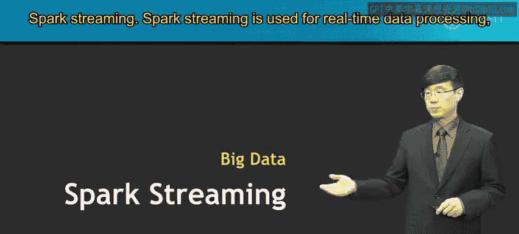
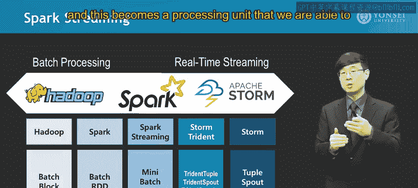
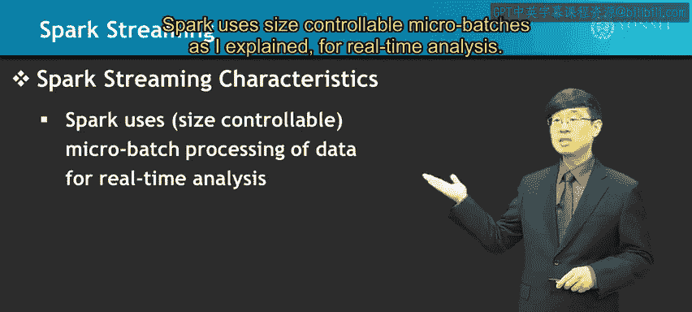
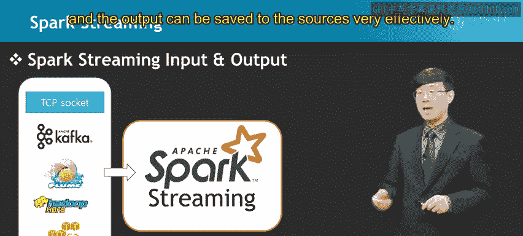
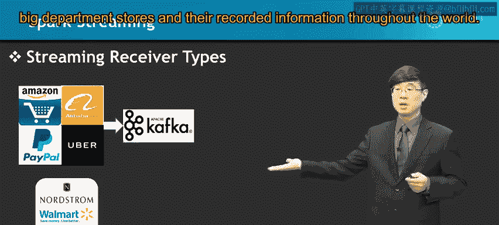
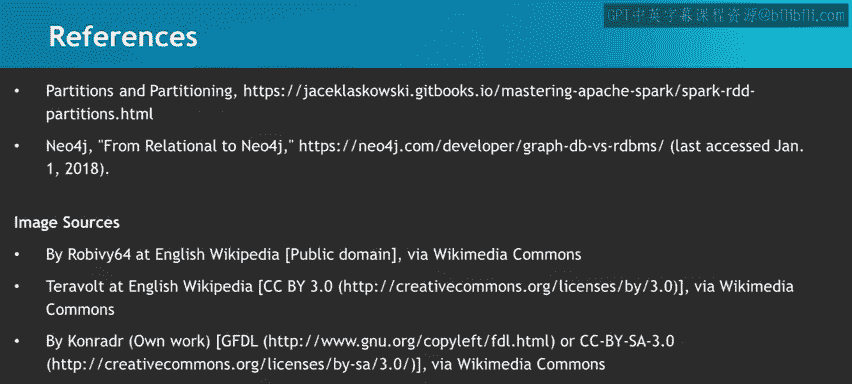

# 延世大学《新兴技术从智能手机到物联网再到大数据》课程 - P29：Spark流处理 🚀

在本节课中，我们将学习Spark流处理（Spark Streaming）的核心概念。Spark流处理是用于实时数据处理的技术，它通过微批处理（Mini-batch）的方式，将连续的数据流分割成小批次进行处理，从而实现近实时的分析能力。

---

## Spark流处理概述 📊

Spark流处理是Spark核心API的扩展，用于实时数据处理。它使用微批处理，将数据流分割成小批次进行处理。

Spark流处理使用微批处理。微批处理是指将数据流分割成小批次进行处理。Hadoop使用大批次处理，Spark也是如此。在Spark流处理中，批次大小可以缩小到半秒。这成为一个处理单元，使我们能够基于微批次大小的数据获得结果。

---

## 其他流处理技术 ⚡

还有其他技术，例如Storm Trident和Storm，它们能以更快的速率处理数据，但方式略有不同。我们将在后面讨论这些技术。

总的来说，从Hadoop的批处理，到Spark的批处理，再到Spark流处理的实时流处理，是我们本节课的重点。

---

## Spark流处理的特点 🛡️

Spark流处理是Spark核心API的扩展。其特点包括支持实时数据流。此外，它具有容错性和可扩展性。它提供高吞吐量和近实时数据支持。

这里使用“近实时”是因为某些应用可能需要快于0.5秒的处理结果，在这种情况下需要使用Storm。然而，超过90%的应用程序使用0.5秒的微批次大小就足够了。当然，我们也可以使用更大的批次大小，但我们可以达到的最小单位是0.5秒。

---

## 数据源与输出目的地 🔌

从HDFS、Kafka、Flume、TCP套接字等获取流数据都是可能的。

Spark流处理支持使用高级函数进行处理，如map、reduce、join、window等。它将输出处理结果保存到文件系统、数据库和实时仪表板。

Spark机器学习函数和图处理算法完全适用于流数据。

正如我所解释的，Spark使用大小可控的微批次进行实时分析。

---

## 与Hadoop批处理的对比 ⚖️

Hadoop使用数据批处理，这需要耗费时间来获得结果。批次越大，从正在处理的批次中获得输出所需的时间就越长。

Spark使用RDD来组织数据并从故障中恢复。查看Spark流处理结构，输入可以来自这些源，输出可以非常有效地保存到这些目的地。

---

## 流接收器类型 📡

流接收器类型包括基础类型。基础类型包括文件系统、套接字连接器、Akka actors，这些源直接在StreamingContext API中可用。

其他接收器类型包括自定义类型，它需要实现用户定义的接收器；以及高级类型，它需要与具有额外依赖的系统（如Kafka、Flume、Twitter等）链接。

---

## Spark流处理流程 🔄

现在描述Spark流处理流程。首先接收实时输入数据流。然后将输入数据流分割成称为DStream（离散化流）的微批次。每个微批次周期保存为一个小RDD。

Spark流处理引擎生成批次的最终输出流。DStream（离散化流）是具有高级抽象级别的连续数据流。

DStream可以从输入数据流源（如Kafka和Flume）创建，或通过对其他DStream进行高级处理操作创建。

这些流表示为一序列小RDD。微批次大小为0.5秒或更大。这意味着最小的微批次大小是半秒。RDD通过DAG进行处理。通过DAG的处理延迟必须小于批次周期。

这意味着，例如，如果微批次大小是半秒，那么在这半秒内，接收到的数据需要被处理，然后需要被发送出去，并且为接收下一个微批次输入数据所做的准备都必须在这个微批次周期内完成。因此，处理延迟必须是微批次大小的一小部分。例如，如果微批次大小是半秒，那么在这半秒内，接收、处理和发送都必须全部完成。

---

## 窗口操作 🪟

窗口操作是你需要考虑的事情。

窗口长度是用于一起进行RDD DAG处理的块数。滑动间隔是在进行RDD处理后滑动窗口的分区数。

例如，如果这些是需要处理的块，那么这将是一个窗口，并且会有一个滑动间隔。

查看用于窗口的转换操作，例如，我们有`window`、`countByWindow`、`reduceByWindow`、`reduceByKeyAndWindow`、`countByValueAndWindow`。在这里，你看到括号，那是你可以放入参数的地方。例如，窗口的一些关键参数将是窗口长度和滑动间隔，这些是我们现在关注的主要事项。

现在，如果窗口长度大于滑动间隔，那么窗口长度减去滑动间隔将导致重叠块，这些重叠块将存在于RDD处理中。例如，在这里显示的块上，如果窗口大小是4，滑动间隔是2，那么你将有一个重叠，下一个窗口将与上一个窗口（黄色部分）存在重叠。如你所见，将有两个块的重叠。

重叠块有助于分析流数据中连续块的相关性和依赖性。

---

## 应用示例：实时监控 📺

例如，需要监控IPTV或网页实时统计数据。换句话说，让我们看看有多少人在观看某个频道，我们希望立即了解正在发生的情况。

例如，需要实时监控频道或页面视图点击，以便我们知道观众对什么感兴趣。使用Kafka进行缓冲，因为Kafka对流数据支持非常有效。

Spark流处理用于处理。我们将绘制当前频道或页面视图点击的热力图，以便我们可以使用该热力图立即知道有多少用户在哪里。如果你想一想，像Netflix这样的公司可以非常有效地使用这一点。这就是为什么Netflix使用Spark流处理。

---

## 应用示例：销售监控 🛒

销售产品类型监控示例，在线销售，你可以通过Kafka读取，因为在线销售是全球进行的，累积的数字以非常快的速度增加。

另一方面，百货商店销售，它们的速度较慢，因为人们将商品放入购物车，拿到收银台，并在同一时间计算。对于批次，它们的计算在收银台完成。我们可以收集它们的所有数据，这些是通过Flume记录的更多数据。

使用Spark流处理的示例来连接两个实时数据流，并一起处理它们。例如，我们有Amazon.com、阿里巴巴、PayPal，以及Uber用户，他们的在线预订和支付信息正在传入。

我们使用Kafka实时流式传输这些信息。另一方面，对于全球大型百货商店及其记录的信息，我们将它们的信息收集到大日志中，并通过Flume将它们移动到系统中。

我们将它们合并到Spark流处理中。这是Spark流处理如何使用的代表性示例。

---

## 内部处理架构 🏗️

这里，来自使用Kafka的输入流，执行器中的一个任务槽将充当接收器，一个线程将实时流数据接收到节点上RDD的一个块（分区）中。

接收器还将此分区的副本复制到另一个节点。在这个例子中，我谈论的是复制因子为2，这是为了使系统具有弹性，并为可靠计算提供备份。

DAG转换器在新的RDD上执行。添加另一个流，例如来自Flume，在不同的节点上，分配执行器中的一个测试槽作为接收器，将实时流接收到节点上RDD的一个块（分区）中。

接收器还将此分区的副本复制到另一个节点。DAG转换在新的RDD上执行。

可以使用union操作将两个RDD统一为一个。这是内部处理的示例。

---

## 总结 📝

本节课中，我们一起学习了Spark流处理的核心概念。我们了解到Spark流处理通过微批处理实现近实时数据分析，支持多种数据源和高级操作，并具有容错和可扩展的特点。我们探讨了其处理流程、窗口操作以及在实际场景（如实时监控和销售分析）中的应用。最后，我们简要了解了其内部处理架构，包括数据接收、复制和DAG执行过程。Spark流处理是处理高速数据流的强大工具，广泛应用于需要实时洞察的领域。