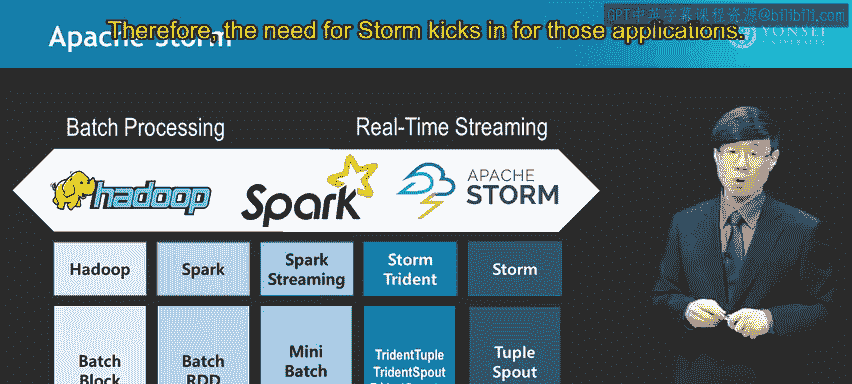
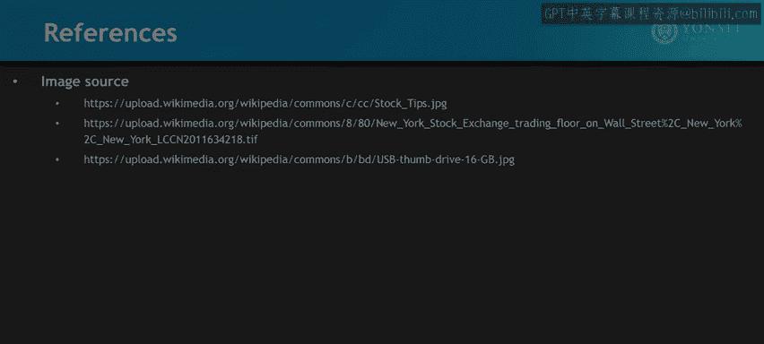

# 课程名称：延世大学《新兴技术从智能手机到物联网再到大数据》 - P30：29_5.1 Apache Storm 🌀

## 概述

在本节课中，我们将要学习 Apache Storm，这是一个用于实时流处理的大数据框架。我们将了解它的核心概念、架构、组件以及它为何适用于需要极低延迟（如微秒级）的应用场景。

---

## Apache Storm 简介

Apache Storm 用于实时流处理，其处理延迟可以低至微秒级别。因此，通过 Storm 可以实现微秒及更高级别的流处理。

许多应用场景使用 Spark Streaming 的微批次处理（最小可达0.5秒）就足以进行分析。然而，像股票市场交易、自动驾驶系统控制等应用需要比半秒更快的服务。在这些场景下，Spark Streaming 的速度可能不够快，因此就需要引入 Apache Storm。

我们将学习 Storm 以及 Storm Trident。Storm Trident 也使用微批次处理，类似于 Spark Streaming，但它们的特性有所不同。Spark Streaming 基于批次和微批次，而 Storm 基于**元组**，这些元组可以非常小。在 Storm Trident 中，一组元组可以组成一个微批次。简而言之，Spark 使用批次和微批次，而 Storm 和 Storm Trident 使用元组以及由元组组成的微批次。接下来我们将深入探讨这些细节。

---

## Apache Storm 详解

Apache Storm 是一个分布式的、容错的实时数据流处理大数据框架。它最初由 BackType 公司开发，后被 Twitter 收购。Twitter 收购 Storm 的原因将在后文揭示。

首先，让我们通过一些有趣的比喻来了解 Storm 的术语。

想象一片广阔的海水，它代表持续变化、永不重复的实时大数据流。☁️ **Nimbus** 在拉丁语中意为“乌云”，在 Storm 架构中，它代表系统的核心主节点。从乌云（Nimbus）中降下的 **Spout**，就像一个龙卷风，它从数据源（如海水表面）吸取数据。有时你会看到从天空降下水甚至鱼的景象，这形象地比喻了 Spout 从外部数据源获取数据的过程。

从乌云中，我们还看到 **Bolts**，即闪电。闪电拥有巨大能量，可以改变、转化事物，既能激发也能摧毁。在 Storm 中，Bolts 就是执行实际数据转换、处理和业务逻辑的单元。

基于这些比喻，我们将在大数据 Storm 技术中使用这些术语：Nimbus（核心）、Spout（数据源）和 Bolt（处理单元）。

---

## Storm 核心组件

以下是 Storm 的核心组件及其功能：

*   **Nimbus**：这是 Storm 集群的主节点。它负责将程序代码分发到整个集群，调度拓扑进程，将任务分配给工作节点，并监控工作节点及节点故障。
*   **Zookeeper**：Apache Zookeeper 为集群提供高可靠性的分布式协调服务。它通过主从复制实现高可用性和容错，并支持通过 Zookeeper 进行非破坏性升级。
*   **Supervisor**：Supervisor 是工作节点上的守护进程。它等待来自主节点（Nimbus）的任务分配，并为每个工作进程执行拓扑进程的一个子集。
*   **Topology**：拓扑是 Storm 中作业的逻辑表示。它是一个基于 Spout 和 Bolt 连接而成的有向无环图，代表了整个计算过程。一个拓扑进程涉及许多工作进程，这些进程分布在集群的多个工作节点上。

---

## Storm 数据处理模型

上一节我们介绍了核心组件，本节中我们来看看数据是如何在 Storm 中流动和处理的。

*   **Spout**：Spout 是数据流的源头，是 Storm 拓扑的输入。一个典型的例子是 Twitter API，它持续产生推文数据流。
*   **Tuple**：元组是数据值的序列，包含有限数量的数据元素。我们可以这样表示它：一个 N 元组是 n 个元素的序列。例如，一个五元组可以是五个数字：`(23, 45, 67, 89, 12)`。
*   **Tuple Stream**：元组流是元组的连续流。
*   **Bolt**：Bolt 是处理元组流的单元。它接收输入的元组流，进行处理，然后发射出新的元组流作为输出。然而，如果 Bolt 位于有向无环图的末端，在某些情况下它可能不发射输出。Bolt 可以执行多种处理类型，包括函数计算、过滤、聚合、连接、与数据库交互等等。

---

## Storm 的发展与特性

Storm 程序最初主要使用 Java 和 Clojure 编写。它于2011年首次发布（版本0.5.0），由 Nathan Marz 及其在 BackType 的团队开发。Twitter 收购了 Storm 并将其贡献为开源的 Apache Storm 项目。2014年2月，Apache Storm 发布了首个主要版本（0.9.1），同年9月，它成为了 Apache 顶级项目。

现在你可能会好奇 Twitter 如何使用 Storm。简单来说，Twitter 需要实时处理海量的推文流，进行趋势分析、个性化推荐等，这正需要 Storm 提供的毫秒甚至微秒级延迟处理能力。

Storm 的特性包括：
*   每秒可处理数百万个元组，这意味着每个元组的处理延迟可低至微秒级。
*   高度容错且能快速恢复。
*   支持高效、快速的集群控制。
*   编程简单，支持多种编程语言。
*   支持各种跨平台操作系统。

Storm 的核心特征是基于拓扑，使用 Spout 和 Bolt 形成有向无环图。拓扑中的节点是处理单元，边是流，用于将数据从一个节点导向另一个节点。整个拓扑形成了数据流转换的管道。

---

## 总结

本节课中，我们一起学习了 Apache Storm。我们了解了它是一个用于极低延迟实时流处理的分布式框架，认识了其核心组件：Nimbus、Zookeeper、Supervisor，以及数据处理模型中的 Spout、Tuple 和 Bolt。我们还探讨了 Storm 的发展历程、主要特性及其适用于需要微秒级响应的应用场景（如金融交易、实时监控）的原因。通过将计算任务组织成拓扑，Storm 能够高效、可靠地处理连续不断的数据流。