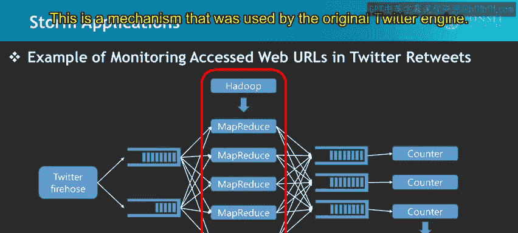
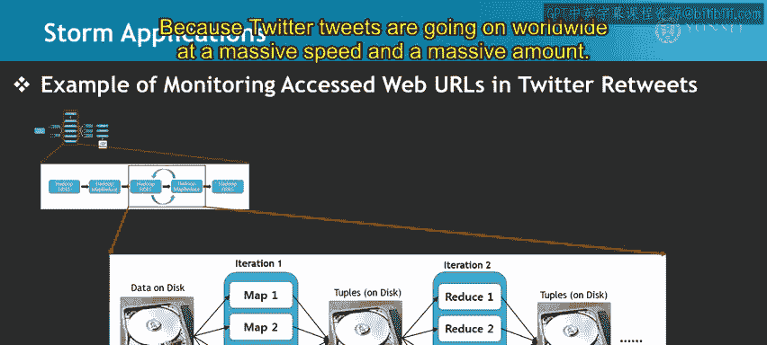
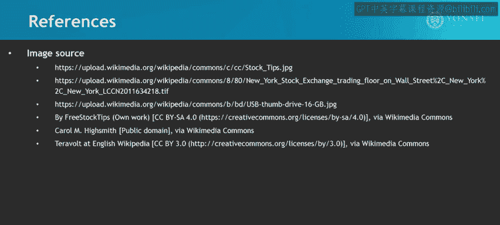

# 31：5.2 Storm 应用 🌀

在本节课中，我们将学习 Apache Storm 的核心应用场景，并通过与 Hadoop 的对比，深入理解 Storm 在处理实时数据流方面的独特优势与工作原理。

## 概述

Apache Storm 是一个分布式实时计算系统，专为处理无界数据流而设计。它能够以可靠、可扩展的方式处理高速流入的数据，适用于多种需要即时响应的场景。本节将详细介绍 Storm 的主要应用案例、其核心组件的工作方式，并通过一个具体的 Twitter 数据处理例子，对比 Hadoop 与 Storm 在架构和性能上的差异。

## Storm 的主要应用场景

Storm 的应用用例主要包括流处理（无需中间队列的直接流处理）和分布式远程过程调用（DRPC）。计算负载被高效地分布到并行处理的 CPU 上，以获取实时、可靠的结果。

以下是 Storm 的一些主要用例：

*   **持续计算**：随着输入流被持续分析，计算过程会得到实时的持续更新，并持续输出计算结果。
*   **实时分析**
*   **在线机器学习**
*   **分布式远程过程调用（DRPC）**：我们将在后续详细讨论。
*   **提取、转换、加载（ETL）操作**：我们同样会在后续详细讨论。

这些是 Storm 的主要应用，接下来我们将深入细节。

### 分布式远程过程调用（DRPC）

DRPC 是一种程序，它可以在基于不同 IP 地址的远程计算机上执行其进程。分布式 RPC 将以分布式并行形式在节点集群上执行，这正是 DRPC 为 Storm 所做的事情。

### 提取、转换、加载（ETL）

ETL 是将三个基本数据库功能结合为一体的操作。ETL 功能从数据库中提取数据，对其进行转换，然后将其加载到数据仓库中。在其定义中可以找到 ETL 这个词。

### 金融服务

金融服务是 Storm 的主要应用领域之一，包括：
*   安全欺诈检测
*   策略违规检测
*   股票监控
*   警报通知
*   价格控制与调整

### 零售服务

在零售服务中，应用包括：
*   物流调度
*   销售监控
*   折扣率控制
*   优惠券分发
*   损耗与缺货管理
*   定价与优惠

所有这些应用，正如你所见，都需要非常快速的更新，并且可能变化非常迅速。因为零售服务在全球范围内实时发生，地点众多，需要监控并纳入所有已完成的变化以及正在进行的所有新交易和销售。Storm 可以很好地支持这一点。

### 网络服务

在网络服务领域，应用包括：
*   Web 服务器和系统支持
*   安全漏洞监控（当然，你希望对此类安全漏洞有即时响应检测，这就是 Storm 最合适的原因）
*   应用程序故障恢复
*   用户问题解决
*   个性化内容保护

### ICT 与电信服务

在 ICT 和电信服务中，应用包括：
*   社交网络服务（这正是 Twitter 使用 Storm 的原因）
*   移动应用和云服务
*   定制服务
*   安全漏洞监控
*   网络中断（例如由网关、路由器和交换机故障、被黑客攻击、遭受 DoS 和 DDoS 攻击引起），通常如何从中恢复，我们可以非常有效地使用 Storm。
*   带宽分配，将适量的带宽分配给正确位置的吞吐量，所有这些都可以使用 Storm 非常有效地控制。
*   移动性支持和无线接入网络连接，这些支持移动中的用户，网络需要适应和改变以支持移动用户，同时在其他设备上，它们需要重新配置、发送信息、重新路由数据，以便用户能有效地获得数据连接。所有这些都需要由移动设备、智能手机以及交通系统来支持。

## 通过与 Hadoop 对比理解 Storm

首先，从集群操作开始，让我们先看大的方面，再聚焦细节。

### 集群操作对比

*   **Hadoop 集群**：在 Hadoop 分布式文件系统（HDFS）上运行 MapReduce 作业。
*   **Storm 集群**：基于有向无环图（DAG）运行拓扑进程。

### 进程结束对比

*   在 Hadoop 中，当指定的数据集被完全处理时，MapReduce 作业结束。
*   然而，在 Storm 中，这是一个持续进行的过程，没有明确的终点。拓扑进程会持续流式传输消息，直到用户有意终止该流。

### 节点类型对比

*   在 Hadoop 中，我们有名称节点（NameNode）和数据节点（DataNode）。名称节点是主节点，数据节点是工作节点。名称节点运行作业跟踪器守护进程（JobTracker Daemon），数据节点运行任务跟踪器守护进程（TaskTracker Daemon）。
*   在 Storm 中，我们有一个主节点（Master Node）和工作节点（Worker Node）。主节点运行 Nimbus 守护进程，而工作节点运行 Supervisor 守护进程。

## Hadoop URL 转发计数示例分析

现在，我们将看一个 Hadoop 的 URL 转发计数示例。这里，Twitter 的 Firehose 提供了需要缓存在中间消息代理节点中的 Twitter 消息流，该代理节点充当中间队列。

工作节点收集数据并存储在 HDFS 中。MapReduce 从 HDFS 读取数据以查找网页 URL，使用模哈希（modular hashing）操作。这样可以选择正确的工作节点来提供基于特定 URL 计数的正确键值信息。因此，同一个工作节点需要进行相同的计数，以便由该特定工作节点提供更新后的计数，这就是模哈希在此系统中使用的地方。

更新后的 URL 计数和统计信息可以被收集并发送到 Cassandra 等数据库。

让我们按步骤回顾一下刚才解释的细节：
1.  Twitter 开始通过 Twitter Firehose 提供其 Twitter 信息。
2.  这些信息需要排队，因为我们不知道它传入的速度有多快，如果 MapReduce 引擎过载，我们可能会丢失一些数据，可能会出现溢出，因此我们需要足够大的缓冲区队列在输入端堆积它们。这些队列节点就是消息代理，它们的存在是为了避免因 MapReduce 引擎溢出而丢失任何信息。
3.  然后我们进行 Hadoop 的 MapReduce 处理。
4.  接着使用模哈希，以便将通过 MapReduce 处理的计数、键和值分配给正确的设备（计数器）。同时，计数器也可能溢出，因此，在工作节点的起始部分会有队列，然后是计数器，结果可以发送到 Cassandra 进行保存。

这是原始 Twitter 引擎使用的机制。

它在中间使用了 Hadoop。仔细观察中间部分，它是 HDFS MapReduce，被反复处理，在某些部分，会有迭代过程以循环结构运行。从拓扑和速度的角度来看这个工作的细节，你可以看到迭代部分：磁盘上的数据将被读入，经过 Map 函数处理，然后保存回硬盘磁盘，接着再次被读取，然后进行 Reduce 处理，最后再写回磁盘。正如我在之前的课程中解释过的，从硬盘驱动器读写速度很慢，而且你还要对大量信息进行此操作。此外，在上面的红色框中，这是一个迭代过程，我需要反复进行。

对于这种情况，这将减慢分析速度，可能对 Twitter 来说太慢了，因为 Twitter 的推文正在全球范围内以巨大的速度和数量进行。

这就是我们面临一些 Hadoop 问题的原因。

### 使用 Hadoop 的挑战

*   **需要中间消息代理功能关键节点**：因为我们不希望 MapReduce 引擎溢出。
*   **HDFS 的读写速度慢**：多次的 HDFS 读写甚至会更慢。
*   **需要计算模哈希操作**：这很繁琐。
*   **将相同的 URL 消息发送到相同的计数工作节点**：这也不方便。
*   **添加额外的工作节点**：如果你想扩展系统、想要增长，那么你需要添加一个新的工作节点（一个新的数据节点）与现有系统并行，然后你将不得不进行大量的额外编程（例如，工作节点/数据节点的 Java 虚拟机 JVM 编程），然后将它们加入集群系统。在整个集群中进行编程替换需要大量时间。
*   **此外**：用于此任务的 Hadoop 程序复杂，难以编程，也难以调试。

那么，让我们看看 Twitter 如何改用 Storm 以更有效的方式完成这个过程。

## Storm 实现方式

在这里，Storm 将以元组（Tuple）的形式接收 Twitter 消息。多个 Bolt 被并行分配以查找 URL 并进行计数。后续阶段的 Bolt 聚合 URL 计数以找到汇总的最终总数。最后阶段的 Bolt 将把 Twitter URL 统计信息保存到 Cassandra。

观察这个结构，Twitter 通过 Firehose 将其推文和记录输入系统，我们有 Spout 作为接收部分。然后我们有 Bolt 实际执行转换和计数。看这里，Spout 前面没有队列。为什么？为什么这是可能的？为什么我们在那些 Spout 之前不需要队列？有一个原因，稍等片刻，我会向你解释。转换和计数操作在 Bolt 中完成，它们被收集起来，最终结果被保存到 Cassandra。

### 使用 Storm 的优势

以下是使用 Storm 的优势：

*   **Spout 控制来自 Twitter 的消息输入流**：它使用基于拉取（pull-based）的方案，这与其他方式不同。换句话说，当你被动地接收发送给你的东西时，你的队列可能会过载、可能会满，那么之后来的数据就会丢失，即溢出丢失。在这里，Spout 作为控制数据流入 Storm 网络的输入数据组件，基于拉取机制，它会将数据拉取进来。这意味着什么？我会给你更多细节，请稍等。
*   **保证所有推文消息的数据处理**：现在有可靠和不可靠的 Spout 和 Bolt，我们需要更多地讨论这一点。如果是可靠的，那么操作更有保障。而不可靠的 Spout 和 Bolt，可能会有一些遗漏，不多，但偶尔会有。我们将更多地讨论这一点。
*   **内置自愈容错能力**：也包含在 Storm 中。
*   **无需中间队列**：不需要中间队列。
*   **无需模哈希操作**：也不需要模哈希操作。
*   **出色的水平可扩展性**：通过 Storm 提供 Spout 和多阶段 Bolt 的出色水平可扩展性。
*   **基于内存的快速读写速度**：在 Bolt 中处理基于内存（RAM）的快速读写速度。换句话说，尽可能使用内存 RAM，而不是硬盘驱动器。再次强调，每个处理过程中，RAM 比 HDD 快大约 100 倍，我们在本课程之前的讲座中已经学习过，请再次查看。
*   **简单易行的程序调试和升级**：成为可能。
*   **即时处理拓扑更新**：通过重新平衡（rebalance）功能，即时处理拓扑更新也成为可能。

这非常棒，因为再次强调，当我们使用 Hadoop 时，其中一个问题是，如果你想添加一个额外的工作节点来帮助和扩展整个系统，那么你需要大量复杂的处理、大量的额外编程，然后与所有其他节点接口，更改它们的程序。那很复杂，但在这里，我们有了重新平衡功能，可以即时为我们提供交换编程能力，我们将进一步研究这一点。

这些是我使用的参考文献，我推荐给你。

## 总结

本节课中，我们一起学习了 Apache Storm 的核心应用领域，包括实时分析、DRPC 和 ETL 等。通过详细对比 Storm 与 Hadoop 在架构、处理模型和节点管理上的区别，我们清晰地认识到 Storm 为高速、无界数据流处理而生的设计优势。最后，通过分析 Twitter 从 Hadoop 迁移到 Storm 的具体案例，我们总结了 Storm 在保证数据不丢失、无需中间队列、基于内存快速计算以及易于扩展和调试等方面的显著优点。这些特性使得 Storm 成为处理实时大数据流的强大工具。