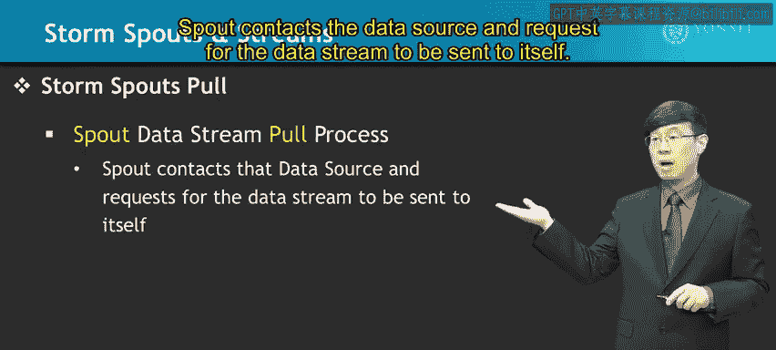
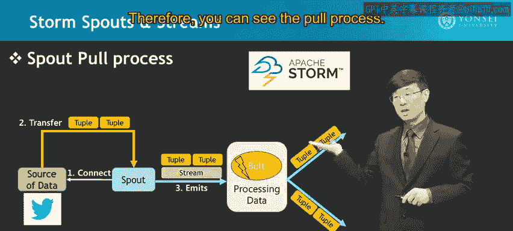
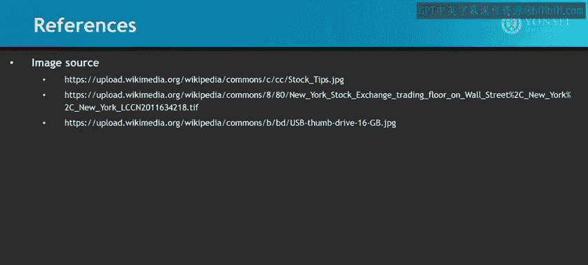

# 延世大学《新兴技术从智能手机到物联网再到大数据》 - P32：31_5.3 Storm喷口与流 🌀

在本节课中，我们将学习Apache Storm中的核心组件：喷口（Spout）和流（Stream）。我们将探讨数据如何被拉取、处理，以及如何通过不同的分组策略在分布式拓扑中高效流动。

---

## 概述

Apache Storm是一个分布式实时计算系统，用于处理高速数据流。其核心概念围绕**喷口**和**流**展开。喷口负责从外部数据源拉取数据，并将其作为数据流发射到拓扑中。流则是这些数据在拓扑组件（如螺栓）之间传递的载体。理解这些概念对于构建可靠、高效的实时数据处理应用至关重要。

---

## 喷口的数据流拉取过程

喷口是Storm拓扑中的数据源。它主动连接到外部数据源，并请求数据流发送给自己。

以下是喷口拉取数据的基本流程：

1.  喷口首先连接到数据源。
2.  数据源随后发送一个元组流。
3.  喷口将这些元组发送给螺栓。
4.  螺栓处理这些元组，并根据需要将额外的元组发送出系统。

因此，你可以看到这是一个**拉取**过程：喷口先请求数据，然后数据才被引入系统。

喷口的拉取机制使其能够成为整个拓扑数据源流的主动控制器。因此，不需要额外的队列节点。总体而言，喷口的拉取操作使其能够控制数据流的开始、终止、流速，管理拓扑处理过程，并控制流数据处理拓扑所需的变更。

喷口的拉取过程经常使用 `nextTuple()` 命令。这是一个喷口用来从数据源接收元组的消息，其触发可以基于定时或用户请求的方式。

---

## 可靠与不可靠的喷口和螺栓

在Storm中，喷口和螺栓可以是可靠的或不可靠的，这取决于应用场景对数据一致性和处理开销的要求。

*   **可靠的喷口与螺栓**：一个可靠的喷口会使用确认和失败消息（这些消息中包含对象和元组ID）来监控螺栓对元组的处理状态。当使用可靠的喷口时，也应使用可靠的螺栓。
*   **不可靠的喷口与螺栓**：不可靠的喷口和螺栓不会执行确认和失败监控过程，因此可能存在数据遗漏。可靠喷口和螺栓的确认与失败监控及消息传递需要更多的处理开销。因此，在某些不需要这种额外开销和消息交换的场景下，会使用不可靠的喷口和螺栓。

例如，对于股票市场数据处理，必须使用可靠的喷口和螺栓，因为不能承受任何数据丢失。一切数据都必须被处理、监控和保护，因此显然首选可靠的Storm拓扑。

另一方面，对于监控和分析社交媒体数据流这类应用，可以使用不可靠的喷口和螺栓。因为在这种情况下，遗漏一两条数据影响不大，处理速度更为重要。总体统计数据量非常庞大，遗漏一两个数据点不会对整体统计结果产生重大影响。此时，可以降低可靠操作带来的开销和额外消息交换，直接使用不可靠组件来收集统计信息。

---

## Storm数据流队列管理

Storm能够高效管理数据流。使用Storm，每秒可以处理超过100万条消息。

Storm可以控制**待处理**（即尚未被处理）元组的最大数量。通过 `topology.max.spout.pending` 这个配置命令，可以实现这一机制。这为你提供了一些额外的时间来处理突发流量或进行其他操作。

---

## Storm流处理API：元组与Trident

Storm提供了两种主要的流处理API。

*   **元组**：如前所述，一个元组是一组有限数量的数据值。一个N元组是N个元素的序列。在代码中，一个元组可以表示为：`Tuple = (value1, value2, ..., valueN)`
*   **Trident**：这是对传入的流进行**微批处理**的过程，一次处理一个微批次。一个微批次是多个元组的集合。与逐条处理相比，Trident模式更高效，能提供更高的吞吐性能。Trident模式类似于Spark Streaming模式，后者也使用微批次。

---

## 流分组策略

对于一个给定的拓扑，**流分组**定义了如何通过喷口与螺栓、或螺栓与螺栓之间的连接接口，并行地发送元组。这些连接用于在集群的分布式拓扑中以并行方式处理多个元组。

以下是一些常见的流分组类型：

*   **随机分组**：这是最简单的类型。它将元组随机发送给一个任务，其效果是将元组处理的工作负载均匀地分布在所有螺栓上。
*   **字段分组**：这种分组会根据元组的特定字段值来选择将其分配给哪个螺栓进行进一步处理。因此，在选择过程中需要使用模运算哈希，这需要额外的处理时间。字段分组常用于流连接、流聚合等场景。例如，在词频统计的螺栓中，使用字段分组可以让相同的单词总是被发送到同一个任务进行处理，这非常有效。

---

## 总结

本节课我们一起学习了Apache Storm中关于喷口和流的核心知识。我们了解了喷口如何主动拉取数据形成流，以及可靠与不可靠组件的适用场景。我们还探讨了Storm的队列管理机制、两种主要的流处理API（元组和Trident），以及不同的流分组策略（如随机分组和字段分组）如何影响数据在拓扑中的分布和处理效率。掌握这些概念是设计和实现高效实时流处理应用的基础。