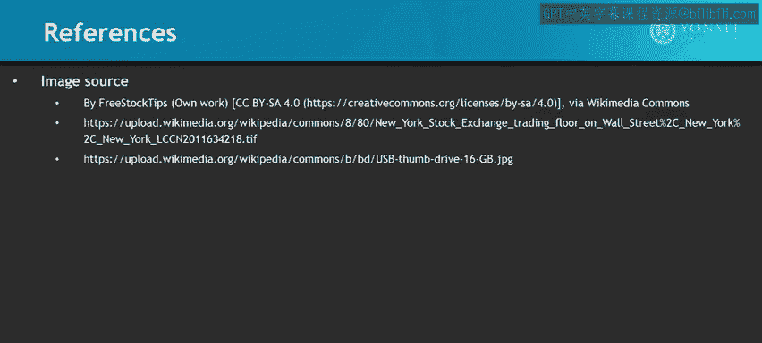

# 33：5.4 Storm拓扑管理 ⚙️


在本节课中，我们将要学习Apache Storm中拓扑的管理，包括其处理语义、集群资源管理工具以及用于控制拓扑生命周期的各种命令。

---

## Storm拓扑与处理语义

上一节我们介绍了Storm的基本概念，本节中我们来看看Storm拓扑的处理保证和管理机制。

Storm的事务处理阶段包括一个提交阶段，在此阶段中，任意数量的Bolt都可以参与，这些Bolt被称为提交者。提交操作遵循严格的顺序，其顺序基于批处理是如何被省略的。

处理阶段包括Storm的默认设置，元组树完成时间被设置为30秒。因此，如果30秒超时且元组树计算未完成，Spout将重新执行整个过程。这启用了“至少一次”的保证处理，这也是Storm中“恰好一次”语义的由来。如果发生故障，则该批次将被重新处理。如果成功，则继续处理下一个元组或批次。通过这种方式，保证了每个批次至少被处理一次，这就是“恰好一次”语义，用于解释Storm的特性。

**核心概念公式**：
*   **至少一次处理**： `处理次数 >= 1`
*   **恰好一次语义**： 通过“至少一次处理”+“事务提交机制”来实现最终效果上的“恰好一次”。

---

## 集群与资源管理：Mesos

了解了处理语义后，我们来看看如何管理运行这些拓扑的集群资源。

Mesos可用于管理集群、拓扑分布、任务分配和处理核心分配。Mesos能够使不同的Storm拓扑独立执行，而不会干扰在同一集群中运行的其他拓扑。这非常强大。因此，如果你有一个集群，需要运行多个操作，并且在某些情况下需要非常精确地管理资源以避免相互干扰，这正是Mesos的强大之处。

---

## 拓扑提交与执行：JAR文件

要将一个拓扑部署到集群中运行，需要提交一个JAR文件。

JAR用于向集群提交拓扑。JAR进程的执行顺序始于将拓扑JAR文件上传到Nimbus主节点。以下是一个执行此操作的编程代码示例：

```bash
storm jar topology.jar com.example.Topology arg1 arg2
```

Nimbus将通过ZooKeeper的帮助将代码分发到各个Supervisor节点。然后，JAR将基于指定的拓扑类和参数运行主函数，参数在主函数的括号中指定。随后，Storm激活拓扑并在集群内开始处理。

---

## 拓扑管理命令

成功提交拓扑后，我们需要一系列命令来管理它的生命周期。以下是常用的管理操作。

### 激活与停用

*   **停用**： 你可以停止从Spout流出元组。Storm UI可用于停用一个拓扑。
*   **激活**： 你可以使用“激活”命令来恢复Spout的元组处理，Storm UI也可用于激活。

### 停用、激活与关闭的深入解析

*   Spout可以使用 `deactivate` 命令停用。系统将进行序列化以保存处理状态信息和元组。
*   要恢复处理，将使用 `activate` 命令。
*   Spout关闭将使用 `close` 命令，这将首先停用它，然后关闭它。

### 终止命令

`kill` 命令用于终止正在进行的拓扑。kill进程首先会对Spout和Bolt的状态及结果进行序列化，并将序列化文件保存。因此，在kill操作激活并终止一切之前，首先将数据结构和处理单元全部序列化，然后保存为文件。拓扑的Spout将被停用，然后Bolt被停止，保存的状态将被清理。

### 重新平衡

`rebalance` 用于重新配置拓扑。它将改变在Spouts和Bolts中进行的处理过程，并在集群中的Spouts和Bolts之间重新分配任务。

一个例子是当需要向集群添加额外的Supervisor节点时，你可以使用rebalance。这比过去在使用Hadoop的JVM时需要在集群中进行的操作要好得多，因为它更快，几乎是即时响应。此外，整体编程和调试更加方便、容易且健壮，因此总体上更易于使用。

重新平衡实现了拓扑近乎无缝的交换。如果需要先终止然后重新提交新拓扑，则至少需要几十秒或几分钟才能完成。

可以使用 `-n` 选项更改工作进程的数量，使用 `-e` 选项更改执行器的数量。例如，在程序代码中，你可以看到使用 `-n` 和 `-e` 的地方，下面就是一个实际使用rebalance进行更改的示例。

```bash
storm rebalance mytopology -n 5 -e spout=3,bolt=4
```

### 初始化活动

初始化活动使用 `open` 命令开启。Open操作包括收集器（用于在将数据发送到集群供Bolts处理时使用）、配置、任务信息、连接到数据源等。

---

## 总结

本节课中我们一起学习了Apache Storm拓扑管理的核心内容。我们了解了Storm如何通过事务阶段实现“恰好一次”处理语义，认识了Mesos在集群资源隔离与管理中的重要作用。我们详细介绍了使用JAR文件提交拓扑的流程，并掌握了激活、停用、终止、重新平衡等一系列关键的拓扑管理命令及其使用场景。这些知识是有效部署和运维实时流处理应用的基础。




**参考资料**：
这些是我使用的参考资料，我推荐给你。谢谢。