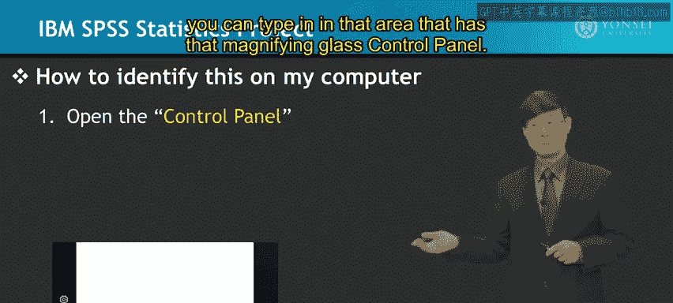
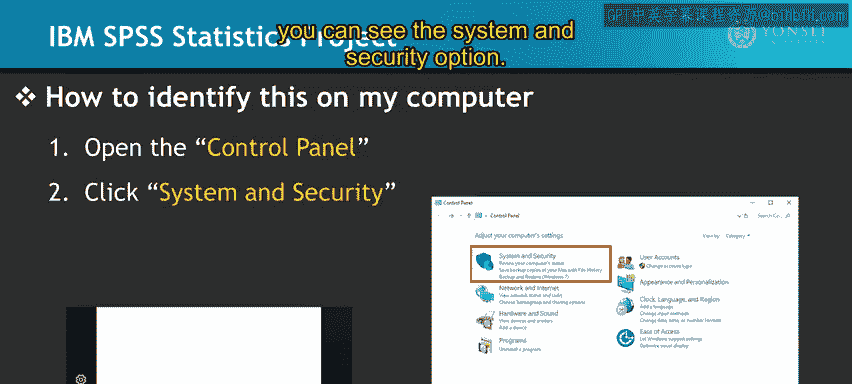
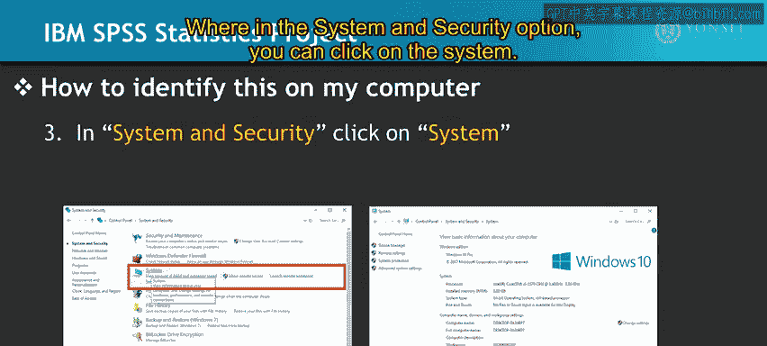
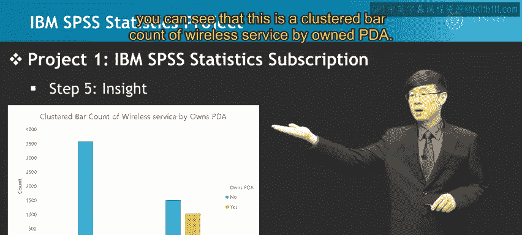
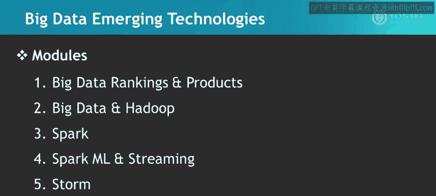

# 35：IBM SPSS Statistics 项目实践 🧮

在本节课中，我们将学习如何使用IBM SPSS Statistics进行企业级数据分析。我们将从注册免费试用账户开始，逐步完成软件的安装、基础操作，并最终完成两个数据分析项目。

IBM SPSS Statistics是企业数据分析领域的重要工具。许多公司提供为期两周至一个月的免费试用期，让用户体验其数据分析系统。IBM SPSS Statistics、SAP S4 HANA等均提供此类服务。本项目将聚焦于IBM SPSS Statistics，因为IBM在大数据领域的公司排名、软件、硬件及专业服务方面均名列前茅。因此，作为大数据领域的从业者，掌握IBM SPSS Statistics的基础操作是很有价值的。

IBM SPSS最初由SPSS公司于1968年发布，后在2009年被IBM收购，成为IBM SPSS Statistics。该软件基于描述性统计、回归分析、高级统计等方法，提供对逻辑批处理和非批处理数据的统计分析。它为Spark、SQL、文本分析、产品服务集成和大数据分析提供了多种解决方案，并支持使用R和Python增强SPSS语法。

---

## 项目一：熟悉IBM SPSS Statistics环境 🖥️

上一节我们介绍了IBM SPSS的背景，本节中我们来看看如何获取并安装该软件。

项目一的目的是通过实际操作，获得使用IBM SPSS进行高级数据分析的初步认识。该软件提供了全面的统计工具集，易于使用的统计分析功能，并能与开源软件集成。

以下是获取试用版的步骤：
1.  访问IBM官方网站的试用页面。
2.  点击红色按钮，开始注册流程。
3.  填写个人信息以创建IBM官方账户。
4.  账户创建成功后，进入下载页面。

在下载页面，您需要根据您的操作系统选择正确的安装文件版本（32位或64位Windows，或iOS系统）。

要确定您的系统类型，请按以下步骤操作：
1.  打开Windows系统的“控制面板”。
2.  选择“系统和安全”选项。
3.  点击“系统”。
4.  在系统信息中，查看“系统类型”，确认是32位还是64位操作系统。

了解系统类型对安装许多软件都很重要。请确认后，下载并安装对应版本的IBM SPSS Statistics。

---

## IBM SPSS 基础操作与界面导览 🔍

安装完成后，我们来看看IBM SPSS Statistics的基本操作界面。

软件界面主要包含数据编辑器、输出查看器等窗口。系统自带示例文件，位于指定目录。我们强烈建议您阅读软件内置的教程以获取更多信息。

首先，打开示例数据文件 `demo.sav`。

在数据编辑器窗口中，您可以通过“变量视图”选项卡编辑数据变量属性，例如使用以下选项更改测量尺度：
`[变量视图 -> 测量 -> 选择尺度（标度/有序/名义）]`

此外，您可以运行各种分析。点击分析菜单中的选项会弹出相应窗口，下方提供了多种方式以展示结果并从不同角度查看数据。

选择变量信息并点击“确定”后，您可以看到提供的选项以及菜单。对于图表，您可以看到可选窗口，并能根据需求控制设置。我们鼓励您尝试不同的选项、阅读教程，以了解使用不同图表类型或不同统计分析机制时能获得哪些额外的洞察。

对于图表，您可以右键点击，通过菜单双击选择您喜欢的图表类型，如直方图、箱线图或饼图。您有多种选择，之后将得到所需的结果结构。

您还可以通过拖放操作来获取结果。在图表选项中，点击右键，使用拖放功能，即可访问并生成所需的图表。

查看我们刚刚获得的结果，这是一个关于“是否拥有PDA”与“无线服务”的簇状条形图。

该图表显示，拥有无线电话服务的人比没有该服务的人更可能拥有PDA（个人数字助理）。这表明两者之间存在相关性。

---

## 项目二：数据分析实践与比较 📊

在熟悉了基础操作后，本节我们将进行具体的数据分析实践。

项目二要求您尝试分析并绘制图表，展示以下两组关系：
1.  **家庭人数**与**主要车辆价格等级**之间的关系。
2.  **家庭收入（千元）**与**主要车辆价格等级**之间的关系。

请注意，`车辆价格等级` 是这两个分析中的共同分母。发生变化的是 `家庭人数` 和 `家庭收入`。

您需要比较这两个分析的结果。

---

## 课程总结与任务 📝

本节课中，我们一起学习了IBM SPSS Statistics的入门知识。我们从注册试用账户、安装软件开始，逐步探索了其操作界面和基础数据分析功能，并布置了两个实践项目。

总体任务要求如下：
1.  完成项目一：尝试按照课程演示的相同选项进行操作，看是否能复现相同的结果。
2.  完成项目二：分析指定的两组关系，绘制图表并比较结果。
3.  进行更多探索：与您的同伴分享结果，并尽可能互相学习。

感谢您学习《大数据与新兴技术》这门课程。这是第六个也是最后一个模块，希望您收获颇丰。祝愿这些知识对您的职业生涯和学术研究有所帮助，并祝您在追求大数据技术及其他领域的道路上取得成功。