# 课程P36：智能设备与移动新兴技术导论 🚀

欢迎来到“智能设备与移动新兴技术”课程。这是“从智能手机到物联网再到大数据”专项课程的一部分。我是延世大学的钟教授，欢迎大家。

在本课程中，我们将学习移动业务、智能设备、通信技术及操作系统等核心知识，并通过实践项目加深理解。课程内容广泛，旨在为初学者构建一个清晰的知识框架。

## 课程模块概述 📚

本课程包含以下核心模块，我们将逐一深入探讨。

*   **移动业务与市场分析**：分析全球智能手机市场份额及移动操作系统趋势。
*   **智能设备详解**：聚焦三星Galaxy Note 8、G S3、苹果iPhone X和Apple Watch Series 3等设备，并研究其**IP67/IP68**防护等级。
*   **SoC处理器技术**：剖析三星Exynos、高通骁龙和苹果A11仿生等主流芯片。
*   **半导体技术演进**：探讨半导体尺寸的微缩进程及**big.LITTLE**异构计算架构。
*   **基于GPS的技术**：学习GPS、A-GPS（辅助GPS）如何实现精准的定位服务。
*   **无线充电技术**：介绍主流的无线充电标准及其背后的感应与共振原理。
*   **移动通信技术**：从1G到5G的代际演进，重点分析4G（LTE/LTE-A）和5G的核心技术。
*   **智能手机操作系统**：深入探讨iOS与Android的版本演进和系统架构。
*   **实践项目**：通过智能手机与移动网络项目，进行实际操作与分析。

## 移动通信技术深度解析 📡

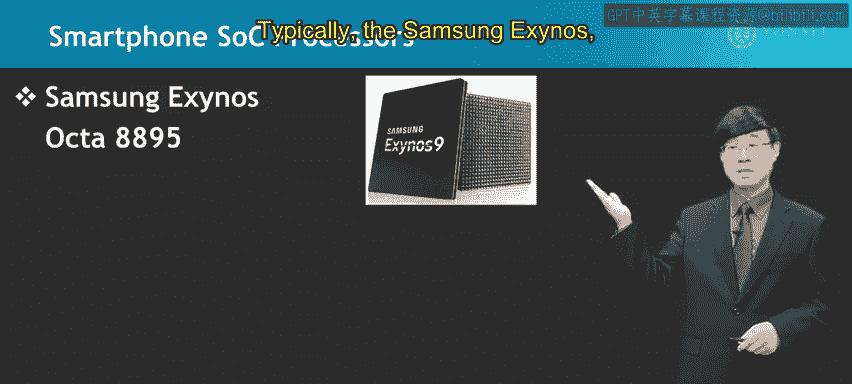

上一节我们概述了课程模块，本节中我们将详细看看移动通信技术的发展与核心。

我们将按阶段研究移动通信技术的演进：从第一代（1G）到第二代（2G），再到第三代（3G），最终演进至第四代（4G）技术，即**LTE**和**LTE-Advanced**。同时，我们也会重点探讨5G移动通信技术。

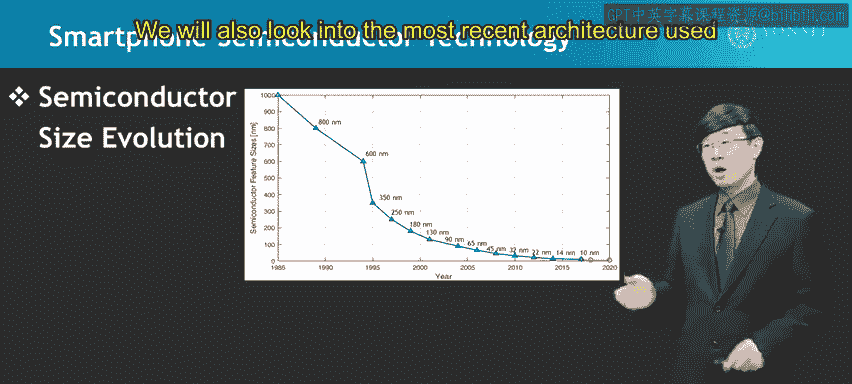

此外，课程还会介绍**SIM卡**（用户身份模块）的出现及其作用。

以下是4G LTE网络的一些关键技术：

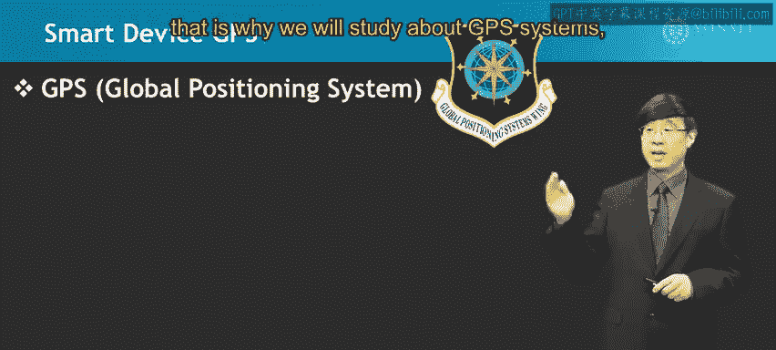

*   **网络架构**：了解LTE服务是如何提供的。
*   **分组转发与切换**：核心的数据传输与管理机制。
*   **MIMO技术**：多输入多输出技术，提升信道容量。
*   **OFDM**：正交频分复用，用于物理层的高速数据传输。

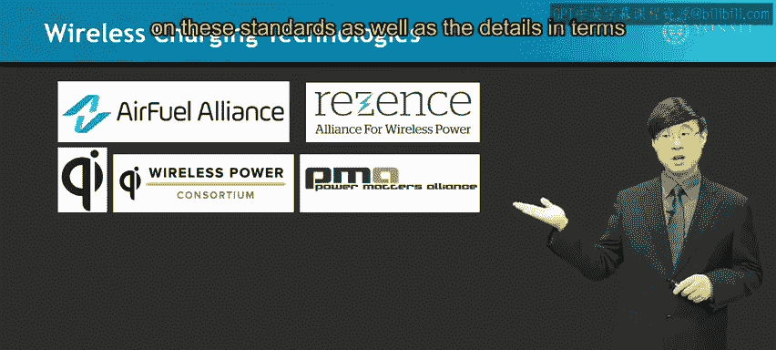

在LTE-Advanced（LTE-A）中，我们关注其增强的核心技术：

*   **ICIC（小区间干扰协调）** 与 **FFR（部分频率复用）**
*   **动态子载波分配**
*   **CoMP（协作多点传输）**
*   **载波聚合**
*   **异构网络与自组织网络（SON）**

## 第五代移动通信技术（5G）🔮

接下来，我们将进入5G移动通信技术领域，了解其总体目标与实现方式。

我们将在详细规格上比较3G、4G和5G，分析它们的差异与能力。5G技术主要围绕三大应用场景进行设计：

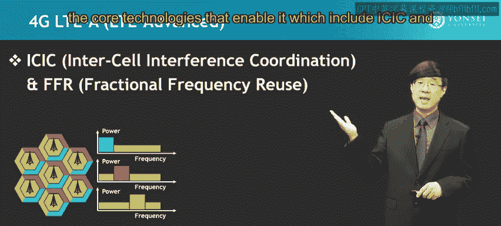

1.  **eMBB（增强移动宽带）**：面向高带宽应用，如超高清视频。
2.  **mMTC（海量机器类通信）**：面向大规模物联网设备连接。
3.  **URLLC（超可靠低时延通信）**：面向对时延和可靠性要求极高的应用，如自动驾驶。

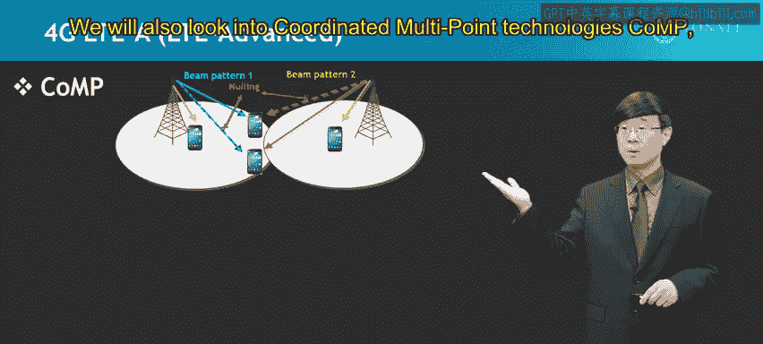

5G的部署模式分为：

*   **SA（独立组网）模式**
*   **NSA（非独立组网）模式**：与4G网络协同工作。

我们还将学习**网络切片**技术，即如何将物理网络基础设施虚拟分割，以支持不同的服务需求。由于5G使用了毫米波等高频信号，我们还需了解**多无线接入技术**如何协同工作。

## 智能手机操作系统 💻

现在，让我们将目光转向智能手机的核心软件——操作系统。

首先从iOS开始，追踪其从支持初代iPhone的iOS 1到现今iOS 11及以后版本的演进历程。我们将关注不同版本的主要特性、新增与移除的功能。

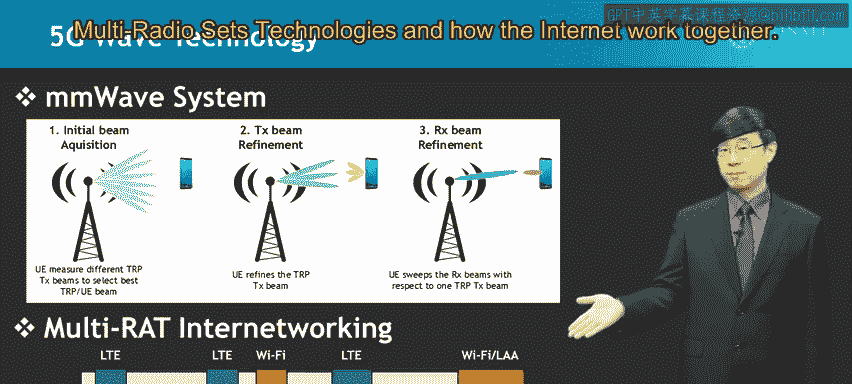

接着，我们会剖析iOS的**五层架构**，了解各层的功能及如何协同工作。

然后，我们转向Android系统，从其早期版本（Alpha, Beta）开始，历经“纸杯蛋糕”（Cupcake）直到“奥利奥”（Oreo）及更高版本。我们将梳理各Android版本的主要特性与技术演变。

最后，深入Android操作系统的**六层架构**，理解各个模块的功能与协作关系。

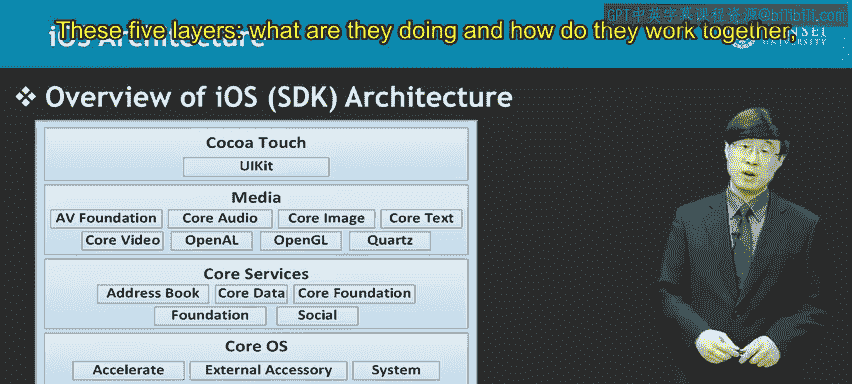

## 实践项目 📱

理论需结合实践。在课程的最后，我们将通过两个实践项目巩固所学知识。

在智能手机项目中，我们将利用**IA64**架构、Google Android及Apple设备，深入查看自己手机的详细软硬件信息。

在移动网络项目中，我们将使用相关组件分析所连接的网络，包括：

*   网络支持的数据速率及使用情况。
*   手机与基站连接的实际信号信息。
*   网络的激活/非激活状态及延迟（时延）。
*   特别地，我们还将探索iPhone的**现场测试模式**，该模式能提供服务小区测量等丰富信息。

## 总结

本节课中，我们一起学习了“智能设备与移动新兴技术”课程的完整框架。我们从移动市场分析入手，逐步深入到智能设备硬件（如SoC、GPS）、关键通信技术（4G/5G）、两大移动操作系统（iOS/Android），并最终通过实践项目将理论应用于实际分析。希望本课程能为你理解快速发展的移动技术世界打下坚实基础。

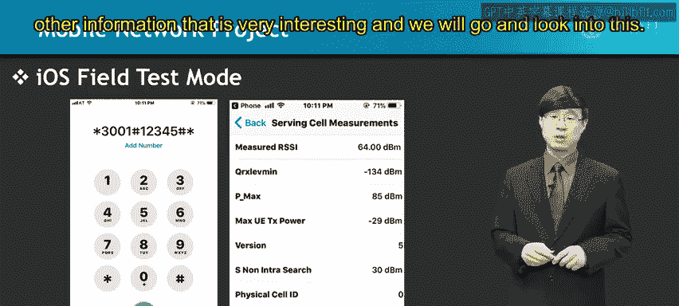

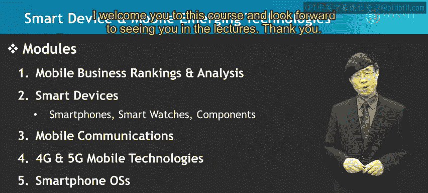

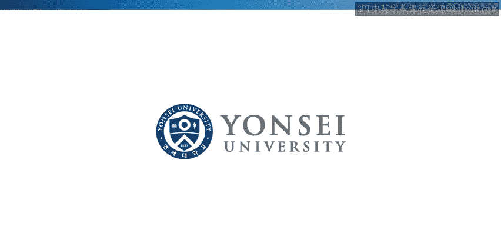

