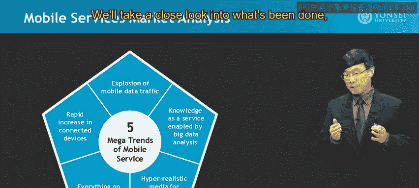
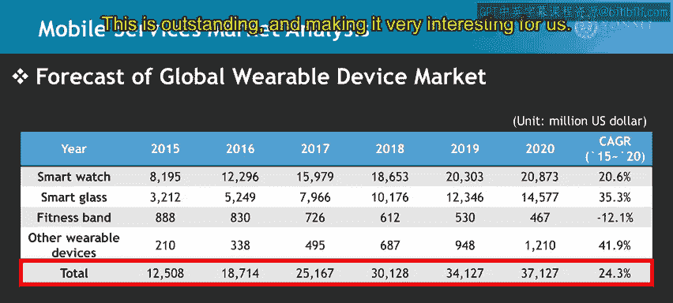

# 课程1：移动服务市场分析 📊

在本节课中，我们将学习移动服务市场的宏观趋势、关键组成部分及其增长预测。我们将从全球电信终端市场的整体预测开始，逐步深入到移动设备、可穿戴设备以及移动通信网络设备的具体分析。

---

## 移动服务的五大趋势 🌐

上一节我们介绍了课程概述，本节中我们来看看驱动移动服务发展的五大宏观趋势。这些趋势将引领未来的技术、服务发展，并需要相应的硬件、软件和网络基础设施来支持。

以下是移动服务的五大趋势：

*   **移动数据流量的爆炸式增长**
*   **大数据分析驱动的知识即服务**
*   **融合服务所需的超现实媒体**
*   **万物上云**
*   **连接设备的快速增长**

---

## 全球电信终端市场预测 📈

了解了宏观趋势后，我们来看看具体的市场数据。本节将分析全球电信终端市场的规模与增长，并引入一个重要的分析指标：复合年增长率。

复合年增长率（CAGR）是衡量一项投资在特定时期内平均年增长率的指标。它是一个几何级数比率，提供了时间段内的恒定回报率，在商业和投资分析中经常使用。

计算CAGR的公式如下：

**CAGR = (Vb / Va)^(1/(Yb - Ya)) - 1**

其中：
*   **Ya** 和 **Yb** 代表年份，且 Yb > Ya。
*   **Va** 和 **Vb** 分别代表对应年份的价值。

计算结果以百分比表示。基于此，我们来看2015年至2020年的市场预测数据。

以下是2015-2020年全球电信终端市场预测（单位：百万美元）：

| 类别 | 2015 | 2016 | 2017 | 2018 | 2019 | 2020 | CAGR |
| :--- | :--- | :--- | :--- | :--- | :--- | :--- | :--- |
| **移动设备** | 441, 844 | 466, 280 | 492, 230 | 519, 810 | 549, 150 | 602, 814 | **6.4%** |
| **基站** | 34, 571 | 37, 680 | 41, 070 | 44, 760 | 48, 790 | 51, 210 | **8.2%** |
| **电信服务** | 1, 021, 560 | 1, 046, 370 | 1, 071, 750 | 1, 097, 720 | 1, 124, 290 | 1, 157, 010 | **2.5%** |
| **总计** | 1, 497, 975 | 1, 550, 330 | 1, 605, 050 | 1, 662, 290 | 1, 722, 230 | 1, 811, 034 | **3.9%** |

**数据分析：**
*   **移动设备市场**：规模巨大，预计到2020年将超过6000亿美元，CAGR为6.4%，增长显著。
*   **基站市场**：CAGR高达8.2%，超过移动设备。这是因为随着4G LTE-A和5G技术的普及，为了提供更可靠的高速宽带服务，需要部署更多、更密集的基站，导致市场规模快速增长。
*   **电信服务市场**：基数庞大，2018年已超过1万亿美元。尽管2.5%的CAGR看似不高，但由于基数巨大，其绝对增长值依然非常可观。

---

## 可穿戴设备市场分析 ⌚️

在分析了整体电信市场后，我们聚焦到一个快速增长的具体设备领域：可穿戴设备。这个市场是移动服务的重要延伸。

以下是可穿戴设备细分市场预测（单位：百万美元）：

| 类别 | 2015 | 2016 | 2017 | 2018 | 2019 | 2020 | CAGR |
| :--- | :--- | :--- | :--- | :--- | :--- | :--- | :--- |
| **智能手表** | 13, 077 | 18, 507 | 25, 143 | 32, 886 | 41, 326 | 49, 881 | **20.6%** |
| **健身手环** | 4, 065 | 4, 195 | 4, 321 | 4, 451 | 4, 584 | 4, 722 | **-0.3%** |
| **智能眼镜** | 211 | 365 | 632 | 1, 094 | 1, 894 | 3, 279 | **35.3%** |
| **其他可穿戴设备** | 1, 093 | 1, 551 | 2, 202 | 3, 127 | 4, 440 | 6, 304 | **41.9%** |
| **总计** | 18, 446 | 24, 618 | 32, 298 | 41, 558 | 52, 244 | 64, 186 | **24.3%** |

**市场动态解读：**
*   **智能手表**：以20.6%的高CAGR增长，功能日益强大和多样化，正在吸收部分健身手环的市场。
*   **健身手环**：市场略有萎缩（CAGR -0.3%），因其功能正被集成到智能手表中。
*   **智能眼镜**：增长迅猛（CAGR 35.3%），主要受增强现实等应用的推动，预计将成为重要的市场产品。
*   **其他可穿戴设备**：增长率最高（CAGR 41.9%），这包括了未来可能智能化的各类物品，如领带、皮带、鞋子等，展示了物联网的巨大潜力。
*   **整体市场**：智能可穿戴设备市场整体预计以24.3%的显著速度增长。

---

## 移动通信网络设备分析 📡

最后，我们转向支撑所有移动服务的基础：网络设备。本节将分析不同代际的移动通信技术及其相关设备的市场前景。

以下是移动通信网络设备市场预测（单位：百万美元）：

| 类别 | 2015 | 2016 | 2017 | 2018 | 2019 | 2020 | CAGR |
| :--- | :--- | :--- | :--- | :--- | :--- | :--- | :--- |
| **2G基站** | 4, 007 | 3, 240 | 2, 621 | 2, 120 | 1, 715 | 1, 387 | **-32.7%** |
| **3G基站** | 11, 007 | 9, 640 | 8, 440 | 7, 390 | 6, 470 | 5, 665 | **-23.7%** |
| **4G基站** | 19, 557 | 23, 800 | 28, 960 | 35, 240 | 42, 880 | 44, 158 | **17.9%** |
| **基站小计** | 34, 571 | 36, 680 | 40, 021 | 44, 750 | 51, 065 | 51, 210 | **6.3%** |
| **小基站** | 2, 290 | 2, 910 | 3, 700 | 4, 700 | 5, 970 | 7, 580 | **27.0%** |
| **核心网** | 13, 290 | 13, 840 | 14, 410 | 15, 010 | 15, 630 | 16, 280 | **4.1%** |
| **总计** | 50, 151 | 53, 430 | 58, 131 | 64, 460 | 72, 665 | 75, 070 | **8.2%** |

**技术演进与市场关系：**
*   **2G/3G基站**：市场持续萎缩（CAGR分别为-32.7%和-23.7%），因其数据通信能力有限，投资正转向更先进的技术。
*   **4G基站**：保持17.9%的健康增长，正在吸收2G/3G的市场份额。在无法实现连续覆盖的区域，4G网络会回落到3G/3G增强型技术。
*   **小基站**：增长最为显著（CAGR 27.0%）。随着4G/5G的部署，为实现高速率和全覆盖，蜂窝小区将变得更小，需要大量部署微基站、家庭基站等小基站设备。5G时代使用高频段，将进一步推动小基站市场的增长。
*   **核心网**：作为网络中枢，在现有基础设施上稳步增长（CAGR 4.1%），未来所有接入技术都需要连接到核心网。
*   **整体网络设备市场**：预计以8.2%的复合年增长率增长。

---

## 总结 📝

本节课中，我们一起学习了移动服务市场的全景分析。

我们首先认识了驱动市场的五大宏观趋势。接着，我们利用复合年增长率深入分析了全球电信终端市场，发现移动设备、基站和电信服务市场均规模巨大且持续增长。随后，我们聚焦于高增长的可穿戴设备细分市场，看到了智能手表、智能眼镜等产品的巨大潜力。最后，我们剖析了移动通信网络设备市场，理解了从2G到5G的技术演进如何直接影响不同网络设备的投资与增长。

这些分析表明，移动服务市场是一个充满活力、机遇与变革的领域，为后续学习智能手机、物联网和大数据等技术奠定了市场认知基础。