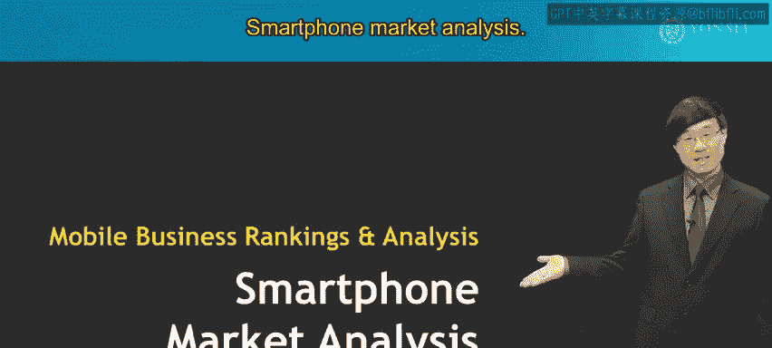
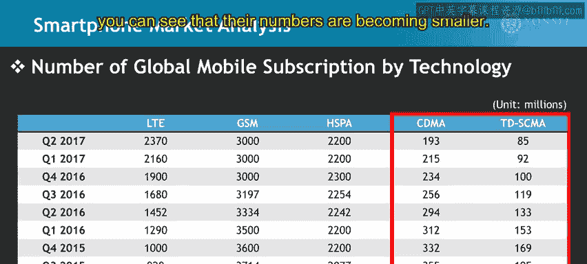
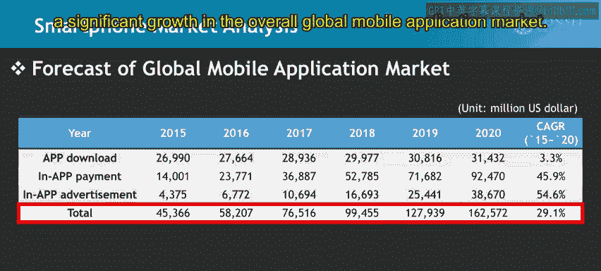
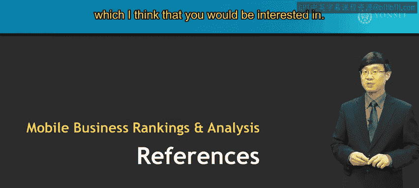
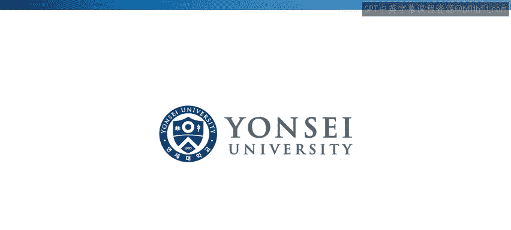

# 38：智能手机市场分析 📱

在本节课中，我们将学习全球智能手机市场的关键数据与趋势。我们将分析不同国家的市场份额、主要设备供应商的表现、移动操作系统的竞争格局以及移动通信技术和应用市场的未来发展。

---

## 🌍 全球智能手机市场份额（按国家）

首先，我们来看按国家划分的全球智能手机市场份额。请注意，这里的数据是百分比。某个国家份额的下降，并不一定意味着其销售额或利润在减少，而可能是由于其他国家的市场份额增长得更快，导致其在全球“蛋糕”中的相对比例变小。在全球范围内，这些百分比的变化具有重要含义，因为总和始终是100%，各国份额相互关联、相互影响。

以下是2011年至2017年部分国家的市场份额变化：

*   **美国（橙色柱状图）**：份额从2011年的21.3%下降到2017年的12.1%，呈持续下降趋势。
*   **中国**：份额从2011年的18.2%大幅增长至2013年的32.8%。这主要是由于其庞大的人口基数带来的显著增长，这也影响了美国份额的相对下降。到2017年，中国的份额略有回落。
*   **印度（黄色柱状图）**：份额从2011年的3%增长到2017年的10.3%。印度在此期间的增长，是导致中国份额在2013年后略有下降的因素之一。
*   **英国与巴西**：在2013年，英国份额（3.9%）高于巴西（3.1%）。但到2017年，情况发生逆转，英国降至3.1%，而巴西增至4.4%。

由此可见，人口大国对智能手机需求的变化能显著影响全球市场格局。了解不同国家的需求、流行的设备功能、应用结构和服务，对于预测未来全球智能手机市场至关重要。

---

## 📊 主要设备供应商分析

上一节我们看了国家层面的份额，现在我们把目光聚焦到具体的设备供应商。以下是2016-2017年期间排名前四的供应商：

*   **三星**：排名第一。
*   **苹果**：排名第二。
*   **华为**：排名第三。
*   **OPPO**：排名第四。

这四家公司合计占据了约54%以上的市场份额，而其他所有厂商合计约占45%。这表明头部厂商对全球市场有着巨大的影响力。

为了更细致地了解竞争动态，我们进一步观察过去两年（2016-2017年）的季度表现：

*   **三星**：在2016年的前三个季度（Q1, Q2, Q3）以及2017年的前三个季度，市场份额均领先。
*   **苹果**：在2016年第四季度（Q4）以18.3%的份额超越三星（18.1%）。同样，在2017年第四季度，苹果以19.2%的份额再次超越三星。

造成这种差异的主要原因是**产品发布周期**。厂商在全年的产品发布策略和时间点，会直接影响其市场份额的季度波动。把握这种趋势对于投资决策和股市表现都有重要意义。

---

## 🤖 移动操作系统市场格局

了解了硬件厂商，我们再来看看驱动这些设备的软件核心——操作系统。回顾2009年，市场格局与今日大不相同：

*   **2009年排名**：1. Symbian； 2. RIM（黑莓）； 3. iOS（苹果）； 4. Microsoft； 5. Android（谷歌）。

从2009年到2012年，市场发生了剧烈变化。Symbian、RIM和Microsoft的份额大幅萎缩。自2011年后，智能手机市场主要由两大操作系统主导：

*   **Android**：占据绝对主导地位，份额超过80%。
*   **iOS**：排名第二，份额曾达到约23.8%的峰值，近年来维持在12%-17%的区间。

目前，Android和iOS在市场中占据强势地位。因此，在本课程后续模块中，我们将重点探讨iOS和Android操作系统的演进及其架构。尽管未来随着增强现实（AR）、物联网（IoT）等新设备的出现，格局可能生变，但当前这两大系统仍是学习的重点。

---

## 📶 移动通信技术订阅数分析

智能手机离不开网络连接。我们来看基于移动通信技术的全球移动订阅数数据（2015年Q2至2017年Q2）。

*   **4G (LTE/LTE-A)**：呈现持续显著增长。
*   **3G增强技术 (HSPA)**：从2015年Q2到2017年Q2整体有所增长，在2016年Q3-Q4期间达到峰值，随后在2017年保持稳定，但仍高于2015年水平。
*   **2G (GSM)**：主要专注于语音通信，也支持低速数据通信，其份额持续萎缩。
*   **CDMA 与 TD-SCDMA**：份额也在变小。

**LTE市场增长显著**，它提供了宽带数据通信。然而，在LTE网络无法覆盖的区域，手机会自动回落到3G增强技术（如HSPA）。正因为3G技术拥有良好的蜂窝覆盖，在人口较少、投资建设LTE网络不经济的地区，HSPA及相关技术仍将支撑起基础服务。

---

## 🔮 未来市场预测

接下来，让我们展望未来。根据市场预测（柱状图显示至2022年）：

*   **LTE（蓝色柱）**：预计将持续增长。
*   **HSPA（橙色柱）**：作为提供更高速率的3G增强技术，预计将维持约32%的较大份额直至2022年。
*   **GSM（灰色柱）**：市场份额预计将进一步缩减。
*   **5G（黄色柱）**：在2021和2022年开始出现（0.1%， 0.4%）。

需要特别注意的是，**5G的移动通信标准将于2020年完成制定**。因此，目前对其产品销售和市场应用的预测仍存在较大不确定性。图表中的数字较小，但实际投资和应用规模可能会远超此估计，具体取决于各种服务模式的接受和使用情况。

---

## 📲 移动应用市场展望

最后，我们分析移动应用市场的未来。以下是三个关键领域的预测：

*   **应用下载量**：预计将从2016年的约260亿次增长至2020年的314.32亿次。其复合年增长率（CAGR）为3.3%。虽然增长率看似不高，但考虑到应用市场本身已非常庞大，这个增长绝对值依然非常显著。
*   **应用内支付**：预计复合年增长率（CAGR）高达45.9%。这表明应用内购市场虽然相对较小，但增长潜力巨大。
*   **应用内广告**：预计复合年增长率（CAGR）为54.6%，增长最为显著。

**整个全球移动应用市场的总复合年增长率预计为29.1%**，显示出强劲的整体增长势头。

---

## 📚 总结

本节课中，我们一起学习了智能手机市场的多维度分析：

1.  **国家份额**：中国、印度等人口大国的需求变化深刻影响着全球市场份额的分布。
2.  **供应商竞争**：三星、苹果、华为、OPPO四家头部厂商占据过半市场，其产品发布周期导致市场份额呈现季度性波动。
3.  **操作系统**：市场已形成Android和iOS双寡头垄断的稳定格局。
4.  **通信技术**：4G (LTE) 持续增长，3G (HSPA) 作为补充仍将长期存在，2G逐渐退场，5G即将登场。
5.  **应用市场**：应用下载量稳步增长，而应用内支付和广告市场则呈现爆发式增长潜力。

理解这些市场动态，是把握从智能手机到物联网再到大数据这一系列新兴技术发展趋势的重要基础。