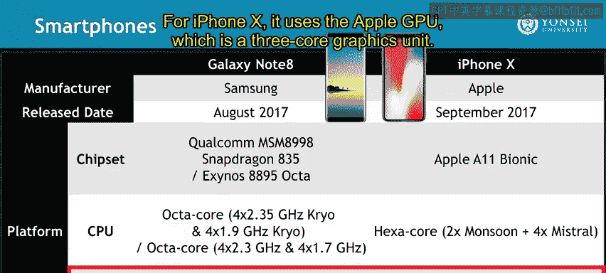
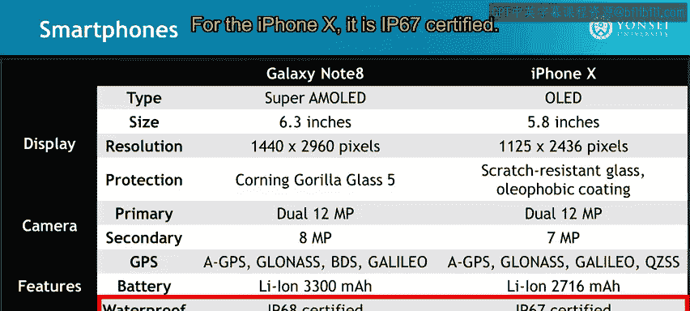
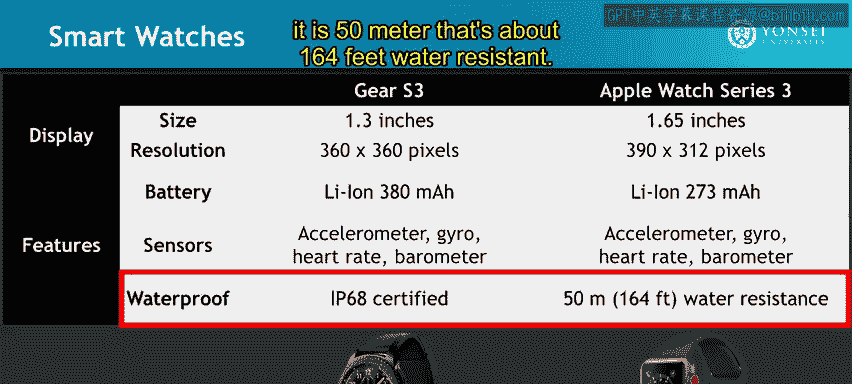
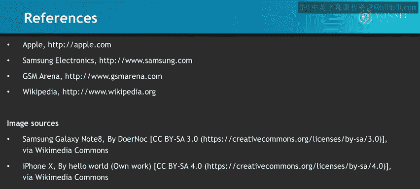

# 课程 3.2.1：智能设备规格 📱⌚️

在本节课中，我们将学习智能手机和智能手表的核心硬件规格。我们将以三星 Galaxy Note 8、iPhone X 以及三星 Gear S3 和 Apple Watch Series 3 为例，详细介绍构成这些智能设备的关键模块，如芯片组、CPU、GPU、显示屏、摄像头和电池等。

---

## 智能手机规格详解

上一节我们概述了本模块的学习目标，本节中我们来看看智能手机的具体规格。我们将重点分析两款代表性设备：三星 Galaxy Note 8 和 iPhone X。

### 平台单元：芯片组与处理器

芯片组是智能手机中最重要的模块，它集成了移动通信、Wi-Fi、蓝牙等网络接口的控制功能，并负责设备的大部分核心处理任务。

以下是两款手机的芯片组信息：
*   **三星 Galaxy Note 8**：采用高通 MSM8998（骁龙 835）芯片组，或三星 Exynos 8895 八核芯片组。
*   **iPhone X**：采用苹果 A11 仿生芯片组。

CPU（中央处理器）负责与设备所有组件交互，并与 GPU（图形处理器）协同工作，确保智能手机各项功能协调运行。

以下是两款手机的 CPU 信息：
*   **三星 Galaxy Note 8**：采用八核 CPU。一种配置是四个 2.35 GHz Kryo 核心加四个 1.9 GHz Kryo 核心；另一种是四个 2.3 GHz 核心加四个 1.7 GHz 核心。
*   **iPhone X**：采用六核 CPU，包含 2 个 Monsoon 核心和 4 个 Mistral 核心。

GPU 负责处理图形渲染任务。

以下是两款手机的 GPU 信息：
*   **三星 Galaxy Note 8**：采用 Adreno 540 或 Mali-G71 MP20。
*   **iPhone X**：采用苹果三核图形处理器。

---

### 显示屏、摄像头与附加功能

了解了核心处理器后，我们接下来看看直接影响用户体验的显示屏、摄像头和其他功能。

显示屏的类型和参数至关重要。

以下是两款手机的显示屏信息：
*   **类型**：Galaxy Note 8 为 Super AMOLED；iPhone X 为 OLED。
*   **尺寸**：Galaxy Note 8 为 6.3 英寸；iPhone X 为 5.8 英寸。
*   **分辨率**：Galaxy Note 8 为 1440 x 2960 像素；iPhone X 为 1125 x 2436 像素。
*   **保护**：Galaxy Note 8 采用康宁大猩猩玻璃 5；iPhone X 采用防刮玻璃并具有疏油涂层。

摄像头是智能手机的关键功能之一。

以下是两款手机的摄像头信息：
*   **后置主摄像头**：两者均为双 1200 万像素。
*   **前置摄像头**：Galaxy Note 8 为 800 万像素；iPhone X 为 700 万像素。

附加功能包括定位和防护能力。

以下是两款手机的附加功能信息：
*   **GPS**：Galaxy Note 8 支持 A-GPS, GLONASS, BDS, Galileo；iPhone X 支持 A-GPS, GLONASS, Galileo, QZSS。
*   **电池**：Galaxy Note 8 为 3300 毫安时；iPhone X 为 2716 毫安时。两者均为锂离子电池，并支持无线充电。
*   **防护等级**：Galaxy Note 8 通过 IP68 认证；iPhone X 通过 IP67 认证。

---

## 智能手表规格详解

在详细了解了智能手机的规格后，本节我们将目光转向可穿戴设备，对比分析三星 Gear S3 和 Apple Watch Series 3 的规格。

### 平台与显示

智能手表的平台同样由操作系统、芯片组和 CPU 构成。

以下是两款手表的平台信息：
*   **操作系统**：Gear S3 基于 Tizen，版本 2.3.2；Apple Watch Series 3 采用 watchOS 4.0。
*   **芯片组**：Gear S3 为 Exynos 7270；Apple Watch Series 3 为 Apple S3。
*   **CPU**：两者均为双核处理器，Gear S3 主频为 1.0 GHz。

显示屏是智能手表的主要交互界面。

以下是两款手表的显示信息：
*   **尺寸**：Gear S3 为 1.3 英寸；Apple Watch Series 3 为 1.65 英寸。
*   **分辨率**：Gear S3 为 360 x 360 像素；Apple Watch Series 3 为 390 x 312 像素。

---

### 电池、传感器与防护

对于可穿戴设备，续航、健康监测和耐用性尤为重要。

以下是两款手表的电池、传感器与防护信息：
*   **电池**：Gear S3 为 380 毫安时锂离子电池；Apple Watch Series 3 为 273 毫安时锂离子电池。两者均支持无线充电。
*   **传感器**：Gear S3 包含加速度计、陀螺仪、心率传感器和气压计；Apple Watch Series 3 也包含同类传感器。
*   **防水**：Gear S3 通过 IP68 认证；Apple Watch Series 3 具备 50 米（约 164 英尺）防水能力。

---

## 总结

本节课中，我们一起学习了智能手机和智能手表的核心硬件规格。我们以三星 Galaxy Note 8、iPhone X、三星 Gear S3 和 Apple Watch Series 3 为例，详细剖析了芯片组、CPU、GPU、显示屏、摄像头、电池、传感器等关键模块的参数与功能。在接下来的课程中，我们将对这些规格表中的专业术语和关键技术进行更深入的讲解。