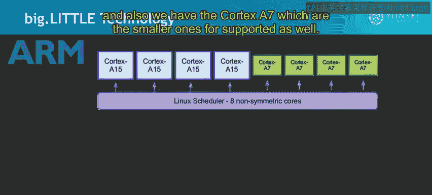
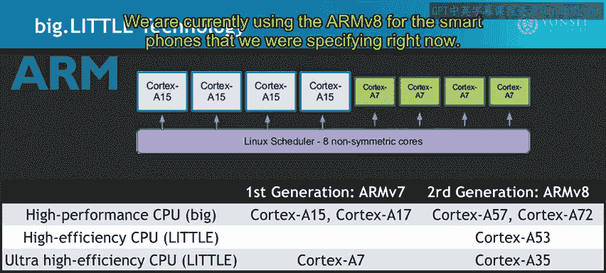
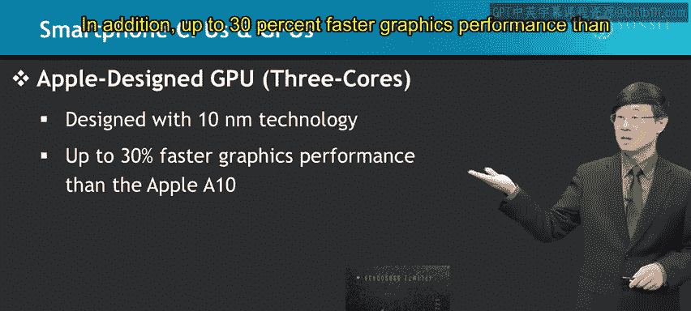
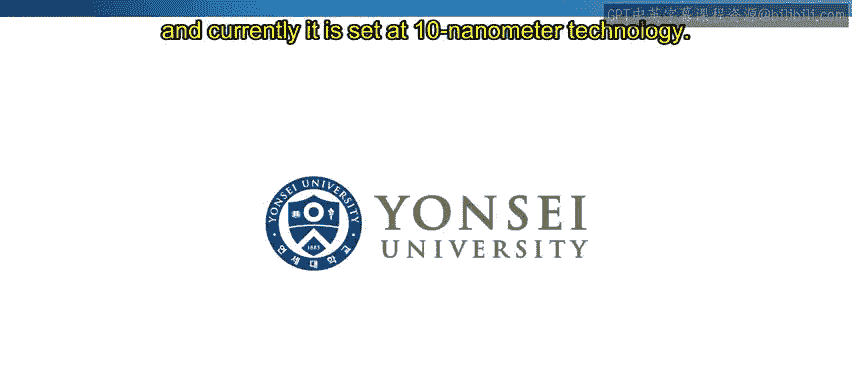

# 40：智能手机芯片组（第1部分）📱

在本节课中，我们将学习智能手机芯片组的基础知识。芯片组是智能手机的核心，它不仅负责设备的主要运算，还集成了蓝牙、Wi-Fi和移动通信等多种网络技术。我们将从ARM架构和“大小核”设计开始，深入了解现代智能手机处理器的运作原理。

---

## 从三星Exynos Octa 8895开始

上一节我们介绍了芯片组的重要性，本节中我们来看看一个具体的例子：三星Exynos Octa 8895。这款芯片于2017年发布，由三星公司设计和制造。它基于**ARM v8-A架构**，并采用了“大小核”异构计算设计。

三星Exynos Octa 8895包含四个大核和四个小核，总计八个核心，构成一个多核处理单元。

---

## 理解“大小核”架构

“大小核”架构由ARM公司于2011年推出。它是一种处理能力优化技术，旨在通过快速的硬件处理速度和高效的固件，从ARM CPU核心获得高性能。其特点包括峰值性能高、持续性能强、并行处理能力提升，以及平均功耗显著降低。

功耗的优化来自于根据运算负载的轻重，智能地调用大核或小核。以下是其工作原理：

*   **大核（高性能核心）**：用于处理计算密集型任务。这些任务也被称为**线程**。在智能手机上，例如运行视频游戏或增强现实应用时，设备处于高负载状态，此时大核会介入以最快速度完成这些繁重操作，但能耗较高。
*   **小核（高能效核心）**：用于处理负载较轻的任务，同样以线程形式存在。例如，**守护进程**——一种在智能手机后台运行的程序。操作系统本身就在后台运行许多这样的进程。

作为开发者，我们通常设定目标：所有需要与用户交互的操作（如点击屏幕后的响应）应在50到100毫秒内完成，否则用户会感到设备迟缓。因此，需要快速处理的**前台操作**由大核负责；而保持手机运行、持续处理后台工作的**后台操作**则由小核处理。

---

## 线程与调度器

那么，什么是线程？**线程**是一系列可以被调度器独立调度和处理的程序指令序列。

在智能手机上，**调度器**通常就是操作系统本身。目前主流的智能手机操作系统是Android和iOS。本课程后续将涵盖这两个系统从最初版本到今天的完整演进过程。

使用“大小核”架构的软件和平台优势明显：
*   在低到中等性能场景下，可节省高达**75%** 的CPU能耗。
*   在高线程负载场景下，性能可提升**40%**。

“高线程负载”指的是从手机多个应用程序中产生的大量线程，这些线程会被分配给芯片组中的多个核心（包括CPU和GPU核心）进行处理。核心的数量取决于智能手机芯片组的具体架构。

---

## ARM架构演进：v7 与 v8

现在我们来深入看看ARM架构。如下图所示，这是一个示例，展示了Linux调度器管理下的八个非对称核心。所谓“非对称”，是因为这些核心并不相同，其中包含了代表大核的Cortex-A15单元（四个）和代表小核的Cortex-A7单元。

我们首先对比第一代ARM v7和第二代ARM v8架构。目前我们讨论的智能手机芯片大多基于**ARM v8**架构。

对于“大小核”技术架构：
*   **第一代（ARM v7）**：大核采用Cortex-A15（或高性能的Cortex-A17），小核采用Cortex-A7。
*   **第二代（ARM v8）**：大核可采用Cortex-A57或Cortex-A72；小核可采用Cortex-A53或Cortex-A35。

因此，在上图中，你可以将规格替换为第二代模块，例如用A57或A72作为大核，用A35或A53替代A7作为小核。

---

## 其他主流芯片组示例

接下来，我们看看其他两款2017年的主流芯片组。

**1. 高通骁龙835 (MSM8998)**
*   发布于2017年，由高通设计，三星制造。
*   基于**ARM v8-A架构**，采用**大小核异构计算**设计。
*   同样拥有四个大核和四个小核。

**2. 苹果A11仿生芯片 (用于iPhone X)**
*   发布于2017年，由苹果设计，台积电制造。
*   基于**ARM v8-A架构**，是苹果第二代自主设计的性能控制器单元。
*   在多线程工作负载上比前代快70%。与A10芯片相比，其能效核心快70%，性能核心快25%。

---

## 智能手机的CPU与GPU

最后，我们简要了解智能手机中的CPU和GPU。

**1. Kryo 280 CPU (与骁龙835一同发布)**
*   基于ARM Cortex-A73架构的定制化设计。
*   增强了**IPS（每秒指令数）** 性能，尤其在整数运算和指令处理方面。
*   但在浮点运算性能上略有下降。
*   用于三星Galaxy Note 8。

**2. Adreno 540 GPU**
*   发布于2017年初，采用10纳米工艺设计。
*   主频提升至710 MHz，稳定性增强。
*   包含**256个ALU（算术逻辑单元）**。ALU是执行加、减以及“与”、“或”、“非”、“异或”等二进制逻辑运算的单元。
*   具备浮点运算能力，性能为**567 GFLOPS**（每秒十亿次浮点运算）。

**3. 苹果A11的CPU与GPU**
*   **CPU**：包含高性能核心“Monsoon”和能效核心“Mistral”。“Monsoon”频率可达2.39 GHz，比A10快25%；“Mistral”也比A10的能效核心快70%。
*   **GPU**：苹果自主设计的三核GPU，采用10纳米工艺。图形性能比A10芯片快30%，并且能以一半的功耗实现A10的性能水平，功耗降低显著。

---

## 总结

本节课中，我们一起学习了智能手机芯片组的基础知识。我们从三星Exynos芯片入手，深入探讨了**ARM的“大小核”异构计算架构**，理解了**线程**和**调度器**如何协同工作以优化性能与功耗。我们还对比了ARM v7和v8架构的差异，并分析了2017年高通骁龙835和苹果A11仿生芯片的具体配置，包括其CPU和GPU的核心特性。这些知识是理解现代智能手机如何平衡强大性能与续航能力的关键。