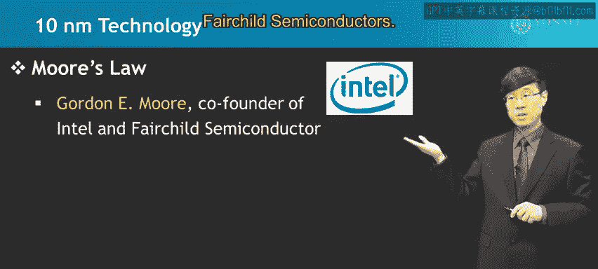
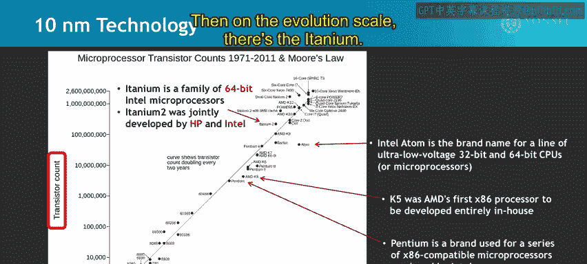
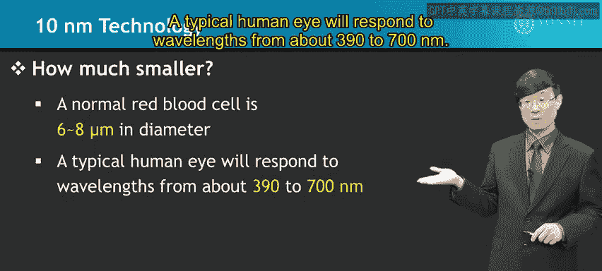
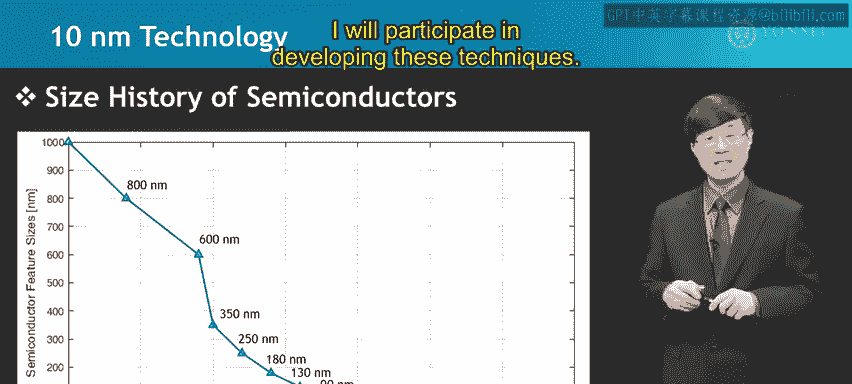

# 课程名称：延世大学《新兴技术：从智能手机到物联网再到大数据》 - P41：5_2.2 智能手机芯片组（第2部分）📱💡

在本节课中，我们将要学习半导体技术发展的前沿——10纳米技术。我们将从摩尔定律开始，回顾晶体管数量的增长历程，并深入探讨10纳米技术的定义、优势及其对未来设备的影响。

---

## 理解半导体技术前沿：摩尔定律与10纳米技术 🔬

为了理解芯片组和CPU，你需要了解半导体发展的前沿技术。目前，这一前沿被设定在10纳米技术。让我们来探讨这个话题。

摩尔定律是理解这一发展的基础。戈登·摩尔是英特尔和仙童半导体的联合创始人。他在1965年的论文中写道：密集集成电路中的晶体管数量大约每两年翻一番。这一增长速度预计至少会再持续十年。令人惊讶的是，这一预测完全准确。因此，摩尔定律变得非常著名。

那么，它是否也适用于当前最先进的半导体技术？让我们来看一看。

## 晶体管数量的演进图表 📈

在10纳米技术中，我们是如何达到这一水平的？下图展示了晶体管数量的演进。纵轴代表晶体管数量。你可以看到，在一个半导体芯片上能放置的晶体管数量是如何增长的。

以下是几个关键的参考点，位于图表的右下角。

*   **奔腾处理器**：奔腾是英特尔生产的一系列X86兼容微处理器的品牌。X86中的“X”位置可以放置半导体设备的实际代码编号。奔腾的典型编号是80586，因此奔腾处理器有时也被称为586处理器。奔腾处理器是广泛PC的入门级产品。
*   **多核处理器**：此后，演进进入了多核处理器时代。与其拥有一个非常强大的核心，不如拥有多个相对独立并能执行操作的处理器核心。
*   **AMD K5**：K5是AMD首个完全独立开发的X86处理器。
*   **英特尔凌动**：凌动是英特尔一系列超低电压32位和64位CPU的品牌名称。
*   **安腾**：安腾是英特尔64位微处理器家族。安腾2由惠普和英特尔联合开发。
*   **至强**：至强是英特尔设计和制造的X86架构微处理器品牌。至强面向非消费级工作站、服务器和嵌入式系统市场。

上一节我们回顾了处理器的发展历程，本节中我们来看看“非消费级”的具体含义。

## “非消费级”产品的含义 🏢

“非消费级”是什么意思？消费级产品通常指智能手机、个人电脑或笔记本电脑，公司直接将其销售给消费者，我们称之为B2C关系。

另一方面，还有企业对企业关系，即公司对公司。通常，“非消费级”指的就是这种B2B关系。例如，需要大量工作站、服务器和其他嵌入式系统的公司会直接从英特尔采购，并将其集成到自己的设备中。用户通常不会直接购买服务器，而是由公司购买服务器，这就是“非消费级”的含义。

在10纳米技术之前，11纳米和14纳米是主流技术趋势。

## 10纳米技术的定义与制定者 📏

最初的10纳米命名由谁定义？是国际半导体技术路线图组织。这是一个进行此类分类的组织。

三星在2017年首次发布了其10纳米工艺节点。ITRS是什么？

它由世界五大领先芯片制造地区赞助，包括欧洲、日本、韩国、台湾和美国。其目标是确保集成电路性能以及采用此类设备的先进产品和应用能够实现成本效益的进步，以维持半导体行业的持续增长和成功。

显然，它扮演着重要角色，并提供了一个基于标准化的参考，以便我们对半导体技术进行分类。

## 10纳米技术的优势 ⚡

为什么是10纳米？这个更小的数字有什么重要意义？

通过减小晶体管之间的距离，在单元间单次传输以及晶体管激活时，都能实现功耗降低。激活晶体管、将其开启所需的能量更少，这非常棒。

以下是10纳米技术带来的其他优势：

*   **芯片更轻薄**：晶体管越小，在相同芯片面积内可以设计更多的晶体管。这意味着在相同芯片面积内拥有更多晶体管，从而带来更多功能和更强的处理能力。
*   **电池续航更长**：晶体管开关速度更快，消耗的能量更少。
*   **发热更少**：在晶体管数量相同的情况下，采用更小的晶体管技术会使发热更少。发热是能量的浪费。我们希望完成处理过程，而不是将其用作加热器。因此，运行温度更低意味着浪费的能量更少，节省的能量更多，设备的使用寿命也更长。

## 10纳米到底有多小？🔍

我们还能做到多小？首先，让我们参考一下10纳米到底意味着什么。它有多小？

*   一个正常的红细胞直径约为6到8微米。微米与纳米不同，我稍后会解释。
*   典型的人眼对大约390到700纳米的波长有反应。
*   一个细菌核糖体大约20纳米。

我们讨论的单位，对于红细胞来说是10的负6次方米，即微米。但我们讨论的范围从20纳米到390-700纳米，是10的负9次方米。我们讨论的基于10纳米技术的晶体管，你可以看到技术设计可以做到多么微小、精确和精密。

## 未来趋势：超越10纳米 🚀

再回到摩尔定律和未来趋势。根据1985年以来的趋势，我们达到了这些数字。如图所示，在2010年之后，我们进入了32纳米、22纳米、14纳米，直到现在的10纳米。

未来会发生什么？我们将迎来个位数纳米技术，如8纳米、6纳米、4纳米。这些数字很快将在未来出现。请做好准备，确保它们出现在你的智能手机和智能手表中。图中下方的红色部分就是我们将要前往的方向。当然，就我个人而言，我也将参与开发这些技术。

## 总结与预告 📚

总的来说，我们首先看了芯片组。在前面的讲座中，这些表格包含了更多的信息。

请坚持学习，因为在接下来的课程中，我将解释更多内容。

这些是我使用的参考资料，我推荐给你。谢谢。

---

**本节课中我们一起学习了**：半导体技术的前沿——10纳米技术。我们从摩尔定律出发，回顾了晶体管数量的增长历史，明确了10纳米技术的定义及其制定者ITRS。我们重点探讨了10纳米技术带来的核心优势：更轻薄、更节能、发热更少，从而延长设备寿命。最后，我们展望了未来将出现的个位数纳米技术趋势。理解这些基础知识，是深入认识智能手机芯片组性能的关键。