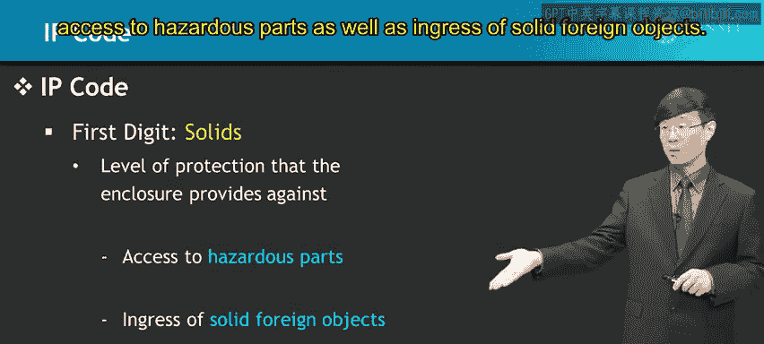
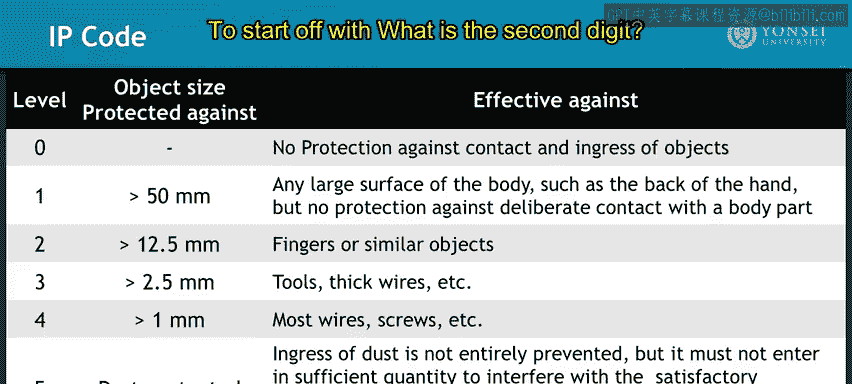
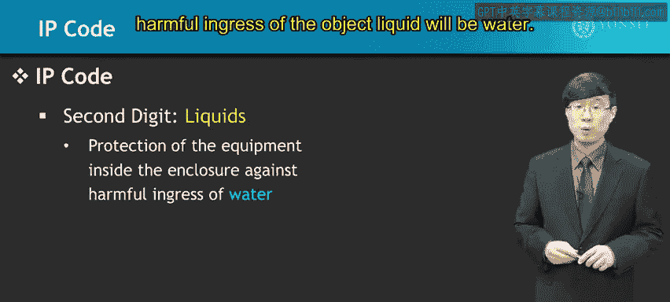
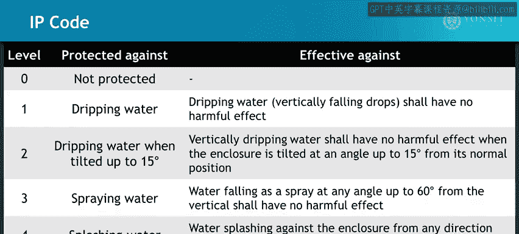
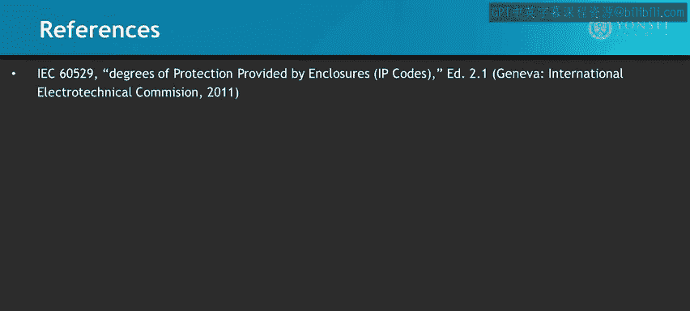

# 42：IP防护等级详解 📱💧

## 概述
在本节课中，我们将学习一个对现代智能设备至关重要的概念——**IP防护等级**。IP等级是衡量电子设备外壳对固体异物（如灰尘）和液体（如水）侵入防护能力的国际标准。理解这个标准，能帮助我们更好地选择和使用智能手机、智能手表等设备。

---

## IP防护等级简介
IP防护等级是国际防护标记的缩写，有时也指防侵入保护标记。它用于对电气设备外壳提供的防护等级进行分类和评级，主要针对固体物体、灰尘、意外接触以及水的侵入。该标准定义在国际标准**IEC 60529**中。

IP代码的结构通常为“IP”后跟两位数字，有时还有可选字母。这两位数字分别代表对固体和液体的防护等级。

*   **第一位数字**代表对**固体**的防护等级。由于典型的小固体物可以小到灰尘级别，所以很多人说第一位数字代表防尘能力。如果能防尘，通常也能防护更大的颗粒物。
*   **第二位数字**代表对**液体**的防护等级。由于测试中通常使用纯水，所以常被称为防水等级。

---

## 第一位数字详解：防尘与防固体异物
上一节我们介绍了IP代码的基本结构，本节中我们来看看第一位数字的具体含义。它表示外壳对接触危险部件以及固体异物侵入的防护等级。

以下是第一位数字各等级的具体说明：

*   **0**：无防护。
*   **1**：防护直径大于50毫米的固体物。可防止手背等大面积身体部位接触。
*   **2**：防护直径大于12.5毫米的固体物。可防止手指或类似大小的物体侵入。
*   **3**：防护直径大于2.5毫米的固体物。可防止工具、粗电线等物体侵入。
*   **4**：防护直径大于1.0毫米的固体物。可防止大多数电线、螺丝等较细物体侵入。
*   **5**：防尘。不能完全防止灰尘进入，但进入的灰尘量不足以影响设备的正常运行。完全防止接触（针对上表中0-4级大小的物体）。
*   **6**：尘密。完全无灰尘进入。完全防止接触。这是防尘的最高等级，也是我们对高端设备（如iPhone X、Galaxy Note 8）的期望等级。

---

## 第二位数字详解：防水等级
了解了防尘等级后，我们接下来看看第二位数字，它代表设备外壳内部对有害液体（通常是水）侵入的防护能力。

以下是第二位数字各等级的具体说明：

*   **0**：无防护。
*   **1**：防垂直落下的水滴。当设备垂直放置时，顶部滴落的水滴无有害影响。
*   **2**：防倾斜15度角内的水滴。当外壳在任意一侧倾斜至15度角时，垂直滴落的水滴无有害影响。
*   **3**：防喷洒的水。从垂直方向两侧至60度角内喷洒的水，无有害影响。
*   **4**：防飞溅的水。从任何方向飞溅到外壳上的水，都无有害影响。
*   **5**：防低压水柱喷射。用直径为6.3毫米的喷嘴，从任意方向向外壳喷射水，无有害影响。
*   **6**：防高压水柱喷射。用直径为12.5毫米的喷嘴，从任意方向向外壳强力喷射水，无有害影响。
*   **7**：防短时浸水。在制造商规定的条件下（如深度、时间），将外壳浸入水深1米内，无有害影响。
*   **8**：防持续浸水。在制造商规定的条件下（通常深度超过1米），设备可长时间浸入水中。这种防护通常被称为“密封”或“气密”，意味着水可能完全无法进入，或者即使有少量进入也不会对设备造成有害影响。这是防水最高等级。

---

## 实际设备IP等级示例
现在我们已经理解了IP代码的两位数字含义，让我们看看一些实际设备的IP等级，这有助于将理论应用于实践。

*   **三星 Galaxy Note 8**：**IP68**
    *   `6`：尘密（最高防尘等级）。
    *   `8`：可在超过1米深的水中浸没（具体条件需遵循制造商说明）。
*   **三星 Gear S3 智能手表**：**IP68**（与Note 8相同）。
*   **苹果 iPhone X**：**IP67**
    *   `6`：尘密。
    *   `7`：可在1米深的水中短时浸没。

---

## 总结
本节课中，我们一起学习了**IP防护等级**这一重要概念。我们了解到，IP代码由两位数字组成：第一位数字表示防尘和防固体异物等级（最高为6），第二位数字表示防水等级（最高为8）。通过解读像`IP67`或`IP68`这样的代码，我们可以清楚地知道一款设备在防尘和防水方面的具体能力，从而做出更明智的购买和使用决策。记住，对于任何涉及浸水的防护等级（如7和8），务必仔细阅读制造商手册中的具体限制条件。