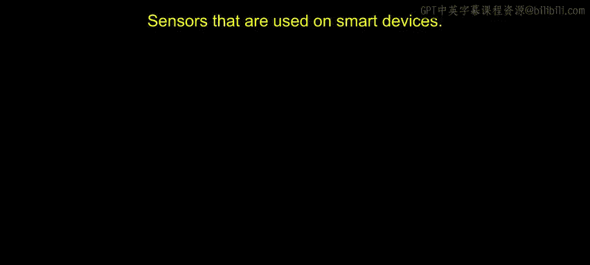
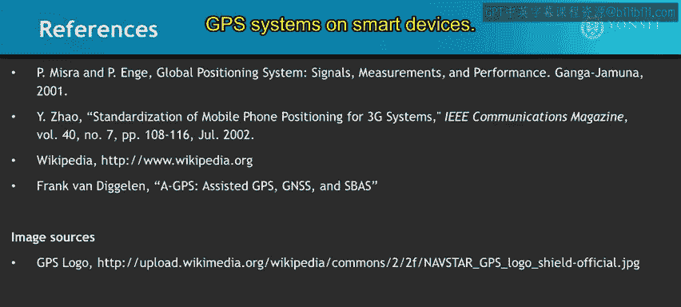
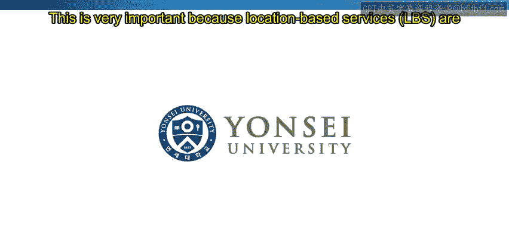

# 课程名称：延世大学《新兴技术：从智能手机到物联网再到大数据》 - P43：7_2.4 传感器 📡

在本节课中，我们将要学习智能设备上使用的几种核心传感器。我们将了解它们的工作原理、应用场景以及它们如何协同工作，为我们的智能设备提供丰富的数据。

---

## 加速度计 🚀

上一节我们介绍了传感器的重要性，本节中我们来看看第一种传感器：加速度计。

加速度计用于测量加速度，即速度的变化率。其核心基于**MEMS（微机电系统）** 传感器技术，该技术内部集成了微电子和微机械模块。为了获得更精确的信息和数据，它通常还会结合陀螺仪传感器的信息。

其应用非常广泛，主要包括：
*   **智能手机和智能手表**：这是我们当前学习的重点。
*   **飞行与驾驶稳定系统**：例如无人机、飞机、导弹、汽车、巴士和火车。

加速度计可以测量的数据包括：
*   地球重力引起的加速度。
*   惯性导航系统数据。
*   振动和机器旋转。
*   设备的直立和倾斜位置。

---

## 陀螺仪 🌀

了解了测量线性运动的加速度计后，我们再来看看测量旋转运动的传感器：陀螺仪。

在智能设备中，陀螺仪（Gyro是Gyroscope sensor的简称）用于测量方向的变化和角速度。

以下是几种陀螺仪传感器的类型：
*   **微芯片封装的MEMS陀螺仪**：这是目前智能手机和智能手表中常用的类型。
*   **固态环形激光陀螺仪**
*   **光纤陀螺仪**
*   **量子陀螺仪**：这种类型可以达到极高的精度。

这里列出后三种类型，是因为在未来，不仅限于微芯片封装的MEMS陀螺仪，这些其他类型的陀螺仪也可能会被集成到各种智能设备中。因此，我们需要关注它们的发展，看它们何时能与MEMS陀螺技术结合。

---

## 心率传感器 ❤️

接下来，我们转向一种与健康监测密切相关的传感器：心率传感器。

这是一种光学红外光传感器技术。其工作原理如下：红外光会被血液吸收，传感器通过测量被吸收的光量来工作。

当检测到的红外光变暗时，很可能是因为血流量增加了，而这正对应一次心跳的发生。因此，在一次心跳时，血流量增加，红外信号的整体吸收量变大，导致检测到的红外光看起来变暗。

通过检测红外光变暗的时刻并计算其周期，就可以估算出心率。这就是心率传感器技术的核心原理。

设计时需要注意一点：为了共享同一个红外LED（发光二极管）——这个LED也常被摄像头用于在暗处拍照和录像——心率传感器通常会与摄像头和红外LED灯设计在彼此靠近的位置。这也是智能手机上常见的布局：在主摄像头旁边，你会看到红外LED灯和紧挨着的心率传感器。

---

## 气压计 🌡️

最后，我们来了解一种用于感知环境变化的传感器：气压计。

气压计用于测量大气压力，应用于气象学和大气传感领域。大气压力数据常用于估算海拔高度。

我们常听到气压计和高度计，两者略有不同，但核心技术相同。我们来具体看看：
*   **气压计**：通常被认为是固定在某个位置、用于测量天气中细微气压变化的静态传感器设备。
*   **高度计**：更像是一种可携带的气压计设备，用于现场测量大气压力。

更精确地说，当我们说移动设备或智能手机上装有“气压计”时，更可能指的是**高度计**，即一种基于MEMS的、用于测量整体压力变化的高度计。然而，在许多规格说明书中，你仍然会看到它被标注为“气压计传感器”，这是基于这些定义的习惯说法。

---

## 总结 📝

本节课中我们一起学习了智能设备上四种关键的传感器：
1.  **加速度计**：基于MEMS技术，测量加速度，用于运动感知和设备姿态判断。
2.  **陀螺仪**：测量角速度和方向变化，与加速度计配合提供更精确的运动数据。
3.  **心率传感器**：利用红外光被血液吸收的原理，通过光信号的变化周期来估算心率。
4.  **气压计/高度计**：测量大气压力，主要用于海拔估算和环境感知。

这些传感器是智能设备感知物理世界的基础，它们收集的数据为从健康监测到导航定位等各种应用提供了可能。