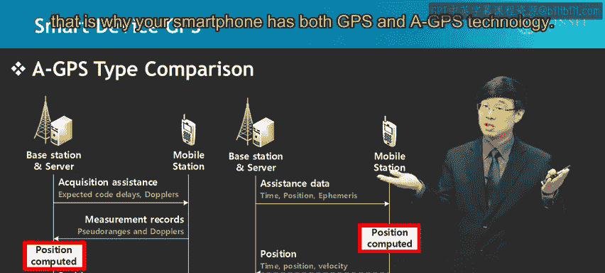
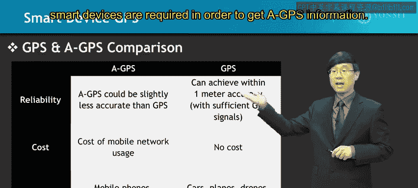
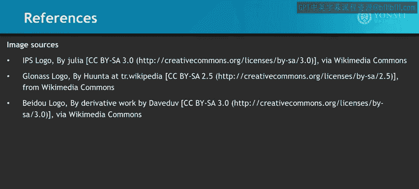

# 44：GPS与AGPS技术详解 📡

在本节课中，我们将学习智能设备上的全球定位系统（GPS）及其增强技术——辅助全球定位系统（AGPS）。我们将了解它们的工作原理、区别以及在实际应用中的表现。

---

## 概述

GPS对于提供基于位置的服务至关重要。为了进行精确定位，我们需要知道设备所处的经度和纬度。上一节我们介绍了加速度和高度预测传感器，本节我们将深入了解GPS，以获得关于如何精确查找位置和定位的整体视图。

---

## GPS：全球定位系统

全球定位系统由美国陆军于1978年创建。

一个GPS设备需要与**四颗或更多**卫星通信，以确定其精确位置（经度和纬度）。请注意，GPS本身不提供海拔高度值，这就是为什么气压计成为智能设备中使用的传感器之一。

需要特别注意的一点是，确定位置需要四颗或更多卫星。当处于室内环境时，你可能无法接收到四颗或更多GPS卫星的信号，这时就会出现问题，可能无法计算出任何位置坐标值。

此外，即使你在室外，在城市高楼林立的常见场景中，如果你的位置无法看到四颗或更多支持GPS信息的卫星信号，那么你的GPS信息可能不准确，或者根本无法获取任何数值。

因此，在许多使用GPS进行位置识别的情况下，你可能无法立即获取位置信息，这可能需要几秒到几分钟，甚至可能需要你移动到一个能显著检测到卫星信号的不同位置。

---

## AGPS：辅助全球定位系统

正因如此，当没有足够的GPS信号（四颗或以上）持续足够时间来获取精确位置时，就需要辅助全球定位系统（AGPS）。这也是智能手机内置AGPS技术的原因。

AGPS利用来自GPS卫星的信息，并借助移动网络辅助服务器提供的位置信息。它的工作方式与GPS相同，提供经度和纬度坐标（这是我们的最终目标），并增加了来自移动通信网络的精确时间信息，这非常有用。

AGPS技术有两种类型：MSA和MSB。我们首先来看MSA。

---

### MSA：移动台辅助定位

这是一种由移动通信网络中的服务器执行的位置计算技术。信息从基站传送到你的智能手机（移动台）。移动台捕获它能接收到的GPS信号快照（在很多情况下可能只有一两颗卫星的信号），并接收移动通信网络中AGPS服务器的帮助。

AGPS服务器具有良好的GPS卫星信号接收能力、强大的计算能力以及非常精确的参考时钟。这意味着，移动通信网络的基站装有GPS检测器，它精确知道自己的位置，并将帮助其蜂窝区域内的移动设备（智能手机）找到位置，因为该移动设备没有接收到足够计算其位置的完整GPS卫星信号。这时MSA AGPS技术就会启动。

以下是MSA的工作流程：

1.  移动台接收捕获辅助信息。
2.  移动服务提供商在AGPS服务器的帮助下，持续记录来自GPS卫星的信息。
3.  AGPS服务器计算位置，并将其传送给移动台（你的智能手机）。

从结构图来看：首先，基站通过移动通信网络连接到服务器，捕获辅助信息被发送到移动台。然后，移动台将其能接收到的任何GPS信号的测量记录发送到基站，基站再将其传送给服务器。接着，位置在服务器端计算，最后该位置信息被传送回你的智能手机（移动台）。这就是MSA技术。

---

### MSB：移动台自主定位

MSB是另一种AGPS类型，即移动台自主定位。

它的工作原理如下：利用信息更快地获取卫星定位信号，向移动台提供GPS卫星的轨道数据和星历。这使得移动台在某些情况下能更快地锁定卫星。移动网络还可以提供精确的时间信息。

让我们进一步了解MSB的工作细节：移动台从AGPS服务器接收辅助数据，并从可见的GPS卫星接收信号。它结合来自服务器的信息和接收到的GPS卫星信号来计算自身位置。

从时间流程图来看：连接到移动通信网络（进而连接到基站）的服务器将向移动台（你的智能手机）发送辅助数据。然后，你的智能手机将使用它能接收到的GPS信号，并结合从基站接收到的辅助数据来计算其位置。接着，它会将其位置报告给基站，基站再将其传送给服务器。这就是MSB。

---

### MSA与MSB的比较

比较这两种类型，可以看到以下区别：

*   在MSA中，捕获辅助信息从基站发送到移动台，移动台能接收到的GPS信号的测量记录被传送到基站，再传送到服务器，位置在服务器端计算，然后该信号被传送到你的智能手机。
*   在MSB类型的AGPS中则不同，服务器通过基站向你的智能手机（移动台）发送信息，你的智能手机（移动台）将使用它能接收到的任何GPS信号来计算位置。然后，最终的位置将被传送到基站，再由基站传送给服务器。

**关键点在于：在MSA中，位置在服务器端计算；在MSB中，位置在你的移动台（智能手机）上计算。** 这就是MSA和MSB在AGPS技术中的主要区别。由于我们有许多基于位置的服务应用需要精确定位，MSA和MSB AGPS技术非常重要。这就是为什么你的智能手机同时拥有GPS和AGPS技术。

---

## GPS与AGPS的综合比较

现在让我们整体比较GPS和AGPS。

从信息源开始比较：
*   **GPS**：使用GPS卫星信号。
*   **AGPS**：使用卫星信号以及通过基站传送的辅助服务器信息。

在速度方面：
*   **GPS**：可能需要几分钟来确定位置，但一旦开始，就能轻松更新。然而，在某些接收不良的情况下，如果无法找到位置，那么一旦获得四颗或更多GPS卫星信号，可能需要几秒甚至几分钟才能提供位置信息。
*   **AGPS**：通常更快，因为它从连接到辅助服务器的基站获取即时信息。基站和辅助服务器持续更新其信息，因此它们可以更快地传送信息。

在可靠性方面：
*   **GPS**：如果拥有足够的GPS信号，并且在晴朗天气下接收良好，可以达到**1米**以内的精度。
*   **AGPS**：精度略低于GPS。

其他方面：
*   **成本**：GPS没有使用成本，而AGPS如果需要为服务付费，则需向移动通信服务提供商支付费用。
*   **应用范围**：GPS用于从汽车、飞机、无人机到机器人、船舶等一切领域。而AGPS需要有移动通信服务提供，必须在提供移动通信服务和AGPS支持的区域才能工作，典型的移动通信覆盖范围就是AGPS的工作范围。此外，你需要智能手机或移动电话等智能设备才能获取AGPS信息。

---

## 其他全球导航卫星系统

除了GPS，还有其他全球导航卫星系统：
*   **GLONASS**：全球导航卫星系统，由俄罗斯空天防御部队运营，是一个用于车辆和航空导航的卫星导航系统。
*   **BDS**：北斗导航卫星系统，这是中国的第二代卫星导航系统。

---

## 总结

本节课中，我们一起学习了GPS和AGPS技术。我们了解了GPS需要四颗或以上卫星进行基本定位，以及在信号受限环境下的局限性。接着，我们深入探讨了AGPS如何利用移动网络辅助服务器来增强定位速度和可靠性，并详细分析了其两种主要类型：MSA（服务器端计算）和MSB（客户端计算）的工作原理与区别。最后，我们比较了GPS与AGPS在信息源、速度、精度、成本和应用范围上的差异，并简要介绍了其他全球导航卫星系统。理解这些技术对于开发和使用基于位置的服务至关重要。