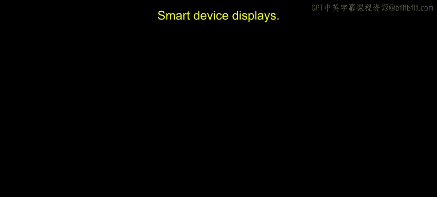

# 延世大学《新兴技术从智能手机到物联网再到大数据》课程 - P45：9_2.6 显示器 📱

在本节课中，我们将要学习智能设备显示器的核心技术。我们将从保护玻璃开始，逐步深入到各种先进的显示技术，如AMOLED及其变种，以及其他关键的屏幕技术。

## 防碎玻璃

智能设备显示器的起点是防碎玻璃。它提供了一个无缝的界面，使得设备表面在整体形状上呈现无缝连接。此外，它提供了非常光滑、奢华的触感。这是它非常适合智能手机的原因。

因此，防碎玻璃被广泛使用。

**康宁大猩猩玻璃**是一种特殊的钢化防碎玻璃，具有抗刮擦特性。它的存在是为了防止深度划痕。对于玻璃来说，即使它非常坚硬、难以破裂，但如果出现一道深划痕，这里就会成为弱点。如果外力作用在这个弱点上，整块玻璃就可能从这里破裂。因此，需要保护以防止深度划痕，使其具备抗刮擦性非常重要，这整体上赋予了玻璃防碎的特性。

这项技术由康宁公司在2013年的国际消费电子展上推出。

## 疏油涂层

**疏油涂层**被用于iPhone等设备上。这是一种分子物理特性，能够排斥油脂。“疏油”意味着“惧怕油脂”。它被用于智能手机表面，以达到抗指纹和防污渍的效果。

我们的手指和脸上有油脂，化妆品中也含有油脂。当我们使用智能手机时，表面很容易变得油腻。为了防止这种情况，疏油涂层是一种能够排斥油脂的机制。因此，手上、脸上和手指上的油脂会留在皮肤上，而不会附着在手机上，使手机保持光亮清洁。

尽管投入了成本为智能手机表面制造这种高科技疏油涂层，但很多人仍会在手机表面使用保护膜或保护贴。这违背了这项昂贵技术的初衷，但这是用户的选择和普遍做法。然而，在原装表面上，疏油涂层具有你可能更喜欢的特殊功能和特性。

## AMOLED显示技术

上一节我们介绍了屏幕的表面处理，本节中我们来看看屏幕本身的核心显示技术。**AMOLED技术**，即主动矩阵有机发光二极管技术，以及Super AMOLED技术，是三星电子非常擅长的优秀产品。

具体来看，AMOLED显示技术被用于电视和智能手机。**OLED**是有机发光二极管。这是一种使用有机化合物作为电致发光材料的薄膜显示技术。

增强体现在**Super AMOLED**技术上，它在AMOLED显示技术中集成了数字化仪。在早期的智能手机中，AMOLED显示屏上方有一个独立的触控检测层，但这带来了一些反射特性，并且增加了额外的一层，使得整体显示屏更厚，手机也随之变厚。因此，Super AMOLED技术将触控感应检测层（即数字化仪）集成到AMOLED层内部。

这带来了什么结果？其特性是显示屏更薄，使得智能手机也更薄，同时功耗更低。此外，Super AMOLED技术改善了阳光下的反射特性，提升了屏幕在户外的可视性，使其在户外更明亮、更容易观看。

接下来是**Super AMOLED Plus**，它使用传统的RGB条纹排列，而非Pentile RGBG矩阵。它提供了比Super AMOLED更明亮、更节能的性能，并被用于三星Galaxy S2智能手机。

然后是**HD Super AMOLED**技术，它支持高于1280x720分辨率的Super AMOLED显示屏，使用Pentile RGBG矩阵。这项技术用于三星Galaxy S3和Note 1。

**Full HD Super AMOLED**是Super AMOLED技术的下一步演进，基于1080p全高清分辨率的Super AMOLED显示屏。当我们谈论1080p全高清分辨率时，意味着我们有1920x1080个像素。这种Full HD Super AMOLED显示屏使用了Pentile RGBG矩阵，并采用了一种名为“钻石像素”的新子像素排列方式。它被用于三星Galaxy S4、S5和Note 3。

接着我们有**WQHD Super AMOLED**。这是WQHD分辨率，即高于2560x1440的Super AMOLED显示屏。它使用Pentile RGBG矩阵，并被用于三星Galaxy S6、S7、S8、Note 4、Note 5和Note 8。Note 8正是我们之前查看整体规格时看到的设备，如果你拥有Note 8，你的智能手机使用的就是这项技术。

## 其他显示技术

看过了AMOLED系列技术，现在我们来了解其他被使用的显示技术。当然，这些技术中的一部分已经包含在Super AMOLED显示技术中。

**平面转换（IPS）** 是一种用于液晶层分子取向的LCD屏幕技术。它在玻璃基板之间进行排列和切换。

其特点是色彩准确，并且从宽广的视角观看也能保持一致的图像。此外，当触摸屏幕时，屏幕上不会出现拖影或漏光效应。在旧技术中，当你触摸屏幕并移动手指时，你会看到光的轨迹跟随你移动，这就是我们所说的拖影。使用IPS技术可以消除这些效应。同时，IPS还能实现清晰的图像和稳定的响应时间。

**LED背光LCD显示屏**使用的是LED背光平板显示技术。与之前的CCFL（冷阴极荧光灯）背光LCD相比，这是一项改进，CCFL是LCD显示技术的旧版本。

以下是LED背光LCD带来的改进：
*   图像质量提升，具有更高的动态对比度和更宽的调光范围。
*   屏幕更薄，从而减轻了设备重量。

进一步的改进包括**RGB LED背光**。这带来了更广的色域。色域是人类眼睛可识别的颜色范围，这意味着你可以看到更多颜色。同时，它减少了热量排放，从而降低了功耗。这使得产品更可靠，使用寿命更长。

本节课中我们一起学习了智能设备显示器的关键技术。我们从保护玻璃和疏油涂层开始，了解了它们如何保护屏幕并提供良好触感。然后，我们深入探讨了AMOLED显示技术的演进，从基础AMOLED到各种Super AMOLED变体，以及它们如何实现更薄、更节能、显示效果更好的屏幕。最后，我们简要介绍了IPS和LED背光LCD等其他重要显示技术及其优势。这些技术共同构成了现代智能设备清晰、绚丽且耐用的视觉体验基础。